# Catalog: Mărime și simboluri (4)

[← README](../../README.md) · [Toate categoriile](README.md)

**Mărime și simboluri** · [Regiuni și grupuri](02-regiuni-si-grupuri.md) · [Vecini](03-vecini.md) · [Paritate, puncte, semne](04-paritate-puncte-semne.md) · [Sume](05-sume.md) · [Indicii pe margine](06-indicii-pe-margine.md) · [Linii](07-linii.md) · [Grile compuse](08-grile-compuse.md) · [Rude apropiate](09-rude-apropiate.md) · [Topologii și mutări fairy](10-topologii-si-mutari-fairy.md) · [Reguli globale](11-reguli-globale.md) · [Indicii în celule](12-indicii-in-celule.md) · [Dimensiuni superioare](13-dimensiuni-superioare.md)

---

_Alege mărimea la „Joc nou”; simbolurile (cifre sau litere) apar pe tastatura de sub tablă._

#### 1. Clasic · Classic (`clasic`)

**Rând, coloană, casetă: fiecare cifră o dată.**

Completează grila astfel încât fiecare rând, fiecare coloană și fiecare casetă să conțină fiecare cifră exact o dată. Mărimi: 4×4 (mini), 6×6 (casete 2×3), 8×8 (2×4), 9×9, 12×12 (3×4), 16×16 (simboluri 1–9 și A–G) și 25×25 (1–9 și A–P).

<table><tr><td align="center">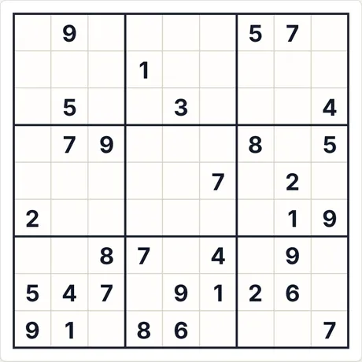 Puzzle la start (9×9 · mediu · 32 indicii)</td><td align="center">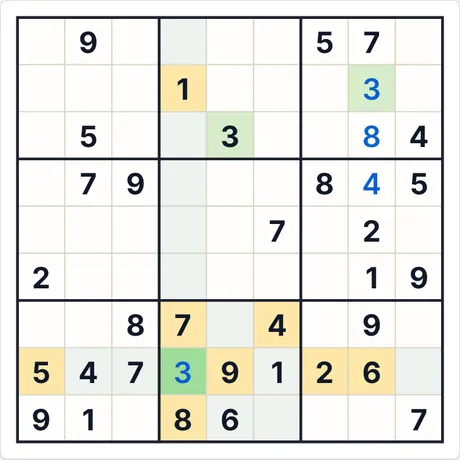 După 4 pași „Pas cu pas”</td></tr></table>

- **Ultimul pas explicat de aplicație:** 3 (rând 8, col. 4): toate celelalte cifre apar deja printre celulele marcate (rând, coloană, regiune sau regulă de vecinătate).
- **Cod pentru același puzzle:** `clasic-9-medium-1799427569` (lipește-l în „Joc nou → Cod”) · efort solver: fără ramificări

<b>Galerie completă: toate tipurile de capturi</b>

<b>Atlas</b>

<table>
<tr><td align="center" valign="top">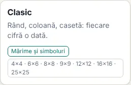 Cardul din Atlas</td><td align="center" valign="top">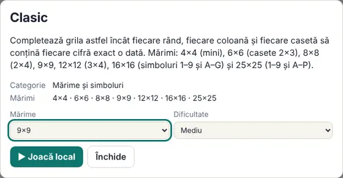 Fișa (se deschide la clic pe card)</td></tr>
</table>

<b>Mărimi (nivel mediu)</b>

<table>
<tr><td align="center" valign="top">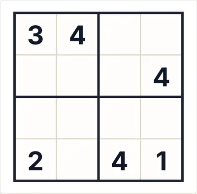 4×4</td><td align="center" valign="top">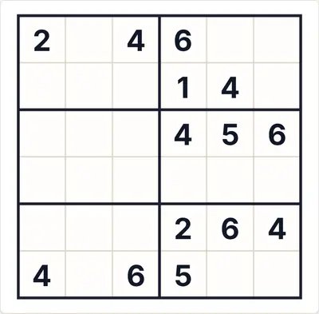 6×6</td><td align="center" valign="top">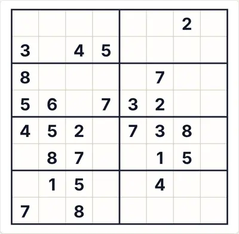 8×8</td></tr>
<tr><td align="center" valign="top">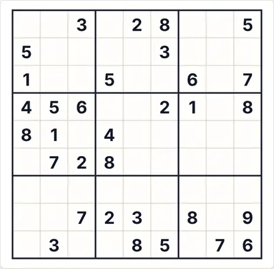 9×9</td><td align="center" valign="top">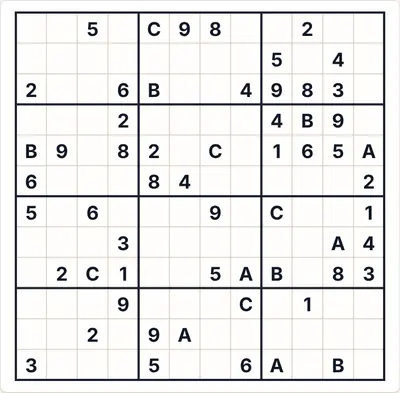 12×12</td><td align="center" valign="top">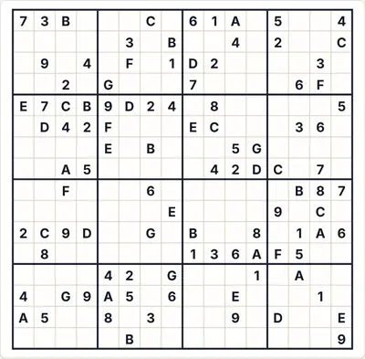 16×16</td></tr>
<tr><td align="center" valign="top">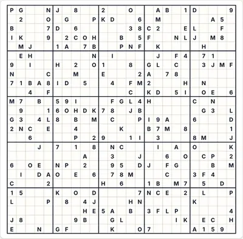 25×25</td></tr>
</table>

<b>Dificultate</b>

<table>
<tr><td align="center" valign="top">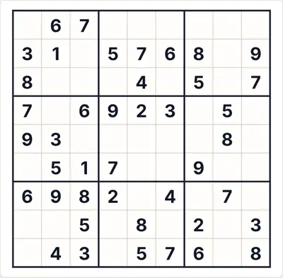 Ușor</td><td align="center" valign="top"> Mediu</td><td align="center" valign="top">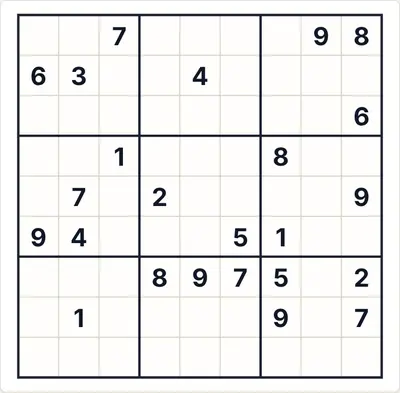 Greu</td></tr>
</table>

<b>Stări de joc</b>

<table>
<tr><td align="center" valign="top">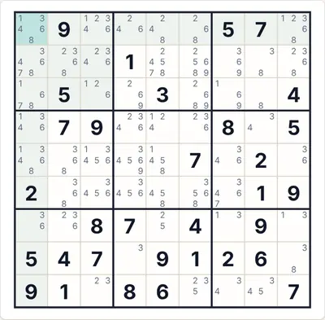 Auto-notițe (candidați)</td><td align="center" valign="top">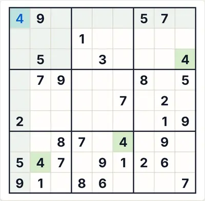 „Verifică” cu o cifră greșită (roșu)</td><td align="center" valign="top">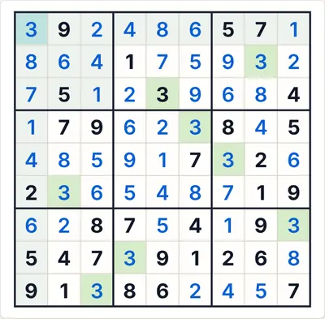 Soluția completă</td></tr>
</table>

<b>Teme și dispozitive</b>

<table>
<tr><td align="center" valign="top">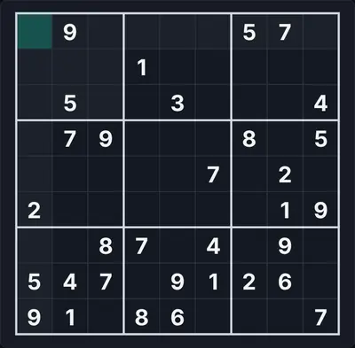 Temă întunecată</td><td align="center" valign="top">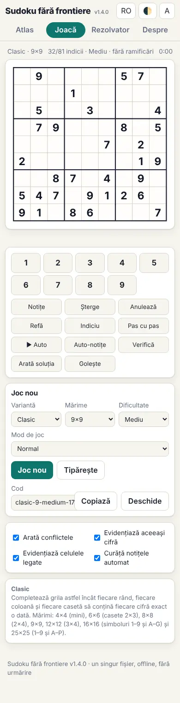 Telefon (390 px)</td><td align="center" valign="top">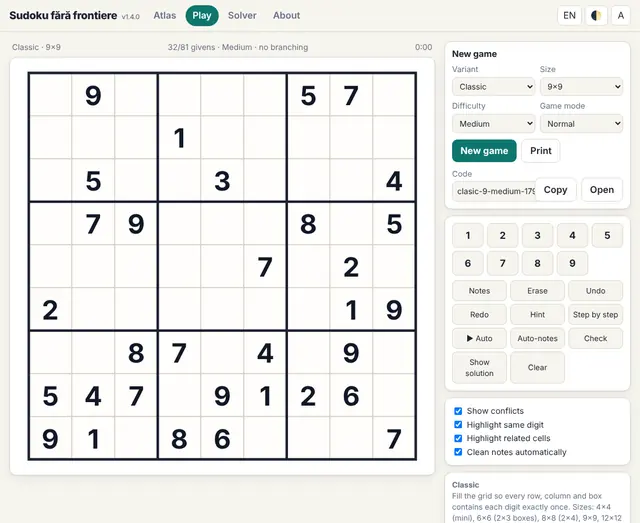 Interfața în engleză</td></tr>
</table>

<b>Panoul de reguli din joc</b>

<table>
<tr><td align="center" valign="top">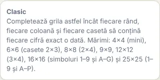 Regulile afișate lângă tablă</td></tr>
</table>

#### 2. Wordoku · Wordoku (`wordoku`)

**Litere în loc de cifre.**

Același joc ca Clasicul, dar cu litere. La 9×9 poți alege orice cuvânt de 9 litere distincte pentru simboluri.

<table><tr><td align="center">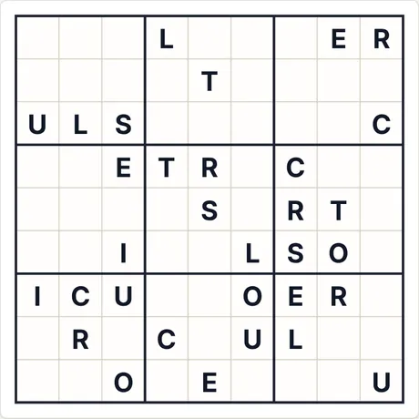 Puzzle la start (9×9 · mediu · 32 indicii)</td><td align="center">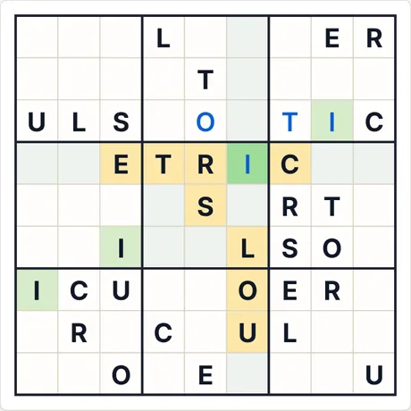 După 4 pași „Pas cu pas”</td></tr></table>

- **Ultimul pas explicat de aplicație:** I (rând 4, col. 6): toate celelalte cifre apar deja printre celulele marcate (rând, coloană, regiune sau regulă de vecinătate).
- **Cod pentru același puzzle:** `wordoku-9-medium-2968750655` (lipește-l în „Joc nou → Cod”) · efort solver: fără ramificări

<b>Galerie completă: toate tipurile de capturi</b>

<b>Atlas</b>

<table>
<tr><td align="center" valign="top">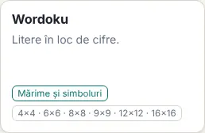 Cardul din Atlas</td><td align="center" valign="top">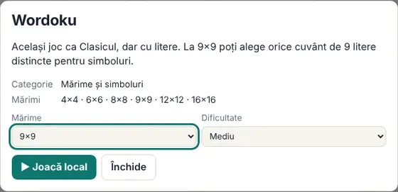 Fișa (se deschide la clic pe card)</td></tr>
</table>

<b>Mărimi (nivel mediu)</b>

<table>
<tr><td align="center" valign="top">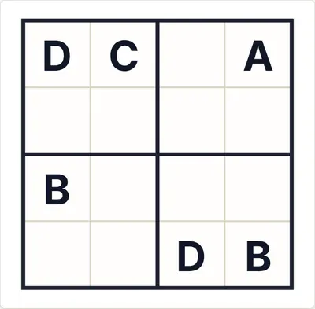 4×4</td><td align="center" valign="top">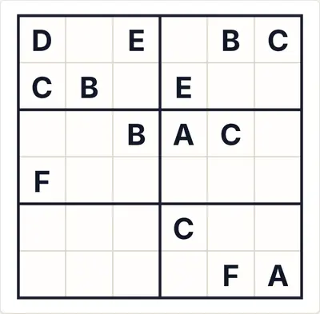 6×6</td><td align="center" valign="top">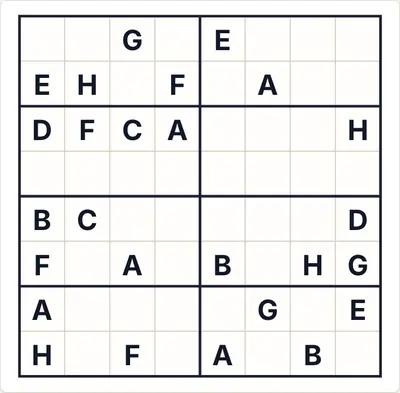 8×8</td></tr>
<tr><td align="center" valign="top">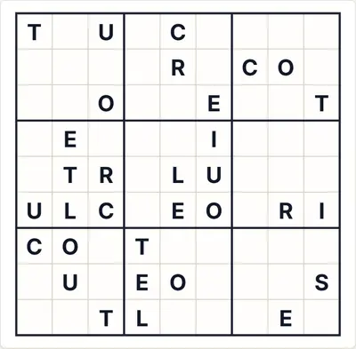 9×9</td><td align="center" valign="top">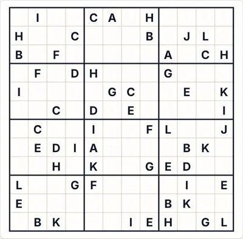 12×12</td><td align="center" valign="top">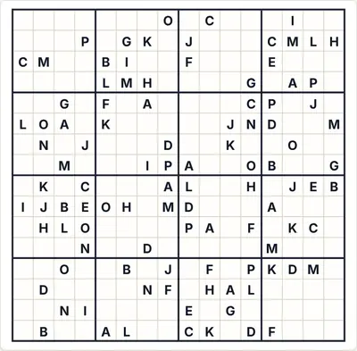 16×16</td></tr>
</table>

<b>Dificultate</b>

<table>
<tr><td align="center" valign="top">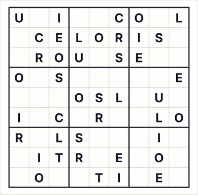 Ușor</td><td align="center" valign="top"> Mediu</td><td align="center" valign="top">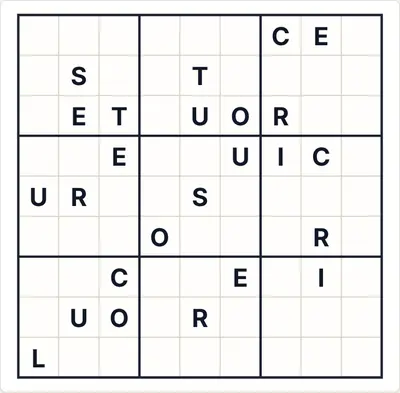 Greu</td></tr>
</table>

<b>Stări de joc</b>

<table>
<tr><td align="center" valign="top">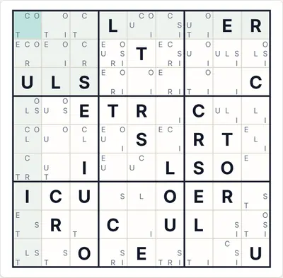 Auto-notițe (candidați)</td><td align="center" valign="top">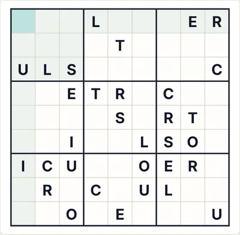 „Verifică” cu o cifră greșită (roșu)</td><td align="center" valign="top">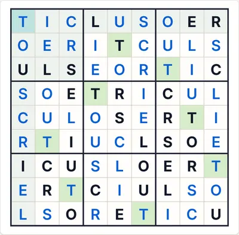 Soluția completă</td></tr>
</table>

<b>Teme și dispozitive</b>

<table>
<tr><td align="center" valign="top">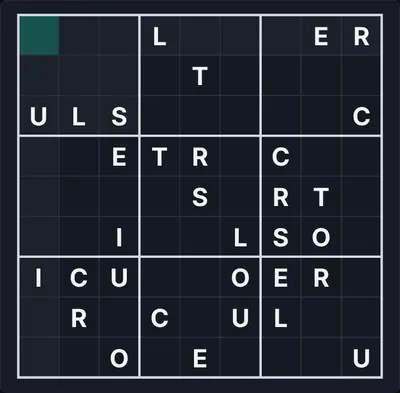 Temă întunecată</td><td align="center" valign="top">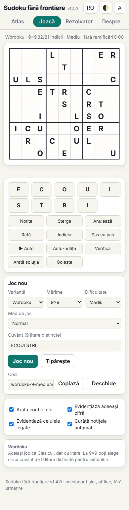 Telefon (390 px)</td><td align="center" valign="top">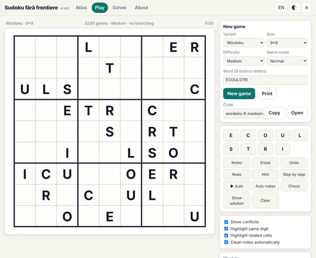 Interfața în engleză</td></tr>
</table>

<b>Panoul de reguli din joc</b>

<table>
<tr><td align="center" valign="top">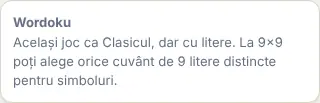 Regulile afișate lângă tablă</td></tr>
</table>

#### 3. Pătrat latin · Latin square (`latin`)

**Doar rânduri și coloane, fără casete.**

Fiecare rând și fiecare coloană conțin fiecare cifră o dată; nu există casete. Mărimi 4–9.

<table><tr><td align="center">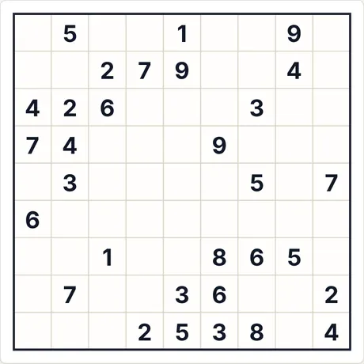 Puzzle la start (9×9 · mediu · 31 indicii)</td><td align="center">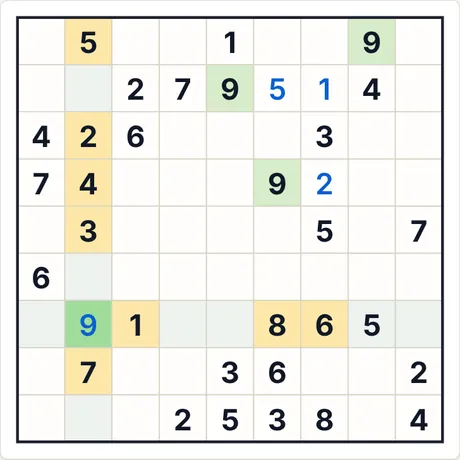 După 4 pași „Pas cu pas”</td></tr></table>

- **Ultimul pas explicat de aplicație:** 9 (rând 7, col. 2): toate celelalte cifre apar deja printre celulele marcate (rând, coloană, regiune sau regulă de vecinătate).
- **Cod pentru același puzzle:** `latin-9-medium-2855996804` (lipește-l în „Joc nou → Cod”) · efort solver: fără ramificări

<b>Galerie completă: toate tipurile de capturi</b>

<b>Atlas</b>

<table>
<tr><td align="center" valign="top">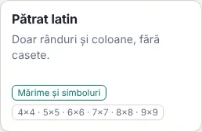 Cardul din Atlas</td><td align="center" valign="top">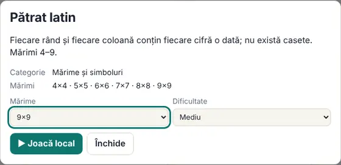 Fișa (se deschide la clic pe card)</td></tr>
</table>

<b>Mărimi (nivel mediu)</b>

<table>
<tr><td align="center" valign="top">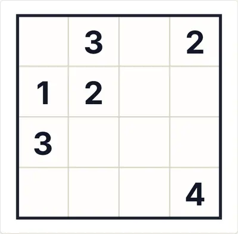 4×4</td><td align="center" valign="top">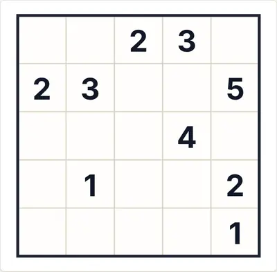 5×5</td><td align="center" valign="top">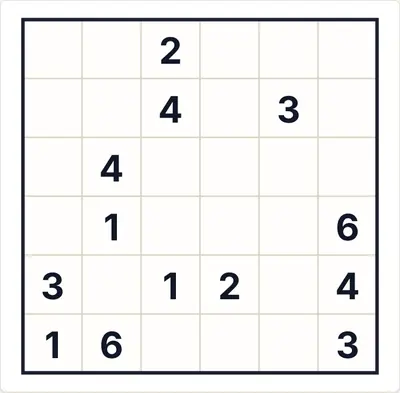 6×6</td></tr>
<tr><td align="center" valign="top">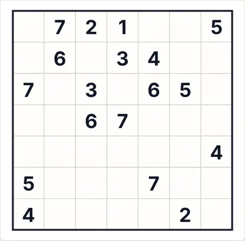 7×7</td><td align="center" valign="top">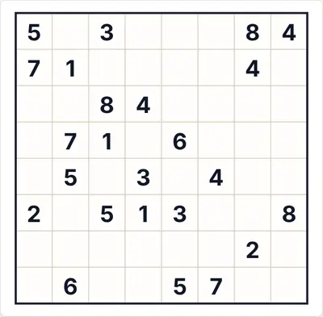 8×8</td><td align="center" valign="top">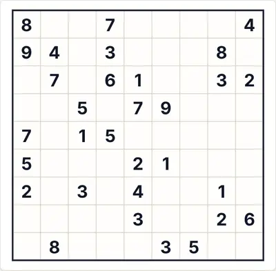 9×9</td></tr>
</table>

<b>Dificultate</b>

<table>
<tr><td align="center" valign="top">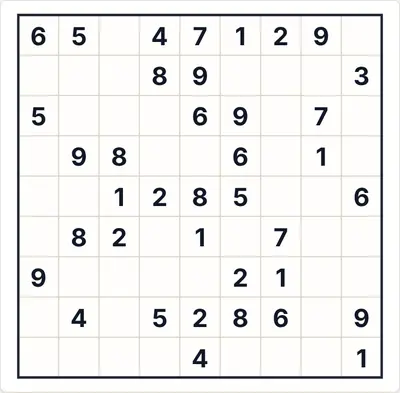 Ușor</td><td align="center" valign="top"> Mediu</td><td align="center" valign="top"> Greu</td></tr>
</table>

<b>Stări de joc</b>

<table>
<tr><td align="center" valign="top"> Auto-notițe (candidați)</td><td align="center" valign="top"> „Verifică” cu o cifră greșită (roșu)</td><td align="center" valign="top"> Soluția completă</td></tr>
</table>

<b>Teme și dispozitive</b>

<table>
<tr><td align="center" valign="top"> Temă întunecată</td><td align="center" valign="top"> Telefon (390 px)</td><td align="center" valign="top"> Interfața în engleză</td></tr>
</table>

<b>Panoul de reguli din joc</b>

<table>
<tr><td align="center" valign="top"> Regulile afișate lângă tablă</td></tr>
</table>

#### 4. Sudoku cu zero · Zero Sudoku (`zero`)

**Cifrele merg de la 0 la N−1.**

Același joc ca Clasicul; singura diferență este că simbolurile sunt 0…N−1 (la 9×9: 0–8). Regulile sunt cele clasice, deci e mai degrabă o variantă de afișare.

<table><tr><td align="center"> Puzzle la start (9×9 · mediu · 32 indicii)</td><td align="center"> După 4 pași „Pas cu pas”</td></tr></table>

- **Ultimul pas explicat de aplicație:** 7 (rând 2, col. 7): toate celelalte cifre apar deja printre celulele marcate (rând, coloană, regiune sau regulă de vecinătate).
- **Cod pentru același puzzle:** `zero-9-medium-3900437634` (lipește-l în „Joc nou → Cod”) · efort solver: fără ramificări

<b>Galerie completă: toate tipurile de capturi</b>

<b>Atlas</b>

<table>
<tr><td align="center" valign="top"> Cardul din Atlas</td><td align="center" valign="top"> Fișa (se deschide la clic pe card)</td></tr>
</table>

<b>Mărimi (nivel mediu)</b>

<table>
<tr><td align="center" valign="top"> 4×4</td><td align="center" valign="top"> 6×6</td><td align="center" valign="top"> 9×9</td></tr>
</table>

<b>Dificultate</b>

<table>
<tr><td align="center" valign="top"> Ușor</td><td align="center" valign="top"> Mediu</td><td align="center" valign="top"> Greu</td></tr>
</table>

<b>Stări de joc</b>

<table>
<tr><td align="center" valign="top"> Auto-notițe (candidați)</td><td align="center" valign="top"> „Verifică” cu o cifră greșită (roșu)</td><td align="center" valign="top"> Soluția completă</td></tr>
</table>

<b>Teme și dispozitive</b>

<table>
<tr><td align="center" valign="top"> Temă întunecată</td><td align="center" valign="top"> Telefon (390 px)</td><td align="center" valign="top"> Interfața în engleză</td></tr>
</table>

<b>Panoul de reguli din joc</b>

<table>
<tr><td align="center" valign="top"> Regulile afișate lângă tablă</td></tr>
</table>

