# Catalog: Topologii și mutări fairy (9)

[← README](../../README.md) · [Toate categoriile](README.md)

[Mărime și simboluri](01-marime-si-simboluri.md) · [Regiuni și grupuri](02-regiuni-si-grupuri.md) · [Vecini](03-vecini.md) · [Paritate, puncte, semne](04-paritate-puncte-semne.md) · [Sume](05-sume.md) · [Indicii pe margine](06-indicii-pe-margine.md) · [Linii](07-linii.md) · [Grile compuse](08-grile-compuse.md) · [Rude apropiate](09-rude-apropiate.md) · **Topologii și mutări fairy** · [Reguli globale](11-reguli-globale.md) · [Indicii în celule](12-indicii-in-celule.md) · [Dimensiuni superioare](13-dimensiuni-superioare.md)

---

_Marginile grilei se lipesc după regula variantei; o celulă de pe margine are vecini și de partea opusă._

#### 102. Anti-alfil · Anti-alfil (`antibishop`)

**Fără aceeași cifră la doi pași pe diagonală.**

Pe lângă regulile clasice, două celule aflate la exact doi pași pe diagonală (câte 2 rânduri și 2 coloane distanță, mutarea „alfil” din șahul fairy) nu pot conține aceeași cifră. Nu e alfilul glisant (acela ar impune diagonale întregi); e doar saltul de 2×2. Mărimi 9×9 și 6×6.

<table><tr><td align="center">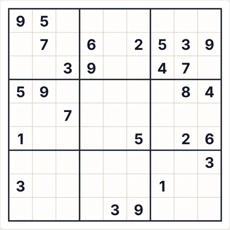 Puzzle la start (9×9 · mediu · 26 indicii)</td><td align="center">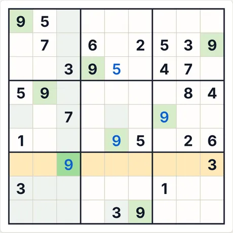 După 4 pași „Pas cu pas”</td></tr></table>

- **Ultimul pas explicat de aplicație:** 9 (rând 7, col. 3): este singura celulă din rândul marcat unde poate sta 9.
- **Cod pentru același puzzle:** `antibishop-9-medium-4275501725` (lipește-l în „Joc nou → Cod”) · efort solver: 1 ramificări

<b>Galerie completă: toate tipurile de capturi</b>

<b>Atlas</b>

<table>
<tr><td align="center" valign="top">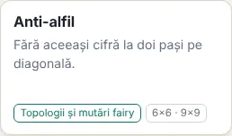 Cardul din Atlas</td><td align="center" valign="top">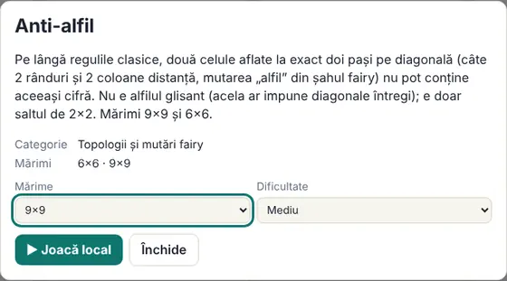 Fișa (se deschide la clic pe card)</td></tr>
</table>

<b>Mărimi (nivel mediu)</b>

<table>
<tr><td align="center" valign="top">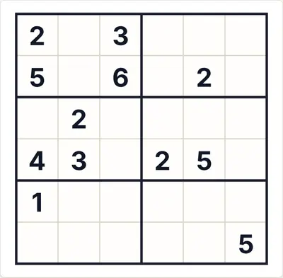 6×6</td><td align="center" valign="top">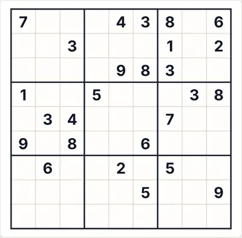 9×9</td></tr>
</table>

<b>Dificultate</b>

<table>
<tr><td align="center" valign="top">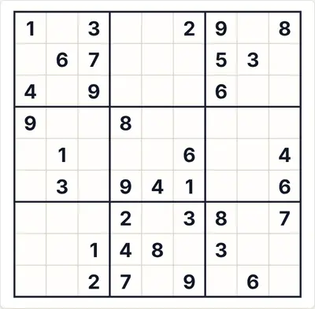 Ușor</td><td align="center" valign="top"> Mediu</td><td align="center" valign="top">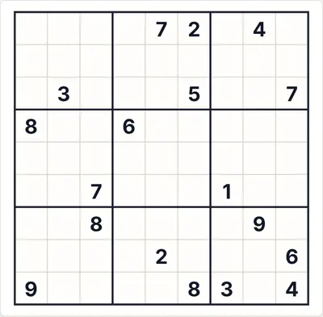 Greu</td></tr>
</table>

<b>Stări de joc</b>

<table>
<tr><td align="center" valign="top">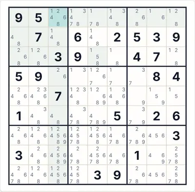 Auto-notițe (candidați)</td><td align="center" valign="top">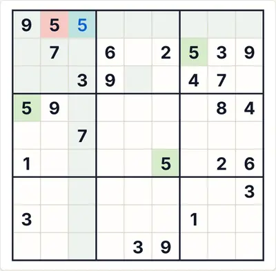 „Verifică” cu o cifră greșită (roșu)</td><td align="center" valign="top">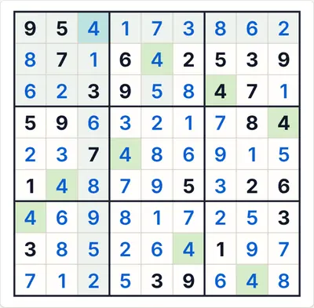 Soluția completă</td></tr>
</table>

<b>Teme și dispozitive</b>

<table>
<tr><td align="center" valign="top">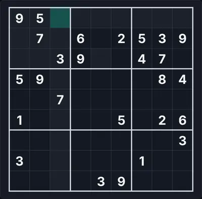 Temă întunecată</td><td align="center" valign="top">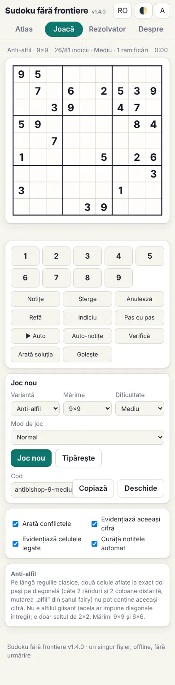 Telefon (390 px)</td><td align="center" valign="top">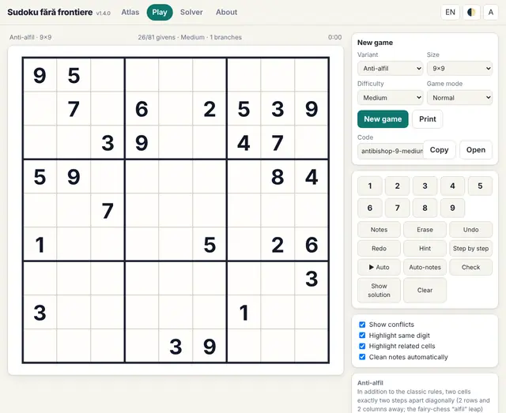 Interfața în engleză</td></tr>
</table>

<b>Panoul de reguli din joc</b>

<table>
<tr><td align="center" valign="top">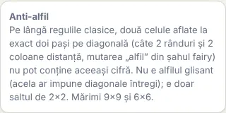 Regulile afișate lângă tablă</td></tr>
</table>

#### 103. Anti-cămilă · Anti-camel (`anticamel`)

**Fără aceeași cifră la un salt de cămilă (1,3).**

Pe lângă regulile clasice, două celule la un salt de cămilă (1 rând și 3 coloane, sau 3 rânduri și 1 coloană) nu pot conține aceeași cifră. Doar 9×9.

<table><tr><td align="center">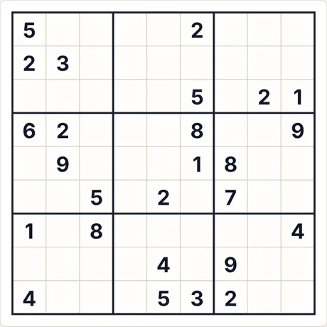 Puzzle la start (9×9 · mediu · 26 indicii)</td><td align="center">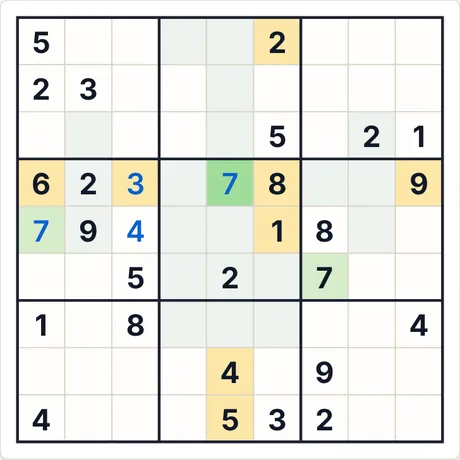 După 4 pași „Pas cu pas”</td></tr></table>

- **Ultimul pas explicat de aplicație:** 7 (rând 4, col. 5): toate celelalte cifre apar deja printre celulele marcate (rând, coloană, regiune sau regulă de vecinătate).
- **Cod pentru același puzzle:** `anticamel-9-medium-634926365` (lipește-l în „Joc nou → Cod”) · efort solver: fără ramificări

<b>Galerie completă: toate tipurile de capturi</b>

<b>Atlas</b>

<table>
<tr><td align="center" valign="top">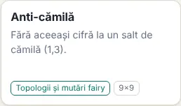 Cardul din Atlas</td><td align="center" valign="top">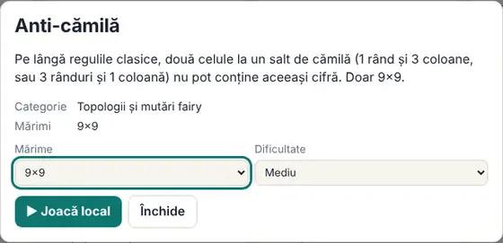 Fișa (se deschide la clic pe card)</td></tr>
</table>

<b>Mărimi (nivel mediu)</b>

<table>
<tr><td align="center" valign="top">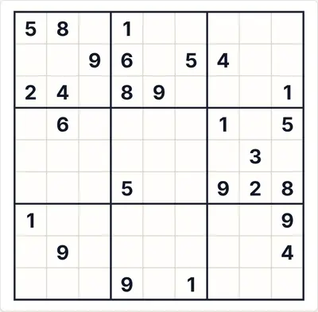 9×9</td></tr>
</table>

<b>Dificultate</b>

<table>
<tr><td align="center" valign="top">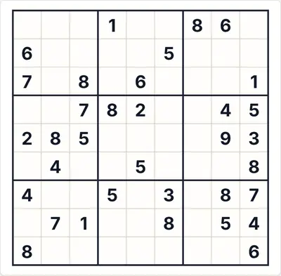 Ușor</td><td align="center" valign="top"> Mediu</td><td align="center" valign="top">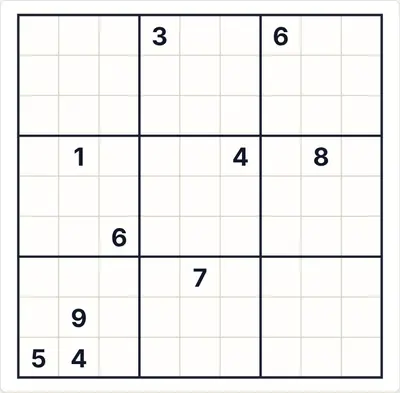 Greu</td></tr>
</table>

<b>Stări de joc</b>

<table>
<tr><td align="center" valign="top">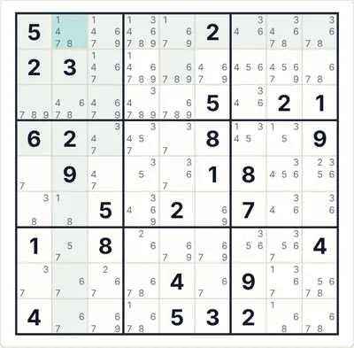 Auto-notițe (candidați)</td><td align="center" valign="top">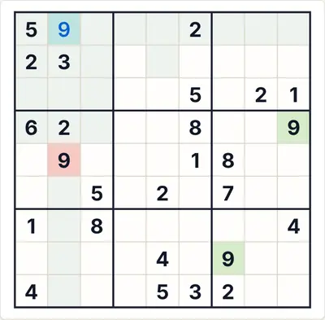 „Verifică” cu o cifră greșită (roșu)</td><td align="center" valign="top">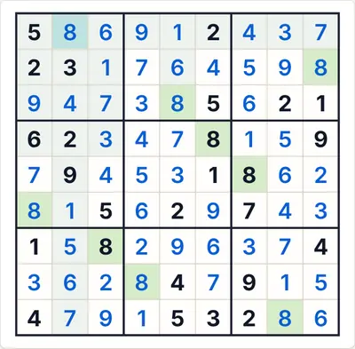 Soluția completă</td></tr>
</table>

<b>Teme și dispozitive</b>

<table>
<tr><td align="center" valign="top">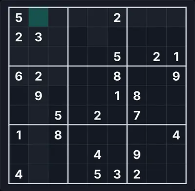 Temă întunecată</td><td align="center" valign="top">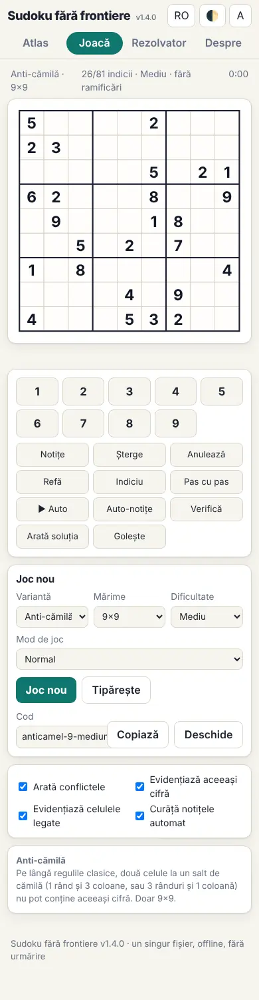 Telefon (390 px)</td><td align="center" valign="top">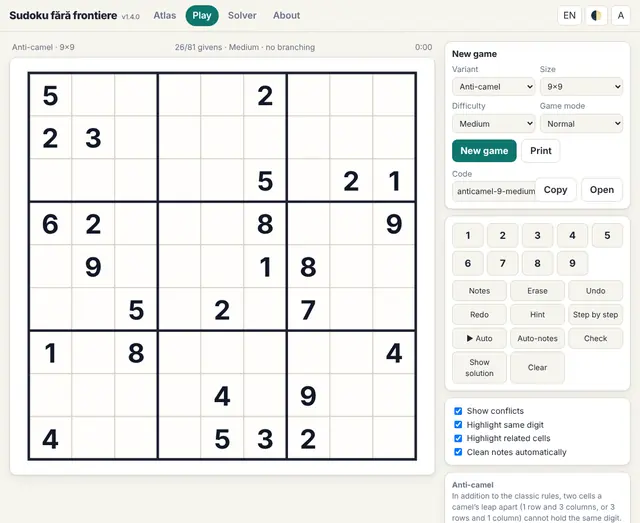 Interfața în engleză</td></tr>
</table>

<b>Panoul de reguli din joc</b>

<table>
<tr><td align="center" valign="top">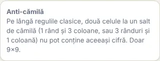 Regulile afișate lângă tablă</td></tr>
</table>

#### 104. Anti-zebră · Anti-zebra (`antizebra`)

**Fără aceeași cifră la un salt de zebră (2,3).**

Pe lângă regulile clasice, două celule la un salt de zebră (2 rânduri și 3 coloane, sau 3 rânduri și 2 coloane) nu pot conține aceeași cifră. Doar 9×9.

<table><tr><td align="center">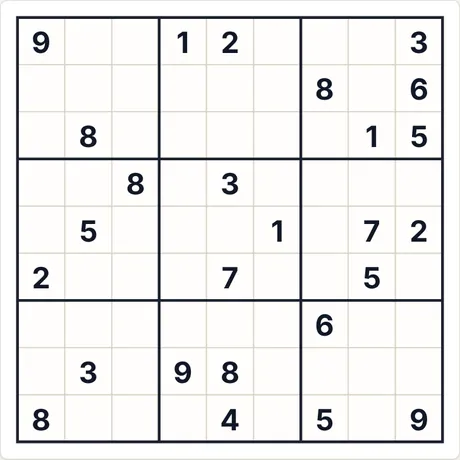 Puzzle la start (9×9 · mediu · 26 indicii)</td><td align="center">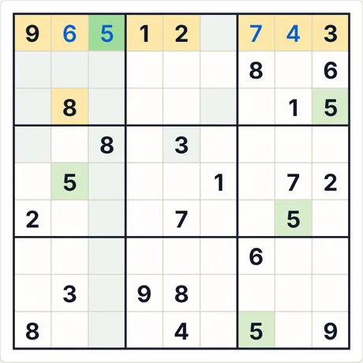 După 4 pași „Pas cu pas”</td></tr></table>

- **Ultimul pas explicat de aplicație:** 5 (rând 1, col. 3): toate celelalte cifre apar deja printre celulele marcate (rând, coloană, regiune sau regulă de vecinătate).
- **Cod pentru același puzzle:** `antizebra-9-medium-439216389` (lipește-l în „Joc nou → Cod”) · efort solver: fără ramificări

<b>Galerie completă: toate tipurile de capturi</b>

<b>Atlas</b>

<table>
<tr><td align="center" valign="top">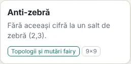 Cardul din Atlas</td><td align="center" valign="top">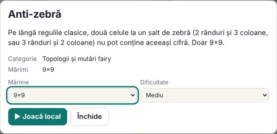 Fișa (se deschide la clic pe card)</td></tr>
</table>

<b>Mărimi (nivel mediu)</b>

<table>
<tr><td align="center" valign="top">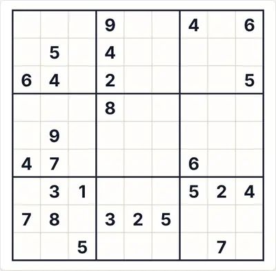 9×9</td></tr>
</table>

<b>Dificultate</b>

<table>
<tr><td align="center" valign="top">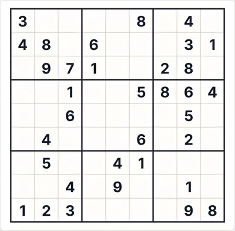 Ușor</td><td align="center" valign="top"> Mediu</td><td align="center" valign="top">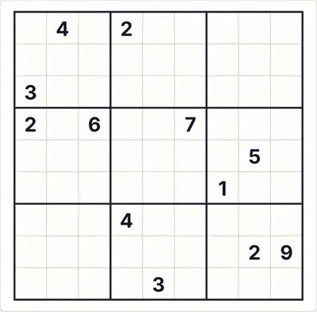 Greu</td></tr>
</table>

<b>Stări de joc</b>

<table>
<tr><td align="center" valign="top">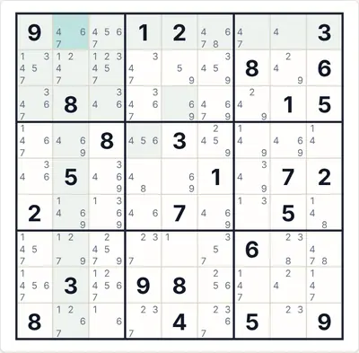 Auto-notițe (candidați)</td><td align="center" valign="top">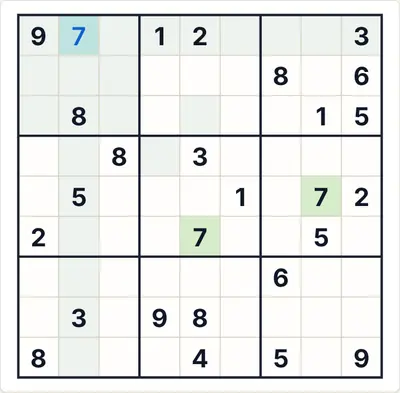 „Verifică” cu o cifră greșită (roșu)</td><td align="center" valign="top">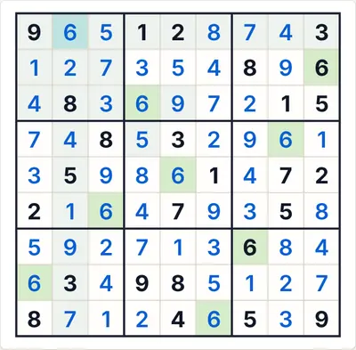 Soluția completă</td></tr>
</table>

<b>Teme și dispozitive</b>

<table>
<tr><td align="center" valign="top">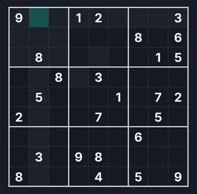 Temă întunecată</td><td align="center" valign="top">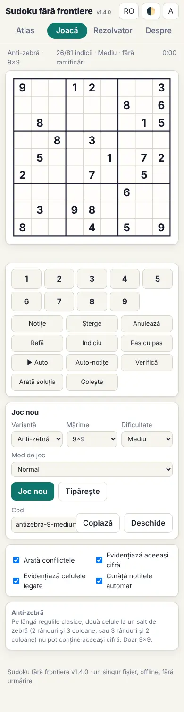 Telefon (390 px)</td><td align="center" valign="top">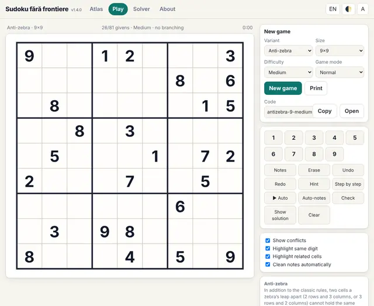 Interfața în engleză</td></tr>
</table>

<b>Panoul de reguli din joc</b>

<table>
<tr><td align="center" valign="top">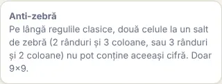 Regulile afișate lângă tablă</td></tr>
</table>

#### 105. Tor anti-rege · Torus anti-king (`torusking`)

**Anti-rege pe o grilă care se închide ca un tor.**

Grila se continuă pe margini: marginea de sus se lipește de cea de jos, stânga de dreapta. Două celule vecine pe diagonală (mutare de rege), inclusiv peste margine, nu pot conține aceeași cifră (de ex. colțul din stânga-sus este vecin diagonal cu cel din dreapta-jos). Doar 9×9.

<table><tr><td align="center">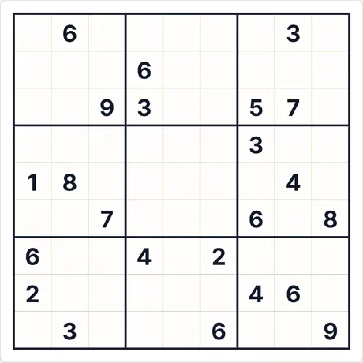 Puzzle la start (9×9 · mediu · 23 indicii)</td><td align="center">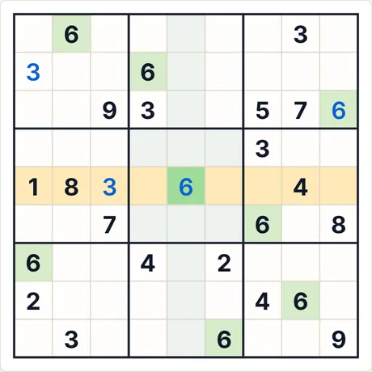 După 4 pași „Pas cu pas”</td></tr></table>

- **Ultimul pas explicat de aplicație:** 6 (rând 5, col. 5): este singura celulă din rândul marcat unde poate sta 6.
- **Cod pentru același puzzle:** `torusking-9-medium-1622319202` (lipește-l în „Joc nou → Cod”) · efort solver: 17 ramificări

<b>Galerie completă: toate tipurile de capturi</b>

<b>Atlas</b>

<table>
<tr><td align="center" valign="top"> Cardul din Atlas</td><td align="center" valign="top">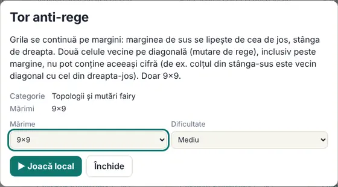 Fișa (se deschide la clic pe card)</td></tr>
</table>

<b>Mărimi (nivel mediu)</b>

<table>
<tr><td align="center" valign="top">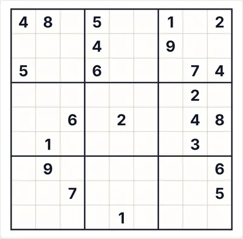 9×9</td></tr>
</table>

<b>Dificultate</b>

<table>
<tr><td align="center" valign="top">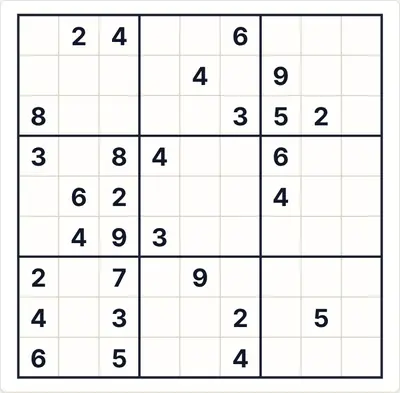 Ușor</td><td align="center" valign="top"> Mediu</td><td align="center" valign="top">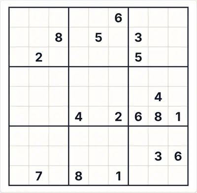 Greu</td></tr>
</table>

<b>Stări de joc</b>

<table>
<tr><td align="center" valign="top">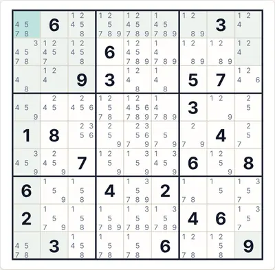 Auto-notițe (candidați)</td><td align="center" valign="top"> „Verifică” cu o cifră greșită (roșu)</td><td align="center" valign="top"> Soluția completă</td></tr>
</table>

<b>Teme și dispozitive</b>

<table>
<tr><td align="center" valign="top"> Temă întunecată</td><td align="center" valign="top"> Telefon (390 px)</td><td align="center" valign="top"> Interfața în engleză</td></tr>
</table>

<b>Panoul de reguli din joc</b>

<table>
<tr><td align="center" valign="top"> Regulile afișate lângă tablă</td></tr>
</table>

#### 106. Tor anti-cal · Torus anti-knight (`torusknight`)

**Anti-cal pe o grilă care se închide ca un tor.**

Grila se continuă pe margini (sus cu jos, stânga cu dreapta). Două celule la o mutare de cal, inclusiv peste margine, nu pot conține aceeași cifră. Doar 9×9.

<table><tr><td align="center"> Puzzle la start (9×9 · mediu · 23 indicii)</td><td align="center"> După 4 pași „Pas cu pas”</td></tr></table>

- **Ultimul pas explicat de aplicație:** 5 (rând 3, col. 6): este singura celulă din rândul marcat unde poate sta 5.
- **Cod pentru același puzzle:** `torusknight-9-medium-2092083509` (lipește-l în „Joc nou → Cod”) · efort solver: fără ramificări

<b>Galerie completă: toate tipurile de capturi</b>

<b>Atlas</b>

<table>
<tr><td align="center" valign="top"> Cardul din Atlas</td><td align="center" valign="top"> Fișa (se deschide la clic pe card)</td></tr>
</table>

<b>Mărimi (nivel mediu)</b>

<table>
<tr><td align="center" valign="top"> 9×9</td></tr>
</table>

<b>Dificultate</b>

<table>
<tr><td align="center" valign="top"> Ușor</td><td align="center" valign="top"> Mediu</td><td align="center" valign="top"> Greu</td></tr>
</table>

<b>Stări de joc</b>

<table>
<tr><td align="center" valign="top"> Auto-notițe (candidați)</td><td align="center" valign="top"> „Verifică” cu o cifră greșită (roșu)</td><td align="center" valign="top"> Soluția completă</td></tr>
</table>

<b>Teme și dispozitive</b>

<table>
<tr><td align="center" valign="top"> Temă întunecată</td><td align="center" valign="top"> Telefon (390 px)</td><td align="center" valign="top"> Interfața în engleză</td></tr>
</table>

<b>Panoul de reguli din joc</b>

<table>
<tr><td align="center" valign="top"> Regulile afișate lângă tablă</td></tr>
</table>

#### 107. Cilindru anti-rege · Cylinder anti-king (`cylking`)

**Stânga se lipește de dreapta; sus și jos rămân margini.**

Marginea din stânga se lipește de cea din dreapta, ca pe un cilindru; sus și jos nu se lipesc. Două celule la o mutare de rege (inclusiv peste lipitura stânga–dreapta) nu pot conține aceeași cifră. Doar 9×9.

<table><tr><td align="center"> Puzzle la start (9×9 · mediu · 24 indicii)</td><td align="center"> După 4 pași „Pas cu pas”</td></tr></table>

- **Ultimul pas explicat de aplicație:** 8 (rând 7, col. 5): este singura celulă din rândul marcat unde poate sta 8.
- **Cod pentru același puzzle:** `cylking-9-medium-3432982682` (lipește-l în „Joc nou → Cod”) · efort solver: 2 ramificări

<b>Galerie completă: toate tipurile de capturi</b>

<b>Atlas</b>

<table>
<tr><td align="center" valign="top"> Cardul din Atlas</td><td align="center" valign="top"> Fișa (se deschide la clic pe card)</td></tr>
</table>

<b>Mărimi (nivel mediu)</b>

<table>
<tr><td align="center" valign="top"> 9×9</td></tr>
</table>

<b>Dificultate</b>

<table>
<tr><td align="center" valign="top"> Ușor</td><td align="center" valign="top"> Mediu</td><td align="center" valign="top"> Greu</td></tr>
</table>

<b>Stări de joc</b>

<table>
<tr><td align="center" valign="top"> Auto-notițe (candidați)</td><td align="center" valign="top"> „Verifică” cu o cifră greșită (roșu)</td><td align="center" valign="top"> Soluția completă</td></tr>
</table>

<b>Teme și dispozitive</b>

<table>
<tr><td align="center" valign="top"> Temă întunecată</td><td align="center" valign="top"> Telefon (390 px)</td><td align="center" valign="top"> Interfața în engleză</td></tr>
</table>

<b>Panoul de reguli din joc</b>

<table>
<tr><td align="center" valign="top"> Regulile afișate lângă tablă</td></tr>
</table>

#### 108. Möbius anti-rege · Möbius anti-king (`mobiusking`)

**Stânga se lipește de dreapta cu o răsucire.**

Marginea din stânga se lipește de cea din dreapta cu o răsucire (rândul r se leagă de rândul 10−r), ca o bandă Möbius. Două celule la o mutare de rege, inclusiv peste lipitură, nu pot conține aceeași cifră. Doar 9×9. Convenția de lipire este cea descrisă aici.

<table><tr><td align="center"> Puzzle la start (9×9 · mediu · 23 indicii)</td><td align="center"> După 4 pași „Pas cu pas”</td></tr></table>

- **Ultimul pas explicat de aplicație:** 6 (rând 5, col. 2): toate celelalte cifre apar deja printre celulele marcate (rând, coloană, regiune sau regulă de vecinătate).
- **Cod pentru același puzzle:** `mobiusking-9-medium-3019619418` (lipește-l în „Joc nou → Cod”) · efort solver: 4 ramificări

<b>Galerie completă: toate tipurile de capturi</b>

<b>Atlas</b>

<table>
<tr><td align="center" valign="top"> Cardul din Atlas</td><td align="center" valign="top"> Fișa (se deschide la clic pe card)</td></tr>
</table>

<b>Mărimi (nivel mediu)</b>

<table>
<tr><td align="center" valign="top"> 9×9</td></tr>
</table>

<b>Dificultate</b>

<table>
<tr><td align="center" valign="top"> Ușor</td><td align="center" valign="top"> Mediu</td><td align="center" valign="top"> Greu</td></tr>
</table>

<b>Stări de joc</b>

<table>
<tr><td align="center" valign="top"> Auto-notițe (candidați)</td><td align="center" valign="top"> „Verifică” cu o cifră greșită (roșu)</td><td align="center" valign="top"> Soluția completă</td></tr>
</table>

<b>Teme și dispozitive</b>

<table>
<tr><td align="center" valign="top"> Temă întunecată</td><td align="center" valign="top"> Telefon (390 px)</td><td align="center" valign="top"> Interfața în engleză</td></tr>
</table>

<b>Panoul de reguli din joc</b>

<table>
<tr><td align="center" valign="top"> Regulile afișate lângă tablă</td></tr>
</table>

#### 109. Klein anti-rege · Klein anti-king (`kleinking`)

**Sticlă Klein: stânga–dreapta cu răsucire, sus–jos simplu.**

Marginea din stânga se lipește de cea din dreapta cu o răsucire (rândul r se leagă de rândul 10−r), iar sus se lipește de jos fără răsucire — o sticlă Klein. Două celule la o mutare de rege, inclusiv peste lipituri, nu pot conține aceeași cifră. Doar 9×9. Convenția de lipire este cea descrisă aici.

<table><tr><td align="center"> Puzzle la start (9×9 · mediu · 23 indicii)</td><td align="center"> După 4 pași „Pas cu pas”</td></tr></table>

- **Ultimul pas explicat de aplicație:** 8 (rând 4, col. 8): este singura celulă din rândul marcat unde poate sta 8.
- **Cod pentru același puzzle:** `kleinking-9-medium-1542891122` (lipește-l în „Joc nou → Cod”) · efort solver: fără ramificări

<b>Galerie completă: toate tipurile de capturi</b>

<b>Atlas</b>

<table>
<tr><td align="center" valign="top"> Cardul din Atlas</td><td align="center" valign="top"> Fișa (se deschide la clic pe card)</td></tr>
</table>

<b>Mărimi (nivel mediu)</b>

<table>
<tr><td align="center" valign="top"> 9×9</td></tr>
</table>

<b>Dificultate</b>

<table>
<tr><td align="center" valign="top"> Ușor</td><td align="center" valign="top"> Mediu</td><td align="center" valign="top"> Greu</td></tr>
</table>

<b>Stări de joc</b>

<table>
<tr><td align="center" valign="top"> Auto-notițe (candidați)</td><td align="center" valign="top"> „Verifică” cu o cifră greșită (roșu)</td><td align="center" valign="top"> Soluția completă</td></tr>
</table>

<b>Teme și dispozitive</b>

<table>
<tr><td align="center" valign="top"> Temă întunecată</td><td align="center" valign="top"> Telefon (390 px)</td><td align="center" valign="top"> Interfața în engleză</td></tr>
</table>

<b>Panoul de reguli din joc</b>

<table>
<tr><td align="center" valign="top"> Regulile afișate lângă tablă</td></tr>
</table>

#### 110. Plan proiectiv anti-rege · Projective-plane anti-king (`projking`)

**Ambele perechi de margini se lipesc cu răsucire.**

Stânga se lipește de dreapta cu răsucire (rândul r cu 10−r) și sus de jos cu răsucire (coloana c cu 10−c): un plan proiectiv real. Două celule la o mutare de rege, inclusiv peste lipituri, nu pot conține aceeași cifră. Doar 9×9. Convenția de lipire este cea descrisă aici.

<table><tr><td align="center"> Puzzle la start (9×9 · mediu · 23 indicii)</td><td align="center"> După 4 pași „Pas cu pas”</td></tr></table>

- **Ultimul pas explicat de aplicație:** 1 (rând 6, col. 6): este singura celulă din rândul marcat unde poate sta 1.
- **Cod pentru același puzzle:** `projking-9-medium-1483663755` (lipește-l în „Joc nou → Cod”) · efort solver: fără ramificări

<b>Galerie completă: toate tipurile de capturi</b>

<b>Atlas</b>

<table>
<tr><td align="center" valign="top"> Cardul din Atlas</td><td align="center" valign="top"> Fișa (se deschide la clic pe card)</td></tr>
</table>

<b>Mărimi (nivel mediu)</b>

<table>
<tr><td align="center" valign="top"> 9×9</td></tr>
</table>

<b>Dificultate</b>

<table>
<tr><td align="center" valign="top"> Ușor</td><td align="center" valign="top"> Mediu</td><td align="center" valign="top"> Greu</td></tr>
</table>

<b>Stări de joc</b>

<table>
<tr><td align="center" valign="top"> Auto-notițe (candidați)</td><td align="center" valign="top"> „Verifică” cu o cifră greșită (roșu)</td><td align="center" valign="top"> Soluția completă</td></tr>
</table>

<b>Teme și dispozitive</b>

<table>
<tr><td align="center" valign="top"> Temă întunecată</td><td align="center" valign="top"> Telefon (390 px)</td><td align="center" valign="top"> Interfața în engleză</td></tr>
</table>

<b>Panoul de reguli din joc</b>

<table>
<tr><td align="center" valign="top"> Regulile afișate lângă tablă</td></tr>
</table>

