# Katalog: Summen (3)

[English](../en/05-sume.md) · [Română](../05-sume.md) · [Français](../fr/05-sume.md) · [Italiano](../it/05-sume.md) · [Español](../es/05-sume.md) · [Português](../pt/05-sume.md) · **Deutsch** · [Magyar](../hu/05-sume.md)

[← README](../../../README.de.md) · [Alle Kategorien](README.md)

[Größe und Symbole](01-marime-si-simboluri.md) · [Gebiete und Gruppen](02-regiuni-si-grupuri.md) · [Nachbarn](03-vecini.md) · [Parität, Punkte, Zeichen](04-paritate-puncte-semne.md) · **Summen** · [Hinweise am Rand](06-indicii-pe-margine.md) · [Linien](07-linii.md) · [Zusammengesetzte Gitter](08-grile-compuse.md) · [Nahe Verwandte](09-rude-apropiate.md) · [Topologien und Märchenschach-Züge](10-topologii-si-mutari-fairy.md) · [Globale Regeln](11-reguli-globale.md) · [Hinweise in Feldern](12-indicii-in-celule.md) · [Höhere Dimensionen](13-dimensiuni-superioare.md)

---

_Die kleinen Zahlen in der Ecke eines Käfigs oder am Rand sind Summen; die Ziffern in einem Käfig wiederholen sich nicht, es sei denn, das Datenblatt sagt etwas anderes._

#### 38. Killer · Killer (`killer`)

**Käfige mit Summe, ohne Wiederholungen.**

Das Gitter ist in gepunktete Käfige unterteilt; die Zahl in der Ecke ist die Summe der Ziffern im Käfig. In einem Käfig wiederholt sich keine Ziffer.

<table><tr><td align="center">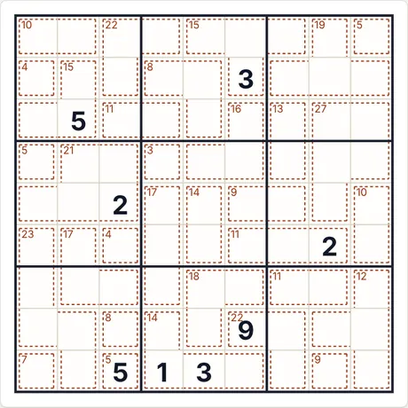 Rätsel am Anfang (9×9 · mittel · 8 Vorgaben)</td><td align="center">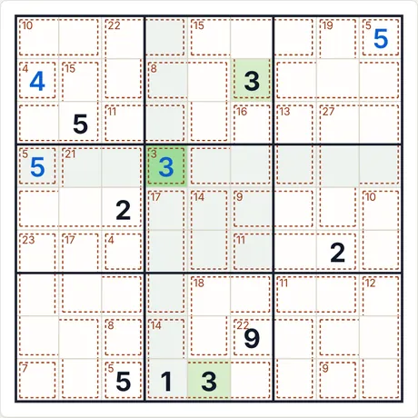 Nach 4 Schritten „Schritt für Schritt“</td></tr></table>

- **Letzter von der App erklärter Schritt:** 3 (Zeile 4, Sp. 4): ergibt sich aus den speziellen Regeln der Variante (Hinweise, Summen, Beziehungen), kombiniert mit den übrigen Ziffern.
- **Code für dasselbe Rätsel:** `killer-9-medium-4271579875` (füge ihn unter „Neues Spiel → Code“ ein) · Aufwand des Lösers: 1 Verzweigung

<b>Vollständige Galerie: alle Arten von Screenshots</b>

<b>Atlas</b>

<table>
<tr><td align="center" valign="top">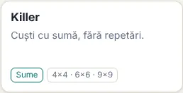 Die Karte im Atlas</td><td align="center" valign="top">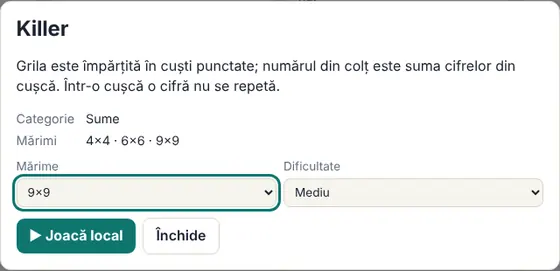 Das Datenblatt (öffnet sich beim Klick auf die Karte)</td></tr>
</table>

<b>Größen (mittlere Stufe)</b>

<table>
<tr><td align="center" valign="top">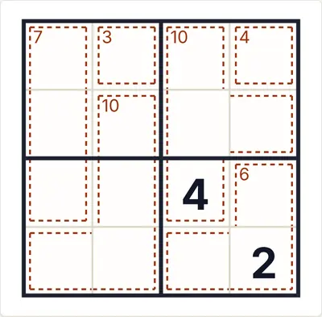 4×4</td><td align="center" valign="top">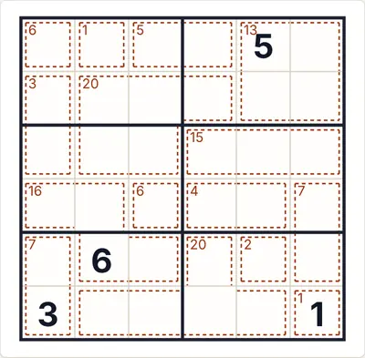 6×6</td><td align="center" valign="top">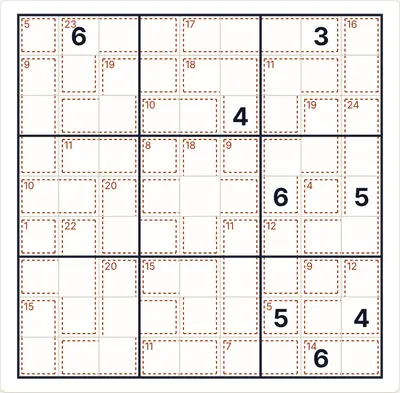 9×9</td></tr>
</table>

<b>Schwierigkeit</b>

<table>
<tr><td align="center" valign="top">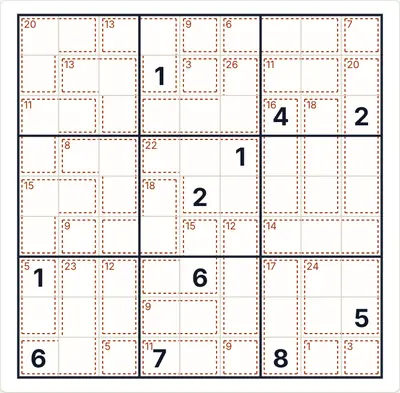 Leicht</td><td align="center" valign="top"> Mittel</td><td align="center" valign="top">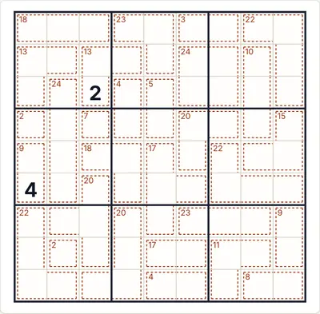 Schwer</td></tr>
</table>

<b>Spielzustände</b>

<table>
<tr><td align="center" valign="top">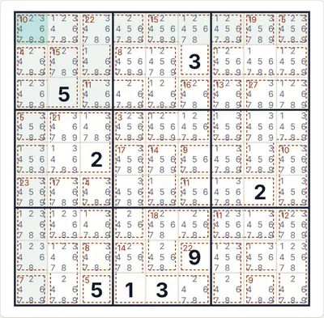 Auto-Notizen (Kandidaten)</td><td align="center" valign="top">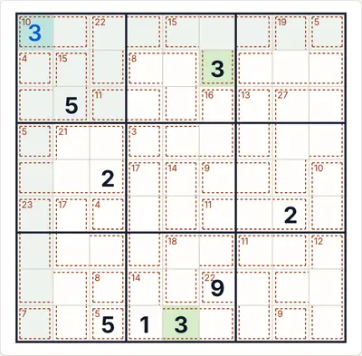 „Prüfen“ mit einer falschen Ziffer (rot)</td><td align="center" valign="top">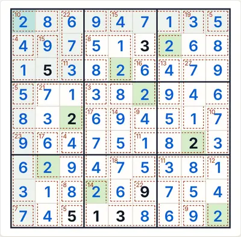 Die vollständige Lösung</td></tr>
</table>

<b>Themen und Geräte</b>

<table>
<tr><td align="center" valign="top">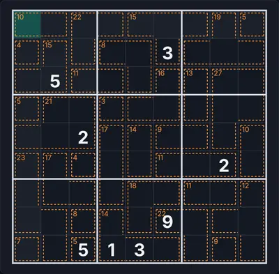 Dunkles Thema</td><td align="center" valign="top">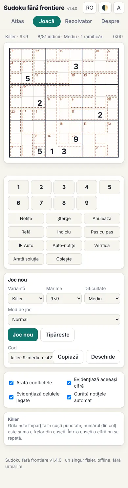 Telefon (390 px)</td><td align="center" valign="top">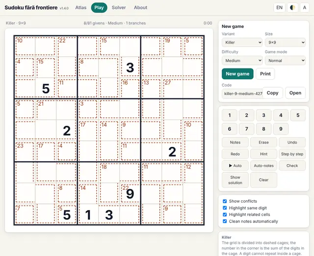 Oberfläche auf Englisch</td></tr>
</table>

<b>Das Regelpanel im Spiel</b>

<table>
<tr><td align="center" valign="top">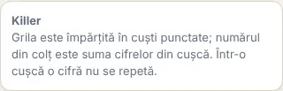 Die Regeln neben dem Spielfeld</td></tr>
</table>

#### 39. Little Killer · Little Killer (`littlekiller`)

**Diagonalsumme, vom Rand aus.**

Eine Zahl mit Pfeil außerhalb des Gitters ist die Summe der Ziffern auf der Diagonale, auf die der Pfeil zeigt; die Ziffern dürfen sich auf der Diagonale wiederholen.

<table><tr><td align="center">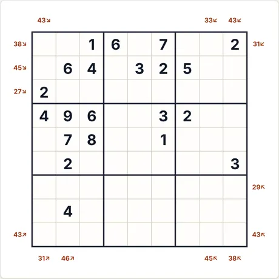 Rätsel am Anfang (9×9 · mittel · 21 Vorgaben)</td><td align="center">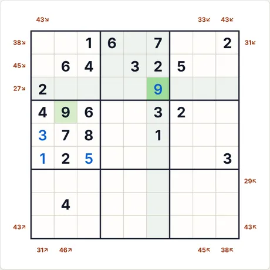 Nach 4 Schritten „Schritt für Schritt“</td></tr></table>

- **Letzter von der App erklärter Schritt:** 9 (Zeile 3, Sp. 6): ergibt sich aus den speziellen Regeln der Variante (Hinweise, Summen, Beziehungen), kombiniert mit den übrigen Ziffern.
- **Code für dasselbe Rätsel:** `littlekiller-9-easy-459682937` (füge ihn unter „Neues Spiel → Code“ ein) · Aufwand des Lösers: 31 Verzweigungen

<b>Vollständige Galerie: alle Arten von Screenshots</b>

<b>Atlas</b>

<table>
<tr><td align="center" valign="top">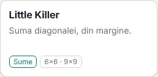 Die Karte im Atlas</td><td align="center" valign="top">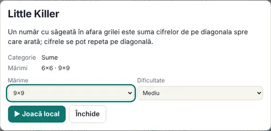 Das Datenblatt (öffnet sich beim Klick auf die Karte)</td></tr>
</table>

<b>Größen (mittlere Stufe)</b>

<table>
<tr><td align="center" valign="top">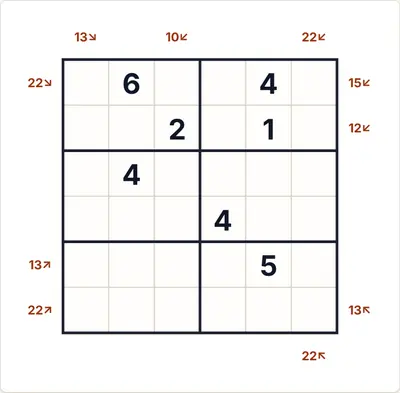 6×6</td><td align="center" valign="top">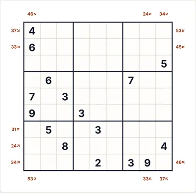 9×9</td></tr>
</table>

<b>Schwierigkeit</b>

<table>
<tr><td align="center" valign="top">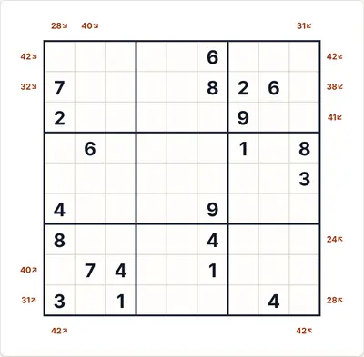 Leicht</td><td align="center" valign="top"> Mittel</td><td align="center" valign="top">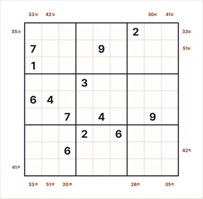 Schwer</td></tr>
</table>

<b>Spielzustände</b>

<table>
<tr><td align="center" valign="top">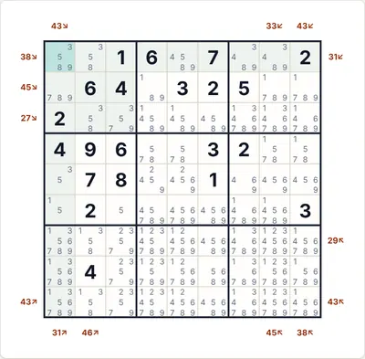 Auto-Notizen (Kandidaten)</td><td align="center" valign="top">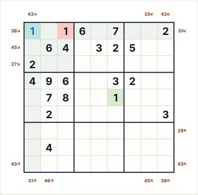 „Prüfen“ mit einer falschen Ziffer (rot)</td><td align="center" valign="top">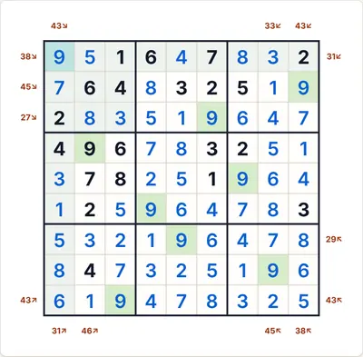 Die vollständige Lösung</td></tr>
</table>

<b>Themen und Geräte</b>

<table>
<tr><td align="center" valign="top">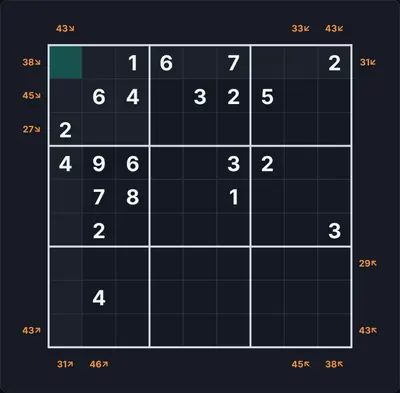 Dunkles Thema</td><td align="center" valign="top">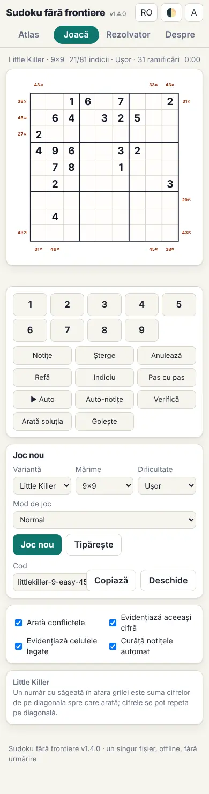 Telefon (390 px)</td><td align="center" valign="top">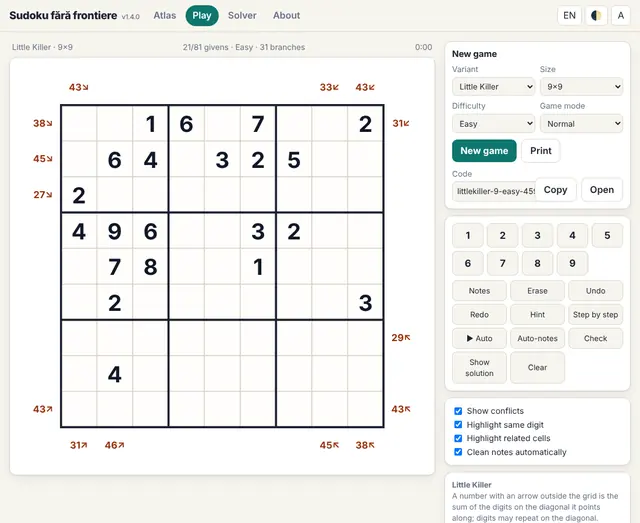 Oberfläche auf Englisch</td></tr>
</table>

<b>Das Regelpanel im Spiel</b>

<table>
<tr><td align="center" valign="top">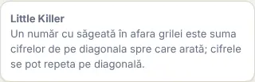 Die Regeln neben dem Spielfeld</td></tr>
</table>

#### 40. Eindeutiger Little Killer · Little Unique Killer (`luk`)

**Little Killer mit verschiedenen Ziffern auf der Diagonale.**

Die Zahl neben einem schrägen Pfeil ist die Summe der Ziffern auf der Diagonale, auf die er zeigt, und auf jeder solchen Diagonale sind die Ziffern alle verschieden (hier liegt der Unterschied zum klassischen Little Killer). Der Name „Little Unique Killer“ wird von dieser App verwendet; ich habe ihn nicht als unter diesem Namen veröffentlichte Variante gefunden.

<table><tr><td align="center">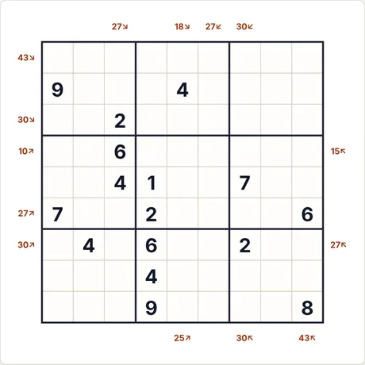 Rätsel am Anfang (9×9 · mittel · 16 Vorgaben)</td><td align="center">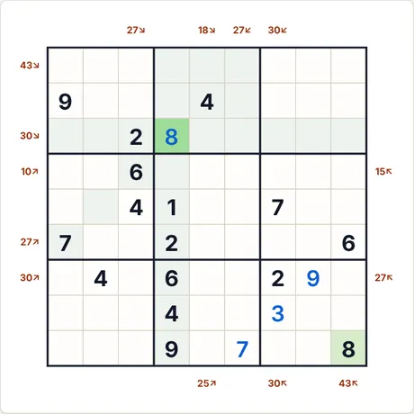 Nach 4 Schritten „Schritt für Schritt“</td></tr></table>

- **Letzter von der App erklärter Schritt:** 8 (Zeile 3, Sp. 4): keine direkte Folgerung; die Ziffer stammt aus der eindeutigen Lösung (es wäre eine Annahme nötig).
- **Code für dasselbe Rätsel:** `luk-9-medium-1817969793` (füge ihn unter „Neues Spiel → Code“ ein) · Aufwand des Lösers: 6 Verzweigungen

<b>Vollständige Galerie: alle Arten von Screenshots</b>

<b>Atlas</b>

<table>
<tr><td align="center" valign="top">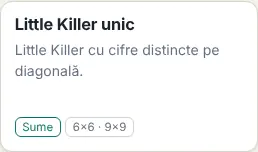 Die Karte im Atlas</td><td align="center" valign="top">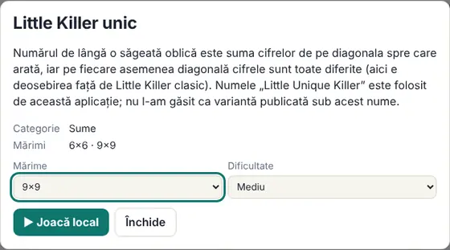 Das Datenblatt (öffnet sich beim Klick auf die Karte)</td></tr>
</table>

<b>Größen (mittlere Stufe)</b>

<table>
<tr><td align="center" valign="top">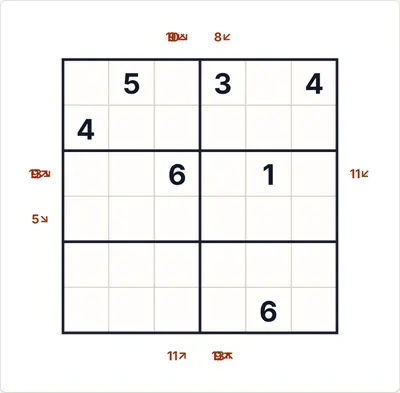 6×6</td><td align="center" valign="top">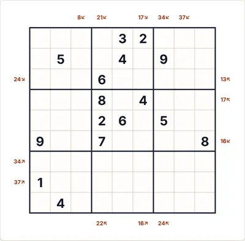 9×9</td></tr>
</table>

<b>Schwierigkeit</b>

<table>
<tr><td align="center" valign="top">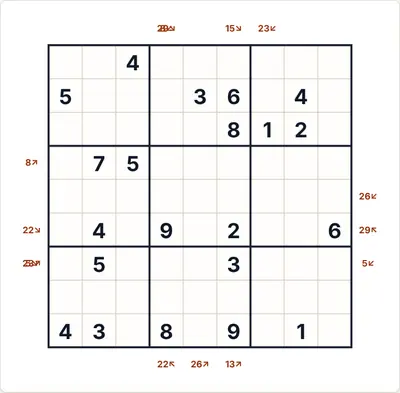 Leicht</td><td align="center" valign="top"> Mittel</td><td align="center" valign="top">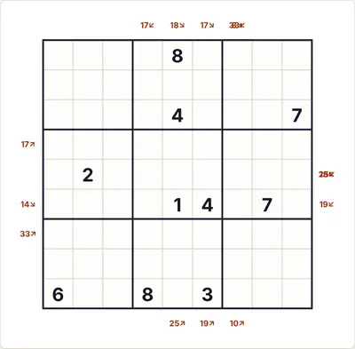 Schwer</td></tr>
</table>

<b>Spielzustände</b>

<table>
<tr><td align="center" valign="top">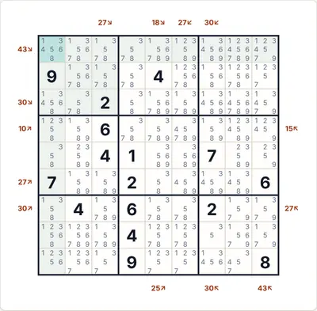 Auto-Notizen (Kandidaten)</td><td align="center" valign="top">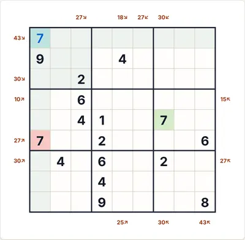 „Prüfen“ mit einer falschen Ziffer (rot)</td><td align="center" valign="top">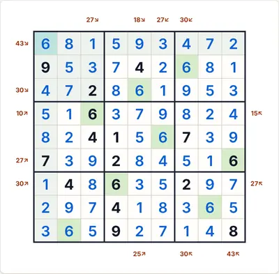 Die vollständige Lösung</td></tr>
</table>

<b>Themen und Geräte</b>

<table>
<tr><td align="center" valign="top">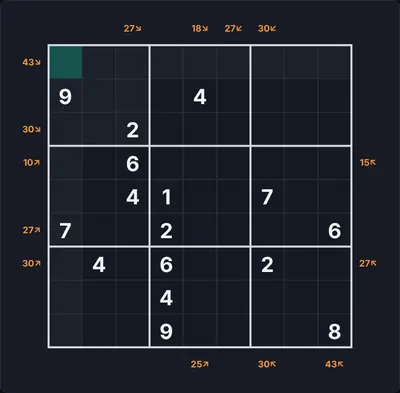 Dunkles Thema</td><td align="center" valign="top">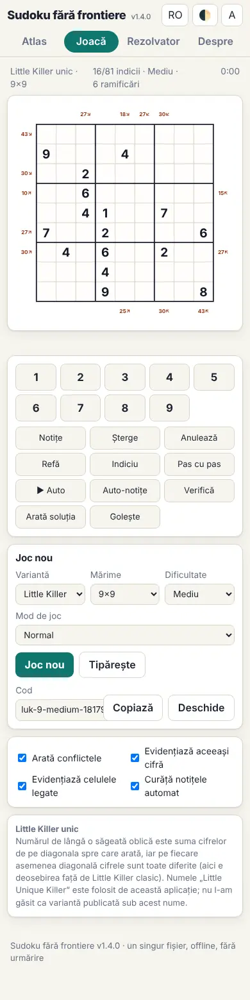 Telefon (390 px)</td><td align="center" valign="top">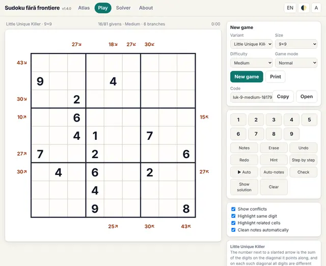 Oberfläche auf Englisch</td></tr>
</table>

<b>Das Regelpanel im Spiel</b>

<table>
<tr><td align="center" valign="top">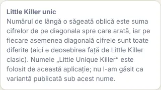 Die Regeln neben dem Spielfeld</td></tr>
</table>

