# Katalog: Nahe Verwandte (3)

[English](../en/09-rude-apropiate.md) · [Română](../09-rude-apropiate.md) · [Français](../fr/09-rude-apropiate.md) · [Italiano](../it/09-rude-apropiate.md) · [Español](../es/09-rude-apropiate.md) · [Português](../pt/09-rude-apropiate.md) · **Deutsch** · [Magyar](../hu/09-rude-apropiate.md)

[← README](../../../README.de.md) · [Alle Kategorien](README.md)

[Größe und Symbole](01-marime-si-simboluri.md) · [Gebiete und Gruppen](02-regiuni-si-grupuri.md) · [Nachbarn](03-vecini.md) · [Parität, Punkte, Zeichen](04-paritate-puncte-semne.md) · [Summen](05-sume.md) · [Hinweise am Rand](06-indicii-pe-margine.md) · [Linien](07-linii.md) · [Zusammengesetzte Gitter](08-grile-compuse.md) · **Nahe Verwandte** · [Topologien und Märchenschach-Züge](10-topologii-si-mutari-fairy.md) · [Globale Regeln](11-reguli-globale.md) · [Hinweise in Feldern](12-indicii-in-celule.md) · [Höhere Dimensionen](13-dimensiuni-superioare.md)

---

_Ein naher Verwandter des Sudoku: Lies das Datenblatt, was sich gegenüber dem klassischen Spiel ändert._

#### 99. Futoshiki · Futoshiki (`futoshiki`)

**Lateinisches Quadrat mit Ungleichheitszeichen.**

Jede Zeile und Spalte enthält die Ziffern 1–N je einmal; die Zeichen < und > zwischen den Zellen müssen beachtet werden. Ein naher Verwandter des Sudoku, ohne Blöcke.

<table><tr><td align="center">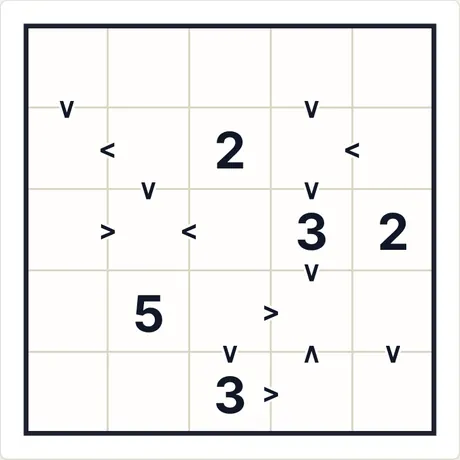 Rätsel am Anfang (5×5 · mittel · 5 Vorgaben)</td><td align="center">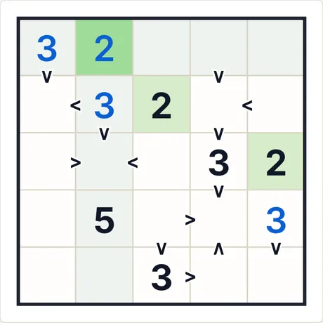 Nach 4 Schritten „Schritt für Schritt“</td></tr></table>

- **Letzter von der App erklärter Schritt:** 2 (Zeile 1, Sp. 2): ergibt sich aus den speziellen Regeln der Variante (Hinweise, Summen, Beziehungen), kombiniert mit den übrigen Ziffern.
- **Code für dasselbe Rätsel:** `futoshiki-5-medium-4235973107` (füge ihn unter „Neues Spiel → Code“ ein) · Aufwand des Lösers: keine Verzweigung

<b>Vollständige Galerie: alle Arten von Screenshots</b>

<b>Atlas</b>

<table>
<tr><td align="center" valign="top">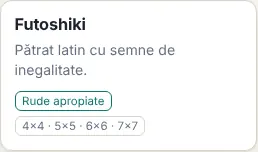 Die Karte im Atlas</td><td align="center" valign="top">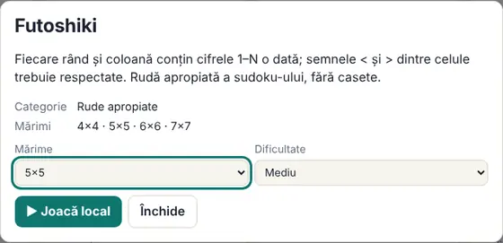 Das Datenblatt (öffnet sich beim Klick auf die Karte)</td></tr>
</table>

<b>Größen (mittlere Stufe)</b>

<table>
<tr><td align="center" valign="top">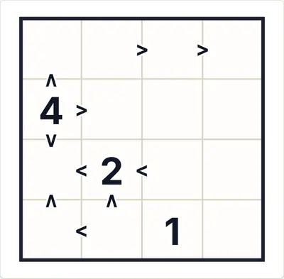 4×4</td><td align="center" valign="top">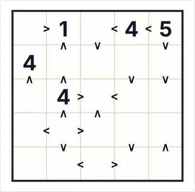 5×5</td><td align="center" valign="top">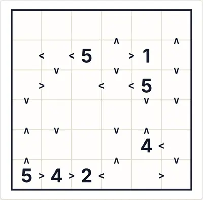 6×6</td></tr>
<tr><td align="center" valign="top">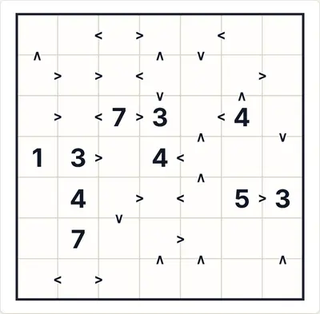 7×7</td></tr>
</table>

<b>Schwierigkeit</b>

<table>
<tr><td align="center" valign="top">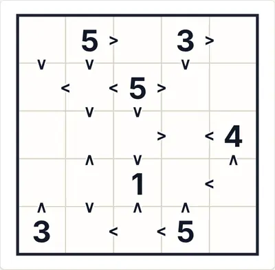 Leicht</td><td align="center" valign="top"> Mittel</td><td align="center" valign="top">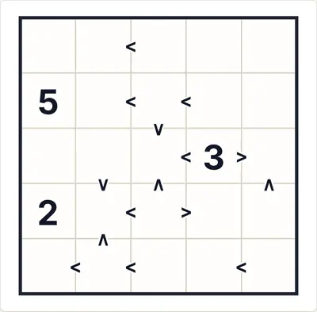 Schwer</td></tr>
</table>

<b>Spielzustände</b>

<table>
<tr><td align="center" valign="top">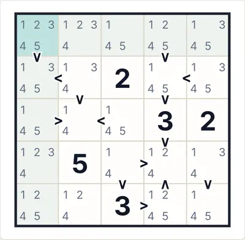 Auto-Notizen (Kandidaten)</td><td align="center" valign="top">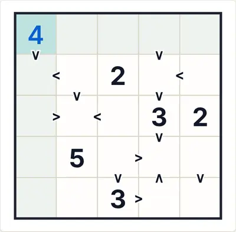 „Prüfen“ mit einer falschen Ziffer (rot)</td><td align="center" valign="top">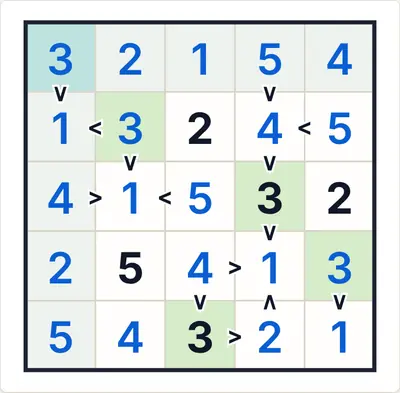 Die vollständige Lösung</td></tr>
</table>

<b>Themen und Geräte</b>

<table>
<tr><td align="center" valign="top">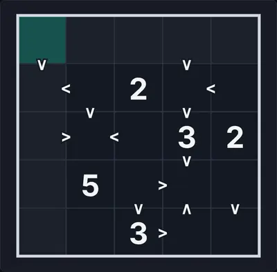 Dunkles Thema</td><td align="center" valign="top">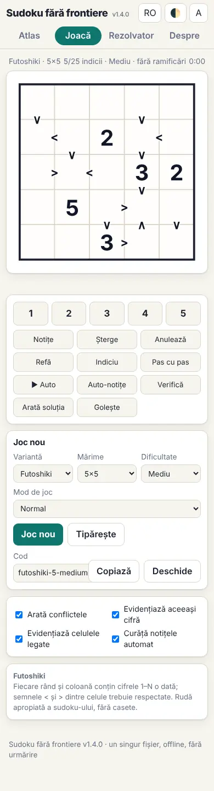 Telefon (390 px)</td><td align="center" valign="top">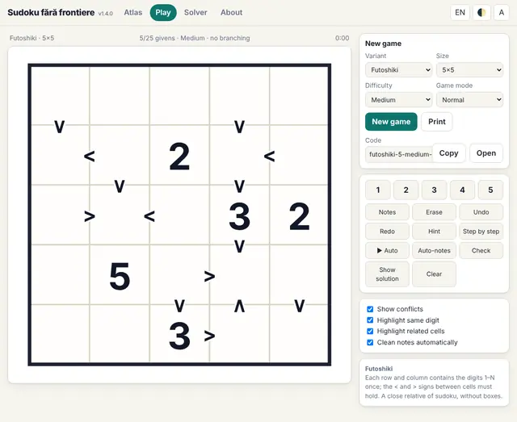 Oberfläche auf Englisch</td></tr>
</table>

<b>Das Regelpanel im Spiel</b>

<table>
<tr><td align="center" valign="top">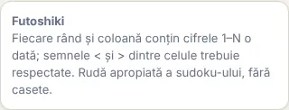 Die Regeln neben dem Spielfeld</td></tr>
</table>

#### 100. KenKen (Calcudoku) · KenKen (Calcudoku) (`kenken`)

**Lateinisches Quadrat mit arithmetischen Käfigen.**

Jede Zeile und Spalte enthält die Ziffern 1–N je einmal; jeder Käfig hat ein Ergebnis und eine Operation (+, −, ×, ÷). Ziffern dürfen sich in einem Käfig wiederholen, wenn sie nicht in derselben Zeile oder Spalte stehen.

<table><tr><td align="center">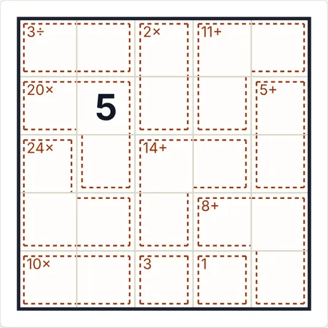 Rätsel am Anfang (5×5 · mittel · 1 Vorgaben)</td><td align="center">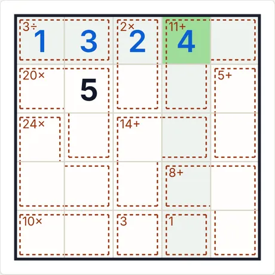 Nach 4 Schritten „Schritt für Schritt“</td></tr></table>

- **Letzter von der App erklärter Schritt:** 4 (Zeile 1, Sp. 4): ergibt sich aus den speziellen Regeln der Variante (Hinweise, Summen, Beziehungen), kombiniert mit den übrigen Ziffern.
- **Code für dasselbe Rätsel:** `kenken-5-medium-3034946116` (füge ihn unter „Neues Spiel → Code“ ein) · Aufwand des Lösers: keine Verzweigung

<b>Vollständige Galerie: alle Arten von Screenshots</b>

<b>Atlas</b>

<table>
<tr><td align="center" valign="top">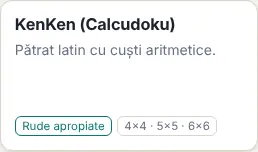 Die Karte im Atlas</td><td align="center" valign="top">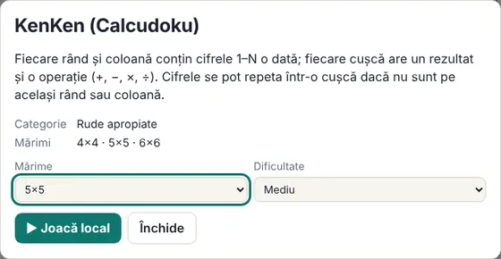 Das Datenblatt (öffnet sich beim Klick auf die Karte)</td></tr>
</table>

<b>Größen (mittlere Stufe)</b>

<table>
<tr><td align="center" valign="top">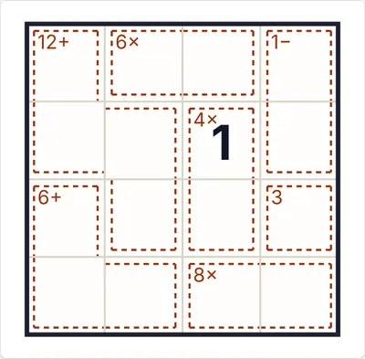 4×4</td><td align="center" valign="top">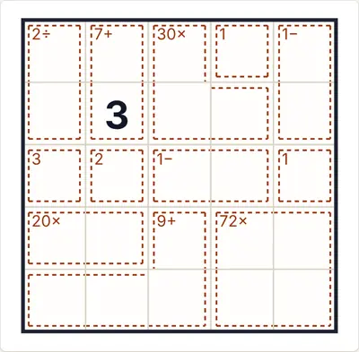 5×5</td><td align="center" valign="top">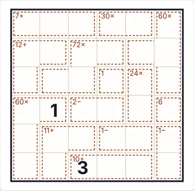 6×6</td></tr>
</table>

<b>Schwierigkeit</b>

<table>
<tr><td align="center" valign="top">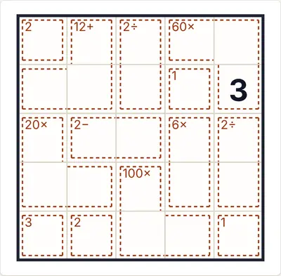 Leicht</td><td align="center" valign="top"> Mittel</td><td align="center" valign="top">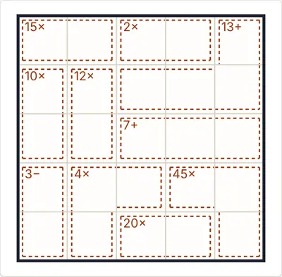 Schwer</td></tr>
</table>

<b>Spielzustände</b>

<table>
<tr><td align="center" valign="top">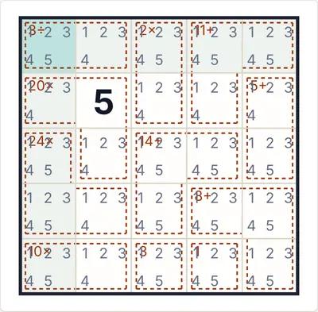 Auto-Notizen (Kandidaten)</td><td align="center" valign="top">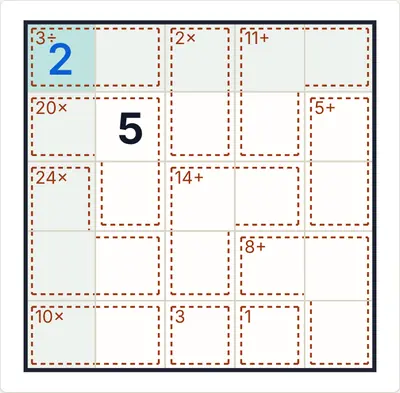 „Prüfen“ mit einer falschen Ziffer (rot)</td><td align="center" valign="top">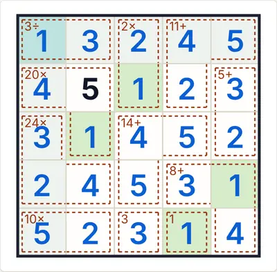 Die vollständige Lösung</td></tr>
</table>

<b>Themen und Geräte</b>

<table>
<tr><td align="center" valign="top">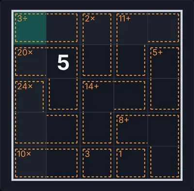 Dunkles Thema</td><td align="center" valign="top">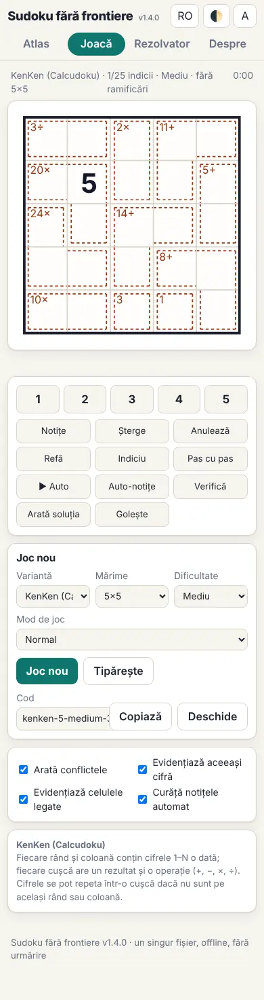 Telefon (390 px)</td><td align="center" valign="top">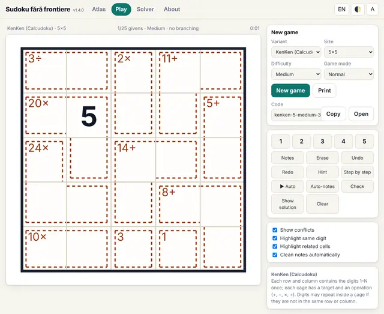 Oberfläche auf Englisch</td></tr>
</table>

<b>Das Regelpanel im Spiel</b>

<table>
<tr><td align="center" valign="top">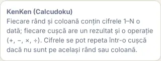 Die Regeln neben dem Spielfeld</td></tr>
</table>

#### 101. Strimko · Strimko (`strimko`)

**Ketten statt Blöcke.**

Jede Zeile, Spalte und Kette (durch Linien verbundene Kreise, auch diagonal zusammenhängend) enthält jede Ziffer genau einmal. Es gibt keine Blöcke. Größen 4–7.

<table><tr><td align="center">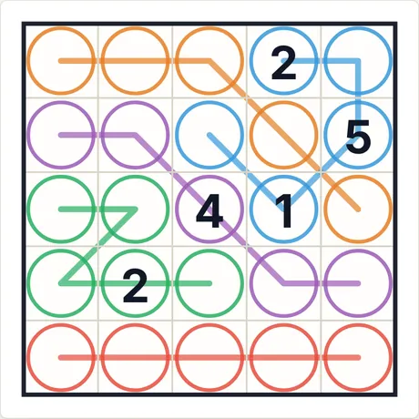 Rätsel am Anfang (5×5 · mittel · 5 Vorgaben)</td><td align="center">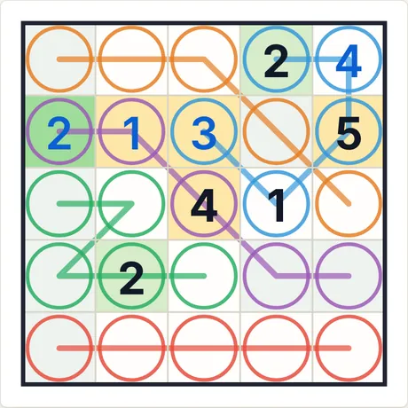 Nach 4 Schritten „Schritt für Schritt“</td></tr></table>

- **Letzter von der App erklärter Schritt:** 2 (Zeile 2, Sp. 1): alle anderen Ziffern kommen bereits unter den markierten Zellen vor (Zeile, Spalte, Gebiet oder Nachbarschaftsregel).
- **Code für dasselbe Rätsel:** `strimko-5-medium-2938744326` (füge ihn unter „Neues Spiel → Code“ ein) · Aufwand des Lösers: keine Verzweigung

<b>Vollständige Galerie: alle Arten von Screenshots</b>

<b>Atlas</b>

<table>
<tr><td align="center" valign="top">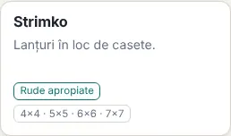 Die Karte im Atlas</td><td align="center" valign="top">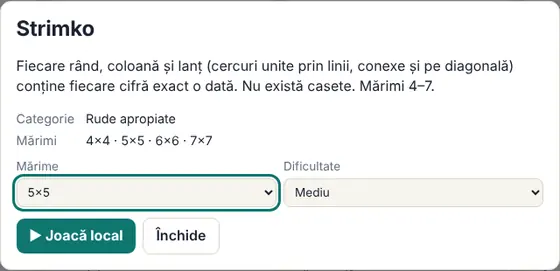 Das Datenblatt (öffnet sich beim Klick auf die Karte)</td></tr>
</table>

<b>Größen (mittlere Stufe)</b>

<table>
<tr><td align="center" valign="top">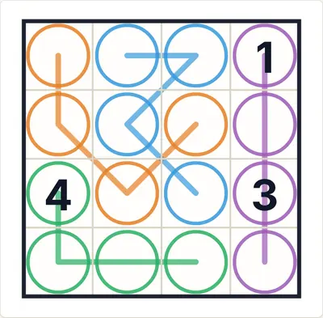 4×4</td><td align="center" valign="top">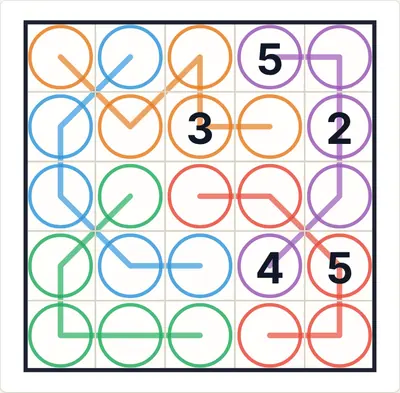 5×5</td><td align="center" valign="top">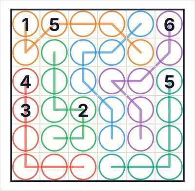 6×6</td></tr>
<tr><td align="center" valign="top">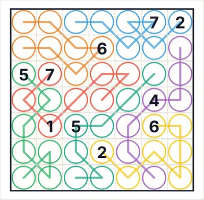 7×7</td></tr>
</table>

<b>Schwierigkeit</b>

<table>
<tr><td align="center" valign="top">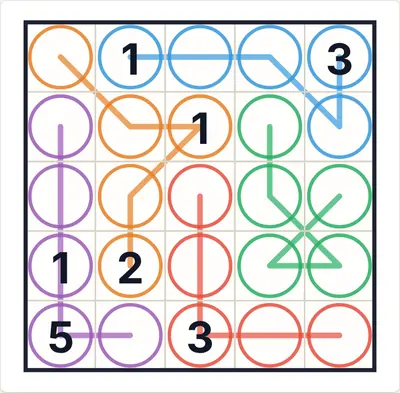 Leicht</td><td align="center" valign="top"> Mittel</td><td align="center" valign="top">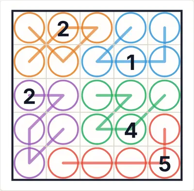 Schwer</td></tr>
</table>

<b>Spielzustände</b>

<table>
<tr><td align="center" valign="top">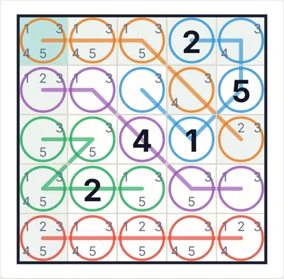 Auto-Notizen (Kandidaten)</td><td align="center" valign="top">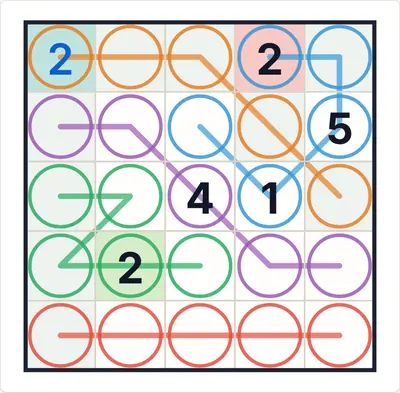 „Prüfen“ mit einer falschen Ziffer (rot)</td><td align="center" valign="top">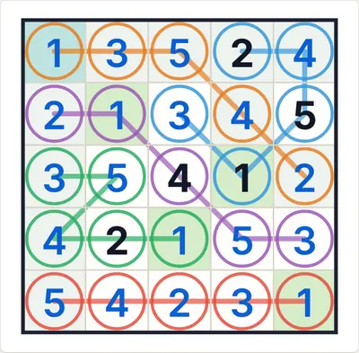 Die vollständige Lösung</td></tr>
</table>

<b>Themen und Geräte</b>

<table>
<tr><td align="center" valign="top">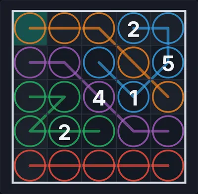 Dunkles Thema</td><td align="center" valign="top">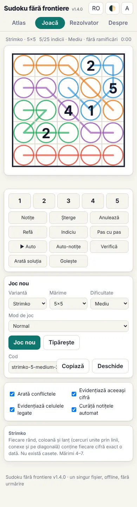 Telefon (390 px)</td><td align="center" valign="top">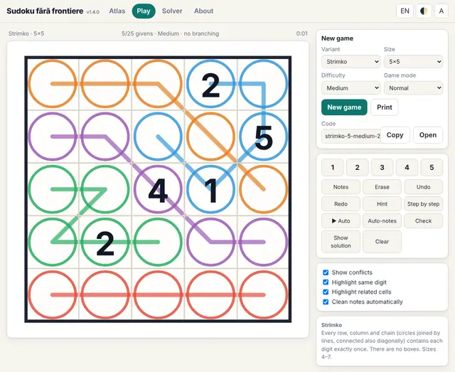 Oberfläche auf Englisch</td></tr>
</table>

<b>Das Regelpanel im Spiel</b>

<table>
<tr><td align="center" valign="top">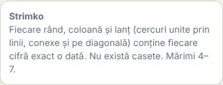 Die Regeln neben dem Spielfeld</td></tr>
</table>

