# Katalog: Höhere Dimensionen (5)

[English](../en/13-dimensiuni-superioare.md) · [Română](../13-dimensiuni-superioare.md) · [Français](../fr/13-dimensiuni-superioare.md) · [Italiano](../it/13-dimensiuni-superioare.md) · [Español](../es/13-dimensiuni-superioare.md) · [Português](../pt/13-dimensiuni-superioare.md) · **Deutsch** · [Magyar](../hu/13-dimensiuni-superioare.md)

[← README](../../../README.de.md) · [Alle Kategorien](README.md)

[Größe und Symbole](01-marime-si-simboluri.md) · [Gebiete und Gruppen](02-regiuni-si-grupuri.md) · [Nachbarn](03-vecini.md) · [Parität, Punkte, Zeichen](04-paritate-puncte-semne.md) · [Summen](05-sume.md) · [Hinweise am Rand](06-indicii-pe-margine.md) · [Linien](07-linii.md) · [Zusammengesetzte Gitter](08-grile-compuse.md) · [Nahe Verwandte](09-rude-apropiate.md) · [Topologien und Märchenschach-Züge](10-topologii-si-mutari-fairy.md) · [Globale Regeln](11-reguli-globale.md) · [Hinweise in Feldern](12-indicii-in-celule.md) · **Höhere Dimensionen**

---

_Die Schichten werden als Gitterscheiben angezeigt; bei den 3D-Würfeln gibt es außerdem eine drehbare „3D-Ansicht“ (mit der Maus ziehen)._

#### 132. Lateinischer Würfel 3D · Latin cube 3D (`cube3`)

**Jede Linie des Würfels enthält jede Ziffer einmal.**

Der N×N×N-Würfel wird in N nebeneinander angeordnete Schichten (durch Leerraum getrennt) abgewickelt. Jede Linie in jeder der drei Richtungen – Zeile in der Schicht, Spalte in der Schicht und „in die Tiefe“ (dieselbe Position in allen Schichten) – enthält jede Ziffer einmal. Größen 4, 5, 6. Der Würfel ist sehr starr: Bei „Schwer“ bleiben nur wenige Vorgaben. Die Darstellung erfolgt schichtweise; du kannst auf „3D-Ansicht“ umschalten (ziehen, um den Würfel zu drehen; der Schieberegler blendet die vorderen Schichten aus; Zellen wählst du per Klick aus).

<table><tr><td align="center">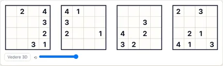 Rätsel am Anfang (4×4 · mittel · 23 Vorgaben)</td><td align="center">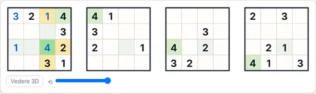 Nach 4 Schritten „Schritt für Schritt“</td></tr></table>

- **Letzter von der App erklärter Schritt:** 4 (Zeile 3, Sp. 3): alle anderen Ziffern kommen bereits unter den markierten Zellen vor (Zeile, Spalte, Gebiet oder Nachbarschaftsregel).
- **Code für dasselbe Rätsel:** `cube3-4-medium-3792369668` (füge ihn unter „Neues Spiel → Code“ ein) · Aufwand des Lösers: keine Verzweigung

<b>Vollständige Galerie: alle Arten von Screenshots</b>

<b>Atlas</b>

<table>
<tr><td align="center" valign="top">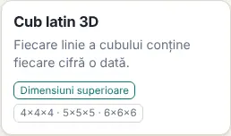 Die Karte im Atlas</td><td align="center" valign="top">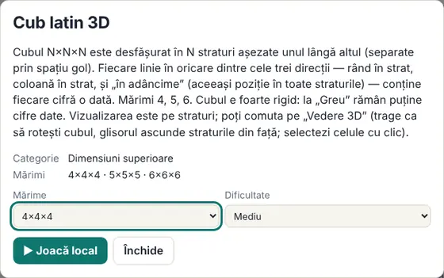 Das Datenblatt (öffnet sich beim Klick auf die Karte)</td></tr>
</table>

<b>Größen (mittlere Stufe)</b>

<table>
<tr><td align="center" valign="top">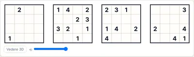 Größe 4</td><td align="center" valign="top">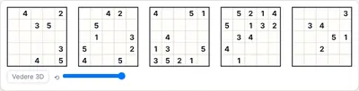 Größe 5</td><td align="center" valign="top">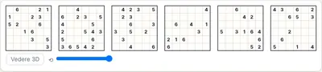 Größe 6</td></tr>
</table>

<b>Schwierigkeit</b>

<table>
<tr><td align="center" valign="top">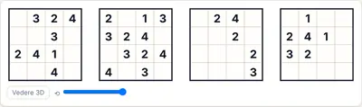 Leicht</td><td align="center" valign="top"> Mittel</td><td align="center" valign="top">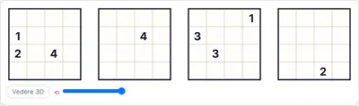 Schwer</td></tr>
</table>

<b>Spielzustände</b>

<table>
<tr><td align="center" valign="top">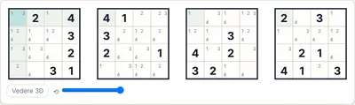 Auto-Notizen (Kandidaten)</td><td align="center" valign="top">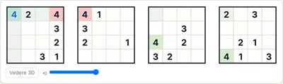 „Prüfen“ mit einer falschen Ziffer (rot)</td><td align="center" valign="top">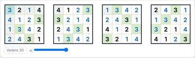 Die vollständige Lösung</td></tr>
</table>

<b>Themen und Geräte</b>

<table>
<tr><td align="center" valign="top">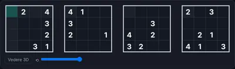 Dunkles Thema</td><td align="center" valign="top">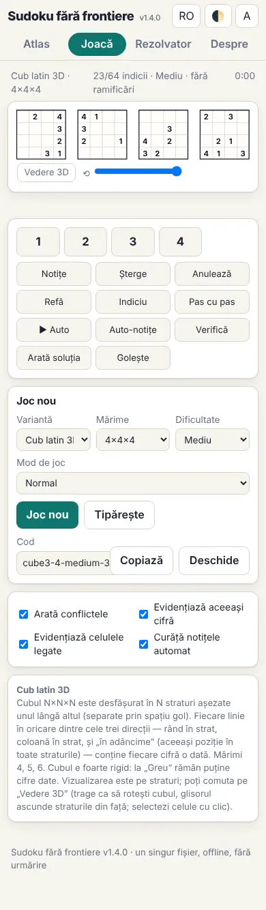 Telefon (390 px)</td><td align="center" valign="top">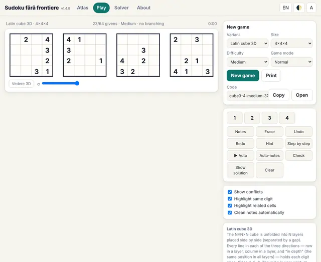 Oberfläche auf Englisch</td></tr>
</table>

<b>Das Regelpanel im Spiel</b>

<table>
<tr><td align="center" valign="top">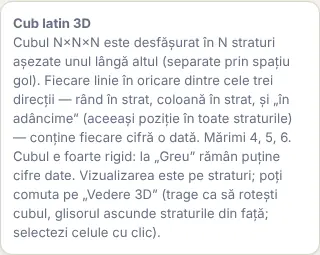 Die Regeln neben dem Spielfeld</td></tr>
</table>

#### 133. Würfel mit 2×2-Blöcken · Cube with 2×2 boxes (`cubebox`)

**Lateinischer Würfel 4×4×4 mit 2×2-Blöcken in jeder Schicht.**

Wie beim Lateinischen Würfel 3D (4×4×4), aber zusätzlich hat jede Schicht vier 2×2-Blöcke (dick umrandet), die jeweils jede Ziffer einmal enthalten: Jede Schicht ist also ein 4×4-Sudoku, und auch die Linien „in die Tiefe“ enthalten jede Ziffer einmal. Nur 4×4×4.

<table><tr><td align="center">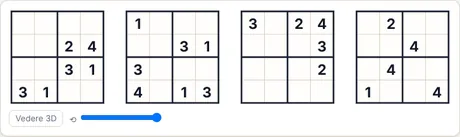 Rätsel am Anfang (4×4 · mittel · 23 Vorgaben)</td><td align="center">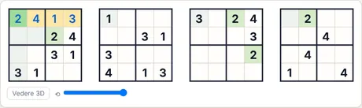 Nach 4 Schritten „Schritt für Schritt“</td></tr></table>

- **Letzter von der App erklärter Schritt:** 2 (Zeile 1, Sp. 1): alle anderen Ziffern kommen bereits unter den markierten Zellen vor (Zeile, Spalte, Gebiet oder Nachbarschaftsregel).
- **Code für dasselbe Rätsel:** `cubebox-4-medium-831564534` (füge ihn unter „Neues Spiel → Code“ ein) · Aufwand des Lösers: keine Verzweigung

<b>Vollständige Galerie: alle Arten von Screenshots</b>

<b>Atlas</b>

<table>
<tr><td align="center" valign="top">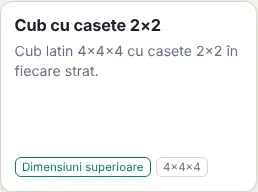 Die Karte im Atlas</td><td align="center" valign="top">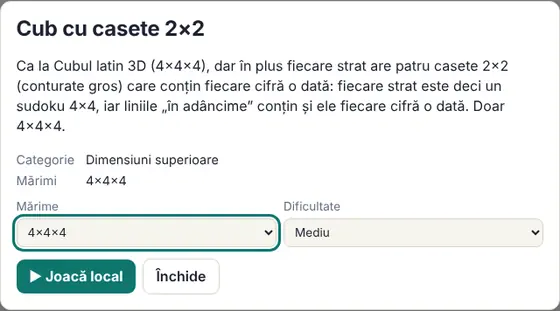 Das Datenblatt (öffnet sich beim Klick auf die Karte)</td></tr>
</table>

<b>Größen (mittlere Stufe)</b>

<table>
<tr><td align="center" valign="top">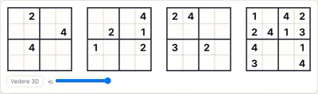 Größe 4</td></tr>
</table>

<b>Schwierigkeit</b>

<table>
<tr><td align="center" valign="top">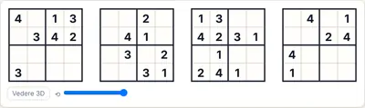 Leicht</td><td align="center" valign="top"> Mittel</td><td align="center" valign="top">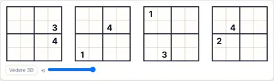 Schwer</td></tr>
</table>

<b>Spielzustände</b>

<table>
<tr><td align="center" valign="top">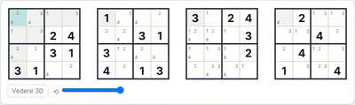 Auto-Notizen (Kandidaten)</td><td align="center" valign="top">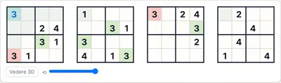 „Prüfen“ mit einer falschen Ziffer (rot)</td><td align="center" valign="top">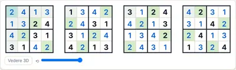 Die vollständige Lösung</td></tr>
</table>

<b>Themen und Geräte</b>

<table>
<tr><td align="center" valign="top">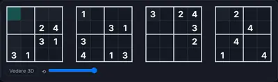 Dunkles Thema</td><td align="center" valign="top">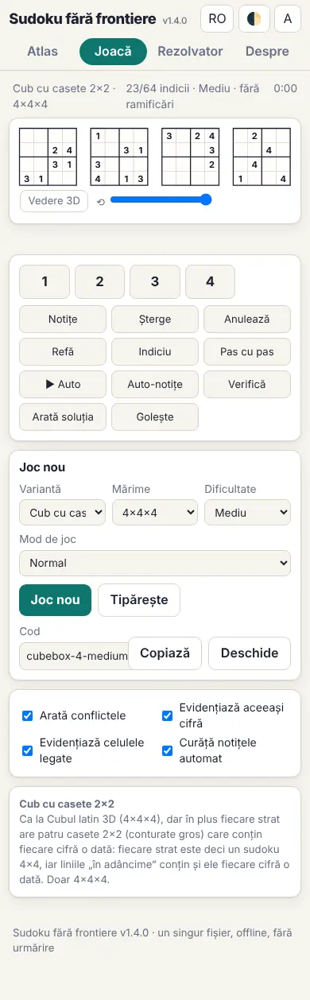 Telefon (390 px)</td><td align="center" valign="top">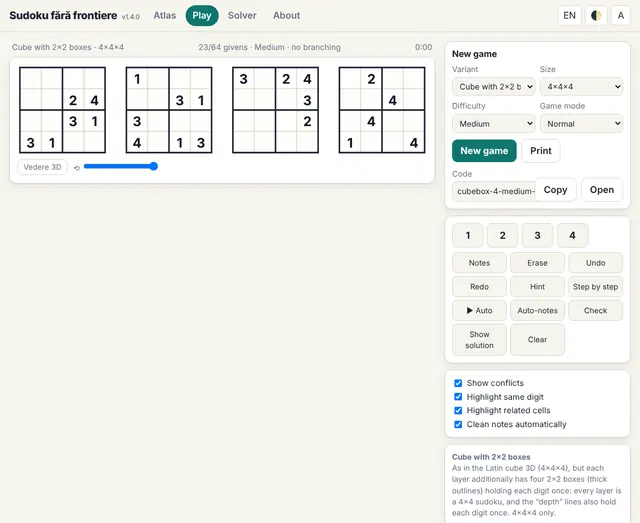 Oberfläche auf Englisch</td></tr>
</table>

<b>Das Regelpanel im Spiel</b>

<table>
<tr><td align="center" valign="top">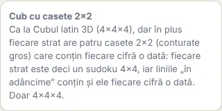 Die Regeln neben dem Spielfeld</td></tr>
</table>

#### 134. Hyperwürfel 4D · Hypercube 4D (`hyper4`)

**Sudoku in vier Dimensionen.**

Der N×N×N×N-Hyperwürfel wird als N×N-Mosaik aus N×N-Schichten abgewickelt (die ersten beiden Koordinaten wählen die Schicht: Zeile und Spalte der Schichten). Jede Linie auf jeder der vier Achsen enthält jede Ziffer einmal. Größen 3 (81 Zellen) und 4 (256 Zellen). Sehr starr: wenige Vorgaben.

<table><tr><td align="center">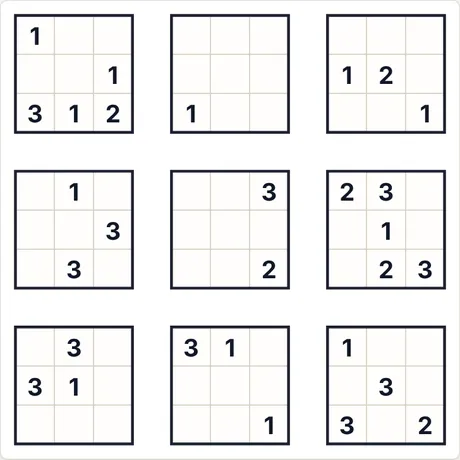 Rätsel am Anfang (3×3 · mittel · 29 Vorgaben)</td><td align="center">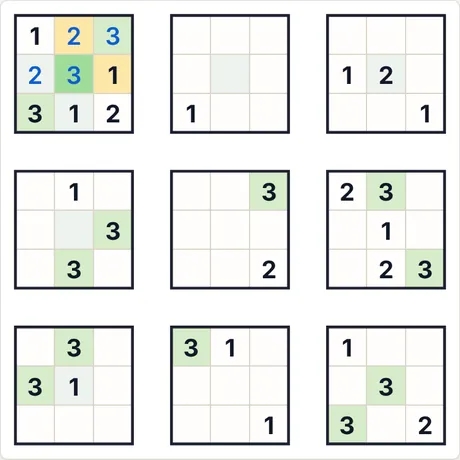 Nach 4 Schritten „Schritt für Schritt“</td></tr></table>

- **Letzter von der App erklärter Schritt:** 3 (Zeile 2, Sp. 2): alle anderen Ziffern kommen bereits unter den markierten Zellen vor (Zeile, Spalte, Gebiet oder Nachbarschaftsregel).
- **Code für dasselbe Rätsel:** `hyper4-3-medium-3877808544` (füge ihn unter „Neues Spiel → Code“ ein) · Aufwand des Lösers: keine Verzweigung

<b>Vollständige Galerie: alle Arten von Screenshots</b>

<b>Atlas</b>

<table>
<tr><td align="center" valign="top">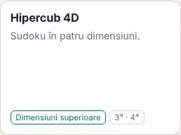 Die Karte im Atlas</td><td align="center" valign="top">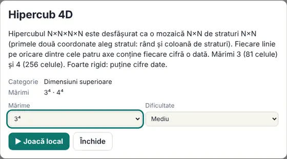 Das Datenblatt (öffnet sich beim Klick auf die Karte)</td></tr>
</table>

<b>Größen (mittlere Stufe)</b>

<table>
<tr><td align="center" valign="top">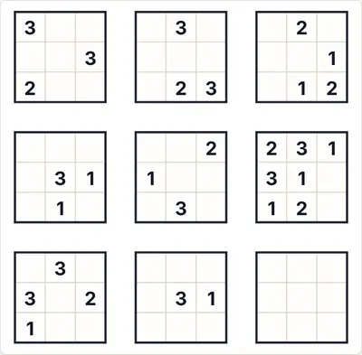 Größe 3</td><td align="center" valign="top">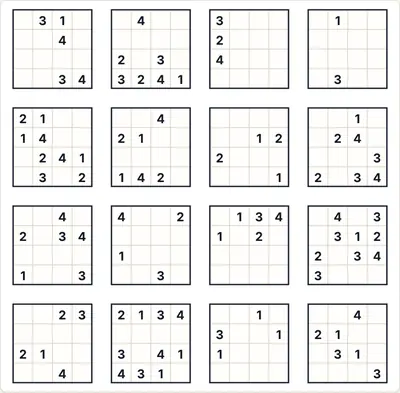 Größe 4</td></tr>
</table>

<b>Schwierigkeit</b>

<table>
<tr><td align="center" valign="top">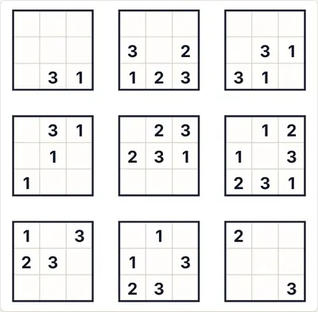 Leicht</td><td align="center" valign="top"> Mittel</td><td align="center" valign="top">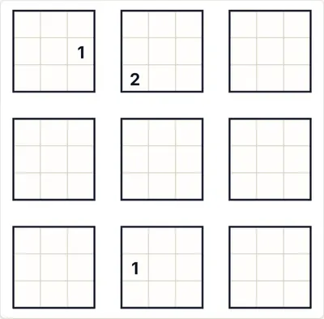 Schwer</td></tr>
</table>

<b>Spielzustände</b>

<table>
<tr><td align="center" valign="top">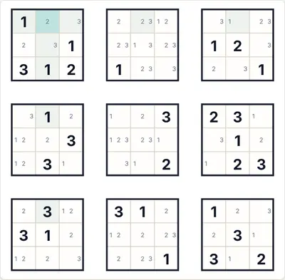 Auto-Notizen (Kandidaten)</td><td align="center" valign="top">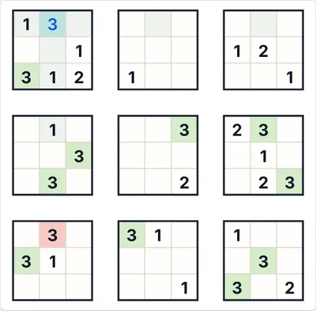 „Prüfen“ mit einer falschen Ziffer (rot)</td><td align="center" valign="top">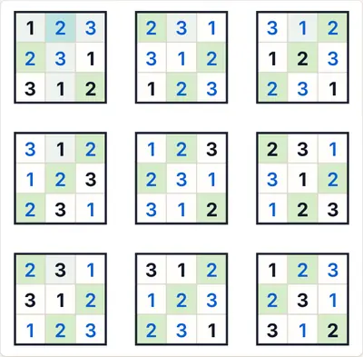 Die vollständige Lösung</td></tr>
</table>

<b>Themen und Geräte</b>

<table>
<tr><td align="center" valign="top">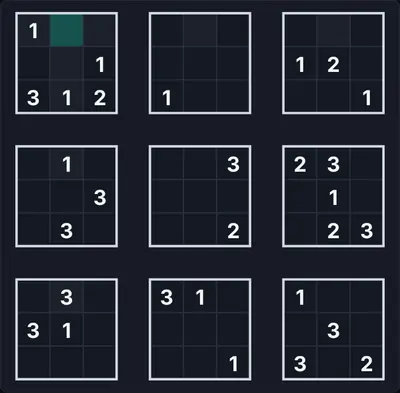 Dunkles Thema</td><td align="center" valign="top">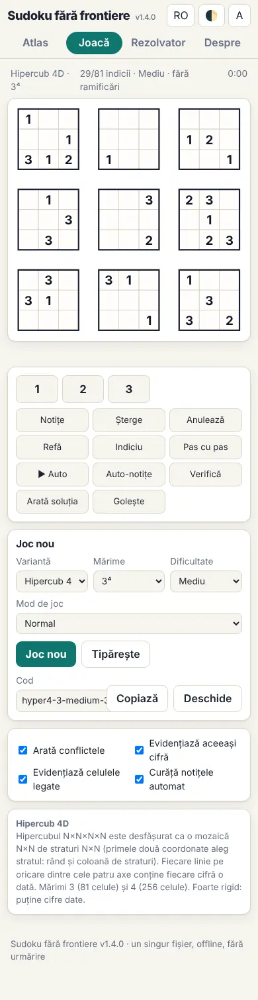 Telefon (390 px)</td><td align="center" valign="top">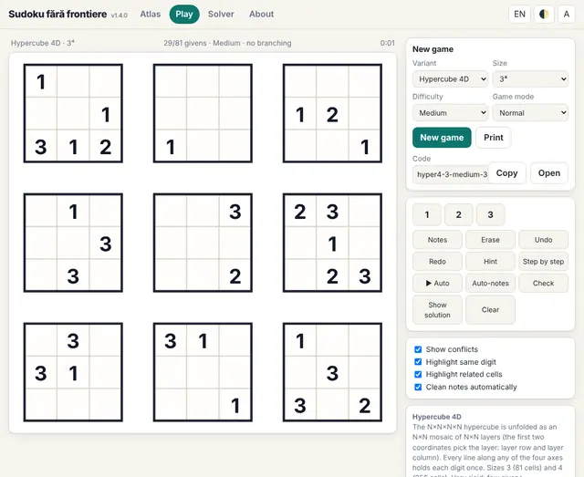 Oberfläche auf Englisch</td></tr>
</table>

<b>Das Regelpanel im Spiel</b>

<table>
<tr><td align="center" valign="top">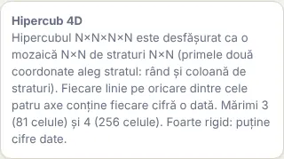 Die Regeln neben dem Spielfeld</td></tr>
</table>

#### 135. Hyperwürfel 5D · Hypercube 5D (`hyper5`)

**Sudoku in fünf Dimensionen (3⁵ = 243 Zellen).**

Der 3×3×3×3×3-Hyperwürfel wird in drei nebeneinander angeordnete 3×3-Mosaike aus 3×3-Schichten abgewickelt. Jede Linie auf jeder der fünf Achsen enthält jede Ziffer einmal. Sehr starr: nur einige wenige Vorgaben; das Spielfeld ist breit, daher sind die Zellen auf schmalen Bildschirmen klein.

<table><tr><td align="center">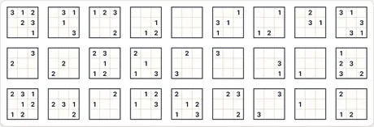 Rätsel am Anfang (3×3 · mittel · 87 Vorgaben)</td><td align="center">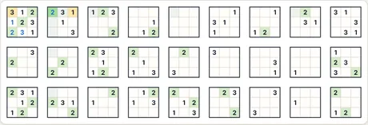 Nach 4 Schritten „Schritt für Schritt“</td></tr></table>

- **Letzter von der App erklärter Schritt:** 2 (Zeile 1, Sp. 5): alle anderen Ziffern kommen bereits unter den markierten Zellen vor (Zeile, Spalte, Gebiet oder Nachbarschaftsregel).
- **Code für dasselbe Rätsel:** `hyper5-3-medium-2668497273` (füge ihn unter „Neues Spiel → Code“ ein) · Aufwand des Lösers: keine Verzweigung

<b>Vollständige Galerie: alle Arten von Screenshots</b>

<b>Atlas</b>

<table>
<tr><td align="center" valign="top">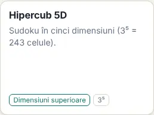 Die Karte im Atlas</td><td align="center" valign="top">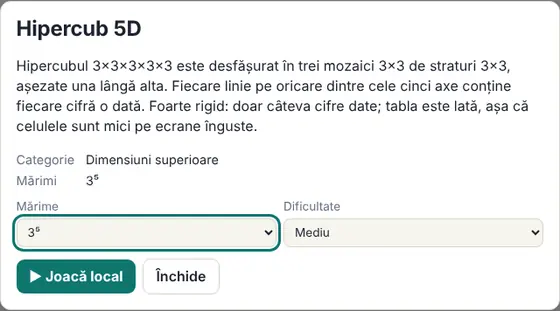 Das Datenblatt (öffnet sich beim Klick auf die Karte)</td></tr>
</table>

<b>Größen (mittlere Stufe)</b>

<table>
<tr><td align="center" valign="top">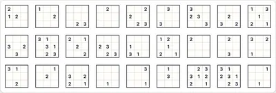 Größe 3</td></tr>
</table>

<b>Schwierigkeit</b>

<table>
<tr><td align="center" valign="top"> Leicht</td><td align="center" valign="top"> Mittel</td><td align="center" valign="top"> Schwer</td></tr>
</table>

<b>Spielzustände</b>

<table>
<tr><td align="center" valign="top"> Auto-Notizen (Kandidaten)</td><td align="center" valign="top"> „Prüfen“ mit einer falschen Ziffer (rot)</td><td align="center" valign="top"> Die vollständige Lösung</td></tr>
</table>

<b>Themen und Geräte</b>

<table>
<tr><td align="center" valign="top"> Dunkles Thema</td><td align="center" valign="top"> Telefon (390 px)</td><td align="center" valign="top"> Oberfläche auf Englisch</td></tr>
</table>

<b>Das Regelpanel im Spiel</b>

<table>
<tr><td align="center" valign="top"> Die Regeln neben dem Spielfeld</td></tr>
</table>

#### 136. Graeco-Lateinisch (orthogonale Quadrate) · Greco-Latin (orthogonal squares) (`greco`)

**Zwei überlagerte Lateinische Quadrate: Jedes Ziffer-Buchstaben-Paar kommt einmal vor.**

Zwei nebeneinanderliegende N×N-Quadrate: das linke mit Ziffern, das rechte mit Buchstaben (A, B, C …; beim Ausfüllen bedeutet die Taste „1/A“ die Ziffer 1 links oder den Buchstaben A rechts). In jedem Quadrat enthält jede Zeile und Spalte jedes Symbol einmal. Außerdem sind die beiden Quadrate orthogonal: Betrachtet man dieselbe Position in beiden Quadraten, ist das Paar (Ziffer, Buchstabe) an allen N² Positionen verschieden – jedes mögliche Paar kommt genau einmal vor. Größen 3, 4, 5, 7 (für 6 gibt es solche Paare nicht; 8 und 9 sind der Geschwindigkeit wegen ausgelassen). Bei 7×7 auf „Schwer“ kann die Erzeugung etwa 10–15 s dauern.

<table><tr><td align="center"> Rätsel am Anfang (4×4 · mittel · 12 Vorgaben)</td><td align="center"> Nach 4 Schritten „Schritt für Schritt“</td></tr></table>

- **Letzter von der App erklärter Schritt:** D (Zeile 2, Sp. 9): alle anderen Ziffern kommen bereits unter den markierten Zellen vor (Zeile, Spalte, Gebiet oder Nachbarschaftsregel).
- **Code für dasselbe Rätsel:** `greco-4-medium-3789110344` (füge ihn unter „Neues Spiel → Code“ ein) · Aufwand des Lösers: keine Verzweigung

<b>Vollständige Galerie: alle Arten von Screenshots</b>

<b>Atlas</b>

<table>
<tr><td align="center" valign="top"> Die Karte im Atlas</td><td align="center" valign="top"> Das Datenblatt (öffnet sich beim Klick auf die Karte)</td></tr>
</table>

<b>Größen (mittlere Stufe)</b>

<table>
<tr><td align="center" valign="top"> Größe 3</td><td align="center" valign="top"> Größe 4</td><td align="center" valign="top"> Größe 5</td></tr>
<tr><td align="center" valign="top"> Größe 7</td></tr>
</table>

<b>Schwierigkeit</b>

<table>
<tr><td align="center" valign="top"> Leicht</td><td align="center" valign="top"> Mittel</td><td align="center" valign="top"> Schwer</td></tr>
</table>

<b>Spielzustände</b>

<table>
<tr><td align="center" valign="top"> Auto-Notizen (Kandidaten)</td><td align="center" valign="top"> „Prüfen“ mit einer falschen Ziffer (rot)</td><td align="center" valign="top"> Die vollständige Lösung</td></tr>
</table>

<b>Themen und Geräte</b>

<table>
<tr><td align="center" valign="top"> Dunkles Thema</td><td align="center" valign="top"> Telefon (390 px)</td><td align="center" valign="top"> Oberfläche auf Englisch</td></tr>
</table>

<b>Das Regelpanel im Spiel</b>

<table>
<tr><td align="center" valign="top"> Die Regeln neben dem Spielfeld</td></tr>
</table>

