# Catalog: Parity, dots, signs (18)

**English** · [Română](../04-paritate-puncte-semne.md) · [Français](../fr/04-paritate-puncte-semne.md) · [Italiano](../it/04-paritate-puncte-semne.md) · [Español](../es/04-paritate-puncte-semne.md) · [Português](../pt/04-paritate-puncte-semne.md) · [Deutsch](../de/04-paritate-puncte-semne.md) · [Magyar](../hu/04-paritate-puncte-semne.md)

[← README](../../../README.md) · [All categories](README.md)

[Size and symbols](01-marime-si-simboluri.md) · [Regions and groups](02-regiuni-si-grupuri.md) · [Neighbours](03-vecini.md) · **Parity, dots, signs** · [Sums](05-sume.md) · [Outside clues](06-indicii-pe-margine.md) · [Lines](07-linii.md) · [Composite grids](08-grile-compuse.md) · [Close relatives](09-rude-apropiate.md) · [Topologies and fairy leaps](10-topologii-si-mutari-fairy.md) · [Global rules](11-reguli-globale.md) · [Cell clues](12-indicii-in-celule.md) · [Higher dimensions](13-dimensiuni-superioare.md)

---

_The signs (dots, circles, comparison arrows, bars) are drawn between cells or inside cells; the absence of a sign may matter, see the rules sheet._

#### 20. Even–odd (`evenodd`)

**Square = even, circle = odd.**

Cells marked with a square contain even digits, cells marked with a circle odd digits. Other rules are classic.

<table><tr><td align="center">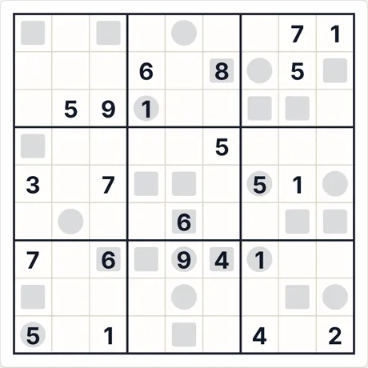 Starting puzzle (9×9 · medium · 23 givens)</td><td align="center">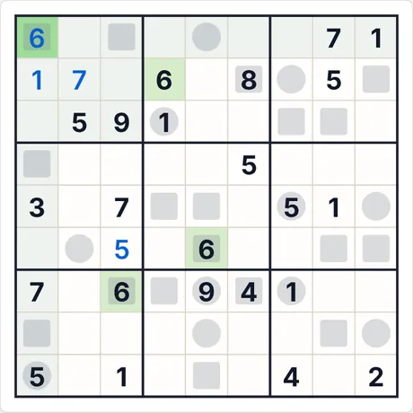 After 4 “Step by step” steps</td></tr></table>

- **Last step explained by the app:** 6 (row 1, col. 1): follows from the variant-specific rules (clues, sums, relations) combined with the other digits.
- **Code for the same puzzle:** `evenodd-9-medium-3539640574` (paste it into “New game → Code”) · solver effort: no branching

<b>Full gallery: all screenshot types</b>

<b>Atlas</b>

<table>
<tr><td align="center" valign="top">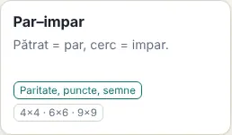 The card in the Atlas</td><td align="center" valign="top">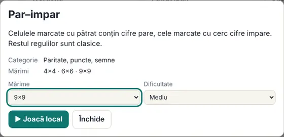 The rules sheet (opens when you click the card)</td></tr>
</table>

<b>Sizes (medium level)</b>

<table>
<tr><td align="center" valign="top">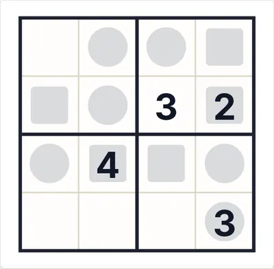 4×4</td><td align="center" valign="top">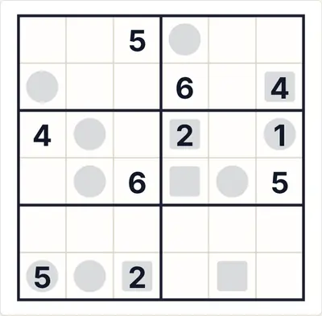 6×6</td><td align="center" valign="top">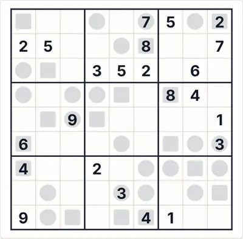 9×9</td></tr>
</table>

<b>Difficulty</b>

<table>
<tr><td align="center" valign="top">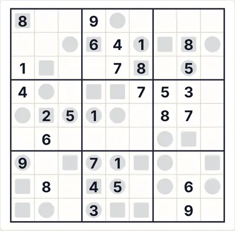 Easy</td><td align="center" valign="top"> Medium</td><td align="center" valign="top">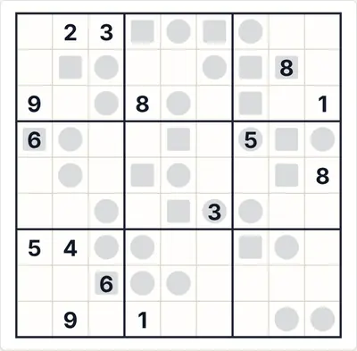 Hard</td></tr>
</table>

<b>Game states</b>

<table>
<tr><td align="center" valign="top">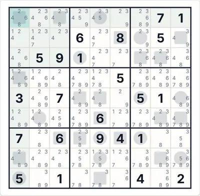 Auto-notes (candidates)</td><td align="center" valign="top">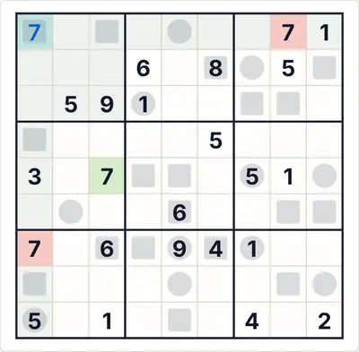 “Check” with a wrong digit (red)</td><td align="center" valign="top">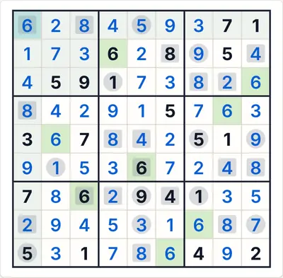 The full solution</td></tr>
</table>

<b>Themes and devices</b>

<table>
<tr><td align="center" valign="top">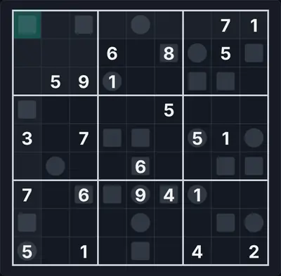 Dark theme</td><td align="center" valign="top">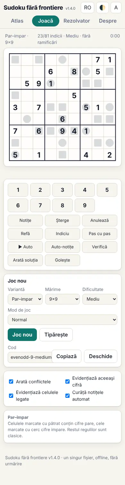 Phone (390 px)</td><td align="center" valign="top">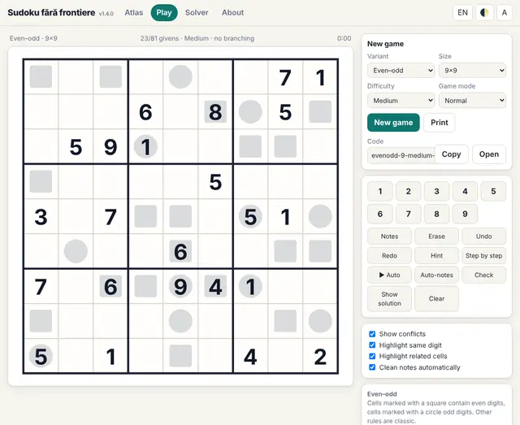 English interface</td></tr>
</table>

<b>The in-game rules panel</b>

<table>
<tr><td align="center" valign="top">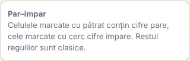 The rules shown next to the board</td></tr>
</table>

#### 21. Kropki (`kropki`)

**Dots: consecutive or double.**

A white dot between two cells: the digits are consecutive. A black dot: one is double the other. No dot: they are neither consecutive nor in ratio 1:2 (all dots are given).

<table><tr><td align="center">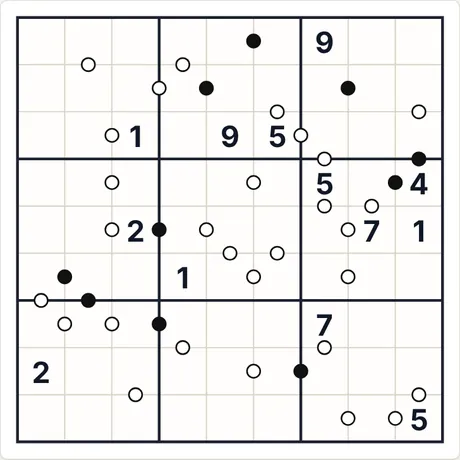 Starting puzzle (9×9 · medium · 13 givens)</td><td align="center">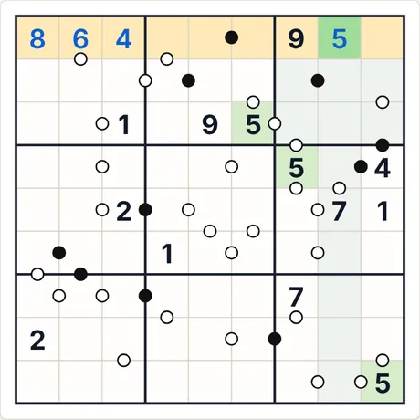 After 4 “Step by step” steps</td></tr></table>

- **Last step explained by the app:** 5 (row 1, col. 8): it is the only cell in the marked row where 5 can go.
- **Code for the same puzzle:** `kropki-9-medium-1974630355` (paste it into “New game → Code”) · solver effort: no branching

<b>Full gallery: all screenshot types</b>

<b>Atlas</b>

<table>
<tr><td align="center" valign="top">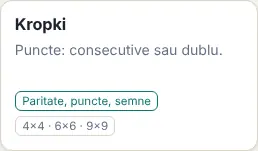 The card in the Atlas</td><td align="center" valign="top">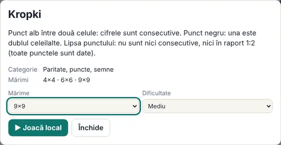 The rules sheet (opens when you click the card)</td></tr>
</table>

<b>Sizes (medium level)</b>

<table>
<tr><td align="center" valign="top">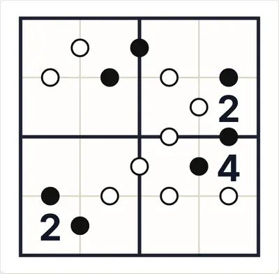 4×4</td><td align="center" valign="top">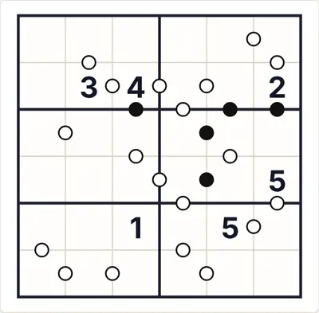 6×6</td><td align="center" valign="top">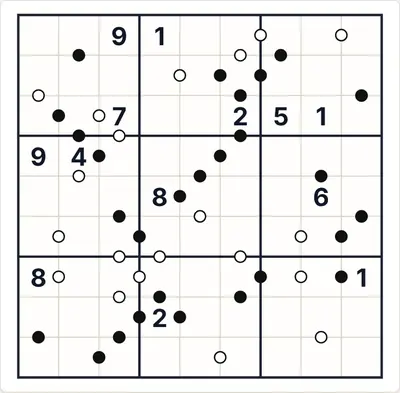 9×9</td></tr>
</table>

<b>Difficulty</b>

<table>
<tr><td align="center" valign="top">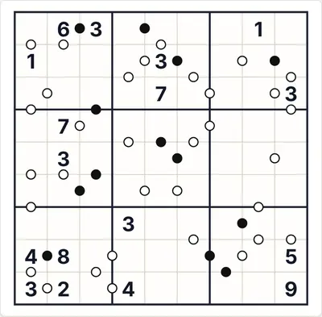 Easy</td><td align="center" valign="top"> Medium</td><td align="center" valign="top">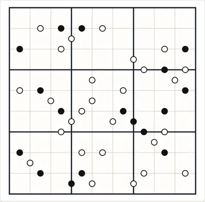 Hard</td></tr>
</table>

<b>Game states</b>

<table>
<tr><td align="center" valign="top">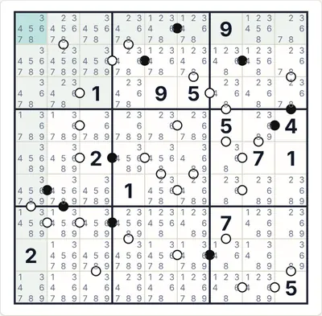 Auto-notes (candidates)</td><td align="center" valign="top">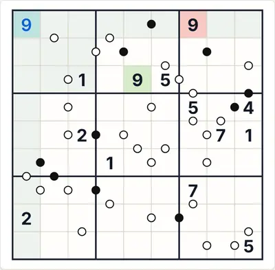 “Check” with a wrong digit (red)</td><td align="center" valign="top">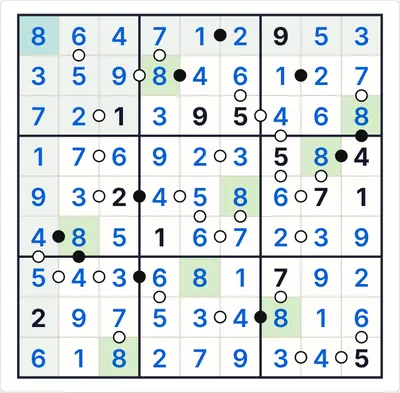 The full solution</td></tr>
</table>

<b>Themes and devices</b>

<table>
<tr><td align="center" valign="top">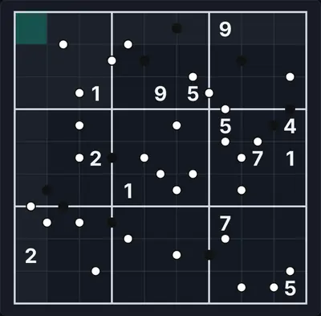 Dark theme</td><td align="center" valign="top">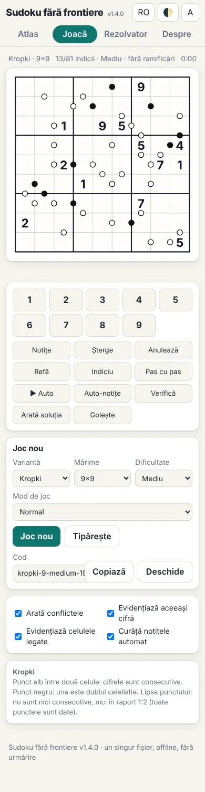 Phone (390 px)</td><td align="center" valign="top">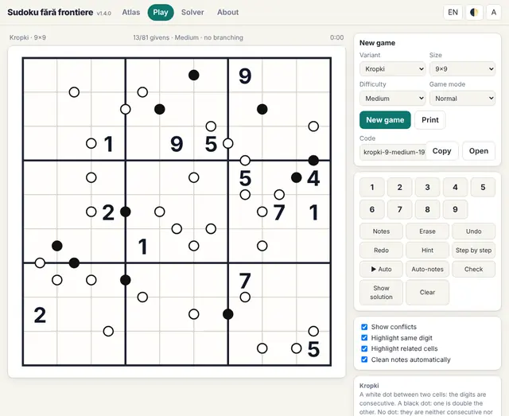 English interface</td></tr>
</table>

<b>The in-game rules panel</b>

<table>
<tr><td align="center" valign="top">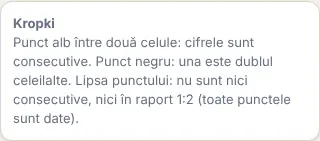 The rules shown next to the board</td></tr>
</table>

#### 22. Consecutive (`consec`)

**Bar = consecutive; no bar = not.**

A bar between two cells means consecutive digits. Where there is no bar, neighbouring digits are not consecutive.

<table><tr><td align="center">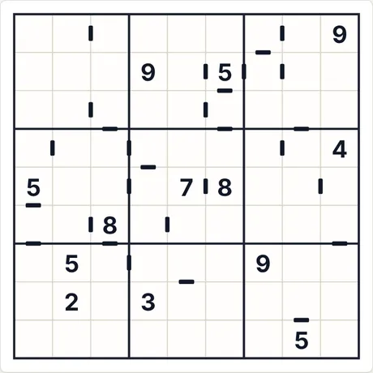 Starting puzzle (9×9 · medium · 13 givens)</td><td align="center">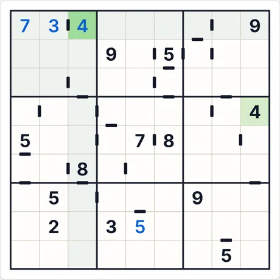 After 4 “Step by step” steps</td></tr></table>

- **Last step explained by the app:** 4 (row 1, col. 3): follows from the variant-specific rules (clues, sums, relations) combined with the other digits.
- **Code for the same puzzle:** `consec-9-medium-2731961495` (paste it into “New game → Code”) · solver effort: no branching

<b>Full gallery: all screenshot types</b>

<b>Atlas</b>

<table>
<tr><td align="center" valign="top">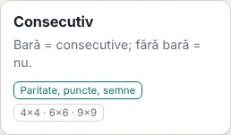 The card in the Atlas</td><td align="center" valign="top">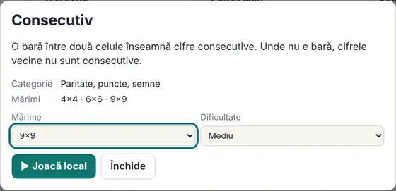 The rules sheet (opens when you click the card)</td></tr>
</table>

<b>Sizes (medium level)</b>

<table>
<tr><td align="center" valign="top">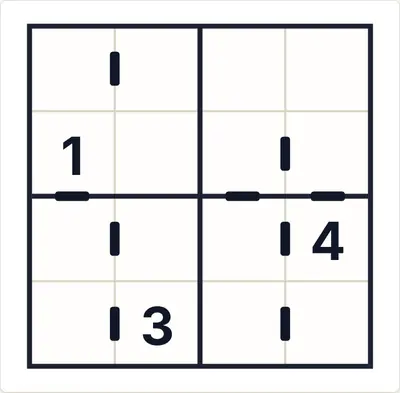 4×4</td><td align="center" valign="top">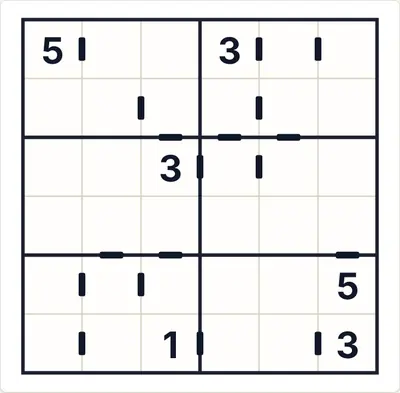 6×6</td><td align="center" valign="top">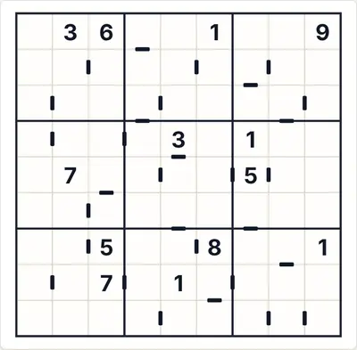 9×9</td></tr>
</table>

<b>Difficulty</b>

<table>
<tr><td align="center" valign="top">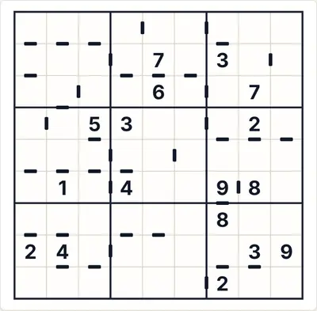 Easy</td><td align="center" valign="top"> Medium</td><td align="center" valign="top">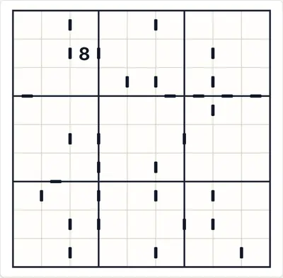 Hard</td></tr>
</table>

<b>Game states</b>

<table>
<tr><td align="center" valign="top">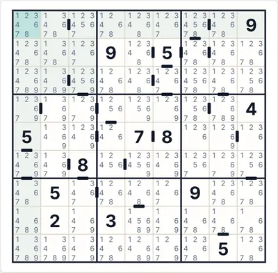 Auto-notes (candidates)</td><td align="center" valign="top">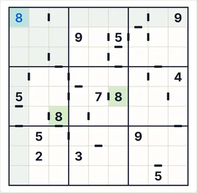 “Check” with a wrong digit (red)</td><td align="center" valign="top">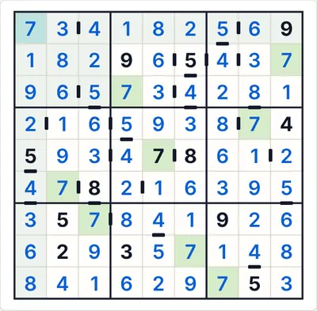 The full solution</td></tr>
</table>

<b>Themes and devices</b>

<table>
<tr><td align="center" valign="top">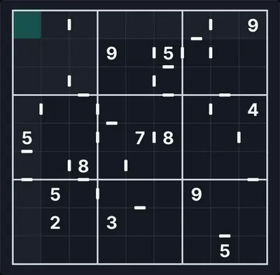 Dark theme</td><td align="center" valign="top">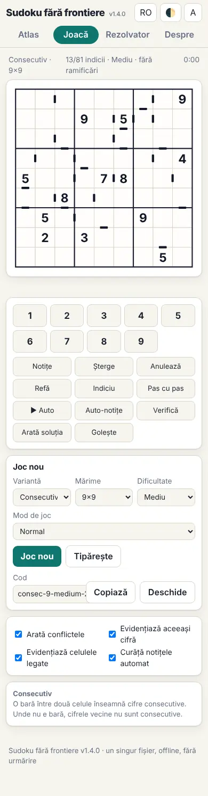 Phone (390 px)</td><td align="center" valign="top">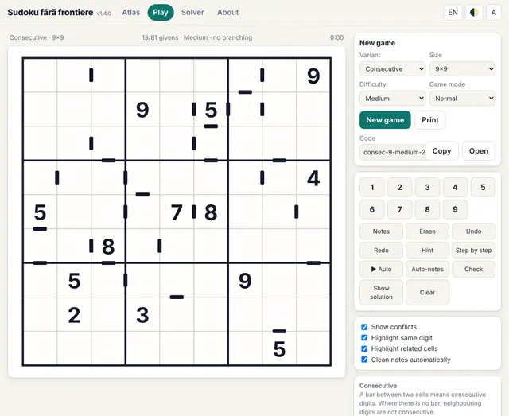 English interface</td></tr>
</table>

<b>The in-game rules panel</b>

<table>
<tr><td align="center" valign="top">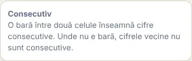 The rules shown next to the board</td></tr>
</table>

#### 23. XV (`xv`)

**X = sum 10, V = sum 5.**

An X between two cells: their sum is 10; a V: their sum is 5. Where there is no sign, the sum is neither 5 nor 10. 9×9 only.

<table><tr><td align="center">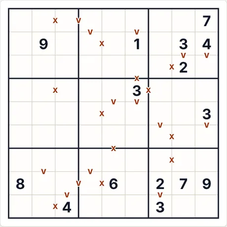 Starting puzzle (9×9 · medium · 15 givens)</td><td align="center">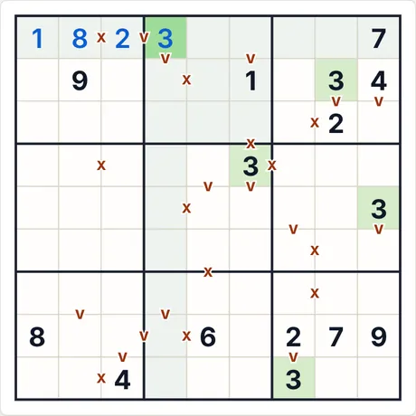 After 4 “Step by step” steps</td></tr></table>

- **Last step explained by the app:** 3 (row 1, col. 4): follows from the variant-specific rules (clues, sums, relations) combined with the other digits.
- **Code for the same puzzle:** `xv-9-medium-3501341575` (paste it into “New game → Code”) · solver effort: no branching

<b>Full gallery: all screenshot types</b>

<b>Atlas</b>

<table>
<tr><td align="center" valign="top"> The card in the Atlas</td><td align="center" valign="top"> The rules sheet (opens when you click the card)</td></tr>
</table>

<b>Sizes (medium level)</b>

<table>
<tr><td align="center" valign="top"> 9×9</td></tr>
</table>

<b>Difficulty</b>

<table>
<tr><td align="center" valign="top"> Easy</td><td align="center" valign="top"> Medium</td><td align="center" valign="top"> Hard</td></tr>
</table>

<b>Game states</b>

<table>
<tr><td align="center" valign="top"> Auto-notes (candidates)</td><td align="center" valign="top"> “Check” with a wrong digit (red)</td><td align="center" valign="top"> The full solution</td></tr>
</table>

<b>Themes and devices</b>

<table>
<tr><td align="center" valign="top"> Dark theme</td><td align="center" valign="top"> Phone (390 px)</td><td align="center" valign="top"> English interface</td></tr>
</table>

<b>The in-game rules panel</b>

<table>
<tr><td align="center" valign="top"> The rules shown next to the board</td></tr>
</table>

#### 24. Greater-than (`greater`)

**Greater / less-than signs.**

The sign between two cells opens towards the larger digit.

<table><tr><td align="center"> Starting puzzle (9×9 · medium · 18 givens)</td><td align="center"> After 4 “Step by step” steps</td></tr></table>

- **Last step explained by the app:** 9 (row 2, col. 1): follows from the variant-specific rules (clues, sums, relations) combined with the other digits.
- **Code for the same puzzle:** `greater-9-medium-4115358759` (paste it into “New game → Code”) · solver effort: 2 branches

<b>Full gallery: all screenshot types</b>

<b>Atlas</b>

<table>
<tr><td align="center" valign="top"> The card in the Atlas</td><td align="center" valign="top"> The rules sheet (opens when you click the card)</td></tr>
</table>

<b>Sizes (medium level)</b>

<table>
<tr><td align="center" valign="top"> 4×4</td><td align="center" valign="top"> 6×6</td><td align="center" valign="top"> 9×9</td></tr>
</table>

<b>Difficulty</b>

<table>
<tr><td align="center" valign="top"> Easy</td><td align="center" valign="top"> Medium</td><td align="center" valign="top"> Hard</td></tr>
</table>

<b>Game states</b>

<table>
<tr><td align="center" valign="top"> Auto-notes (candidates)</td><td align="center" valign="top"> “Check” with a wrong digit (red)</td><td align="center" valign="top"> The full solution</td></tr>
</table>

<b>Themes and devices</b>

<table>
<tr><td align="center" valign="top"> Dark theme</td><td align="center" valign="top"> Phone (390 px)</td><td align="center" valign="top"> English interface</td></tr>
</table>

<b>The in-game rules panel</b>

<table>
<tr><td align="center" valign="top"> The rules shown next to the board</td></tr>
</table>

#### 25. Battenburg (`batt`)

**Chessboard parity on a 2×2.**

A four-square mark at the corner shared by four cells means the parities alternate like a chessboard (two even and two odd, on the diagonals). At unmarked corners the parities do not form such a pattern.

<table><tr><td align="center"> Starting puzzle (9×9 · medium · 19 givens)</td><td align="center"> After 4 “Step by step” steps</td></tr></table>

- **Last step explained by the app:** 5 (row 4, col. 5): no direct deduction; the digit is taken from the unique solution (a guess would be needed).
- **Code for the same puzzle:** `batt-9-medium-2595666856` (paste it into “New game → Code”) · solver effort: 50 branches

<b>Full gallery: all screenshot types</b>

<b>Atlas</b>

<table>
<tr><td align="center" valign="top"> The card in the Atlas</td><td align="center" valign="top"> The rules sheet (opens when you click the card)</td></tr>
</table>

<b>Sizes (medium level)</b>

<table>
<tr><td align="center" valign="top"> 4×4</td><td align="center" valign="top"> 6×6</td><td align="center" valign="top"> 9×9</td></tr>
</table>

<b>Difficulty</b>

<table>
<tr><td align="center" valign="top"> Easy</td><td align="center" valign="top"> Medium</td><td align="center" valign="top"> Hard</td></tr>
</table>

<b>Game states</b>

<table>
<tr><td align="center" valign="top"> Auto-notes (candidates)</td><td align="center" valign="top"> “Check” with a wrong digit (red)</td><td align="center" valign="top"> The full solution</td></tr>
</table>

<b>Themes and devices</b>

<table>
<tr><td align="center" valign="top"> Dark theme</td><td align="center" valign="top"> Phone (390 px)</td><td align="center" valign="top"> English interface</td></tr>
</table>

<b>The in-game rules panel</b>

<table>
<tr><td align="center" valign="top"> The rules shown next to the board</td></tr>
</table>

#### 26. Quadruples (`quad`)

**Circles listing digits of a 2×2.**

A circle at the corner shared by four cells lists digits that appear among those four cells (repeated if they are repeated in the circle).

<table><tr><td align="center"> Starting puzzle (9×9 · medium · 19 givens)</td><td align="center"> After 4 “Step by step” steps</td></tr></table>

- **Last step explained by the app:** 4 (row 3, col. 4): it is the only cell in the marked row where 4 can go.
- **Code for the same puzzle:** `quad-9-medium-2215314964` (paste it into “New game → Code”) · solver effort: 1 branches

<b>Full gallery: all screenshot types</b>

<b>Atlas</b>

<table>
<tr><td align="center" valign="top"> The card in the Atlas</td><td align="center" valign="top"> The rules sheet (opens when you click the card)</td></tr>
</table>

<b>Sizes (medium level)</b>

<table>
<tr><td align="center" valign="top"> 4×4</td><td align="center" valign="top"> 6×6</td><td align="center" valign="top"> 9×9</td></tr>
</table>

<b>Difficulty</b>

<table>
<tr><td align="center" valign="top"> Easy</td><td align="center" valign="top"> Medium</td><td align="center" valign="top"> Hard</td></tr>
</table>

<b>Game states</b>

<table>
<tr><td align="center" valign="top"> Auto-notes (candidates)</td><td align="center" valign="top"> “Check” with a wrong digit (red)</td><td align="center" valign="top"> The full solution</td></tr>
</table>

<b>Themes and devices</b>

<table>
<tr><td align="center" valign="top"> Dark theme</td><td align="center" valign="top"> Phone (390 px)</td><td align="center" valign="top"> English interface</td></tr>
</table>

<b>The in-game rules panel</b>

<table>
<tr><td align="center" valign="top"> The rules shown next to the board</td></tr>
</table>

#### 27. Marked evens only (`evenonly`)

**Shaded cells are even.**

Every cell marked with a grey square holds an even digit. Unmarked cells say nothing: they may be anything. It differs from Even–odd, where both kinds are marked.

<table><tr><td align="center"> Starting puzzle (9×9 · medium · 24 givens)</td><td align="center"> After 4 “Step by step” steps</td></tr></table>

- **Last step explained by the app:** 7 (row 1, col. 3): follows from the variant-specific rules (clues, sums, relations) combined with the other digits.
- **Code for the same puzzle:** `evenonly-9-medium-114904509` (paste it into “New game → Code”) · solver effort: no branching

<b>Full gallery: all screenshot types</b>

<b>Atlas</b>

<table>
<tr><td align="center" valign="top"> The card in the Atlas</td><td align="center" valign="top"> The rules sheet (opens when you click the card)</td></tr>
</table>

<b>Sizes (medium level)</b>

<table>
<tr><td align="center" valign="top"> 4×4</td><td align="center" valign="top"> 6×6</td><td align="center" valign="top"> 9×9</td></tr>
</table>

<b>Difficulty</b>

<table>
<tr><td align="center" valign="top"> Easy</td><td align="center" valign="top"> Medium</td><td align="center" valign="top"> Hard</td></tr>
</table>

<b>Game states</b>

<table>
<tr><td align="center" valign="top"> Auto-notes (candidates)</td><td align="center" valign="top"> “Check” with a wrong digit (red)</td><td align="center" valign="top"> The full solution</td></tr>
</table>

<b>Themes and devices</b>

<table>
<tr><td align="center" valign="top"> Dark theme</td><td align="center" valign="top"> Phone (390 px)</td><td align="center" valign="top"> English interface</td></tr>
</table>

<b>The in-game rules panel</b>

<table>
<tr><td align="center" valign="top"> The rules shown next to the board</td></tr>
</table>

#### 28. Marked odds only (`oddonly`)

**Circled cells are odd.**

Every cell marked with a grey circle holds an odd digit. Unmarked cells say nothing: they may be anything.

<table><tr><td align="center"> Starting puzzle (9×9 · medium · 24 givens)</td><td align="center"> After 4 “Step by step” steps</td></tr></table>

- **Last step explained by the app:** 7 (row 2, col. 4): it is the only cell in the marked column where 7 can go.
- **Code for the same puzzle:** `oddonly-9-medium-4248896984` (paste it into “New game → Code”) · solver effort: no branching

<b>Full gallery: all screenshot types</b>

<b>Atlas</b>

<table>
<tr><td align="center" valign="top"> The card in the Atlas</td><td align="center" valign="top"> The rules sheet (opens when you click the card)</td></tr>
</table>

<b>Sizes (medium level)</b>

<table>
<tr><td align="center" valign="top"> 4×4</td><td align="center" valign="top"> 6×6</td><td align="center" valign="top"> 9×9</td></tr>
</table>

<b>Difficulty</b>

<table>
<tr><td align="center" valign="top"> Easy</td><td align="center" valign="top"> Medium</td><td align="center" valign="top"> Hard</td></tr>
</table>

<b>Game states</b>

<table>
<tr><td align="center" valign="top"> Auto-notes (candidates)</td><td align="center" valign="top"> “Check” with a wrong digit (red)</td><td align="center" valign="top"> The full solution</td></tr>
</table>

<b>Themes and devices</b>

<table>
<tr><td align="center" valign="top"> Dark theme</td><td align="center" valign="top"> Phone (390 px)</td><td align="center" valign="top"> English interface</td></tr>
</table>

<b>The in-game rules panel</b>

<table>
<tr><td align="center" valign="top"> The rules shown next to the board</td></tr>
</table>

#### 29. Fortress (`fortress`)

**Shaded cells beat their neighbours.**

A shaded cell is greater than every orthogonal neighbour that is not shaded. Nothing is imposed between two adjacent shaded cells.

<table><tr><td align="center"> Starting puzzle (9×9 · medium · 18 givens)</td><td align="center"> After 4 “Step by step” steps</td></tr></table>

- **Last step explained by the app:** 3 (row 2, col. 1): follows from the variant-specific rules (clues, sums, relations) combined with the other digits.
- **Code for the same puzzle:** `fortress-9-medium-1637740984` (paste it into “New game → Code”) · solver effort: 1 branches

<b>Full gallery: all screenshot types</b>

<b>Atlas</b>

<table>
<tr><td align="center" valign="top"> The card in the Atlas</td><td align="center" valign="top"> The rules sheet (opens when you click the card)</td></tr>
</table>

<b>Sizes (medium level)</b>

<table>
<tr><td align="center" valign="top"> 4×4</td><td align="center" valign="top"> 6×6</td><td align="center" valign="top"> 9×9</td></tr>
</table>

<b>Difficulty</b>

<table>
<tr><td align="center" valign="top"> Easy</td><td align="center" valign="top"> Medium</td><td align="center" valign="top"> Hard</td></tr>
</table>

<b>Game states</b>

<table>
<tr><td align="center" valign="top"> Auto-notes (candidates)</td><td align="center" valign="top"> “Check” with a wrong digit (red)</td><td align="center" valign="top"> The full solution</td></tr>
</table>

<b>Themes and devices</b>

<table>
<tr><td align="center" valign="top"> Dark theme</td><td align="center" valign="top"> Phone (390 px)</td><td align="center" valign="top"> English interface</td></tr>
</table>

<b>The in-game rules panel</b>

<table>
<tr><td align="center" valign="top"> The rules shown next to the board</td></tr>
</table>

#### 30. Min / Max (`minmax`)

**Cells smaller or larger than all neighbours.**

A cell marked with a downward triangle ("min") is strictly smaller than all its orthogonal neighbours; one marked with an upward triangle ("max") is strictly larger than all of them.

<table><tr><td align="center"> Starting puzzle (9×9 · medium · 18 givens)</td><td align="center"> After 4 “Step by step” steps</td></tr></table>

- **Last step explained by the app:** 8 (row 2, col. 4): follows from the variant-specific rules (clues, sums, relations) combined with the other digits.
- **Code for the same puzzle:** `minmax-9-medium-3067254727` (paste it into “New game → Code”) · solver effort: 1 branches

<b>Full gallery: all screenshot types</b>

<b>Atlas</b>

<table>
<tr><td align="center" valign="top"> The card in the Atlas</td><td align="center" valign="top"> The rules sheet (opens when you click the card)</td></tr>
</table>

<b>Sizes (medium level)</b>

<table>
<tr><td align="center" valign="top"> 4×4</td><td align="center" valign="top"> 6×6</td><td align="center" valign="top"> 9×9</td></tr>
</table>

<b>Difficulty</b>

<table>
<tr><td align="center" valign="top"> Easy</td><td align="center" valign="top"> Medium</td><td align="center" valign="top"> Hard</td></tr>
</table>

<b>Game states</b>

<table>
<tr><td align="center" valign="top"> Auto-notes (candidates)</td><td align="center" valign="top"> “Check” with a wrong digit (red)</td><td align="center" valign="top"> The full solution</td></tr>
</table>

<b>Themes and devices</b>

<table>
<tr><td align="center" valign="top"> Dark theme</td><td align="center" valign="top"> Phone (390 px)</td><td align="center" valign="top"> English interface</td></tr>
</table>

<b>The in-game rules panel</b>

<table>
<tr><td align="center" valign="top"> The rules shown next to the board</td></tr>
</table>

#### 31. Indexing (`indexing`)

**The first digit of a row says where the 1 is.**

In every row, the digit in the first (leftmost) cell gives the column number where the 1 of that row sits. If the first cell holds 1, then the 1 is right there. Convention: sources describe several forms of "indexing"; this card uses this one, on rows only.

<table><tr><td align="center"> Starting puzzle (9×9 · medium · 19 givens)</td><td align="center"> After 4 “Step by step” steps</td></tr></table>

- **Last step explained by the app:** 5 (row 5, col. 1): follows from the variant-specific rules (clues, sums, relations) combined with the other digits.
- **Code for the same puzzle:** `indexing-9-medium-3283531442` (paste it into “New game → Code”) · solver effort: 1 branches

<b>Full gallery: all screenshot types</b>

<b>Atlas</b>

<table>
<tr><td align="center" valign="top"> The card in the Atlas</td><td align="center" valign="top"> The rules sheet (opens when you click the card)</td></tr>
</table>

<b>Sizes (medium level)</b>

<table>
<tr><td align="center" valign="top"> 4×4</td><td align="center" valign="top"> 6×6</td><td align="center" valign="top"> 9×9</td></tr>
</table>

<b>Difficulty</b>

<table>
<tr><td align="center" valign="top"> Easy</td><td align="center" valign="top"> Medium</td><td align="center" valign="top"> Hard</td></tr>
</table>

<b>Game states</b>

<table>
<tr><td align="center" valign="top"> Auto-notes (candidates)</td><td align="center" valign="top"> “Check” with a wrong digit (red)</td><td align="center" valign="top"> The full solution</td></tr>
</table>

<b>Themes and devices</b>

<table>
<tr><td align="center" valign="top"> Dark theme</td><td align="center" valign="top"> Phone (390 px)</td><td align="center" valign="top"> English interface</td></tr>
</table>

<b>The in-game rules panel</b>

<table>
<tr><td align="center" valign="top"> The rules shown next to the board</td></tr>
</table>

#### 32. Ratio ×3 (`ratio`)

**Dots for pairs in 3:1 ratio.**

On the edge between two adjacent cells, a circle with a 3 means one digit is three times the other (1–3, 2–6 or 3–9). As with Kropki, if there is no circle, adjacent digits are NOT in a 3:1 ratio. Convention chosen by this app: sources describe "ratio" variants vaguely, so here "ratio" strictly means factor 3.

<table><tr><td align="center"> Starting puzzle (9×9 · medium · 15 givens)</td><td align="center"> After 4 “Step by step” steps</td></tr></table>

- **Last step explained by the app:** 8 (row 1, col. 5): follows from the variant-specific rules (clues, sums, relations) combined with the other digits.
- **Code for the same puzzle:** `ratio-9-medium-2219775124` (paste it into “New game → Code”) · solver effort: no branching

<b>Full gallery: all screenshot types</b>

<b>Atlas</b>

<table>
<tr><td align="center" valign="top"> The card in the Atlas</td><td align="center" valign="top"> The rules sheet (opens when you click the card)</td></tr>
</table>

<b>Sizes (medium level)</b>

<table>
<tr><td align="center" valign="top"> 4×4</td><td align="center" valign="top"> 6×6</td><td align="center" valign="top"> 9×9</td></tr>
</table>

<b>Difficulty</b>

<table>
<tr><td align="center" valign="top"> Easy</td><td align="center" valign="top"> Medium</td><td align="center" valign="top"> Hard</td></tr>
</table>

<b>Game states</b>

<table>
<tr><td align="center" valign="top"> Auto-notes (candidates)</td><td align="center" valign="top"> “Check” with a wrong digit (red)</td><td align="center" valign="top"> The full solution</td></tr>
</table>

<b>Themes and devices</b>

<table>
<tr><td align="center" valign="top"> Dark theme</td><td align="center" valign="top"> Phone (390 px)</td><td align="center" valign="top"> English interface</td></tr>
</table>

<b>The in-game rules panel</b>

<table>
<tr><td align="center" valign="top"> The rules shown next to the board</td></tr>
</table>

#### 33. Difference (`diff`)

**The number between cells is their difference.**

In addition to the classic rules, a number between two neighbouring cells is the difference (absolute value) between their digits. A missing number says nothing.

<table><tr><td align="center"> Starting puzzle (9×9 · medium · 16 givens)</td><td align="center"> After 4 “Step by step” steps</td></tr></table>

- **Last step explained by the app:** 1 (row 1, col. 5): follows from the variant-specific rules (clues, sums, relations) combined with the other digits.
- **Code for the same puzzle:** `diff-9-medium-3892901881` (paste it into “New game → Code”) · solver effort: no branching

<b>Full gallery: all screenshot types</b>

<b>Atlas</b>

<table>
<tr><td align="center" valign="top"> The card in the Atlas</td><td align="center" valign="top"> The rules sheet (opens when you click the card)</td></tr>
</table>

<b>Sizes (medium level)</b>

<table>
<tr><td align="center" valign="top"> 4×4</td><td align="center" valign="top"> 6×6</td><td align="center" valign="top"> 9×9</td></tr>
</table>

<b>Difficulty</b>

<table>
<tr><td align="center" valign="top"> Easy</td><td align="center" valign="top"> Medium</td><td align="center" valign="top"> Hard</td></tr>
</table>

<b>Game states</b>

<table>
<tr><td align="center" valign="top"> Auto-notes (candidates)</td><td align="center" valign="top"> “Check” with a wrong digit (red)</td><td align="center" valign="top"> The full solution</td></tr>
</table>

<b>Themes and devices</b>

<table>
<tr><td align="center" valign="top"> Dark theme</td><td align="center" valign="top"> Phone (390 px)</td><td align="center" valign="top"> English interface</td></tr>
</table>

<b>The in-game rules panel</b>

<table>
<tr><td align="center" valign="top"> The rules shown next to the board</td></tr>
</table>

#### 34. Kropki marked only (`kropkipos`)

**Dots given; no dot says nothing.**

As in Kropki (white = consecutive, black = double), but the absence of a dot means nothing: an unmarked relation may exist.

<table><tr><td align="center"> Starting puzzle (9×9 · medium · 15 givens)</td><td align="center"> After 4 “Step by step” steps</td></tr></table>

- **Last step explained by the app:** 8 (row 2, col. 2): follows from the variant-specific rules (clues, sums, relations) combined with the other digits.
- **Code for the same puzzle:** `kropkipos-9-medium-1158818748` (paste it into “New game → Code”) · solver effort: 2 branches

<b>Full gallery: all screenshot types</b>

<b>Atlas</b>

<table>
<tr><td align="center" valign="top"> The card in the Atlas</td><td align="center" valign="top"> The rules sheet (opens when you click the card)</td></tr>
</table>

<b>Sizes (medium level)</b>

<table>
<tr><td align="center" valign="top"> 4×4</td><td align="center" valign="top"> 6×6</td><td align="center" valign="top"> 9×9</td></tr>
</table>

<b>Difficulty</b>

<table>
<tr><td align="center" valign="top"> Easy</td><td align="center" valign="top"> Medium</td><td align="center" valign="top"> Hard</td></tr>
</table>

<b>Game states</b>

<table>
<tr><td align="center" valign="top"> Auto-notes (candidates)</td><td align="center" valign="top"> “Check” with a wrong digit (red)</td><td align="center" valign="top"> The full solution</td></tr>
</table>

<b>Themes and devices</b>

<table>
<tr><td align="center" valign="top"> Dark theme</td><td align="center" valign="top"> Phone (390 px)</td><td align="center" valign="top"> English interface</td></tr>
</table>

<b>The in-game rules panel</b>

<table>
<tr><td align="center" valign="top"> The rules shown next to the board</td></tr>
</table>

#### 35. XV marked only (`xvpos`)

**Signs given; no sign says nothing.**

As in XV (X = sum 10, V = sum 5), but the absence of a sign means nothing. 9×9 only.

<table><tr><td align="center"> Starting puzzle (9×9 · medium · 16 givens)</td><td align="center"> After 4 “Step by step” steps</td></tr></table>

- **Last step explained by the app:** 6 (row 7, col. 5): no direct deduction; the digit is taken from the unique solution (a guess would be needed).
- **Code for the same puzzle:** `xvpos-9-medium-3148096374` (paste it into “New game → Code”) · solver effort: 2 branches

<b>Full gallery: all screenshot types</b>

<b>Atlas</b>

<table>
<tr><td align="center" valign="top"> The card in the Atlas</td><td align="center" valign="top"> The rules sheet (opens when you click the card)</td></tr>
</table>

<b>Sizes (medium level)</b>

<table>
<tr><td align="center" valign="top"> 9×9</td></tr>
</table>

<b>Difficulty</b>

<table>
<tr><td align="center" valign="top"> Easy</td><td align="center" valign="top"> Medium</td><td align="center" valign="top"> Hard</td></tr>
</table>

<b>Game states</b>

<table>
<tr><td align="center" valign="top"> Auto-notes (candidates)</td><td align="center" valign="top"> “Check” with a wrong digit (red)</td><td align="center" valign="top"> The full solution</td></tr>
</table>

<b>Themes and devices</b>

<table>
<tr><td align="center" valign="top"> Dark theme</td><td align="center" valign="top"> Phone (390 px)</td><td align="center" valign="top"> English interface</td></tr>
</table>

<b>The in-game rules panel</b>

<table>
<tr><td align="center" valign="top"> The rules shown next to the board</td></tr>
</table>

#### 36. Consecutive marked only (`consecpos`)

**Bars given; no bar says nothing.**

As in Consecutive (bar = consecutive digits), but the absence of a bar means nothing.

<table><tr><td align="center"> Starting puzzle (9×9 · medium · 16 givens)</td><td align="center"> After 4 “Step by step” steps</td></tr></table>

- **Last step explained by the app:** 1 (row 1, col. 6): it is the only cell in the marked row where 1 can go.
- **Code for the same puzzle:** `consecpos-9-medium-157366339` (paste it into “New game → Code”) · solver effort: 2 branches

<b>Full gallery: all screenshot types</b>

<b>Atlas</b>

<table>
<tr><td align="center" valign="top"> The card in the Atlas</td><td align="center" valign="top"> The rules sheet (opens when you click the card)</td></tr>
</table>

<b>Sizes (medium level)</b>

<table>
<tr><td align="center" valign="top"> 4×4</td><td align="center" valign="top"> 6×6</td><td align="center" valign="top"> 9×9</td></tr>
</table>

<b>Difficulty</b>

<table>
<tr><td align="center" valign="top"> Easy</td><td align="center" valign="top"> Medium</td><td align="center" valign="top"> Hard</td></tr>
</table>

<b>Game states</b>

<table>
<tr><td align="center" valign="top"> Auto-notes (candidates)</td><td align="center" valign="top"> “Check” with a wrong digit (red)</td><td align="center" valign="top"> The full solution</td></tr>
</table>

<b>Themes and devices</b>

<table>
<tr><td align="center" valign="top"> Dark theme</td><td align="center" valign="top"> Phone (390 px)</td><td align="center" valign="top"> English interface</td></tr>
</table>

<b>The in-game rules panel</b>

<table>
<tr><td align="center" valign="top"> The rules shown next to the board</td></tr>
</table>

#### 37. Clueless (`clueless`)

**Only Kropki dots; usually no given digits.**

The grid usually has zero given digits (rarely a single one, when the dots alone do not fix the solution); all other information comes from the Kropki dots (white = consecutive, black = double, no dot = neither). The difficulty level has no effect.

<table><tr><td align="center"> Starting puzzle (9×9 · medium · 0 givens)</td><td align="center"> After 4 “Step by step” steps</td></tr></table>

- **Last step explained by the app:** 4 (row 4, col. 2): follows from the variant-specific rules (clues, sums, relations) combined with the other digits.
- **Code for the same puzzle:** `clueless-9-medium-542807658` (paste it into “New game → Code”) · solver effort: 6 branches

<b>Full gallery: all screenshot types</b>

<b>Atlas</b>

<table>
<tr><td align="center" valign="top"> The card in the Atlas</td><td align="center" valign="top"> The rules sheet (opens when you click the card)</td></tr>
</table>

<b>Sizes (medium level)</b>

<table>
<tr><td align="center" valign="top"> 4×4</td><td align="center" valign="top"> 6×6</td><td align="center" valign="top"> 9×9</td></tr>
</table>

<b>Difficulty</b>

<table>
<tr><td align="center" valign="top"> Easy</td><td align="center" valign="top"> Medium</td><td align="center" valign="top"> Hard</td></tr>
</table>

<b>Game states</b>

<table>
<tr><td align="center" valign="top"> Auto-notes (candidates)</td><td align="center" valign="top"> “Check” with a wrong digit (red)</td><td align="center" valign="top"> The full solution</td></tr>
</table>

<b>Themes and devices</b>

<table>
<tr><td align="center" valign="top"> Dark theme</td><td align="center" valign="top"> Phone (390 px)</td><td align="center" valign="top"> English interface</td></tr>
</table>

<b>The in-game rules panel</b>

<table>
<tr><td align="center" valign="top"> The rules shown next to the board</td></tr>
</table>

