# Catalog: Cell clues (11)

**English** · [Română](../12-indicii-in-celule.md) · [Français](../fr/12-indicii-in-celule.md) · [Italiano](../it/12-indicii-in-celule.md) · [Español](../es/12-indicii-in-celule.md) · [Português](../pt/12-indicii-in-celule.md) · [Deutsch](../de/12-indicii-in-celule.md) · [Magyar](../hu/12-indicii-in-celule.md)

[← README](../../../README.md) · [All categories](README.md)

[Size and symbols](01-marime-si-simboluri.md) · [Regions and groups](02-regiuni-si-grupuri.md) · [Neighbours](03-vecini.md) · [Parity, dots, signs](04-paritate-puncte-semne.md) · [Sums](05-sume.md) · [Outside clues](06-indicii-pe-margine.md) · [Lines](07-linii.md) · [Composite grids](08-grile-compuse.md) · [Close relatives](09-rude-apropiate.md) · [Topologies and fairy leaps](10-topologii-si-mutari-fairy.md) · [Global rules](11-reguli-globale.md) · **Cell clues** · [Higher dimensions](13-dimensiuni-superioare.md)

---

_Clues drawn directly in cells or on groups of cells; see the rules sheet for the meaning of each sign._

#### 121. Relief (`relief`)

**How many neighbours are smaller.**

In addition to the classic rules, a number in a marked cell shows how many of its four orthogonal neighbours hold a smaller digit than that cell. The cell’s own digit still has to be found.

<table><tr><td align="center">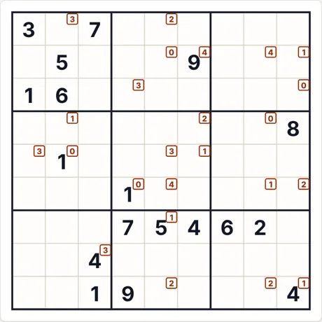 Starting puzzle (9×9 · medium · 18 givens)</td><td align="center">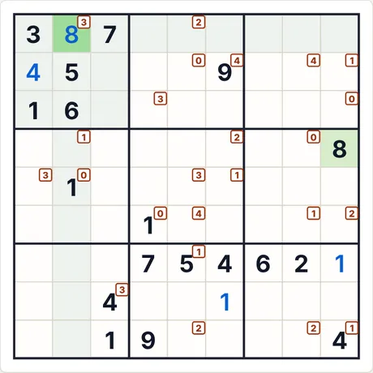 After 4 “Step by step” steps</td></tr></table>

- **Last step explained by the app:** 8 (row 1, col. 2): no direct deduction; the digit is taken from the unique solution (a guess would be needed).
- **Code for the same puzzle:** `relief-9-medium-2696294536` (paste it into “New game → Code”) · solver effort: 56 branches

<b>Full gallery: all screenshot types</b>

<b>Atlas</b>

<table>
<tr><td align="center" valign="top">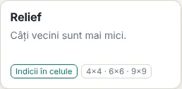 The card in the Atlas</td><td align="center" valign="top">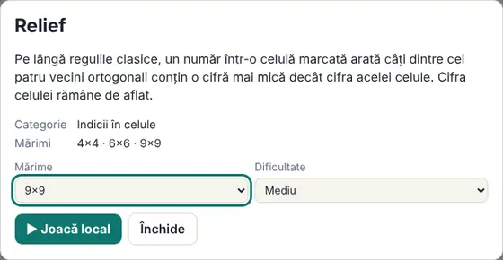 The rules sheet (opens when you click the card)</td></tr>
</table>

<b>Sizes (medium level)</b>

<table>
<tr><td align="center" valign="top">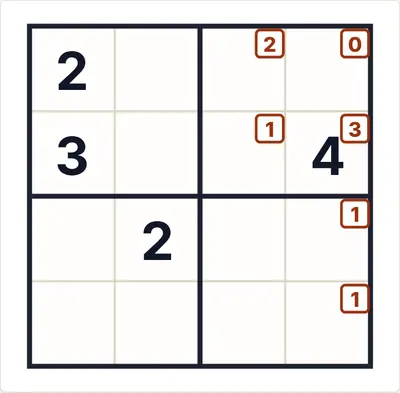 4×4</td><td align="center" valign="top">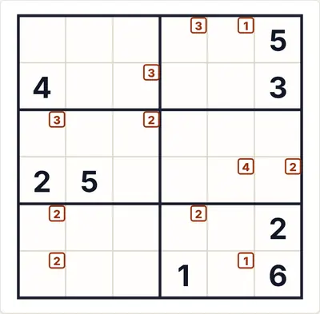 6×6</td><td align="center" valign="top">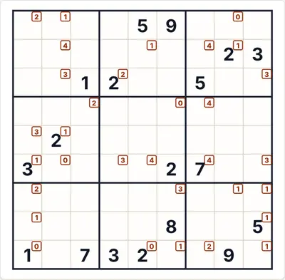 9×9</td></tr>
</table>

<b>Difficulty</b>

<table>
<tr><td align="center" valign="top">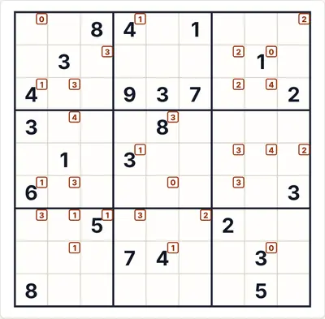 Easy</td><td align="center" valign="top"> Medium</td><td align="center" valign="top">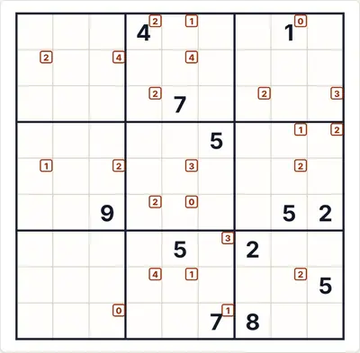 Hard</td></tr>
</table>

<b>Game states</b>

<table>
<tr><td align="center" valign="top">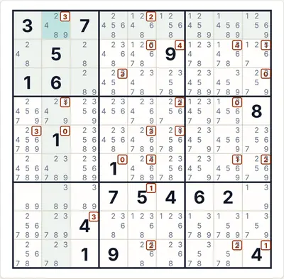 Auto-notes (candidates)</td><td align="center" valign="top">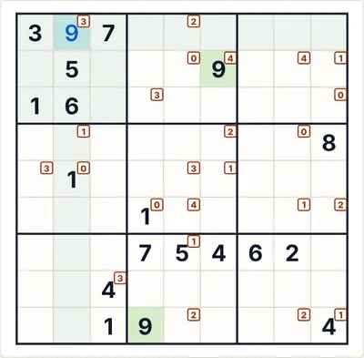 “Check” with a wrong digit (red)</td><td align="center" valign="top">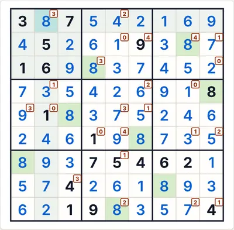 The full solution</td></tr>
</table>

<b>Themes and devices</b>

<table>
<tr><td align="center" valign="top">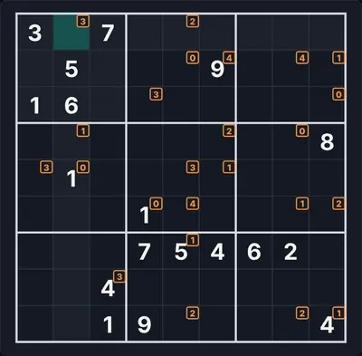 Dark theme</td><td align="center" valign="top">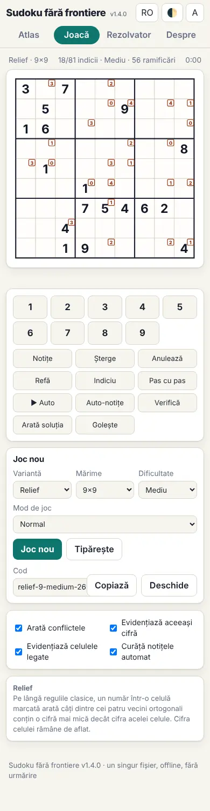 Phone (390 px)</td><td align="center" valign="top">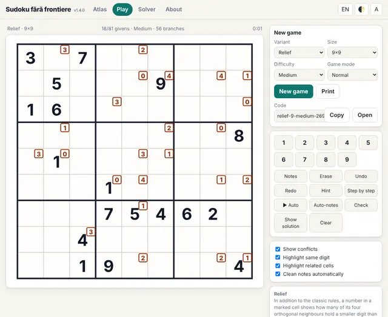 English interface</td></tr>
</table>

<b>The in-game rules panel</b>

<table>
<tr><td align="center" valign="top"> The rules shown next to the board</td></tr>
</table>

#### 122. Odd-sweeper (`oddsweeper`)

**How many of the 8 neighbours are odd.**

In addition to the classic rules, a number in a marked cell shows how many of its eight neighbours (diagonals included) hold odd digits, as in minesweeper. The cell’s own digit still has to be found.

<table><tr><td align="center">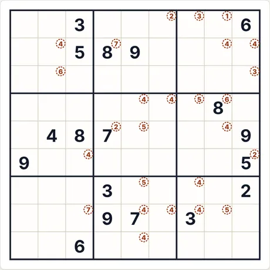 Starting puzzle (9×9 · medium · 18 givens)</td><td align="center">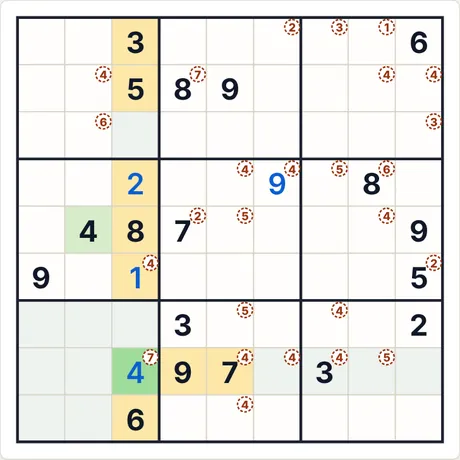 After 4 “Step by step” steps</td></tr></table>

- **Last step explained by the app:** 4 (row 8, col. 3): all the other digits already appear among the marked cells (row, column, region or neighbour rule).
- **Code for the same puzzle:** `oddsweeper-9-medium-964916310` (paste it into “New game → Code”) · solver effort: 1219 branches

<b>Full gallery: all screenshot types</b>

<b>Atlas</b>

<table>
<tr><td align="center" valign="top">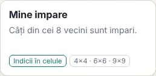 The card in the Atlas</td><td align="center" valign="top">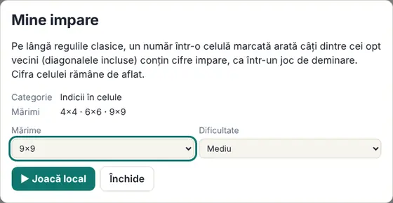 The rules sheet (opens when you click the card)</td></tr>
</table>

<b>Sizes (medium level)</b>

<table>
<tr><td align="center" valign="top">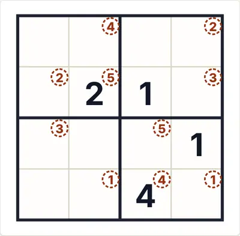 4×4</td><td align="center" valign="top">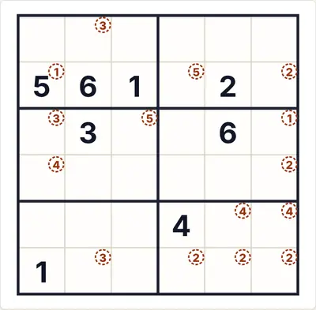 6×6</td><td align="center" valign="top">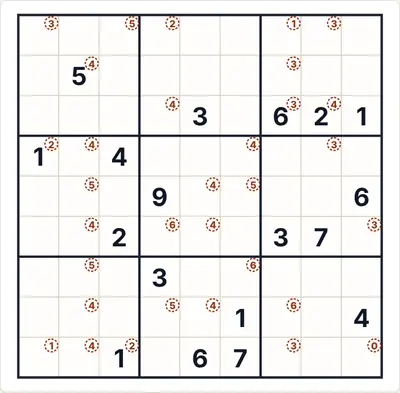 9×9</td></tr>
</table>

<b>Difficulty</b>

<table>
<tr><td align="center" valign="top">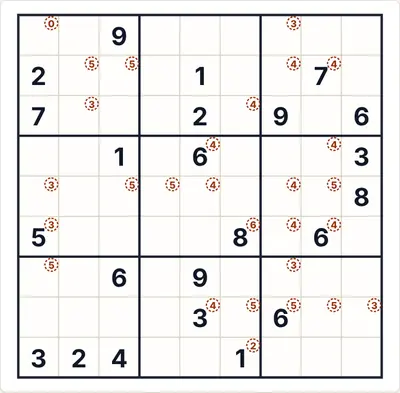 Easy</td><td align="center" valign="top"> Medium</td><td align="center" valign="top">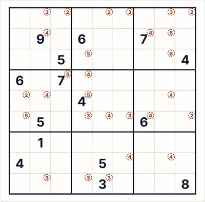 Hard</td></tr>
</table>

<b>Game states</b>

<table>
<tr><td align="center" valign="top">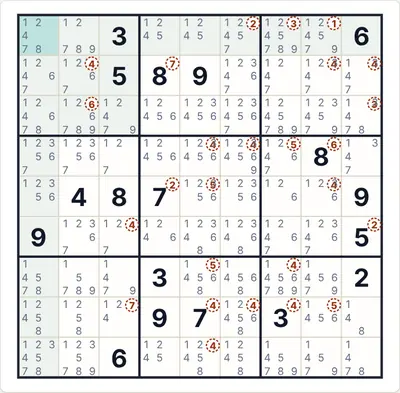 Auto-notes (candidates)</td><td align="center" valign="top">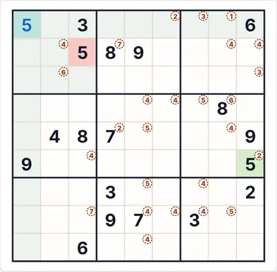 “Check” with a wrong digit (red)</td><td align="center" valign="top">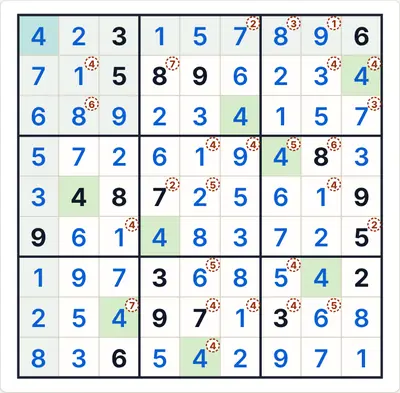 The full solution</td></tr>
</table>

<b>Themes and devices</b>

<table>
<tr><td align="center" valign="top">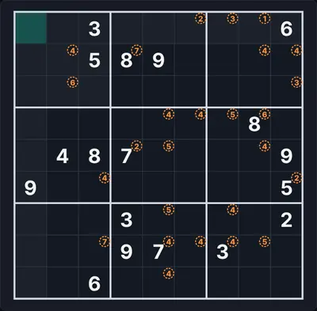 Dark theme</td><td align="center" valign="top">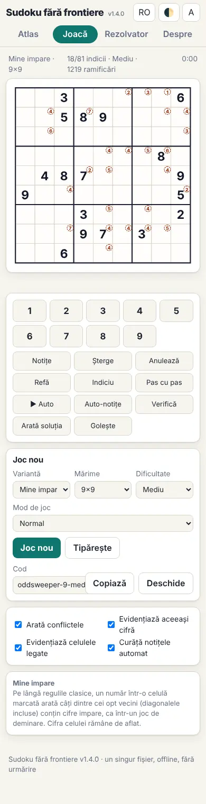 Phone (390 px)</td><td align="center" valign="top">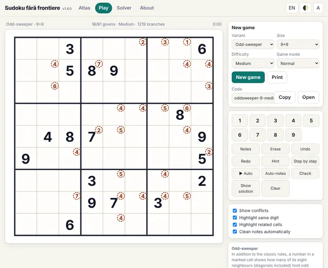 English interface</td></tr>
</table>

<b>The in-game rules panel</b>

<table>
<tr><td align="center" valign="top">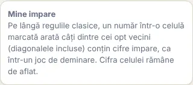 The rules shown next to the board</td></tr>
</table>

#### 123. Compass (`compass`)

**The arrow points to the largest neighbour.**

In addition to the classic rules, an arrow in a marked cell points at the largest of its eight neighbours (strictly larger than all other neighbours). The cell’s own digit is not compared; at the edge only existing neighbours count.

<table><tr><td align="center">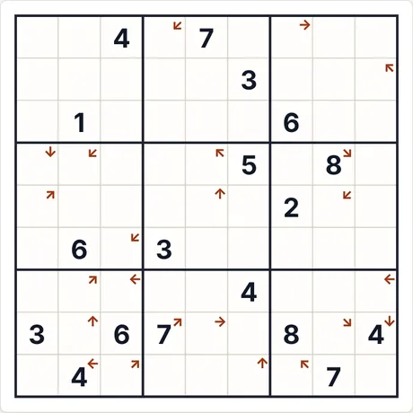 Starting puzzle (9×9 · medium · 18 givens)</td><td align="center">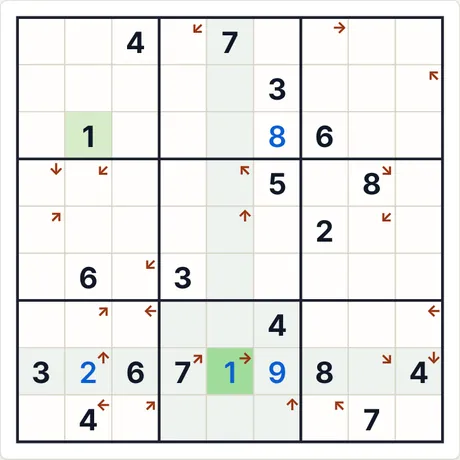 After 4 “Step by step” steps</td></tr></table>

- **Last step explained by the app:** 1 (row 8, col. 5): no direct deduction; the digit is taken from the unique solution (a guess would be needed).
- **Code for the same puzzle:** `compass-9-medium-1055457902` (paste it into “New game → Code”) · solver effort: 1321 branches

<b>Full gallery: all screenshot types</b>

<b>Atlas</b>

<table>
<tr><td align="center" valign="top">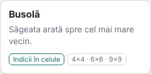 The card in the Atlas</td><td align="center" valign="top">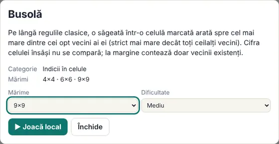 The rules sheet (opens when you click the card)</td></tr>
</table>

<b>Sizes (medium level)</b>

<table>
<tr><td align="center" valign="top">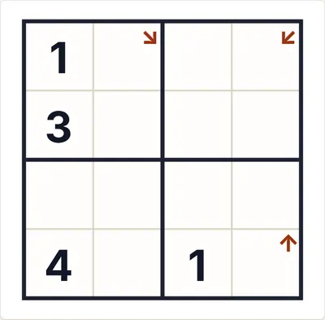 4×4</td><td align="center" valign="top">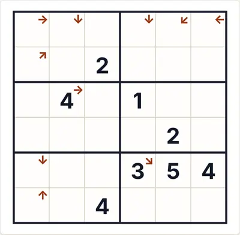 6×6</td><td align="center" valign="top">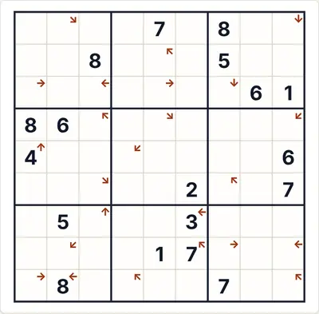 9×9</td></tr>
</table>

<b>Difficulty</b>

<table>
<tr><td align="center" valign="top">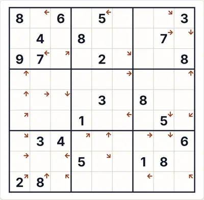 Easy</td><td align="center" valign="top"> Medium</td><td align="center" valign="top">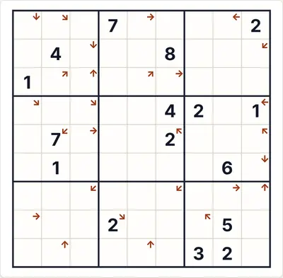 Hard</td></tr>
</table>

<b>Game states</b>

<table>
<tr><td align="center" valign="top">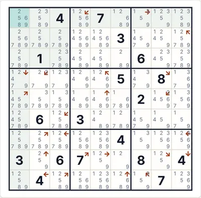 Auto-notes (candidates)</td><td align="center" valign="top">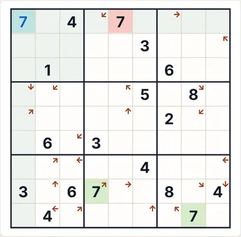 “Check” with a wrong digit (red)</td><td align="center" valign="top">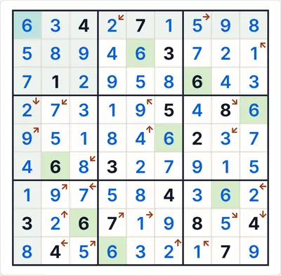 The full solution</td></tr>
</table>

<b>Themes and devices</b>

<table>
<tr><td align="center" valign="top">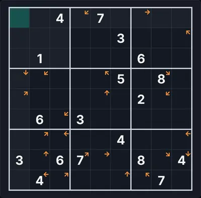 Dark theme</td><td align="center" valign="top">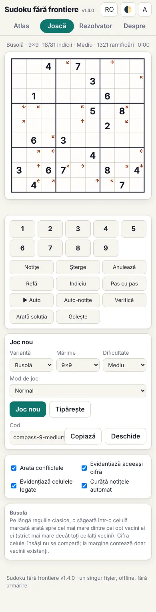 Phone (390 px)</td><td align="center" valign="top">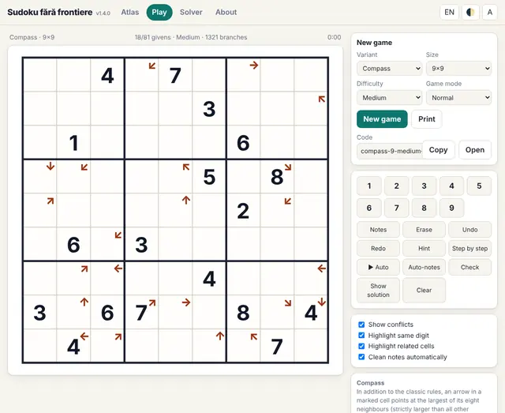 English interface</td></tr>
</table>

<b>The in-game rules panel</b>

<table>
<tr><td align="center" valign="top"> The rules shown next to the board</td></tr>
</table>

#### 124. Quad sum (`quadsum`)

**Sum of a 2×2 block.**

In addition to the classic rules, a number at the junction of four cells is the sum of those four digits (digits may repeat, because the block can touch two or four boxes).

<table><tr><td align="center">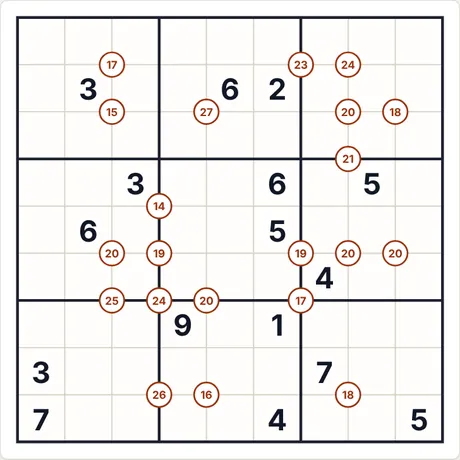 Starting puzzle (9×9 · medium · 16 givens)</td><td align="center">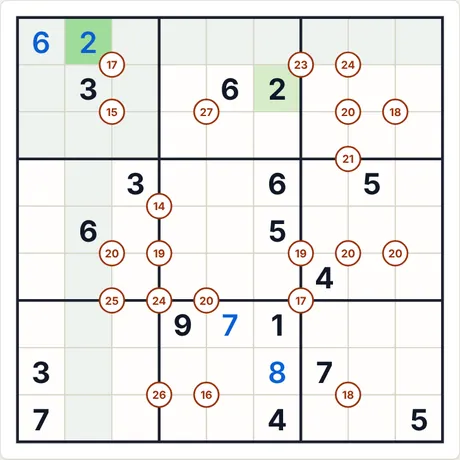 After 4 “Step by step” steps</td></tr></table>

- **Last step explained by the app:** 2 (row 1, col. 2): follows from the variant-specific rules (clues, sums, relations) combined with the other digits.
- **Code for the same puzzle:** `quadsum-9-medium-3898620671` (paste it into “New game → Code”) · solver effort: no branching

<b>Full gallery: all screenshot types</b>

<b>Atlas</b>

<table>
<tr><td align="center" valign="top">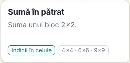 The card in the Atlas</td><td align="center" valign="top">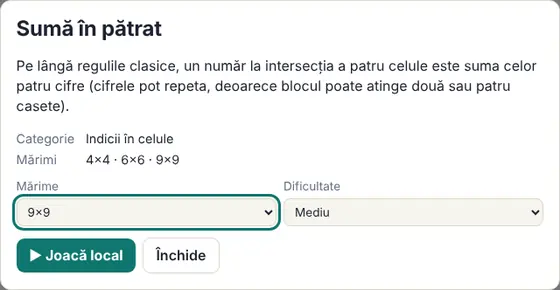 The rules sheet (opens when you click the card)</td></tr>
</table>

<b>Sizes (medium level)</b>

<table>
<tr><td align="center" valign="top"> 4×4</td><td align="center" valign="top"> 6×6</td><td align="center" valign="top"> 9×9</td></tr>
</table>

<b>Difficulty</b>

<table>
<tr><td align="center" valign="top"> Easy</td><td align="center" valign="top"> Medium</td><td align="center" valign="top"> Hard</td></tr>
</table>

<b>Game states</b>

<table>
<tr><td align="center" valign="top"> Auto-notes (candidates)</td><td align="center" valign="top"> “Check” with a wrong digit (red)</td><td align="center" valign="top"> The full solution</td></tr>
</table>

<b>Themes and devices</b>

<table>
<tr><td align="center" valign="top"> Dark theme</td><td align="center" valign="top"> Phone (390 px)</td><td align="center" valign="top"> English interface</td></tr>
</table>

<b>The in-game rules panel</b>

<table>
<tr><td align="center" valign="top"> The rules shown next to the board</td></tr>
</table>

#### 125. Stone 2×2 (`stone`)

**Four different digits in a block.**

In addition to the classic rules, in every 2×2 block marked with a square the four digits are all different. Marks appear only on blocks touching at least two boxes; an unmarked block may or may not have different digits.

<table><tr><td align="center"> Starting puzzle (9×9 · medium · 23 givens)</td><td align="center"> After 4 “Step by step” steps</td></tr></table>

- **Last step explained by the app:** 6 (row 9, col. 5): it is the only cell in the marked column where 6 can go.
- **Code for the same puzzle:** `stone-9-medium-1062674283` (paste it into “New game → Code”) · solver effort: 7 branches

<b>Full gallery: all screenshot types</b>

<b>Atlas</b>

<table>
<tr><td align="center" valign="top"> The card in the Atlas</td><td align="center" valign="top"> The rules sheet (opens when you click the card)</td></tr>
</table>

<b>Sizes (medium level)</b>

<table>
<tr><td align="center" valign="top"> 4×4</td><td align="center" valign="top"> 6×6</td><td align="center" valign="top"> 9×9</td></tr>
</table>

<b>Difficulty</b>

<table>
<tr><td align="center" valign="top"> Easy</td><td align="center" valign="top"> Medium</td><td align="center" valign="top"> Hard</td></tr>
</table>

<b>Game states</b>

<table>
<tr><td align="center" valign="top"> Auto-notes (candidates)</td><td align="center" valign="top"> “Check” with a wrong digit (red)</td><td align="center" valign="top"> The full solution</td></tr>
</table>

<b>Themes and devices</b>

<table>
<tr><td align="center" valign="top"> Dark theme</td><td align="center" valign="top"> Phone (390 px)</td><td align="center" valign="top"> English interface</td></tr>
</table>

<b>The in-game rules panel</b>

<table>
<tr><td align="center" valign="top"> The rules shown next to the board</td></tr>
</table>

#### 126. Domino (`domino`)

**A two-cell tile showing its digits.**

In addition to the classic rules, a domino tile covers two neighbouring cells and shows which two digits they hold (in either order). The definition chosen here is the simplest one; sources differ.

<table><tr><td align="center"> Starting puzzle (9×9 · medium · 16 givens)</td><td align="center"> After 4 “Step by step” steps</td></tr></table>

- **Last step explained by the app:** 6 (row 1, col. 3): follows from the variant-specific rules (clues, sums, relations) combined with the other digits.
- **Code for the same puzzle:** `domino-9-medium-2561228437` (paste it into “New game → Code”) · solver effort: no branching

<b>Full gallery: all screenshot types</b>

<b>Atlas</b>

<table>
<tr><td align="center" valign="top"> The card in the Atlas</td><td align="center" valign="top"> The rules sheet (opens when you click the card)</td></tr>
</table>

<b>Sizes (medium level)</b>

<table>
<tr><td align="center" valign="top"> 4×4</td><td align="center" valign="top"> 6×6</td><td align="center" valign="top"> 9×9</td></tr>
</table>

<b>Difficulty</b>

<table>
<tr><td align="center" valign="top"> Easy</td><td align="center" valign="top"> Medium</td><td align="center" valign="top"> Hard</td></tr>
</table>

<b>Game states</b>

<table>
<tr><td align="center" valign="top"> Auto-notes (candidates)</td><td align="center" valign="top"> “Check” with a wrong digit (red)</td><td align="center" valign="top"> The full solution</td></tr>
</table>

<b>Themes and devices</b>

<table>
<tr><td align="center" valign="top"> Dark theme</td><td align="center" valign="top"> Phone (390 px)</td><td align="center" valign="top"> English interface</td></tr>
</table>

<b>The in-game rules panel</b>

<table>
<tr><td align="center" valign="top"> The rules shown next to the board</td></tr>
</table>

#### 127. Perfect-square pill (`pillsq`)

**Two digits read form a perfect square.**

In addition to the classic rules, a pill covers two neighbouring cells; the two-digit number read in the direction of the arrow is a perfect square (16, 25, 36, 49, 64 or 81). 9×9 only.

<table><tr><td align="center"> Starting puzzle (9×9 · medium · 19 givens)</td><td align="center"> After 4 “Step by step” steps</td></tr></table>

- **Last step explained by the app:** 9 (row 1, col. 7): follows from the variant-specific rules (clues, sums, relations) combined with the other digits.
- **Code for the same puzzle:** `pillsq-9-medium-2681486728` (paste it into “New game → Code”) · solver effort: no branching

<b>Full gallery: all screenshot types</b>

<b>Atlas</b>

<table>
<tr><td align="center" valign="top"> The card in the Atlas</td><td align="center" valign="top"> The rules sheet (opens when you click the card)</td></tr>
</table>

<b>Sizes (medium level)</b>

<table>
<tr><td align="center" valign="top"> 9×9</td></tr>
</table>

<b>Difficulty</b>

<table>
<tr><td align="center" valign="top"> Easy</td><td align="center" valign="top"> Medium</td><td align="center" valign="top"> Hard</td></tr>
</table>

<b>Game states</b>

<table>
<tr><td align="center" valign="top"> Auto-notes (candidates)</td><td align="center" valign="top"> “Check” with a wrong digit (red)</td><td align="center" valign="top"> The full solution</td></tr>
</table>

<b>Themes and devices</b>

<table>
<tr><td align="center" valign="top"> Dark theme</td><td align="center" valign="top"> Phone (390 px)</td><td align="center" valign="top"> English interface</td></tr>
</table>

<b>The in-game rules panel</b>

<table>
<tr><td align="center" valign="top"> The rules shown next to the board</td></tr>
</table>

#### 128. Prime cage (`primecage`)

**Distinct digits whose sum is prime.**

In addition to the classic rules, the digits in each dashed cage are different and their sum is a prime number (the sum is not shown; cages are marked P).

<table><tr><td align="center"> Starting puzzle (9×9 · medium · 24 givens)</td><td align="center"> After 4 “Step by step” steps</td></tr></table>

- **Last step explained by the app:** 2 (row 2, col. 9): follows from the variant-specific rules (clues, sums, relations) combined with the other digits.
- **Code for the same puzzle:** `primecage-9-medium-4252411907` (paste it into “New game → Code”) · solver effort: 3 branches

<b>Full gallery: all screenshot types</b>

<b>Atlas</b>

<table>
<tr><td align="center" valign="top"> The card in the Atlas</td><td align="center" valign="top"> The rules sheet (opens when you click the card)</td></tr>
</table>

<b>Sizes (medium level)</b>

<table>
<tr><td align="center" valign="top"> 6×6</td><td align="center" valign="top"> 9×9</td></tr>
</table>

<b>Difficulty</b>

<table>
<tr><td align="center" valign="top"> Easy</td><td align="center" valign="top"> Medium</td><td align="center" valign="top"> Hard</td></tr>
</table>

<b>Game states</b>

<table>
<tr><td align="center" valign="top"> Auto-notes (candidates)</td><td align="center" valign="top"> “Check” with a wrong digit (red)</td><td align="center" valign="top"> The full solution</td></tr>
</table>

<b>Themes and devices</b>

<table>
<tr><td align="center" valign="top"> Dark theme</td><td align="center" valign="top"> Phone (390 px)</td><td align="center" valign="top"> English interface</td></tr>
</table>

<b>The in-game rules panel</b>

<table>
<tr><td align="center" valign="top"> The rules shown next to the board</td></tr>
</table>

#### 129. Balanced cage (`balcage`)

**Sum equals product.**

In addition to the classic rules, in every cage marked Σ=Π the sum of the digits equals their product (digits may repeat; for example 1+2+3 = 1·2·3).

<table><tr><td align="center"> Starting puzzle (9×9 · medium · 18 givens)</td><td align="center"> After 4 “Step by step” steps</td></tr></table>

- **Last step explained by the app:** 2 (row 5, col. 2): it is the only cell in the marked row where 2 can go.
- **Code for the same puzzle:** `balcage-9-medium-2755606647` (paste it into “New game → Code”) · solver effort: 223 branches

<b>Full gallery: all screenshot types</b>

<b>Atlas</b>

<table>
<tr><td align="center" valign="top"> The card in the Atlas</td><td align="center" valign="top"> The rules sheet (opens when you click the card)</td></tr>
</table>

<b>Sizes (medium level)</b>

<table>
<tr><td align="center" valign="top"> 6×6</td><td align="center" valign="top"> 9×9</td></tr>
</table>

<b>Difficulty</b>

<table>
<tr><td align="center" valign="top"> Easy</td><td align="center" valign="top"> Medium</td><td align="center" valign="top"> Hard</td></tr>
</table>

<b>Game states</b>

<table>
<tr><td align="center" valign="top"> Auto-notes (candidates)</td><td align="center" valign="top"> “Check” with a wrong digit (red)</td><td align="center" valign="top"> The full solution</td></tr>
</table>

<b>Themes and devices</b>

<table>
<tr><td align="center" valign="top"> Dark theme</td><td align="center" valign="top"> Phone (390 px)</td><td align="center" valign="top"> English interface</td></tr>
</table>

<b>The in-game rules panel</b>

<table>
<tr><td align="center" valign="top"> The rules shown next to the board</td></tr>
</table>

#### 130. Doublers (`doubler`)

**Killer where some cells count twice.**

As in Killer (different digits in a cage, given sum), but a cell marked ×2 in the cage is added twice.

<table><tr><td align="center"> Starting puzzle (9×9 · medium · 10 givens)</td><td align="center"> After 4 “Step by step” steps</td></tr></table>

- **Last step explained by the app:** 5 (row 1, col. 4): follows from the variant-specific rules (clues, sums, relations) combined with the other digits.
- **Code for the same puzzle:** `doubler-9-medium-2563509363` (paste it into “New game → Code”) · solver effort: no branching

<b>Full gallery: all screenshot types</b>

<b>Atlas</b>

<table>
<tr><td align="center" valign="top"> The card in the Atlas</td><td align="center" valign="top"> The rules sheet (opens when you click the card)</td></tr>
</table>

<b>Sizes (medium level)</b>

<table>
<tr><td align="center" valign="top"> 4×4</td><td align="center" valign="top"> 6×6</td><td align="center" valign="top"> 9×9</td></tr>
</table>

<b>Difficulty</b>

<table>
<tr><td align="center" valign="top"> Easy</td><td align="center" valign="top"> Medium</td><td align="center" valign="top"> Hard</td></tr>
</table>

<b>Game states</b>

<table>
<tr><td align="center" valign="top"> Auto-notes (candidates)</td><td align="center" valign="top"> “Check” with a wrong digit (red)</td><td align="center" valign="top"> The full solution</td></tr>
</table>

<b>Themes and devices</b>

<table>
<tr><td align="center" valign="top"> Dark theme</td><td align="center" valign="top"> Phone (390 px)</td><td align="center" valign="top"> English interface</td></tr>
</table>

<b>The in-game rules panel</b>

<table>
<tr><td align="center" valign="top"> The rules shown next to the board</td></tr>
</table>

#### 131. Mirror clone (`clonemir`)

**Two same shapes, the second mirrored.**

In addition to the classic rules, two coloured areas have the same shape, the second flipped left–right; corresponding cells hold the same digit.

<table><tr><td align="center"> Starting puzzle (9×9 · medium · 26 givens)</td><td align="center"> After 4 “Step by step” steps</td></tr></table>

- **Last step explained by the app:** 9 (row 2, col. 4): it is the only cell in the marked row where 9 can go.
- **Code for the same puzzle:** `clonemir-9-medium-3077784619` (paste it into “New game → Code”) · solver effort: no branching

<b>Full gallery: all screenshot types</b>

<b>Atlas</b>

<table>
<tr><td align="center" valign="top"> The card in the Atlas</td><td align="center" valign="top"> The rules sheet (opens when you click the card)</td></tr>
</table>

<b>Sizes (medium level)</b>

<table>
<tr><td align="center" valign="top"> 6×6</td><td align="center" valign="top"> 9×9</td></tr>
</table>

<b>Difficulty</b>

<table>
<tr><td align="center" valign="top"> Easy</td><td align="center" valign="top"> Medium</td><td align="center" valign="top"> Hard</td></tr>
</table>

<b>Game states</b>

<table>
<tr><td align="center" valign="top"> Auto-notes (candidates)</td><td align="center" valign="top"> “Check” with a wrong digit (red)</td><td align="center" valign="top"> The full solution</td></tr>
</table>

<b>Themes and devices</b>

<table>
<tr><td align="center" valign="top"> Dark theme</td><td align="center" valign="top"> Phone (390 px)</td><td align="center" valign="top"> English interface</td></tr>
</table>

<b>The in-game rules panel</b>

<table>
<tr><td align="center" valign="top"> The rules shown next to the board</td></tr>
</table>

