# Catálogo: Cuadrículas compuestas (7)

[English](../en/08-grile-compuse.md) · [Română](../08-grile-compuse.md) · [Français](../fr/08-grile-compuse.md) · [Italiano](../it/08-grile-compuse.md) · **Español** · [Português](../pt/08-grile-compuse.md) · [Deutsch](../de/08-grile-compuse.md) · [Magyar](../hu/08-grile-compuse.md)

[← README](../../../README.es.md) · [Todas las categorías](README.md)

[Tamaño y símbolos](01-marime-si-simboluri.md) · [Regiones y grupos](02-regiuni-si-grupuri.md) · [Vecinos](03-vecini.md) · [Paridad, puntos, signos](04-paritate-puncte-semne.md) · [Sumas](05-sume.md) · [Pistas en el borde](06-indicii-pe-margine.md) · [Líneas](07-linii.md) · **Cuadrículas compuestas** · [Parientes cercanos](09-rude-apropiate.md) · [Topologías y saltos fairy](10-topologii-si-mutari-fairy.md) · [Reglas globales](11-reguli-globale.md) · [Pistas en las celdas](12-indicii-in-celule.md) · [Dimensiones superiores](13-dimensiuni-superioare.md)

---

_Las cuadrículas se solapan; las celdas comunes cumplen a la vez las reglas de ambas cuadrículas. El tablero se puede ampliar con «tamaño del texto»._

#### 92. Samurai · Samurai (`samurai`)

**Cinco cuadrículas solapadas.**

Cinco cuadrículas 9×9 solapadas en las esquinas; las cajas comunes se rellenan una sola vez.

<table><tr><td align="center">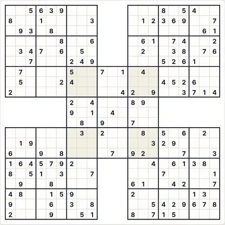 Puzle al inicio (9×9 · medio · 148 dados)</td><td align="center">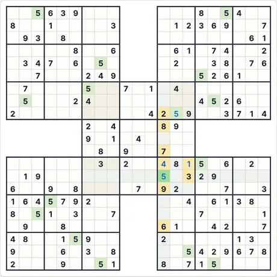 Tras 4 pasos de «Paso a paso»</td></tr></table>

- **Último paso explicado por la aplicación:** 5 (fila 14, col. 13): todos los demás dígitos ya aparecen entre las celdas marcadas (fila, columna, región o regla de vecindad).
- **Código del mismo puzle:** `samurai-9-medium-77238695` (pégalo en «Partida nueva → Código») · esfuerzo del resolutor: sin ramificaciones

<b>Galería completa: todos los tipos de capturas</b>

<b>Atlas</b>

<table>
<tr><td align="center" valign="top">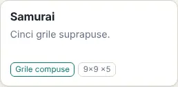 Tarjeta del Atlas</td><td align="center" valign="top">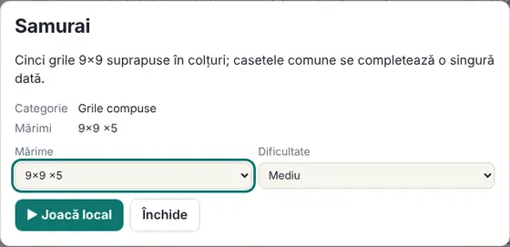 Ficha (se abre al hacer clic en la tarjeta)</td></tr>
</table>

<b>Tamaños (nivel medio)</b>

<table>
<tr><td align="center" valign="top">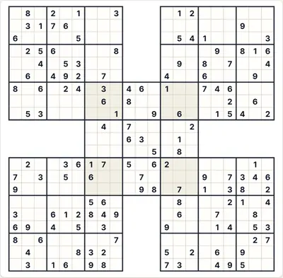 9×9</td></tr>
</table>

<b>Dificultad</b>

<table>
<tr><td align="center" valign="top">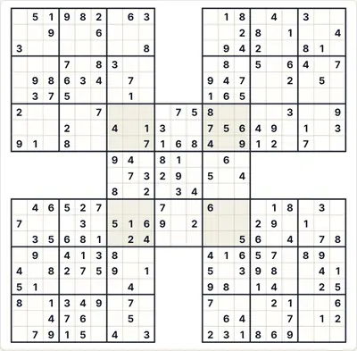 Fácil</td><td align="center" valign="top"> Medio</td><td align="center" valign="top">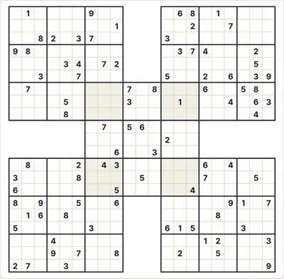 Difícil</td></tr>
</table>

<b>Estados de juego</b>

<table>
<tr><td align="center" valign="top">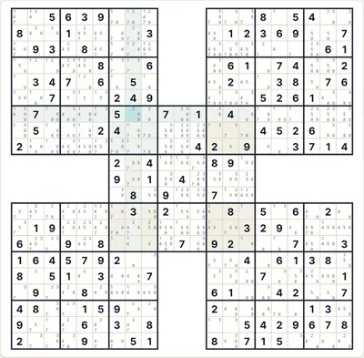 Notas automáticas (candidatos)</td><td align="center" valign="top">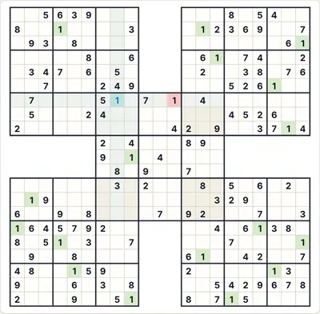 «Comprobar» con un dígito erróneo (rojo)</td><td align="center" valign="top">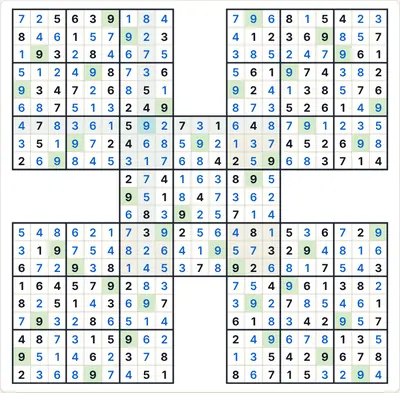 Solución completa</td></tr>
</table>

<b>Temas y dispositivos</b>

<table>
<tr><td align="center" valign="top">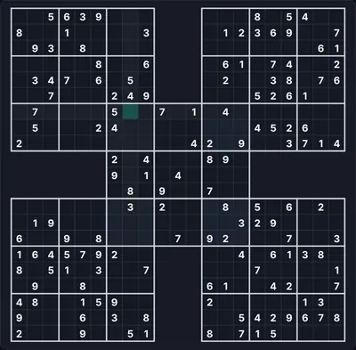 Tema oscuro</td><td align="center" valign="top">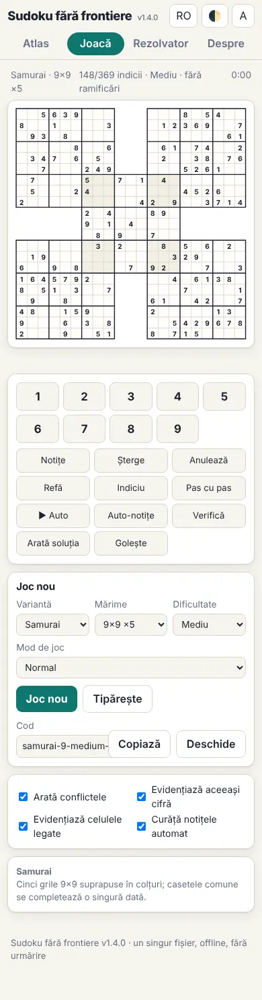 Teléfono (390 px)</td><td align="center" valign="top">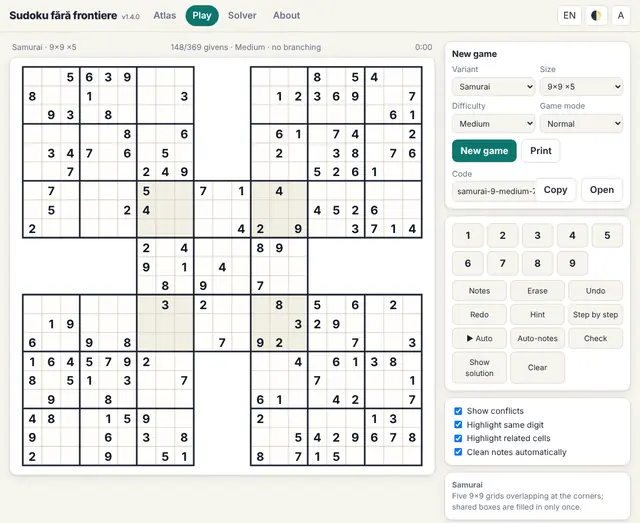 Interfaz en inglés</td></tr>
</table>

<b>Panel de reglas en el juego</b>

<table>
<tr><td align="center" valign="top">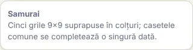 Reglas mostradas junto al tablero</td></tr>
</table>

#### 93. Twodoku · Twodoku (`twodoku`)

**Dos cuadrículas que tienen una caja común.**

Dos cuadrículas 9×9 que tienen una caja común.

<table><tr><td align="center">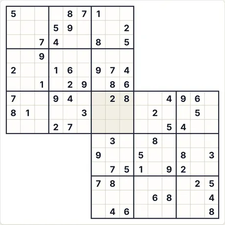 Puzle al inicio (9×9 · medio · 61 dados)</td><td align="center">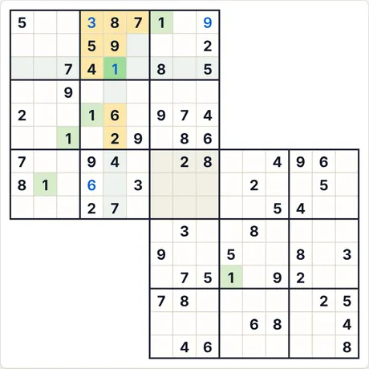 Tras 4 pasos de «Paso a paso»</td></tr></table>

- **Último paso explicado por la aplicación:** 1 (fila 3, col. 5): todos los demás dígitos ya aparecen entre las celdas marcadas (fila, columna, región o regla de vecindad).
- **Código del mismo puzle:** `twodoku-9-medium-3978143716` (pégalo en «Partida nueva → Código») · esfuerzo del resolutor: sin ramificaciones

<b>Galería completa: todos los tipos de capturas</b>

<b>Atlas</b>

<table>
<tr><td align="center" valign="top">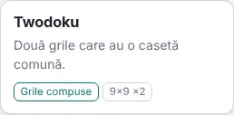 Tarjeta del Atlas</td><td align="center" valign="top">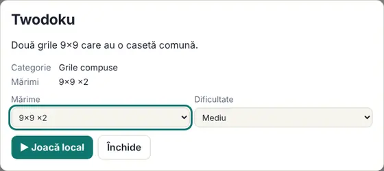 Ficha (se abre al hacer clic en la tarjeta)</td></tr>
</table>

<b>Tamaños (nivel medio)</b>

<table>
<tr><td align="center" valign="top">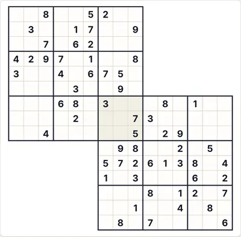 9×9</td></tr>
</table>

<b>Dificultad</b>

<table>
<tr><td align="center" valign="top">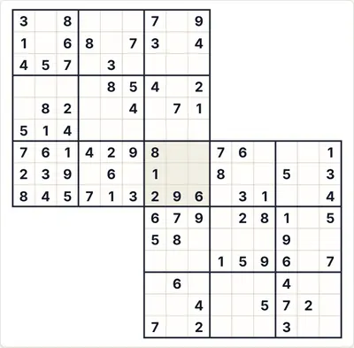 Fácil</td><td align="center" valign="top"> Medio</td><td align="center" valign="top">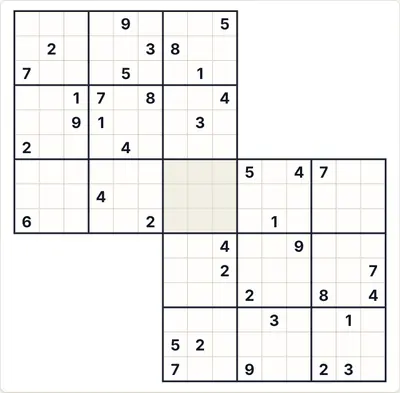 Difícil</td></tr>
</table>

<b>Estados de juego</b>

<table>
<tr><td align="center" valign="top">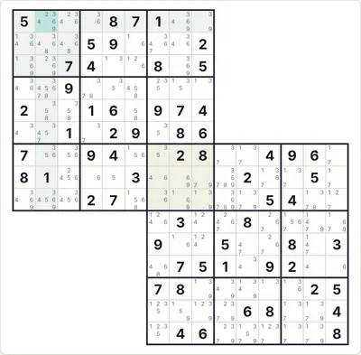 Notas automáticas (candidatos)</td><td align="center" valign="top">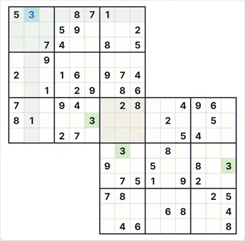 «Comprobar» con un dígito erróneo (rojo)</td><td align="center" valign="top">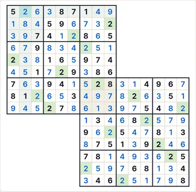 Solución completa</td></tr>
</table>

<b>Temas y dispositivos</b>

<table>
<tr><td align="center" valign="top">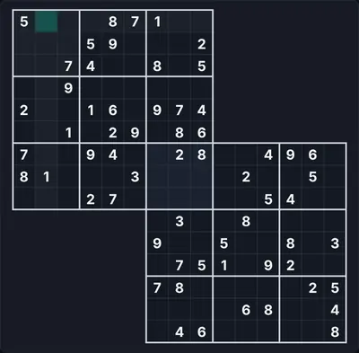 Tema oscuro</td><td align="center" valign="top">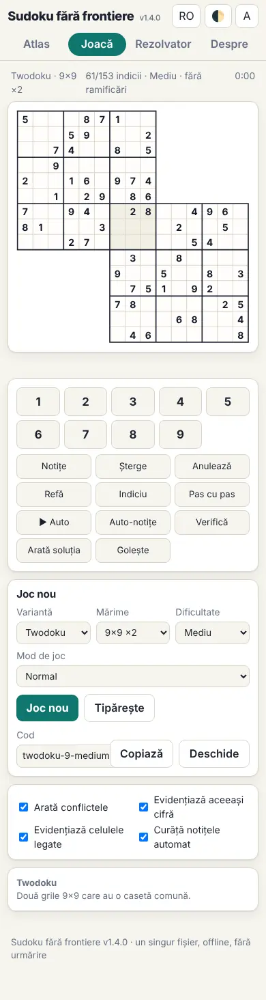 Teléfono (390 px)</td><td align="center" valign="top">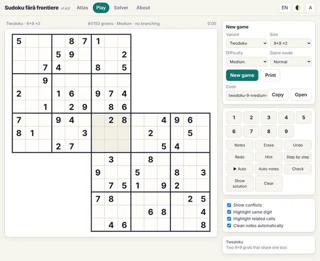 Interfaz en inglés</td></tr>
</table>

<b>Panel de reglas en el juego</b>

<table>
<tr><td align="center" valign="top">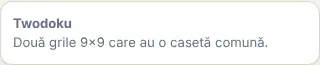 Reglas mostradas junto al tablero</td></tr>
</table>

#### 94. Gattai-3 · Gattai-3 (`gattai3`)

**Tres cuadrículas en cadena.**

Tres cuadrículas 9×9 unidas en diagonal, cada pareja vecina con una caja común.

<table><tr><td align="center">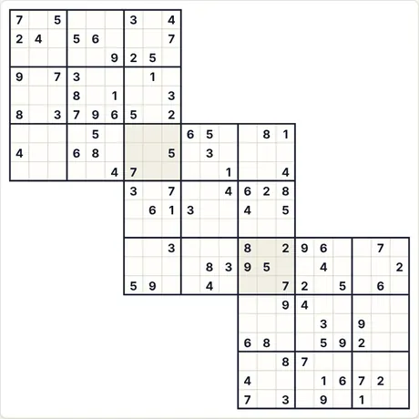 Puzle al inicio (9×9 · medio · 90 dados)</td><td align="center">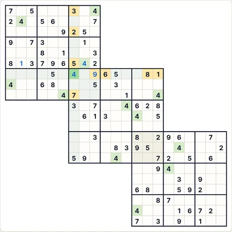 Tras 4 pasos de «Paso a paso»</td></tr></table>

- **Último paso explicado por la aplicación:** 4 (fila 7, col. 7): todos los demás dígitos ya aparecen entre las celdas marcadas (fila, columna, región o regla de vecindad).
- **Código del mismo puzle:** `gattai3-9-medium-1878816279` (pégalo en «Partida nueva → Código») · esfuerzo del resolutor: sin ramificaciones

<b>Galería completa: todos los tipos de capturas</b>

<b>Atlas</b>

<table>
<tr><td align="center" valign="top">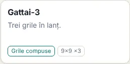 Tarjeta del Atlas</td><td align="center" valign="top">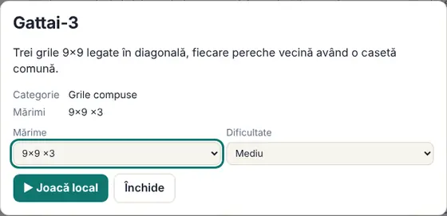 Ficha (se abre al hacer clic en la tarjeta)</td></tr>
</table>

<b>Tamaños (nivel medio)</b>

<table>
<tr><td align="center" valign="top">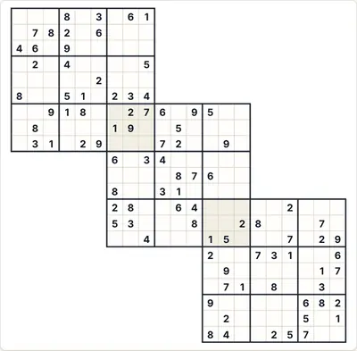 9×9</td></tr>
</table>

<b>Dificultad</b>

<table>
<tr><td align="center" valign="top">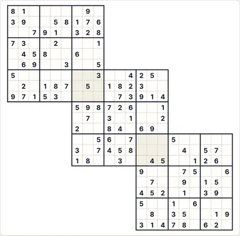 Fácil</td><td align="center" valign="top"> Medio</td><td align="center" valign="top">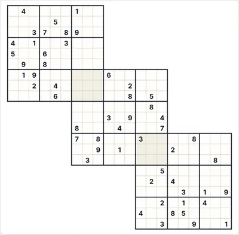 Difícil</td></tr>
</table>

<b>Estados de juego</b>

<table>
<tr><td align="center" valign="top">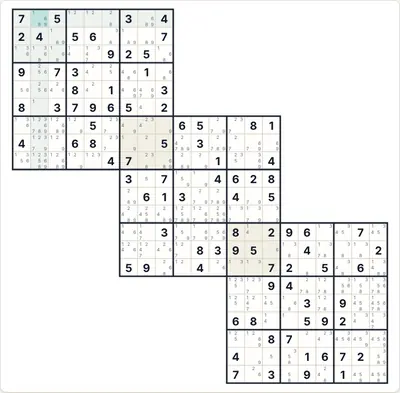 Notas automáticas (candidatos)</td><td align="center" valign="top">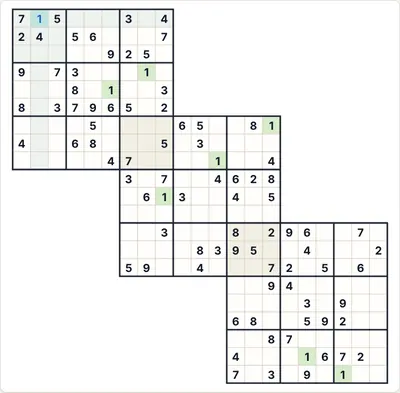 «Comprobar» con un dígito erróneo (rojo)</td><td align="center" valign="top">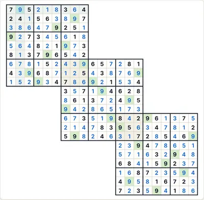 Solución completa</td></tr>
</table>

<b>Temas y dispositivos</b>

<table>
<tr><td align="center" valign="top">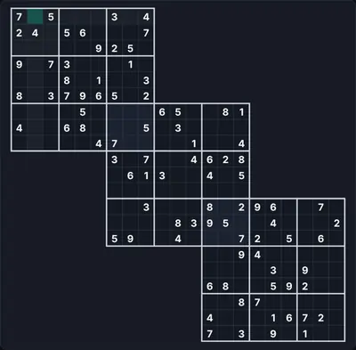 Tema oscuro</td><td align="center" valign="top">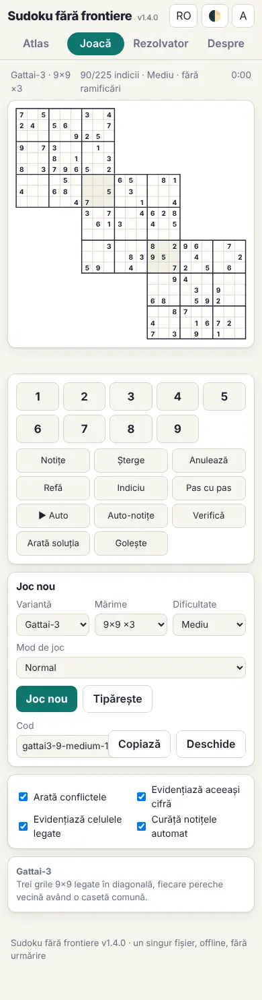 Teléfono (390 px)</td><td align="center" valign="top">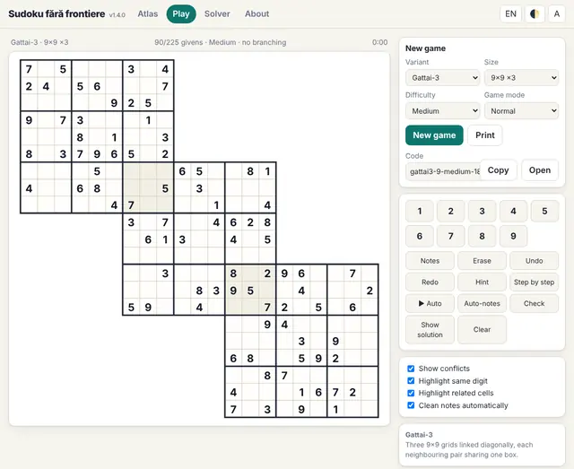 Interfaz en inglés</td></tr>
</table>

<b>Panel de reglas en el juego</b>

<table>
<tr><td align="center" valign="top">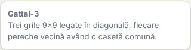 Reglas mostradas junto al tablero</td></tr>
</table>

#### 95. Sohei (anillo de cuatro) · Sohei (ring of four) (`sohei`)

**Cuatro cuadrículas 9×9 unidas en un anillo en rombo.**

Cuatro cuadrículas 9×9 están dispuestas en rombo (arriba, derecha, abajo, izquierda); cada dos cuadrículas vecinas comparten una caja 3×3 (en total cuatro cajas comunes), y en el centro queda un hueco. Cada fila, columna y caja contiene cada dígito una vez; los dígitos de las cajas comunes cuentan para ambas cuadrículas. La geometría es una convención elegida aquí; las fuentes difieren.

<table><tr><td align="center">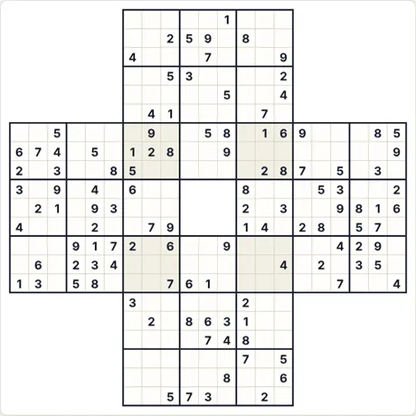 Puzle al inicio (9×9 · medio · 115 dados)</td><td align="center">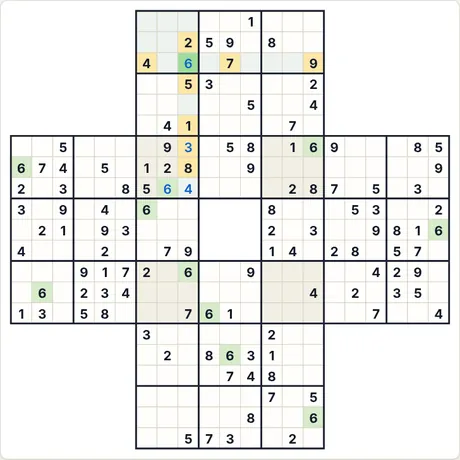 Tras 4 pasos de «Paso a paso»</td></tr></table>

- **Último paso explicado por la aplicación:** 6 (fila 3, col. 9): todos los demás dígitos ya aparecen entre las celdas marcadas (fila, columna, región o regla de vecindad).
- **Código del mismo puzle:** `sohei-9-medium-3287590607` (pégalo en «Partida nueva → Código») · esfuerzo del resolutor: sin ramificaciones

<b>Galería completa: todos los tipos de capturas</b>

<b>Atlas</b>

<table>
<tr><td align="center" valign="top">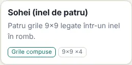 Tarjeta del Atlas</td><td align="center" valign="top">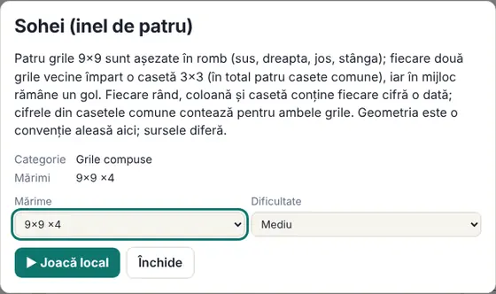 Ficha (se abre al hacer clic en la tarjeta)</td></tr>
</table>

<b>Tamaños (nivel medio)</b>

<table>
<tr><td align="center" valign="top">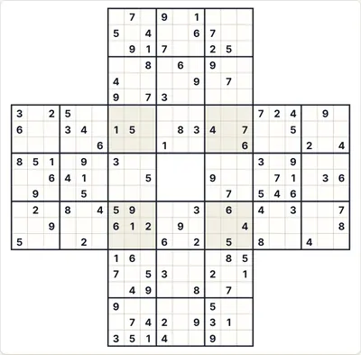 9×9</td></tr>
</table>

<b>Dificultad</b>

<table>
<tr><td align="center" valign="top">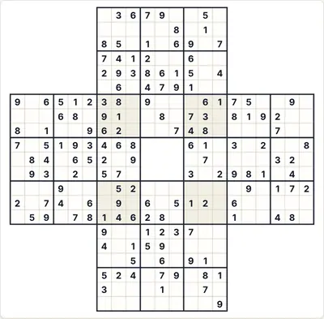 Fácil</td><td align="center" valign="top"> Medio</td><td align="center" valign="top">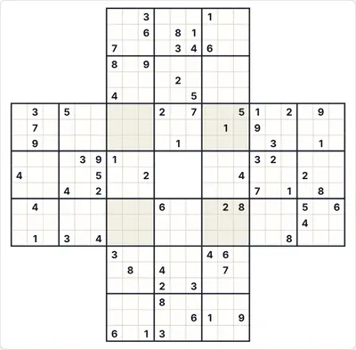 Difícil</td></tr>
</table>

<b>Estados de juego</b>

<table>
<tr><td align="center" valign="top">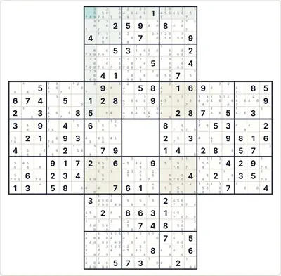 Notas automáticas (candidatos)</td><td align="center" valign="top"> «Comprobar» con un dígito erróneo (rojo)</td><td align="center" valign="top"> Solución completa</td></tr>
</table>

<b>Temas y dispositivos</b>

<table>
<tr><td align="center" valign="top"> Tema oscuro</td><td align="center" valign="top"> Teléfono (390 px)</td><td align="center" valign="top"> Interfaz en inglés</td></tr>
</table>

<b>Panel de reglas en el juego</b>

<table>
<tr><td align="center" valign="top"> Reglas mostradas junto al tablero</td></tr>
</table>

#### 96. Kazaguruma (molino de viento) · Kazaguruma (windmill) (`kazaguruma`)

**Centro más cuatro brazos, cada uno solapado en dos cajas.**

Una cuadrícula 9×9 central y cuatro brazos 9×9 en forma de molino de viento; cada brazo se solapa con el centro en dos cajas vecinas (18 celdas). Cada fila, columna y caja contiene cada dígito una vez. La geometría es una convención elegida aquí; las fuentes difieren.

<table><tr><td align="center"> Puzle al inicio (9×9 · medio · 133 dados)</td><td align="center"> Tras 4 pasos de «Paso a paso»</td></tr></table>

- **Último paso explicado por la aplicación:** 9 (fila 10, col. 11): todos los demás dígitos ya aparecen entre las celdas marcadas (fila, columna, región o regla de vecindad).
- **Código del mismo puzle:** `kazaguruma-9-medium-3826569037` (pégalo en «Partida nueva → Código») · esfuerzo del resolutor: sin ramificaciones

<b>Galería completa: todos los tipos de capturas</b>

<b>Atlas</b>

<table>
<tr><td align="center" valign="top"> Tarjeta del Atlas</td><td align="center" valign="top"> Ficha (se abre al hacer clic en la tarjeta)</td></tr>
</table>

<b>Tamaños (nivel medio)</b>

<table>
<tr><td align="center" valign="top"> 9×9</td></tr>
</table>

<b>Dificultad</b>

<table>
<tr><td align="center" valign="top"> Fácil</td><td align="center" valign="top"> Medio</td><td align="center" valign="top"> Difícil</td></tr>
</table>

<b>Estados de juego</b>

<table>
<tr><td align="center" valign="top"> Notas automáticas (candidatos)</td><td align="center" valign="top"> «Comprobar» con un dígito erróneo (rojo)</td><td align="center" valign="top"> Solución completa</td></tr>
</table>

<b>Temas y dispositivos</b>

<table>
<tr><td align="center" valign="top"> Tema oscuro</td><td align="center" valign="top"> Teléfono (390 px)</td><td align="center" valign="top"> Interfaz en inglés</td></tr>
</table>

<b>Panel de reglas en el juego</b>

<table>
<tr><td align="center" valign="top"> Reglas mostradas junto al tablero</td></tr>
</table>

#### 97. Tripledoku (V) · Tripledoku (V) (`tripledoku`)

**Tres cuadrículas en forma de V.**

Tres cuadrículas 9×9 dispuestas en V: arriba a la izquierda, abajo en el medio y arriba a la derecha; la cuadrícula del medio comparte una caja con cada una de las otras dos. Es la misma idea que Gattai-3, pero con otra geometría (V en lugar de diagonal).

<table><tr><td align="center"> Puzle al inicio (9×9 · medio · 90 dados)</td><td align="center"> Tras 4 pasos de «Paso a paso»</td></tr></table>

- **Último paso explicado por la aplicación:** 8 (fila 4, col. 8): todos los demás dígitos ya aparecen entre las celdas marcadas (fila, columna, región o regla de vecindad).
- **Código del mismo puzle:** `tripledoku-9-medium-2816838371` (pégalo en «Partida nueva → Código») · esfuerzo del resolutor: sin ramificaciones

<b>Galería completa: todos los tipos de capturas</b>

<b>Atlas</b>

<table>
<tr><td align="center" valign="top"> Tarjeta del Atlas</td><td align="center" valign="top"> Ficha (se abre al hacer clic en la tarjeta)</td></tr>
</table>

<b>Tamaños (nivel medio)</b>

<table>
<tr><td align="center" valign="top"> 9×9</td></tr>
</table>

<b>Dificultad</b>

<table>
<tr><td align="center" valign="top"> Fácil</td><td align="center" valign="top"> Medio</td><td align="center" valign="top"> Difícil</td></tr>
</table>

<b>Estados de juego</b>

<table>
<tr><td align="center" valign="top"> Notas automáticas (candidatos)</td><td align="center" valign="top"> «Comprobar» con un dígito erróneo (rojo)</td><td align="center" valign="top"> Solución completa</td></tr>
</table>

<b>Temas y dispositivos</b>

<table>
<tr><td align="center" valign="top"> Tema oscuro</td><td align="center" valign="top"> Teléfono (390 px)</td><td align="center" valign="top"> Interfaz en inglés</td></tr>
</table>

<b>Panel de reglas en el juego</b>

<table>
<tr><td align="center" valign="top"> Reglas mostradas junto al tablero</td></tr>
</table>

#### 98. Cruz · Cross (`cross`)

**Centro más cuatro brazos, cada uno solapado en una banda entera.**

Una cuadrícula 9×9 central y cuatro brazos (arriba, izquierda, derecha, abajo); cada brazo se solapa con el centro en una banda entera de tres cajas (27 celdas), y algunas cajas pertenecen a tres cuadrículas. Cada fila, columna y caja contiene cada dígito una vez. La geometría es una convención elegida aquí.

<table><tr><td align="center"> Puzle al inicio (9×9 · medio · 119 dados)</td><td align="center"> Tras 4 pasos de «Paso a paso»</td></tr></table>

- **Último paso explicado por la aplicación:** 6 (fila 9, col. 7): todos los demás dígitos ya aparecen entre las celdas marcadas (fila, columna, región o regla de vecindad).
- **Código del mismo puzle:** `cross-9-medium-1483531318` (pégalo en «Partida nueva → Código») · esfuerzo del resolutor: sin ramificaciones

<b>Galería completa: todos los tipos de capturas</b>

<b>Atlas</b>

<table>
<tr><td align="center" valign="top"> Tarjeta del Atlas</td><td align="center" valign="top"> Ficha (se abre al hacer clic en la tarjeta)</td></tr>
</table>

<b>Tamaños (nivel medio)</b>

<table>
<tr><td align="center" valign="top"> 9×9</td></tr>
</table>

<b>Dificultad</b>

<table>
<tr><td align="center" valign="top"> Fácil</td><td align="center" valign="top"> Medio</td><td align="center" valign="top"> Difícil</td></tr>
</table>

<b>Estados de juego</b>

<table>
<tr><td align="center" valign="top"> Notas automáticas (candidatos)</td><td align="center" valign="top"> «Comprobar» con un dígito erróneo (rojo)</td><td align="center" valign="top"> Solución completa</td></tr>
</table>

<b>Temas y dispositivos</b>

<table>
<tr><td align="center" valign="top"> Tema oscuro</td><td align="center" valign="top"> Teléfono (390 px)</td><td align="center" valign="top"> Interfaz en inglés</td></tr>
</table>

<b>Panel de reglas en el juego</b>

<table>
<tr><td align="center" valign="top"> Reglas mostradas junto al tablero</td></tr>
</table>

