# Catalogue : Voisins (4)

[English](../en/03-vecini.md) · [Română](../03-vecini.md) · **Français** · [Italiano](../it/03-vecini.md) · [Español](../es/03-vecini.md) · [Português](../pt/03-vecini.md) · [Deutsch](../de/03-vecini.md) · [Magyar](../hu/03-vecini.md)

[← README](../../../README.fr.md) · [Toutes les catégories](README.md)

[Taille et symboles](01-marime-si-simboluri.md) · [Régions et groupes](02-regiuni-si-grupuri.md) · **Voisins** · [Parité, points, signes](04-paritate-puncte-semne.md) · [Sommes](05-sume.md) · [Indices en marge](06-indicii-pe-margine.md) · [Lignes](07-linii.md) · [Grilles composées](08-grile-compuse.md) · [Variantes apparentées](09-rude-apropiate.md) · [Topologies et déplacements fairy](10-topologii-si-mutari-fairy.md) · [Règles globales](11-reguli-globale.md) · [Indices dans les cases](12-indicii-in-celule.md) · [Dimensions supérieures](13-dimensiuni-superioare.md)

---

_La règle dit quelles cases ne peuvent pas avoir le même chiffre ou des chiffres proches ; les conflits apparaissent en rouge si « conflits » est coché._

#### 16. Anti-cavalier · Anti-knight (`antiknight`)

**Pas de même chiffre à un saut de cavalier.**

En plus des règles classiques, deux cases séparées par un saut de cavalier des échecs ne peuvent pas contenir le même chiffre. Seulement en 9×9.

<table><tr><td align="center">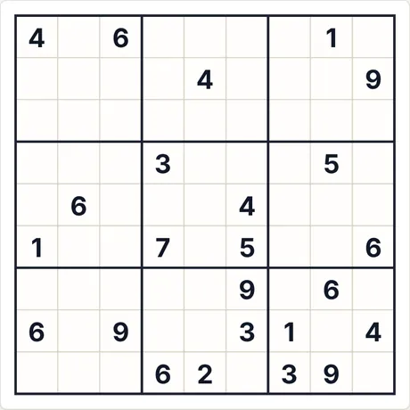 Puzzle de départ (9×9 · moyen · 24 indices)</td><td align="center">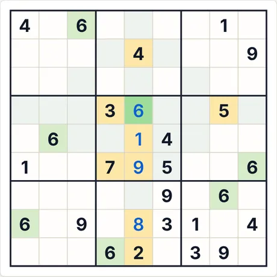 Après 4 étapes de « Pas à pas »</td></tr></table>

- **Dernière étape expliquée par l’application :** 6 (ligne 4, col. 5) : tous les autres chiffres apparaissent déjà parmi les cases marquées (ligne, colonne, région ou règle de voisinage).
- **Code du même puzzle :** `antiknight-9-medium-867238284` (collez-le dans « Nouvelle partie → Code ») · effort du résolveur : sans embranchement

<b>Galerie complète : tous les types de captures</b>

<b>Atlas</b>

<table>
<tr><td align="center" valign="top">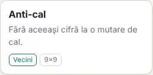 La carte dans l’Atlas</td><td align="center" valign="top">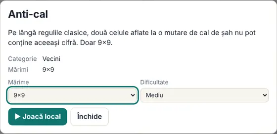 La fiche (s’ouvre d’un clic sur la carte)</td></tr>
</table>

<b>Tailles (niveau moyen)</b>

<table>
<tr><td align="center" valign="top">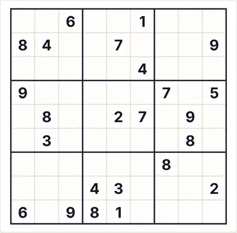 9×9</td></tr>
</table>

<b>Difficulté</b>

<table>
<tr><td align="center" valign="top">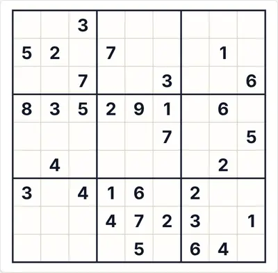 Facile</td><td align="center" valign="top"> Moyen</td><td align="center" valign="top">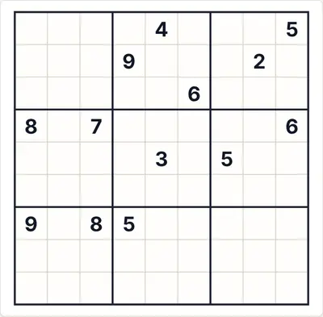 Difficile</td></tr>
</table>

<b>États de jeu</b>

<table>
<tr><td align="center" valign="top">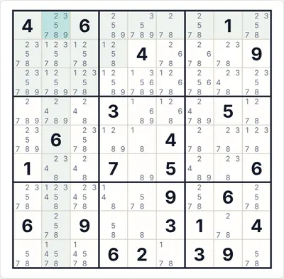 Notes auto (candidats)</td><td align="center" valign="top">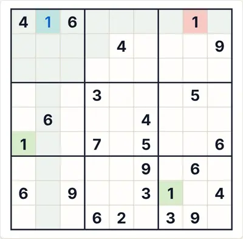 « Vérifier » avec un chiffre erroné (en rouge)</td><td align="center" valign="top">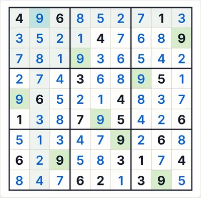 La solution complète</td></tr>
</table>

<b>Thèmes et appareils</b>

<table>
<tr><td align="center" valign="top">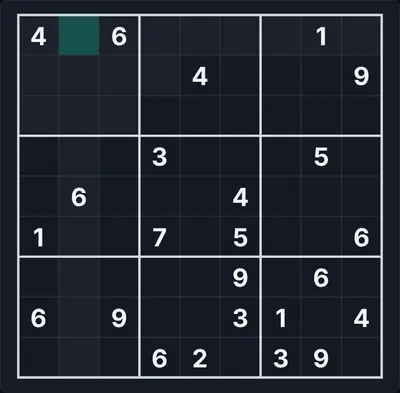 Thème sombre</td><td align="center" valign="top">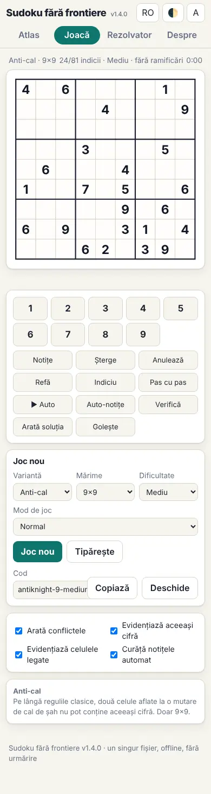 Téléphone (390 px)</td><td align="center" valign="top">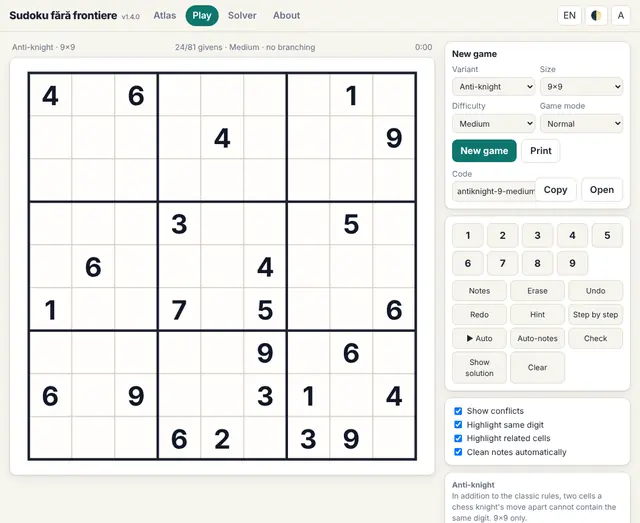 Interface en anglais</td></tr>
</table>

<b>Panneau des règles dans le jeu</b>

<table>
<tr><td align="center" valign="top">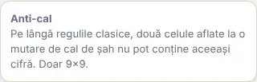 Les règles affichées à côté de la grille</td></tr>
</table>

#### 17. Anti-roi · Anti-king (`antiking`)

**Les voisins en diagonale sont différents.**

En plus des règles classiques, deux cases voisines en diagonale (déplacement du roi) ne peuvent pas contenir le même chiffre. Seulement en 9×9.

<table><tr><td align="center">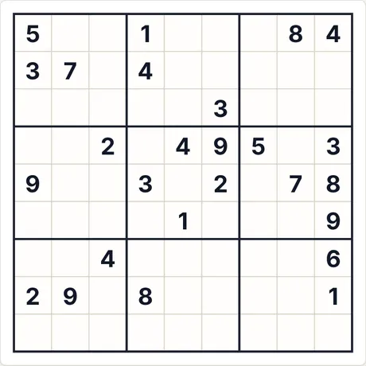 Puzzle de départ (9×9 · moyen · 26 indices)</td><td align="center">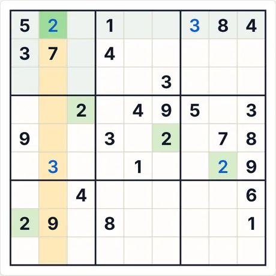 Après 4 étapes de « Pas à pas »</td></tr></table>

- **Dernière étape expliquée par l’application :** 2 (ligne 1, col. 2) : c’est la seule case de la colonne marquée où 2 peut aller.
- **Code du même puzzle :** `antiking-9-medium-1002649182` (collez-le dans « Nouvelle partie → Code ») · effort du résolveur : sans embranchement

<b>Galerie complète : tous les types de captures</b>

<b>Atlas</b>

<table>
<tr><td align="center" valign="top">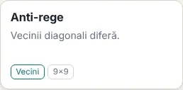 La carte dans l’Atlas</td><td align="center" valign="top">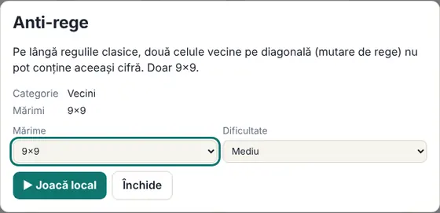 La fiche (s’ouvre d’un clic sur la carte)</td></tr>
</table>

<b>Tailles (niveau moyen)</b>

<table>
<tr><td align="center" valign="top">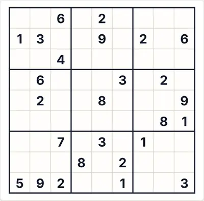 9×9</td></tr>
</table>

<b>Difficulté</b>

<table>
<tr><td align="center" valign="top">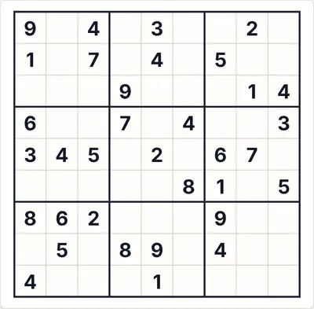 Facile</td><td align="center" valign="top"> Moyen</td><td align="center" valign="top">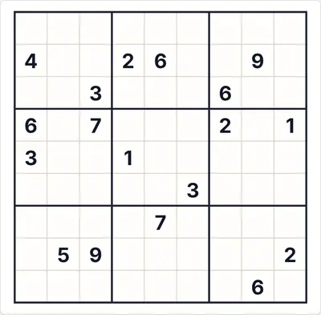 Difficile</td></tr>
</table>

<b>États de jeu</b>

<table>
<tr><td align="center" valign="top">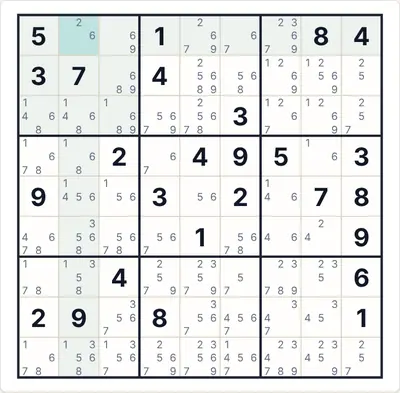 Notes auto (candidats)</td><td align="center" valign="top">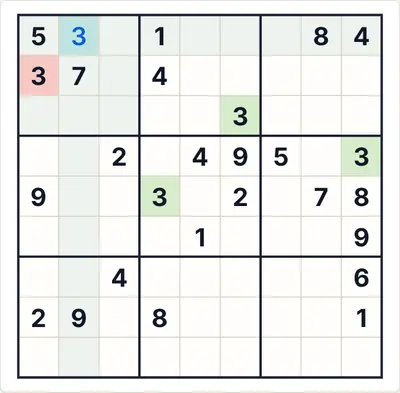 « Vérifier » avec un chiffre erroné (en rouge)</td><td align="center" valign="top">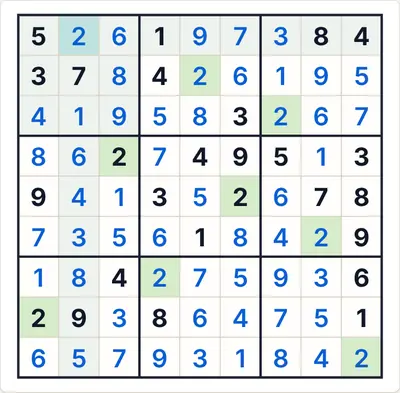 La solution complète</td></tr>
</table>

<b>Thèmes et appareils</b>

<table>
<tr><td align="center" valign="top">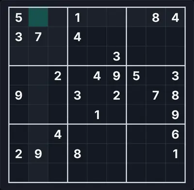 Thème sombre</td><td align="center" valign="top">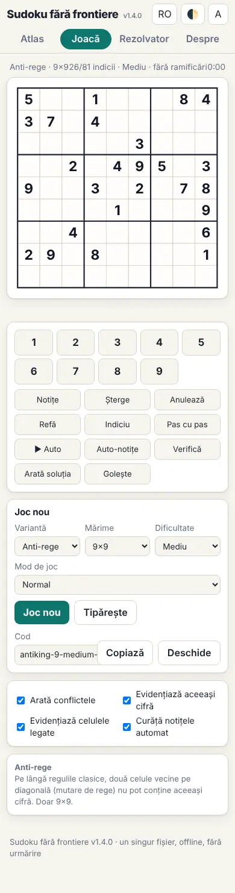 Téléphone (390 px)</td><td align="center" valign="top">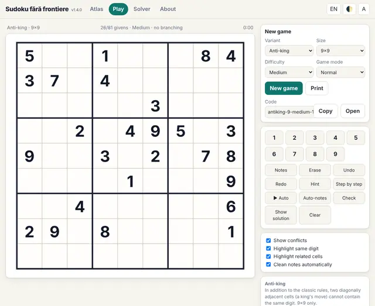 Interface en anglais</td></tr>
</table>

<b>Panneau des règles dans le jeu</b>

<table>
<tr><td align="center" valign="top">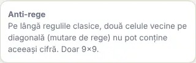 Les règles affichées à côté de la grille</td></tr>
</table>

#### 18. Sans consécutifs · Non-consecutive (`nonconsec`)

**Les voisins ne sont pas consécutifs.**

En plus des règles classiques, les cases voisines à l’horizontale ou à la verticale ne peuvent pas contenir des chiffres consécutifs (par ex. 4 à côté de 5). 9×9 et 6×6.

<table><tr><td align="center">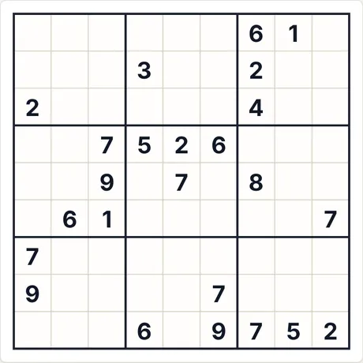 Puzzle de départ (9×9 · moyen · 24 indices)</td><td align="center">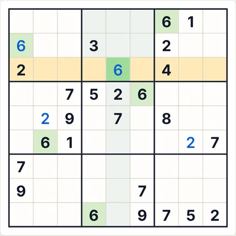 Après 4 étapes de « Pas à pas »</td></tr></table>

- **Dernière étape expliquée par l’application :** 6 (ligne 3, col. 5) : c’est la seule case de la ligne marquée où 6 peut aller.
- **Code du même puzzle :** `nonconsec-9-medium-749961353` (collez-le dans « Nouvelle partie → Code ») · effort du résolveur : sans embranchement

<b>Galerie complète : tous les types de captures</b>

<b>Atlas</b>

<table>
<tr><td align="center" valign="top">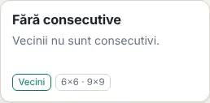 La carte dans l’Atlas</td><td align="center" valign="top">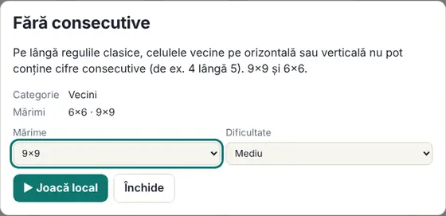 La fiche (s’ouvre d’un clic sur la carte)</td></tr>
</table>

<b>Tailles (niveau moyen)</b>

<table>
<tr><td align="center" valign="top">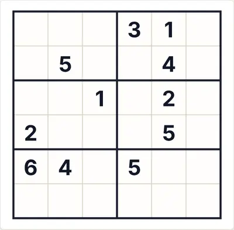 6×6</td><td align="center" valign="top">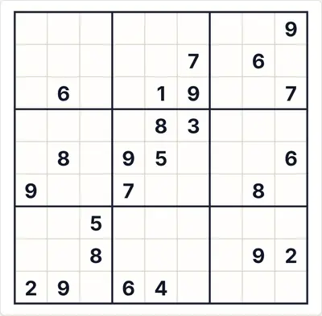 9×9</td></tr>
</table>

<b>Difficulté</b>

<table>
<tr><td align="center" valign="top">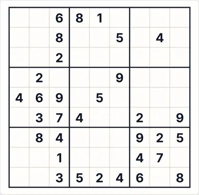 Facile</td><td align="center" valign="top"> Moyen</td><td align="center" valign="top">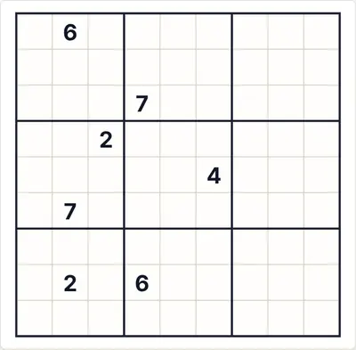 Difficile</td></tr>
</table>

<b>États de jeu</b>

<table>
<tr><td align="center" valign="top">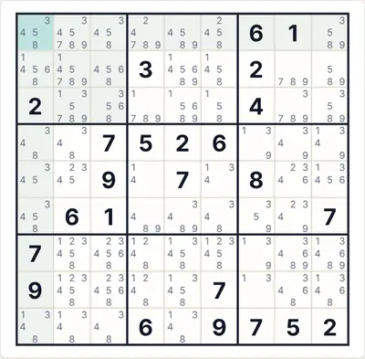 Notes auto (candidats)</td><td align="center" valign="top">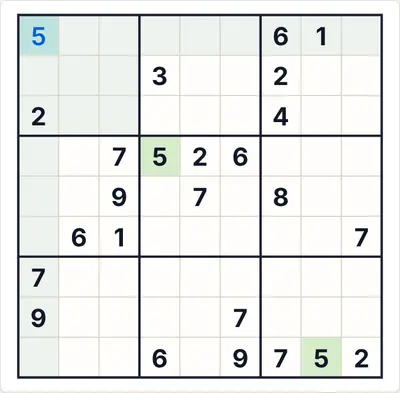 « Vérifier » avec un chiffre erroné (en rouge)</td><td align="center" valign="top">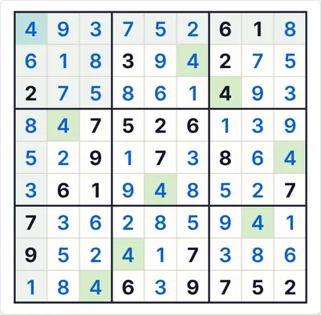 La solution complète</td></tr>
</table>

<b>Thèmes et appareils</b>

<table>
<tr><td align="center" valign="top">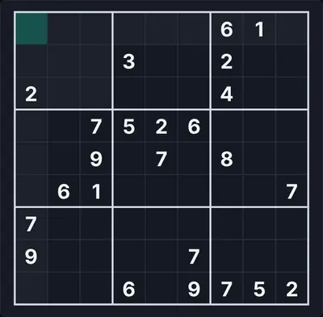 Thème sombre</td><td align="center" valign="top">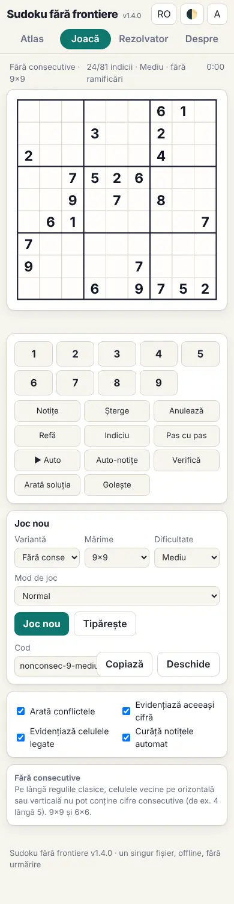 Téléphone (390 px)</td><td align="center" valign="top">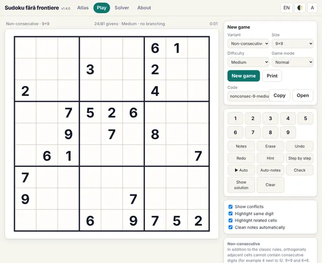 Interface en anglais</td></tr>
</table>

<b>Panneau des règles dans le jeu</b>

<table>
<tr><td align="center" valign="top">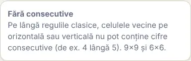 Les règles affichées à côté de la grille</td></tr>
</table>

#### 19. Miracle · Miracle (`miracle`)

**Anti-cavalier + anti-roi + sans consécutifs.**

Les trois restrictions ci-dessus, simultanément. La variante est extrêmement contraignante : les puzzles ont très peu d’indices donnés.

<table><tr><td align="center">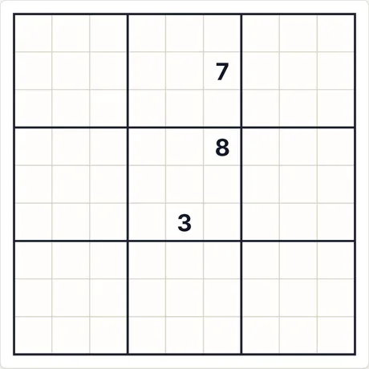 Puzzle de départ (9×9 · moyen · 3 indices)</td><td align="center">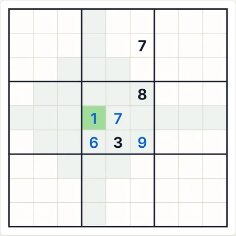 Après 4 étapes de « Pas à pas »</td></tr></table>

- **Dernière étape expliquée par l’application :** 1 (ligne 5, col. 4) : aucune déduction directe ; le chiffre est tiré de la solution unique (il faudrait faire une hypothèse).
- **Code du même puzzle :** `miracle-9-medium-1546367855` (collez-le dans « Nouvelle partie → Code ») · effort du résolveur : 113 embranchements

<b>Galerie complète : tous les types de captures</b>

<b>Atlas</b>

<table>
<tr><td align="center" valign="top">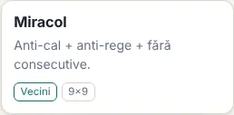 La carte dans l’Atlas</td><td align="center" valign="top">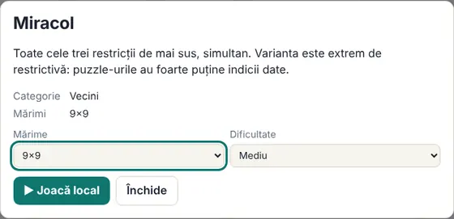 La fiche (s’ouvre d’un clic sur la carte)</td></tr>
</table>

<b>Tailles (niveau moyen)</b>

<table>
<tr><td align="center" valign="top">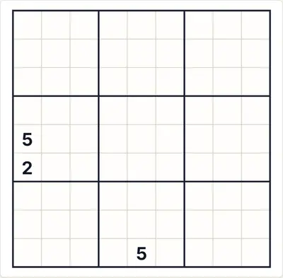 9×9</td></tr>
</table>

<b>Difficulté</b>

<table>
<tr><td align="center" valign="top">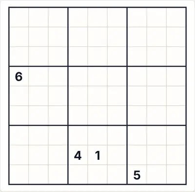 Facile</td><td align="center" valign="top"> Moyen</td><td align="center" valign="top">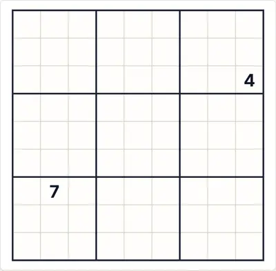 Difficile</td></tr>
</table>

<b>États de jeu</b>

<table>
<tr><td align="center" valign="top"> Notes auto (candidats)</td><td align="center" valign="top"> « Vérifier » avec un chiffre erroné (en rouge)</td><td align="center" valign="top"> La solution complète</td></tr>
</table>

<b>Thèmes et appareils</b>

<table>
<tr><td align="center" valign="top"> Thème sombre</td><td align="center" valign="top"> Téléphone (390 px)</td><td align="center" valign="top"> Interface en anglais</td></tr>
</table>

<b>Panneau des règles dans le jeu</b>

<table>
<tr><td align="center" valign="top"> Les règles affichées à côté de la grille</td></tr>
</table>

