# Catalogo: Linee (32)

[English](../en/07-linii.md) · [Română](../07-linii.md) · [Français](../fr/07-linii.md) · **Italiano** · [Español](../es/07-linii.md) · [Português](../pt/07-linii.md) · [Deutsch](../de/07-linii.md) · [Magyar](../hu/07-linii.md)

[← README](../../../README.it.md) · [Tutte le categorie](README.md)

[Dimensione e simboli](01-marime-si-simboluri.md) · [Regioni e gruppi](02-regiuni-si-grupuri.md) · [Vicini](03-vecini.md) · [Parità, punti, segni](04-paritate-puncte-semne.md) · [Somme](05-sume.md) · [Indizi sul bordo](06-indicii-pe-margine.md) · **Linee** · [Griglie composte](08-grile-compuse.md) · [Parenti stretti](09-rude-apropiate.md) · [Topologie e mosse fairy](10-topologii-si-mutari-fairy.md) · [Regole globali](11-reguli-globale.md) · [Indizi nelle celle](12-indicii-in-celule.md) · [Dimensioni superiori](13-dimensiuni-superioare.md)

---

_Le linee colorate attraversano le celle; le cifre su di esse seguono la regola della linea, descritta nella scheda._

#### 60. Termometri · Thermometers (`thermo`)

**Cifre crescenti dal bulbo.**

Su ogni termometro le cifre crescono strettamente a partire dal bulbo.

<table><tr><td align="center">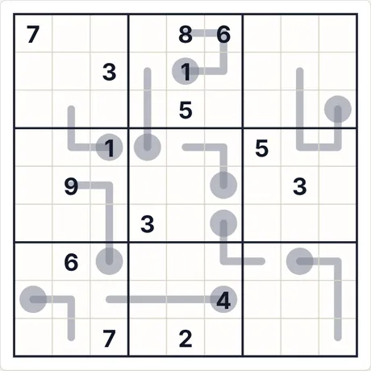 Puzzle iniziale (9×9 · medio · 15 indizi)</td><td align="center">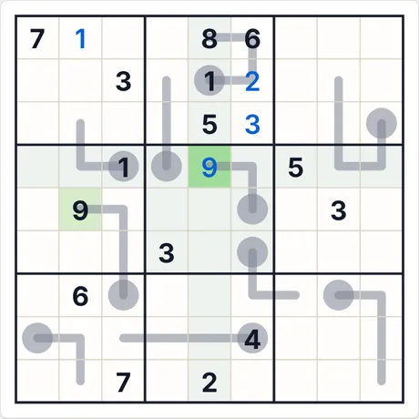 Dopo 4 passi di «Passo passo»</td></tr></table>

- **Ultimo passo spiegato dall'app:** 9 (riga 4, col. 5): deriva dalle regole specifiche della variante (indizi, somme, relazioni), combinate con le altre cifre.
- **Codice per lo stesso puzzle:** `thermo-9-medium-2425483238` (incollalo in «Nuova partita → Codice») · impegno del risolutore: 4 ramificazioni

<b>Galleria completa: tutti i tipi di schermata</b>

<b>Atlante</b>

<table>
<tr><td align="center" valign="top">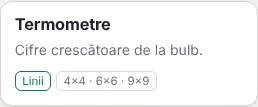 La scheda nell'Atlante</td><td align="center" valign="top">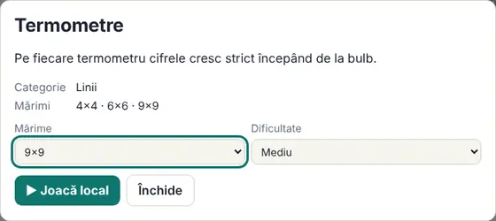 La scheda (si apre con un clic sulla carta)</td></tr>
</table>

<b>Dimensioni (livello medio)</b>

<table>
<tr><td align="center" valign="top">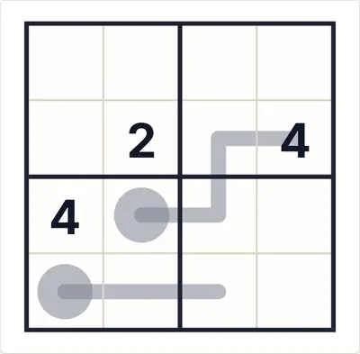 4×4</td><td align="center" valign="top">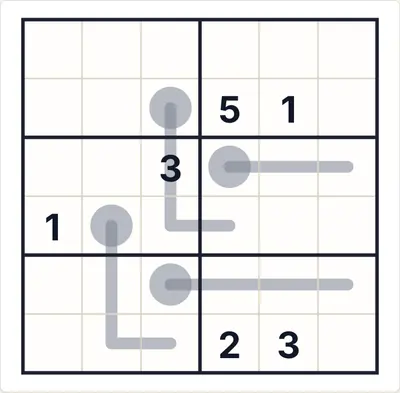 6×6</td><td align="center" valign="top">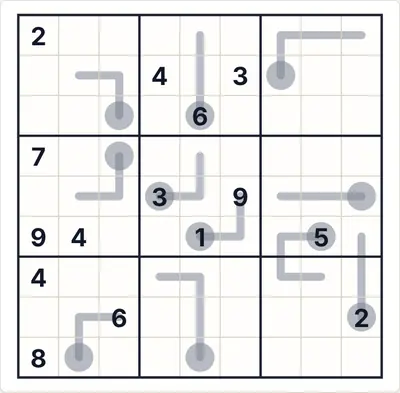 9×9</td></tr>
</table>

<b>Difficoltà</b>

<table>
<tr><td align="center" valign="top">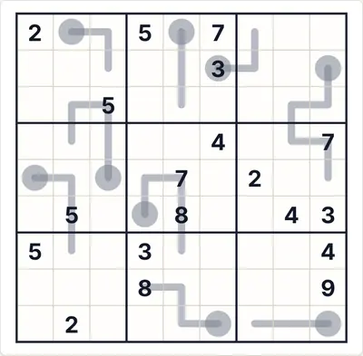 Facile</td><td align="center" valign="top"> Media</td><td align="center" valign="top">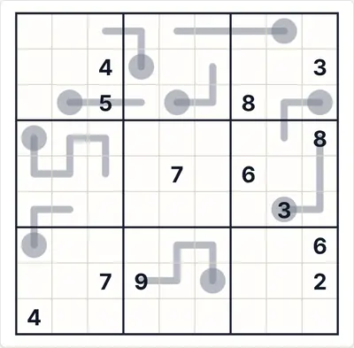 Difficile</td></tr>
</table>

<b>Stati di gioco</b>

<table>
<tr><td align="center" valign="top">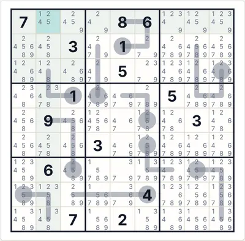 Appunti automatici (candidati)</td><td align="center" valign="top">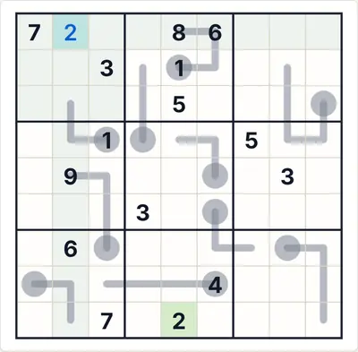 «Verifica» con una cifra sbagliata (rosso)</td><td align="center" valign="top">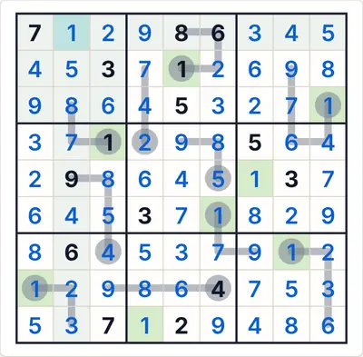 La soluzione completa</td></tr>
</table>

<b>Temi e dispositivi</b>

<table>
<tr><td align="center" valign="top">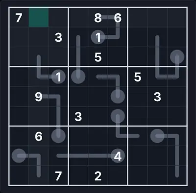 Tema scuro</td><td align="center" valign="top">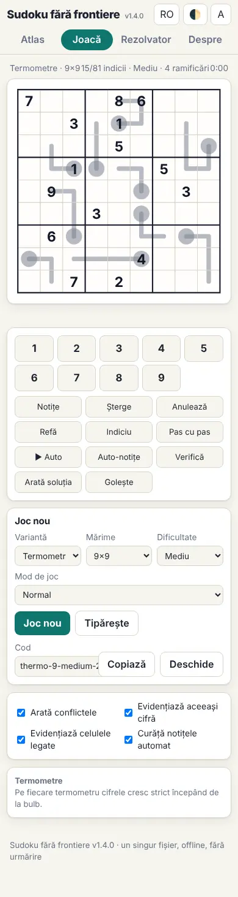 Telefono (390 px)</td><td align="center" valign="top">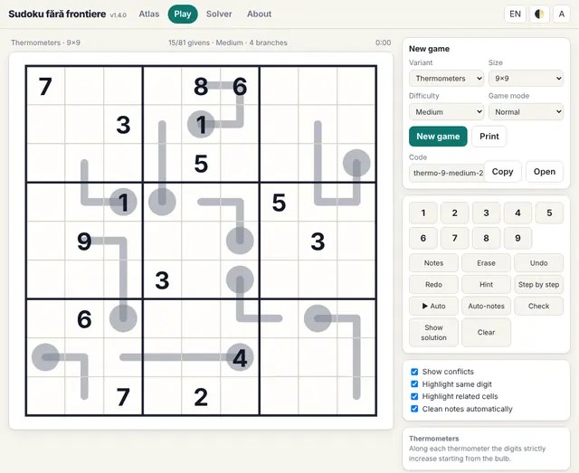 Interfaccia in inglese</td></tr>
</table>

<b>Il pannello delle regole nel gioco</b>

<table>
<tr><td align="center" valign="top">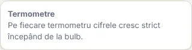 Le regole mostrate accanto alla tavola</td></tr>
</table>

#### 61. Frecce · Arrows (`arrow`)

**Cerchio = somma della freccia.**

La cifra nel cerchio di una freccia è uguale alla somma delle cifre sulla freccia.

<table><tr><td align="center">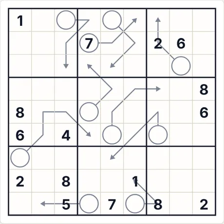 Puzzle iniziale (9×9 · medio · 16 indizi)</td><td align="center">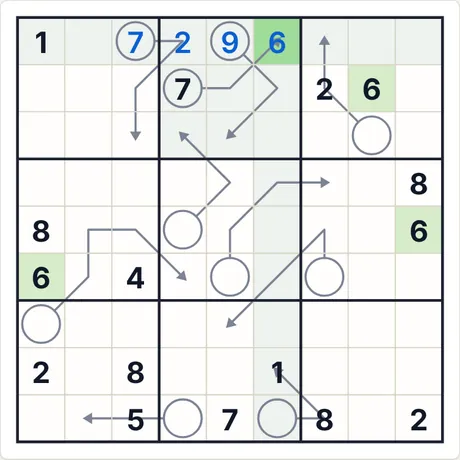 Dopo 4 passi di «Passo passo»</td></tr></table>

- **Ultimo passo spiegato dall'app:** 6 (riga 1, col. 6): deriva dalle regole specifiche della variante (indizi, somme, relazioni), combinate con le altre cifre.
- **Codice per lo stesso puzzle:** `arrow-9-medium-614115628` (incollalo in «Nuova partita → Codice») · impegno del risolutore: 1 ramificazione

<b>Galleria completa: tutti i tipi di schermata</b>

<b>Atlante</b>

<table>
<tr><td align="center" valign="top">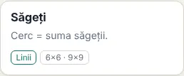 La scheda nell'Atlante</td><td align="center" valign="top">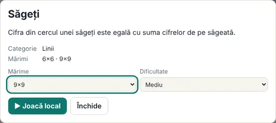 La scheda (si apre con un clic sulla carta)</td></tr>
</table>

<b>Dimensioni (livello medio)</b>

<table>
<tr><td align="center" valign="top">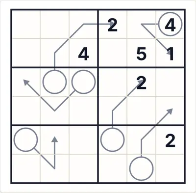 6×6</td><td align="center" valign="top">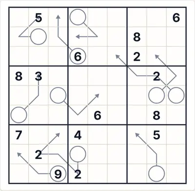 9×9</td></tr>
</table>

<b>Difficoltà</b>

<table>
<tr><td align="center" valign="top">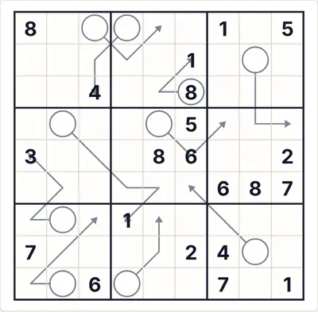 Facile</td><td align="center" valign="top"> Media</td><td align="center" valign="top">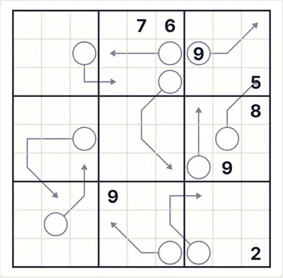 Difficile</td></tr>
</table>

<b>Stati di gioco</b>

<table>
<tr><td align="center" valign="top">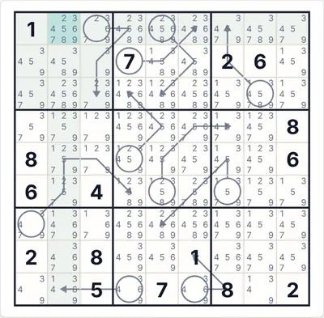 Appunti automatici (candidati)</td><td align="center" valign="top">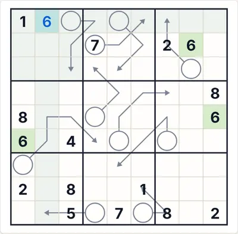 «Verifica» con una cifra sbagliata (rosso)</td><td align="center" valign="top">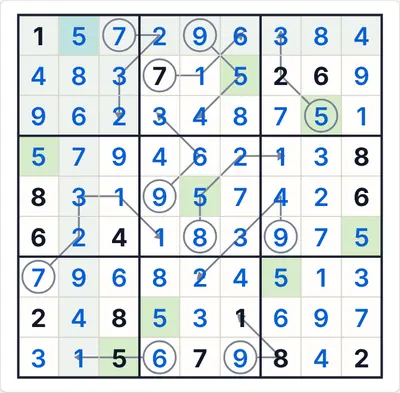 La soluzione completa</td></tr>
</table>

<b>Temi e dispositivi</b>

<table>
<tr><td align="center" valign="top">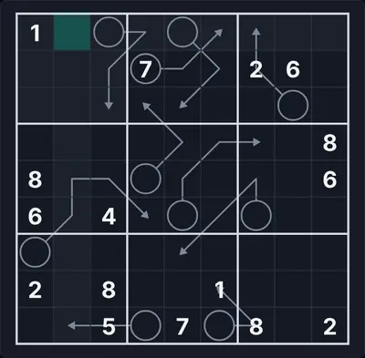 Tema scuro</td><td align="center" valign="top">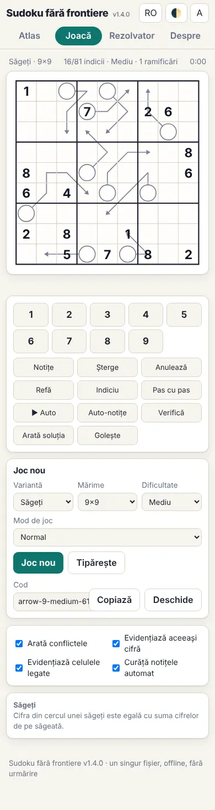 Telefono (390 px)</td><td align="center" valign="top">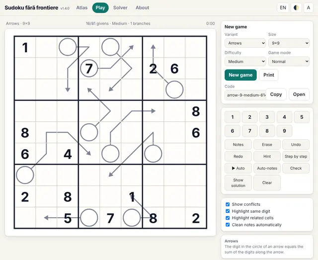 Interfaccia in inglese</td></tr>
</table>

<b>Il pannello delle regole nel gioco</b>

<table>
<tr><td align="center" valign="top"> Le regole mostrate accanto alla tavola</td></tr>
</table>

#### 62. Renban · Renban (`renban`)

**Cifre consecutive sulla linea.**

Sulla linea viola le cifre formano un insieme di numeri consecutivi, in qualsiasi ordine, senza ripetizioni.

<table><tr><td align="center">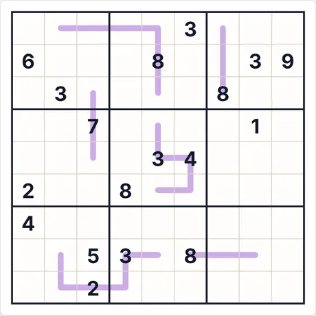 Puzzle iniziale (9×9 · medio · 18 indizi)</td><td align="center">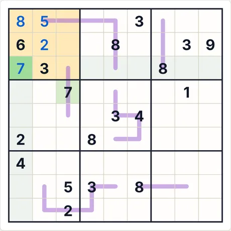 Dopo 4 passi di «Passo passo»</td></tr></table>

- **Ultimo passo spiegato dall'app:** 7 (riga 3, col. 1): è l'unica cella della regione evidenziata in cui può stare 7.
- **Codice per lo stesso puzzle:** `renban-9-medium-1333277870` (incollalo in «Nuova partita → Codice») · impegno del risolutore: 2 ramificazioni

<b>Galleria completa: tutti i tipi di schermata</b>

<b>Atlante</b>

<table>
<tr><td align="center" valign="top">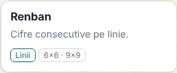 La scheda nell'Atlante</td><td align="center" valign="top">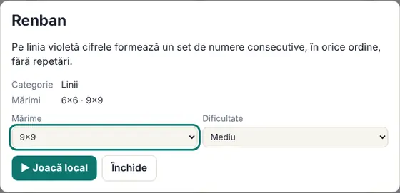 La scheda (si apre con un clic sulla carta)</td></tr>
</table>

<b>Dimensioni (livello medio)</b>

<table>
<tr><td align="center" valign="top">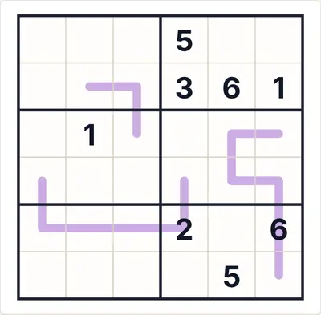 6×6</td><td align="center" valign="top">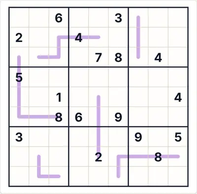 9×9</td></tr>
</table>

<b>Difficoltà</b>

<table>
<tr><td align="center" valign="top">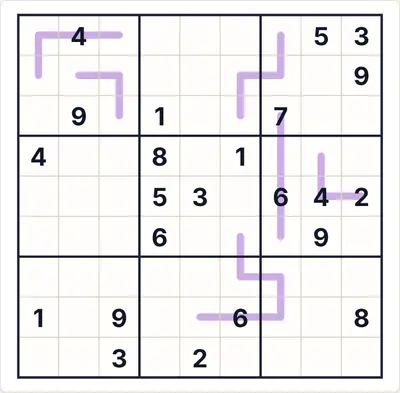 Facile</td><td align="center" valign="top"> Media</td><td align="center" valign="top">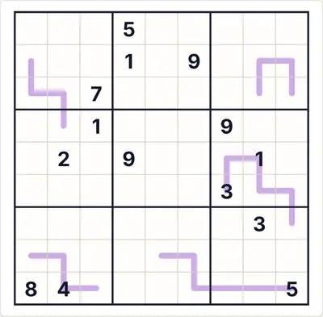 Difficile</td></tr>
</table>

<b>Stati di gioco</b>

<table>
<tr><td align="center" valign="top">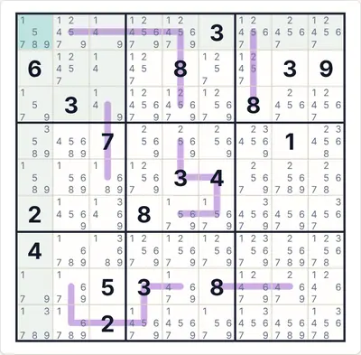 Appunti automatici (candidati)</td><td align="center" valign="top">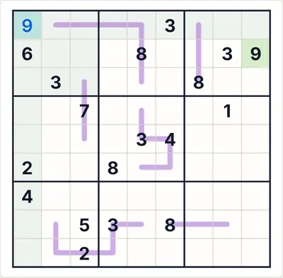 «Verifica» con una cifra sbagliata (rosso)</td><td align="center" valign="top">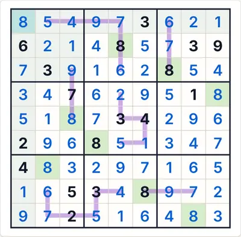 La soluzione completa</td></tr>
</table>

<b>Temi e dispositivi</b>

<table>
<tr><td align="center" valign="top">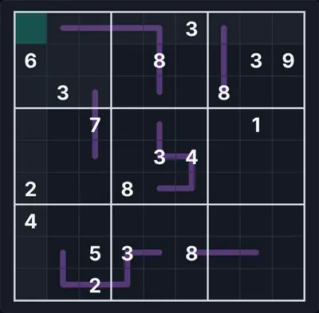 Tema scuro</td><td align="center" valign="top">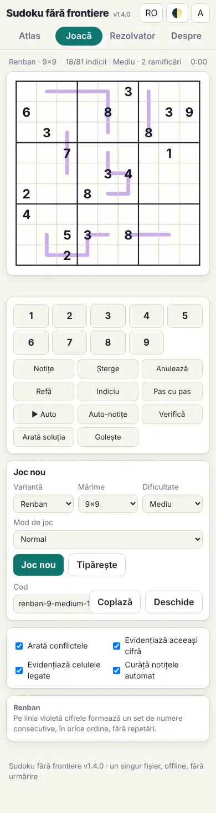 Telefono (390 px)</td><td align="center" valign="top">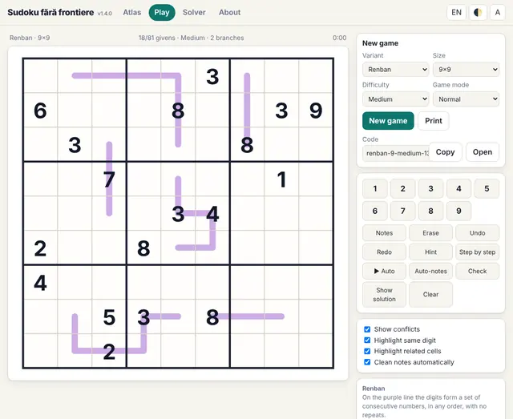 Interfaccia in inglese</td></tr>
</table>

<b>Il pannello delle regole nel gioco</b>

<table>
<tr><td align="center" valign="top">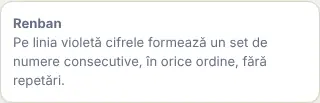 Le regole mostrate accanto alla tavola</td></tr>
</table>

#### 63. Sussurri tedeschi · German whispers (`whisper`)

**I vicini differiscono di almeno 5.**

Sulla linea verde, due cifre adiacenti differiscono di almeno 5. Solo 9×9.

<table><tr><td align="center">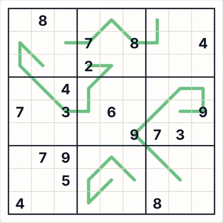 Puzzle iniziale (9×9 · medio · 18 indizi)</td><td align="center">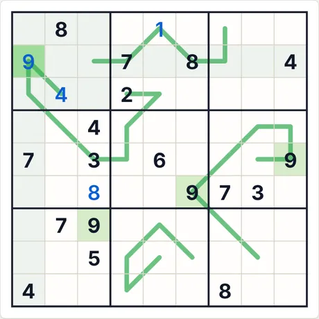 Dopo 4 passi di «Passo passo»</td></tr></table>

- **Ultimo passo spiegato dall'app:** 9 (riga 2, col. 1): deriva dalle regole specifiche della variante (indizi, somme, relazioni), combinate con le altre cifre.
- **Codice per lo stesso puzzle:** `whisper-9-medium-2904769413` (incollalo in «Nuova partita → Codice») · impegno del risolutore: 7 ramificazioni

<b>Galleria completa: tutti i tipi di schermata</b>

<b>Atlante</b>

<table>
<tr><td align="center" valign="top">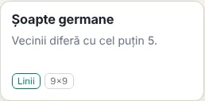 La scheda nell'Atlante</td><td align="center" valign="top">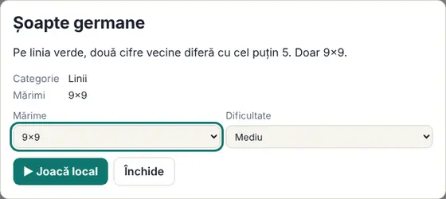 La scheda (si apre con un clic sulla carta)</td></tr>
</table>

<b>Dimensioni (livello medio)</b>

<table>
<tr><td align="center" valign="top">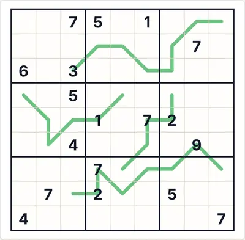 9×9</td></tr>
</table>

<b>Difficoltà</b>

<table>
<tr><td align="center" valign="top"> Facile</td><td align="center" valign="top"> Media</td><td align="center" valign="top"> Difficile</td></tr>
</table>

<b>Stati di gioco</b>

<table>
<tr><td align="center" valign="top"> Appunti automatici (candidati)</td><td align="center" valign="top"> «Verifica» con una cifra sbagliata (rosso)</td><td align="center" valign="top"> La soluzione completa</td></tr>
</table>

<b>Temi e dispositivi</b>

<table>
<tr><td align="center" valign="top"> Tema scuro</td><td align="center" valign="top"> Telefono (390 px)</td><td align="center" valign="top"> Interfaccia in inglese</td></tr>
</table>

<b>Il pannello delle regole nel gioco</b>

<table>
<tr><td align="center" valign="top"> Le regole mostrate accanto alla tavola</td></tr>
</table>

#### 64. Palindromo · Palindrome (`palindrome`)

**La linea si legge allo stesso modo nei due sensi.**

Le cifre sulla linea grigia formano un palindromo.

<table><tr><td align="center"> Puzzle iniziale (9×9 · medio · 21 indizi)</td><td align="center"> Dopo 4 passi di «Passo passo»</td></tr></table>

- **Ultimo passo spiegato dall'app:** 8 (riga 1, col. 4): deriva dalle regole specifiche della variante (indizi, somme, relazioni), combinate con le altre cifre.
- **Codice per lo stesso puzzle:** `palindrome-9-medium-1200688220` (incollalo in «Nuova partita → Codice») · impegno del risolutore: nessuna ramificazione

<b>Galleria completa: tutti i tipi di schermata</b>

<b>Atlante</b>

<table>
<tr><td align="center" valign="top"> La scheda nell'Atlante</td><td align="center" valign="top"> La scheda (si apre con un clic sulla carta)</td></tr>
</table>

<b>Dimensioni (livello medio)</b>

<table>
<tr><td align="center" valign="top"> 6×6</td><td align="center" valign="top"> 9×9</td></tr>
</table>

<b>Difficoltà</b>

<table>
<tr><td align="center" valign="top"> Facile</td><td align="center" valign="top"> Media</td><td align="center" valign="top"> Difficile</td></tr>
</table>

<b>Stati di gioco</b>

<table>
<tr><td align="center" valign="top"> Appunti automatici (candidati)</td><td align="center" valign="top"> «Verifica» con una cifra sbagliata (rosso)</td><td align="center" valign="top"> La soluzione completa</td></tr>
</table>

<b>Temi e dispositivi</b>

<table>
<tr><td align="center" valign="top"> Tema scuro</td><td align="center" valign="top"> Telefono (390 px)</td><td align="center" valign="top"> Interfaccia in inglese</td></tr>
</table>

<b>Il pannello delle regole nel gioco</b>

<table>
<tr><td align="center" valign="top"> Le regole mostrate accanto alla tavola</td></tr>
</table>

#### 65. Tra le linee · Between lines (`between`)

**L'interno sta tra le estremità.**

Le cifre sulla linea, comprese tra i due cerchi, sono strettamente comprese tra le cifre nei cerchi.

<table><tr><td align="center"> Puzzle iniziale (9×9 · medio · 18 indizi)</td><td align="center"> Dopo 4 passi di «Passo passo»</td></tr></table>

- **Ultimo passo spiegato dall'app:** 9 (riga 2, col. 8): deriva dalle regole specifiche della variante (indizi, somme, relazioni), combinate con le altre cifre.
- **Codice per lo stesso puzzle:** `between-9-medium-990496850` (incollalo in «Nuova partita → Codice») · impegno del risolutore: 6 ramificazioni

<b>Galleria completa: tutti i tipi di schermata</b>

<b>Atlante</b>

<table>
<tr><td align="center" valign="top"> La scheda nell'Atlante</td><td align="center" valign="top"> La scheda (si apre con un clic sulla carta)</td></tr>
</table>

<b>Dimensioni (livello medio)</b>

<table>
<tr><td align="center" valign="top"> 6×6</td><td align="center" valign="top"> 9×9</td></tr>
</table>

<b>Difficoltà</b>

<table>
<tr><td align="center" valign="top"> Facile</td><td align="center" valign="top"> Media</td><td align="center" valign="top"> Difficile</td></tr>
</table>

<b>Stati di gioco</b>

<table>
<tr><td align="center" valign="top"> Appunti automatici (candidati)</td><td align="center" valign="top"> «Verifica» con una cifra sbagliata (rosso)</td><td align="center" valign="top"> La soluzione completa</td></tr>
</table>

<b>Temi e dispositivi</b>

<table>
<tr><td align="center" valign="top"> Tema scuro</td><td align="center" valign="top"> Telefono (390 px)</td><td align="center" valign="top"> Interfaccia in inglese</td></tr>
</table>

<b>Il pannello delle regole nel gioco</b>

<table>
<tr><td align="center" valign="top"> Le regole mostrate accanto alla tavola</td></tr>
</table>

#### 66. Linee entropiche · Entropic lines (`entropic`)

**Bassa / media / alta.**

Sulla linea arancione, tre celle consecutive qualsiasi contengono una cifra ciascuna da ogni terzo dell'intervallo (nel 9×9: 1–3, 4–6, 7–9).

<table><tr><td align="center"> Puzzle iniziale (9×9 · medio · 18 indizi)</td><td align="center"> Dopo 4 passi di «Passo passo»</td></tr></table>

- **Ultimo passo spiegato dall'app:** 6 (riga 9, col. 8): deriva dalle regole specifiche della variante (indizi, somme, relazioni), combinate con le altre cifre.
- **Codice per lo stesso puzzle:** `entropic-9-medium-749257994` (incollalo in «Nuova partita → Codice») · impegno del risolutore: 3 ramificazioni

<b>Galleria completa: tutti i tipi di schermata</b>

<b>Atlante</b>

<table>
<tr><td align="center" valign="top"> La scheda nell'Atlante</td><td align="center" valign="top"> La scheda (si apre con un clic sulla carta)</td></tr>
</table>

<b>Dimensioni (livello medio)</b>

<table>
<tr><td align="center" valign="top"> 6×6</td><td align="center" valign="top"> 9×9</td></tr>
</table>

<b>Difficoltà</b>

<table>
<tr><td align="center" valign="top"> Facile</td><td align="center" valign="top"> Media</td><td align="center" valign="top"> Difficile</td></tr>
</table>

<b>Stati di gioco</b>

<table>
<tr><td align="center" valign="top"> Appunti automatici (candidati)</td><td align="center" valign="top"> «Verifica» con una cifra sbagliata (rosso)</td><td align="center" valign="top"> La soluzione completa</td></tr>
</table>

<b>Temi e dispositivi</b>

<table>
<tr><td align="center" valign="top"> Tema scuro</td><td align="center" valign="top"> Telefono (390 px)</td><td align="center" valign="top"> Interfaccia in inglese</td></tr>
</table>

<b>Il pannello delle regole nel gioco</b>

<table>
<tr><td align="center" valign="top"> Le regole mostrate accanto alla tavola</td></tr>
</table>

#### 67. Linee modulari · Modular lines (`modular`)

**Resti diversi modulo 3.**

Sulla linea turchese, tre celle consecutive qualsiasi hanno resti diversi nella divisione per 3.

<table><tr><td align="center"> Puzzle iniziale (9×9 · medio · 18 indizi)</td><td align="center"> Dopo 4 passi di «Passo passo»</td></tr></table>

- **Ultimo passo spiegato dall'app:** 2 (riga 4, col. 9): è l'unica cella della riga evidenziata in cui può stare 2.
- **Codice per lo stesso puzzle:** `modular-9-medium-109391293` (incollalo in «Nuova partita → Codice») · impegno del risolutore: 21 ramificazioni

<b>Galleria completa: tutti i tipi di schermata</b>

<b>Atlante</b>

<table>
<tr><td align="center" valign="top"> La scheda nell'Atlante</td><td align="center" valign="top"> La scheda (si apre con un clic sulla carta)</td></tr>
</table>

<b>Dimensioni (livello medio)</b>

<table>
<tr><td align="center" valign="top"> 6×6</td><td align="center" valign="top"> 9×9</td></tr>
</table>

<b>Difficoltà</b>

<table>
<tr><td align="center" valign="top"> Facile</td><td align="center" valign="top"> Media</td><td align="center" valign="top"> Difficile</td></tr>
</table>

<b>Stati di gioco</b>

<table>
<tr><td align="center" valign="top"> Appunti automatici (candidati)</td><td align="center" valign="top"> «Verifica» con una cifra sbagliata (rosso)</td><td align="center" valign="top"> La soluzione completa</td></tr>
</table>

<b>Temi e dispositivi</b>

<table>
<tr><td align="center" valign="top"> Tema scuro</td><td align="center" valign="top"> Telefono (390 px)</td><td align="center" valign="top"> Interfaccia in inglese</td></tr>
</table>

<b>Il pannello delle regole nel gioco</b>

<table>
<tr><td align="center" valign="top"> Le regole mostrate accanto alla tavola</td></tr>
</table>

#### 68. Sussurri olandesi · Dutch whispers (`dutch`)

**I vicini differiscono di almeno 4.**

Sulla linea verde, due cifre adiacenti qualsiasi differiscono di almeno 4 (nei sussurri tedeschi la soglia è 5). La linea può passare in diagonale. Le cifre possono ripetersi se non si trovano nella stessa riga, colonna o riquadro. Solo 9×9.

<table><tr><td align="center"> Puzzle iniziale (9×9 · medio · 19 indizi)</td><td align="center"> Dopo 4 passi di «Passo passo»</td></tr></table>

- **Ultimo passo spiegato dall'app:** 4 (riga 2, col. 1): deriva dalle regole specifiche della variante (indizi, somme, relazioni), combinate con le altre cifre.
- **Codice per lo stesso puzzle:** `dutch-9-medium-4257656518` (incollalo in «Nuova partita → Codice») · impegno del risolutore: 1 ramificazione

<b>Galleria completa: tutti i tipi di schermata</b>

<b>Atlante</b>

<table>
<tr><td align="center" valign="top"> La scheda nell'Atlante</td><td align="center" valign="top"> La scheda (si apre con un clic sulla carta)</td></tr>
</table>

<b>Dimensioni (livello medio)</b>

<table>
<tr><td align="center" valign="top"> 9×9</td></tr>
</table>

<b>Difficoltà</b>

<table>
<tr><td align="center" valign="top"> Facile</td><td align="center" valign="top"> Media</td><td align="center" valign="top"> Difficile</td></tr>
</table>

<b>Stati di gioco</b>

<table>
<tr><td align="center" valign="top"> Appunti automatici (candidati)</td><td align="center" valign="top"> «Verifica» con una cifra sbagliata (rosso)</td><td align="center" valign="top"> La soluzione completa</td></tr>
</table>

<b>Temi e dispositivi</b>

<table>
<tr><td align="center" valign="top"> Tema scuro</td><td align="center" valign="top"> Telefono (390 px)</td><td align="center" valign="top"> Interfaccia in inglese</td></tr>
</table>

<b>Il pannello delle regole nel gioco</b>

<table>
<tr><td align="center" valign="top"> Le regole mostrate accanto alla tavola</td></tr>
</table>

#### 69. Nabner · Nabner (`nabner`)

**Nessuna ripetizione e nessun consecutivo sulla linea.**

Su una linea marrone nessuna cifra si ripete e nessuna coppia di cifre sulla linea (non solo adiacenti) è formata da numeri consecutivi. È l'opposto di Renban: da qui il nome.

<table><tr><td align="center"> Puzzle iniziale (9×9 · medio · 21 indizi)</td><td align="center"> Dopo 4 passi di «Passo passo»</td></tr></table>

- **Ultimo passo spiegato dall'app:** 8 (riga 5, col. 8): è l'unica cella della riga evidenziata in cui può stare 8.
- **Codice per lo stesso puzzle:** `nabner-9-medium-1410854542` (incollalo in «Nuova partita → Codice») · impegno del risolutore: 1 ramificazione

<b>Galleria completa: tutti i tipi di schermata</b>

<b>Atlante</b>

<table>
<tr><td align="center" valign="top"> La scheda nell'Atlante</td><td align="center" valign="top"> La scheda (si apre con un clic sulla carta)</td></tr>
</table>

<b>Dimensioni (livello medio)</b>

<table>
<tr><td align="center" valign="top"> 6×6</td><td align="center" valign="top"> 9×9</td></tr>
</table>

<b>Difficoltà</b>

<table>
<tr><td align="center" valign="top"> Facile</td><td align="center" valign="top"> Media</td><td align="center" valign="top"> Difficile</td></tr>
</table>

<b>Stati di gioco</b>

<table>
<tr><td align="center" valign="top"> Appunti automatici (candidati)</td><td align="center" valign="top"> «Verifica» con una cifra sbagliata (rosso)</td><td align="center" valign="top"> La soluzione completa</td></tr>
</table>

<b>Temi e dispositivi</b>

<table>
<tr><td align="center" valign="top"> Tema scuro</td><td align="center" valign="top"> Telefono (390 px)</td><td align="center" valign="top"> Interfaccia in inglese</td></tr>
</table>

<b>Il pannello delle regole nel gioco</b>

<table>
<tr><td align="center" valign="top"> Le regole mostrate accanto alla tavola</td></tr>
</table>

#### 70. Termometro lento · Slow thermometer (`slowthermo`)

**Le cifre non diminuiscono dal bulbo.**

Su ogni termometro lento le cifre crescono o restano uguali a partire dal bulbo; due cifre uguali possono comparire solo in celle che non condividono una riga, una colonna o un riquadro (ad esempio in diagonale). I termometri possono passare in diagonale.

<table><tr><td align="center"> Puzzle iniziale (9×9 · medio · 18 indizi)</td><td align="center"> Dopo 4 passi di «Passo passo»</td></tr></table>

- **Ultimo passo spiegato dall'app:** 9 (riga 2, col. 3): deriva dalle regole specifiche della variante (indizi, somme, relazioni), combinate con le altre cifre.
- **Codice per lo stesso puzzle:** `slowthermo-9-medium-788837339` (incollalo in «Nuova partita → Codice») · impegno del risolutore: 4 ramificazioni

<b>Galleria completa: tutti i tipi di schermata</b>

<b>Atlante</b>

<table>
<tr><td align="center" valign="top"> La scheda nell'Atlante</td><td align="center" valign="top"> La scheda (si apre con un clic sulla carta)</td></tr>
</table>

<b>Dimensioni (livello medio)</b>

<table>
<tr><td align="center" valign="top"> 6×6</td><td align="center" valign="top"> 9×9</td></tr>
</table>

<b>Difficoltà</b>

<table>
<tr><td align="center" valign="top"> Facile</td><td align="center" valign="top"> Media</td><td align="center" valign="top"> Difficile</td></tr>
</table>

<b>Stati di gioco</b>

<table>
<tr><td align="center" valign="top"> Appunti automatici (candidati)</td><td align="center" valign="top"> «Verifica» con una cifra sbagliata (rosso)</td><td align="center" valign="top"> La soluzione completa</td></tr>
</table>

<b>Temi e dispositivi</b>

<table>
<tr><td align="center" valign="top"> Tema scuro</td><td align="center" valign="top"> Telefono (390 px)</td><td align="center" valign="top"> Interfaccia in inglese</td></tr>
</table>

<b>Il pannello delle regole nel gioco</b>

<table>
<tr><td align="center" valign="top"> Le regole mostrate accanto alla tavola</td></tr>
</table>

#### 71. Linea di parità · Parity line (`parityline`)

**La parità si alterna.**

Sulla linea gialla, due cifre adiacenti hanno sempre parità diversa: pari, dispari, pari… o viceversa. Convenzione: questa è la variante «alternata»; la variante con la stessa parità è la scheda separata «Linea di stessa parità».

<table><tr><td align="center"> Puzzle iniziale (9×9 · medio · 19 indizi)</td><td align="center"> Dopo 4 passi di «Passo passo»</td></tr></table>

- **Ultimo passo spiegato dall'app:** 4 (riga 1, col. 5): deriva dalle regole specifiche della variante (indizi, somme, relazioni), combinate con le altre cifre.
- **Codice per lo stesso puzzle:** `parityline-9-medium-1881226032` (incollalo in «Nuova partita → Codice») · impegno del risolutore: nessuna ramificazione

<b>Galleria completa: tutti i tipi di schermata</b>

<b>Atlante</b>

<table>
<tr><td align="center" valign="top"> La scheda nell'Atlante</td><td align="center" valign="top"> La scheda (si apre con un clic sulla carta)</td></tr>
</table>

<b>Dimensioni (livello medio)</b>

<table>
<tr><td align="center" valign="top"> 6×6</td><td align="center" valign="top"> 9×9</td></tr>
</table>

<b>Difficoltà</b>

<table>
<tr><td align="center" valign="top"> Facile</td><td align="center" valign="top"> Media</td><td align="center" valign="top"> Difficile</td></tr>
</table>

<b>Stati di gioco</b>

<table>
<tr><td align="center" valign="top"> Appunti automatici (candidati)</td><td align="center" valign="top"> «Verifica» con una cifra sbagliata (rosso)</td><td align="center" valign="top"> La soluzione completa</td></tr>
</table>

<b>Temi e dispositivi</b>

<table>
<tr><td align="center" valign="top"> Tema scuro</td><td align="center" valign="top"> Telefono (390 px)</td><td align="center" valign="top"> Interfaccia in inglese</td></tr>
</table>

<b>Il pannello delle regole nel gioco</b>

<table>
<tr><td align="center" valign="top"> Le regole mostrate accanto alla tavola</td></tr>
</table>

#### 72. Linea di stessa parità · Same-parity line (`sameparity`)

**Tutte le cifre adiacenti hanno la stessa parità.**

Sulla linea indaco, due cifre adiacenti hanno la stessa parità: l'intera linea è o solo di cifre pari o solo di cifre dispari (non si dice quale).

<table><tr><td align="center"> Puzzle iniziale (9×9 · medio · 19 indizi)</td><td align="center"> Dopo 4 passi di «Passo passo»</td></tr></table>

- **Ultimo passo spiegato dall'app:** 2 (riga 6, col. 2): deriva dalle regole specifiche della variante (indizi, somme, relazioni), combinate con le altre cifre.
- **Codice per lo stesso puzzle:** `sameparity-9-medium-1080309129` (incollalo in «Nuova partita → Codice») · impegno del risolutore: 2 ramificazioni

<b>Galleria completa: tutti i tipi di schermata</b>

<b>Atlante</b>

<table>
<tr><td align="center" valign="top"> La scheda nell'Atlante</td><td align="center" valign="top"> La scheda (si apre con un clic sulla carta)</td></tr>
</table>

<b>Dimensioni (livello medio)</b>

<table>
<tr><td align="center" valign="top"> 6×6</td><td align="center" valign="top"> 9×9</td></tr>
</table>

<b>Difficoltà</b>

<table>
<tr><td align="center" valign="top"> Facile</td><td align="center" valign="top"> Media</td><td align="center" valign="top"> Difficile</td></tr>
</table>

<b>Stati di gioco</b>

<table>
<tr><td align="center" valign="top"> Appunti automatici (candidati)</td><td align="center" valign="top"> «Verifica» con una cifra sbagliata (rosso)</td><td align="center" valign="top"> La soluzione completa</td></tr>
</table>

<b>Temi e dispositivi</b>

<table>
<tr><td align="center" valign="top"> Tema scuro</td><td align="center" valign="top"> Telefono (390 px)</td><td align="center" valign="top"> Interfaccia in inglese</td></tr>
</table>

<b>Il pannello delle regole nel gioco</b>

<table>
<tr><td align="center" valign="top"> Le regole mostrate accanto alla tavola</td></tr>
</table>

#### 73. Lockout · Lockout (`lockout`)

**Le estremità differiscono di ≥4; in mezzo, le cifre sono all'esterno.**

Alle estremità di una linea ci sono due rombi. Le cifre nei rombi differiscono di almeno 4, e tutte le cifre comprese tra di essi sono fuori dall'intervallo chiuso tra le due (minori del minimo o maggiori del massimo). Solo 9×9.

<table><tr><td align="center"> Puzzle iniziale (9×9 · medio · 19 indizi)</td><td align="center"> Dopo 4 passi di «Passo passo»</td></tr></table>

- **Ultimo passo spiegato dall'app:** 8 (riga 6, col. 1): deriva dalle regole specifiche della variante (indizi, somme, relazioni), combinate con le altre cifre.
- **Codice per lo stesso puzzle:** `lockout-9-medium-845235648` (incollalo in «Nuova partita → Codice») · impegno del risolutore: 23 ramificazioni

<b>Galleria completa: tutti i tipi di schermata</b>

<b>Atlante</b>

<table>
<tr><td align="center" valign="top"> La scheda nell'Atlante</td><td align="center" valign="top"> La scheda (si apre con un clic sulla carta)</td></tr>
</table>

<b>Dimensioni (livello medio)</b>

<table>
<tr><td align="center" valign="top"> 9×9</td></tr>
</table>

<b>Difficoltà</b>

<table>
<tr><td align="center" valign="top"> Facile</td><td align="center" valign="top"> Media</td><td align="center" valign="top"> Difficile</td></tr>
</table>

<b>Stati di gioco</b>

<table>
<tr><td align="center" valign="top"> Appunti automatici (candidati)</td><td align="center" valign="top"> «Verifica» con una cifra sbagliata (rosso)</td><td align="center" valign="top"> La soluzione completa</td></tr>
</table>

<b>Temi e dispositivi</b>

<table>
<tr><td align="center" valign="top"> Tema scuro</td><td align="center" valign="top"> Telefono (390 px)</td><td align="center" valign="top"> Interfaccia in inglese</td></tr>
</table>

<b>Il pannello delle regole nel gioco</b>

<table>
<tr><td align="center" valign="top"> Le regole mostrate accanto alla tavola</td></tr>
</table>

#### 74. Freccia doppia · Double arrow (`doublearrow`)

**La somma nel mezzo = la somma delle estremità.**

Una linea con un cerchio a entrambe le estremità: la somma delle cifre comprese tra i cerchi è uguale alla somma delle due cifre nei cerchi. Le cifre possono ripetersi sulla linea se non condividono un gruppo.

<table><tr><td align="center"> Puzzle iniziale (9×9 · medio · 16 indizi)</td><td align="center"> Dopo 4 passi di «Passo passo»</td></tr></table>

- **Ultimo passo spiegato dall'app:** 1 (riga 5, col. 2): nessuna deduzione diretta; la cifra è presa dalla soluzione unica (servirebbe un'ipotesi).
- **Codice per lo stesso puzzle:** `doublearrow-9-medium-1465837717` (incollalo in «Nuova partita → Codice») · impegno del risolutore: 3 ramificazioni

<b>Galleria completa: tutti i tipi di schermata</b>

<b>Atlante</b>

<table>
<tr><td align="center" valign="top"> La scheda nell'Atlante</td><td align="center" valign="top"> La scheda (si apre con un clic sulla carta)</td></tr>
</table>

<b>Dimensioni (livello medio)</b>

<table>
<tr><td align="center" valign="top"> 6×6</td><td align="center" valign="top"> 9×9</td></tr>
</table>

<b>Difficoltà</b>

<table>
<tr><td align="center" valign="top"> Facile</td><td align="center" valign="top"> Media</td><td align="center" valign="top"> Difficile</td></tr>
</table>

<b>Stati di gioco</b>

<table>
<tr><td align="center" valign="top"> Appunti automatici (candidati)</td><td align="center" valign="top"> «Verifica» con una cifra sbagliata (rosso)</td><td align="center" valign="top"> La soluzione completa</td></tr>
</table>

<b>Temi e dispositivi</b>

<table>
<tr><td align="center" valign="top"> Tema scuro</td><td align="center" valign="top"> Telefono (390 px)</td><td align="center" valign="top"> Interfaccia in inglese</td></tr>
</table>

<b>Il pannello delle regole nel gioco</b>

<table>
<tr><td align="center" valign="top"> Le regole mostrate accanto alla tavola</td></tr>
</table>

#### 75. Zipper · Zipper (`zipper`)

**Le coppie simmetriche sommano la cifra al centro.**

Su una linea con un numero dispari di celle, le cifre alla stessa distanza dalla cella centrale (contrassegnata con un cerchio) sommano la cifra centrale. Convenzione: tutte le coppie simmetriche danno la stessa somma, uguale al centro.

<table><tr><td align="center"> Puzzle iniziale (9×9 · medio · 19 indizi)</td><td align="center"> Dopo 4 passi di «Passo passo»</td></tr></table>

- **Ultimo passo spiegato dall'app:** 8 (riga 1, col. 4): deriva dalle regole specifiche della variante (indizi, somme, relazioni), combinate con le altre cifre.
- **Codice per lo stesso puzzle:** `zipper-9-medium-2998133029` (incollalo in «Nuova partita → Codice») · impegno del risolutore: nessuna ramificazione

<b>Galleria completa: tutti i tipi di schermata</b>

<b>Atlante</b>

<table>
<tr><td align="center" valign="top"> La scheda nell'Atlante</td><td align="center" valign="top"> La scheda (si apre con un clic sulla carta)</td></tr>
</table>

<b>Dimensioni (livello medio)</b>

<table>
<tr><td align="center" valign="top"> 6×6</td><td align="center" valign="top"> 9×9</td></tr>
</table>

<b>Difficoltà</b>

<table>
<tr><td align="center" valign="top"> Facile</td><td align="center" valign="top"> Media</td><td align="center" valign="top"> Difficile</td></tr>
</table>

<b>Stati di gioco</b>

<table>
<tr><td align="center" valign="top"> Appunti automatici (candidati)</td><td align="center" valign="top"> «Verifica» con una cifra sbagliata (rosso)</td><td align="center" valign="top"> La soluzione completa</td></tr>
</table>

<b>Temi e dispositivi</b>

<table>
<tr><td align="center" valign="top"> Tema scuro</td><td align="center" valign="top"> Telefono (390 px)</td><td align="center" valign="top"> Interfaccia in inglese</td></tr>
</table>

<b>Il pannello delle regole nel gioco</b>

<table>
<tr><td align="center" valign="top"> Le regole mostrate accanto alla tavola</td></tr>
</table>

#### 76. Linee con somme per regione · Region sum lines (`regionsum`)

**La somma in ogni riquadro attraversato è la stessa.**

Sulla linea rosa, la somma delle cifre di ogni riquadro attraversato dalla linea è la stessa per tutti i riquadri attraversati (la linea tocca almeno due riquadri). Si sommano tutte le celle della linea nel riquadro in questione. Convenzione: se la linea esce da un riquadro e vi rientra, le celle dei due passaggi si sommano insieme (nelle ricette pubblicate ogni segmento continuo si somma separatamente).

<table><tr><td align="center"> Puzzle iniziale (9×9 · medio · 19 indizi)</td><td align="center"> Dopo 4 passi di «Passo passo»</td></tr></table>

- **Ultimo passo spiegato dall'app:** 5 (riga 4, col. 7): tutte le altre cifre compaiono già tra le celle evidenziate (riga, colonna, regione o regola di vicinato).
- **Codice per lo stesso puzzle:** `regionsum-9-medium-518360475` (incollalo in «Nuova partita → Codice») · impegno del risolutore: 179 ramificazioni

<b>Galleria completa: tutti i tipi di schermata</b>

<b>Atlante</b>

<table>
<tr><td align="center" valign="top"> La scheda nell'Atlante</td><td align="center" valign="top"> La scheda (si apre con un clic sulla carta)</td></tr>
</table>

<b>Dimensioni (livello medio)</b>

<table>
<tr><td align="center" valign="top"> 6×6</td><td align="center" valign="top"> 9×9</td></tr>
</table>

<b>Difficoltà</b>

<table>
<tr><td align="center" valign="top"> Facile</td><td align="center" valign="top"> Media</td><td align="center" valign="top"> Difficile</td></tr>
</table>

<b>Stati di gioco</b>

<table>
<tr><td align="center" valign="top"> Appunti automatici (candidati)</td><td align="center" valign="top"> «Verifica» con una cifra sbagliata (rosso)</td><td align="center" valign="top"> La soluzione completa</td></tr>
</table>

<b>Temi e dispositivi</b>

<table>
<tr><td align="center" valign="top"> Tema scuro</td><td align="center" valign="top"> Telefono (390 px)</td><td align="center" valign="top"> Interfaccia in inglese</td></tr>
</table>

<b>Il pannello delle regole nel gioco</b>

<table>
<tr><td align="center" valign="top"> Le regole mostrate accanto alla tavola</td></tr>
</table>

#### 77. Freccia media · Average arrow (`avgarrow`)

**Il cerchio = la media delle cifre sulla freccia.**

La cifra nel cerchio è la media aritmetica delle cifre sulla freccia (somma delle cifre della freccia = il loro numero × la cifra nel cerchio). Il segno μ contrassegna la variante.

<table><tr><td align="center"> Puzzle iniziale (9×9 · medio · 18 indizi)</td><td align="center"> Dopo 4 passi di «Passo passo»</td></tr></table>

- **Ultimo passo spiegato dall'app:** 4 (riga 1, col. 5): deriva dalle regole specifiche della variante (indizi, somme, relazioni), combinate con le altre cifre.
- **Codice per lo stesso puzzle:** `avgarrow-9-medium-1756715097` (incollalo in «Nuova partita → Codice») · impegno del risolutore: nessuna ramificazione

<b>Galleria completa: tutti i tipi di schermata</b>

<b>Atlante</b>

<table>
<tr><td align="center" valign="top"> La scheda nell'Atlante</td><td align="center" valign="top"> La scheda (si apre con un clic sulla carta)</td></tr>
</table>

<b>Dimensioni (livello medio)</b>

<table>
<tr><td align="center" valign="top"> 6×6</td><td align="center" valign="top"> 9×9</td></tr>
</table>

<b>Difficoltà</b>

<table>
<tr><td align="center" valign="top"> Facile</td><td align="center" valign="top"> Media</td><td align="center" valign="top"> Difficile</td></tr>
</table>

<b>Stati di gioco</b>

<table>
<tr><td align="center" valign="top"> Appunti automatici (candidati)</td><td align="center" valign="top"> «Verifica» con una cifra sbagliata (rosso)</td><td align="center" valign="top"> La soluzione completa</td></tr>
</table>

<b>Temi e dispositivi</b>

<table>
<tr><td align="center" valign="top"> Tema scuro</td><td align="center" valign="top"> Telefono (390 px)</td><td align="center" valign="top"> Interfaccia in inglese</td></tr>
</table>

<b>Il pannello delle regole nel gioco</b>

<table>
<tr><td align="center" valign="top"> Le regole mostrate accanto alla tavola</td></tr>
</table>

#### 78. Freccia prodotto · Product arrow (`prodarrow`)

**Il cerchio = il prodotto delle cifre sulla freccia.**

La cifra nel cerchio è uguale al prodotto delle cifre sulla freccia. Il segno × contrassegna la variante. Le frecce hanno 2–3 celle.

<table><tr><td align="center"> Puzzle iniziale (9×9 · medio · 19 indizi)</td><td align="center"> Dopo 4 passi di «Passo passo»</td></tr></table>

- **Ultimo passo spiegato dall'app:** 7 (riga 1, col. 2): deriva dalle regole specifiche della variante (indizi, somme, relazioni), combinate con le altre cifre.
- **Codice per lo stesso puzzle:** `prodarrow-9-medium-480287737` (incollalo in «Nuova partita → Codice») · impegno del risolutore: 1 ramificazione

<b>Galleria completa: tutti i tipi di schermata</b>

<b>Atlante</b>

<table>
<tr><td align="center" valign="top"> La scheda nell'Atlante</td><td align="center" valign="top"> La scheda (si apre con un clic sulla carta)</td></tr>
</table>

<b>Dimensioni (livello medio)</b>

<table>
<tr><td align="center" valign="top"> 6×6</td><td align="center" valign="top"> 9×9</td></tr>
</table>

<b>Difficoltà</b>

<table>
<tr><td align="center" valign="top"> Facile</td><td align="center" valign="top"> Media</td><td align="center" valign="top"> Difficile</td></tr>
</table>

<b>Stati di gioco</b>

<table>
<tr><td align="center" valign="top"> Appunti automatici (candidati)</td><td align="center" valign="top"> «Verifica» con una cifra sbagliata (rosso)</td><td align="center" valign="top"> La soluzione completa</td></tr>
</table>

<b>Temi e dispositivi</b>

<table>
<tr><td align="center" valign="top"> Tema scuro</td><td align="center" valign="top"> Telefono (390 px)</td><td align="center" valign="top"> Interfaccia in inglese</td></tr>
</table>

<b>Il pannello delle regole nel gioco</b>

<table>
<tr><td align="center" valign="top"> Le regole mostrate accanto alla tavola</td></tr>
</table>

#### 79. Freccia «pillola» · Pill arrow (`pillarrow`)

**La pillola forma un numero di due cifre.**

Le due celle della pillola formano un numero di due cifre (decine, unità); la somma delle cifre sulla freccia è uguale a quel numero. Solo 9×9, quindi in questi puzzle la pillola inizia con 1–4.

<table><tr><td align="center"> Puzzle iniziale (9×9 · medio · 16 indizi)</td><td align="center"> Dopo 4 passi di «Passo passo»</td></tr></table>

- **Ultimo passo spiegato dall'app:** 2 (riga 3, col. 2): deriva dalle regole specifiche della variante (indizi, somme, relazioni), combinate con le altre cifre.
- **Codice per lo stesso puzzle:** `pillarrow-9-medium-790682527` (incollalo in «Nuova partita → Codice») · impegno del risolutore: 8 ramificazioni

<b>Galleria completa: tutti i tipi di schermata</b>

<b>Atlante</b>

<table>
<tr><td align="center" valign="top"> La scheda nell'Atlante</td><td align="center" valign="top"> La scheda (si apre con un clic sulla carta)</td></tr>
</table>

<b>Dimensioni (livello medio)</b>

<table>
<tr><td align="center" valign="top"> 9×9</td></tr>
</table>

<b>Difficoltà</b>

<table>
<tr><td align="center" valign="top"> Facile</td><td align="center" valign="top"> Media</td><td align="center" valign="top"> Difficile</td></tr>
</table>

<b>Stati di gioco</b>

<table>
<tr><td align="center" valign="top"> Appunti automatici (candidati)</td><td align="center" valign="top"> «Verifica» con una cifra sbagliata (rosso)</td><td align="center" valign="top"> La soluzione completa</td></tr>
</table>

<b>Temi e dispositivi</b>

<table>
<tr><td align="center" valign="top"> Tema scuro</td><td align="center" valign="top"> Telefono (390 px)</td><td align="center" valign="top"> Interfaccia in inglese</td></tr>
</table>

<b>Il pannello delle regole nel gioco</b>

<table>
<tr><td align="center" valign="top"> Le regole mostrate accanto alla tavola</td></tr>
</table>

#### 80. Nebbia · Fog of war (`fog`)

**Gli indizi compaiono man mano che risolvi.**

Gli indizi (termometri, frecce, Renban) sono nascosti nella nebbia. Una cella è illuminata se lei o un suo vicino (anche in diagonale) è dato o completato correttamente; un indizio diventa visibile quando almeno una delle sue celle è illuminata. Il puzzle è costruito in modo che, partendo solo da ciò che si vede, la semplice propagazione logica (candidati unici) possa proseguire fino in fondo. I conflitti sono mostrati solo per gli indizi visibili.

<table><tr><td align="center"> Puzzle iniziale (9×9 · medio · 19 indizi)</td><td align="center"> Dopo 4 passi di «Passo passo»</td></tr></table>

- **Ultimo passo spiegato dall'app:** 4 (riga 1, col. 2): deriva dalle regole specifiche della variante (indizi, somme, relazioni), combinate con le altre cifre.
- **Codice per lo stesso puzzle:** `fog-9-medium-2932433515` (incollalo in «Nuova partita → Codice») · impegno del risolutore: nessuna ramificazione

<b>Galleria completa: tutti i tipi di schermata</b>

<b>Atlante</b>

<table>
<tr><td align="center" valign="top"> La scheda nell'Atlante</td><td align="center" valign="top"> La scheda (si apre con un clic sulla carta)</td></tr>
</table>

<b>Dimensioni (livello medio)</b>

<table>
<tr><td align="center" valign="top"> 6×6</td><td align="center" valign="top"> 9×9</td></tr>
</table>

<b>Difficoltà</b>

<table>
<tr><td align="center" valign="top"> Facile</td><td align="center" valign="top"> Media</td><td align="center" valign="top"> Difficile</td></tr>
</table>

<b>Stati di gioco</b>

<table>
<tr><td align="center" valign="top"> Appunti automatici (candidati)</td><td align="center" valign="top"> «Verifica» con una cifra sbagliata (rosso)</td><td align="center" valign="top"> La soluzione completa</td></tr>
</table>

<b>Temi e dispositivi</b>

<table>
<tr><td align="center" valign="top"> Tema scuro</td><td align="center" valign="top"> Telefono (390 px)</td><td align="center" valign="top"> Interfaccia in inglese</td></tr>
</table>

<b>Il pannello delle regole nel gioco</b>

<table>
<tr><td align="center" valign="top"> Le regole mostrate accanto alla tavola</td></tr>
</table>

#### 81. Legato · Legato (`legato`)

**Le cifre adiacenti differiscono al massimo di 2.**

Oltre alle regole classiche, su una linea legato due cifre adiacenti differiscono al massimo di 2. La linea può passare anche in diagonale; due celle consecutive possono contenere la stessa cifra solo se non condividono riga, colonna o riquadro.

<table><tr><td align="center"> Puzzle iniziale (9×9 · medio · 19 indizi)</td><td align="center"> Dopo 4 passi di «Passo passo»</td></tr></table>

- **Ultimo passo spiegato dall'app:** 3 (riga 1, col. 8): deriva dalle regole specifiche della variante (indizi, somme, relazioni), combinate con le altre cifre.
- **Codice per lo stesso puzzle:** `legato-9-medium-3235032131` (incollalo in «Nuova partita → Codice») · impegno del risolutore: 2 ramificazioni

<b>Galleria completa: tutti i tipi di schermata</b>

<b>Atlante</b>

<table>
<tr><td align="center" valign="top"> La scheda nell'Atlante</td><td align="center" valign="top"> La scheda (si apre con un clic sulla carta)</td></tr>
</table>

<b>Dimensioni (livello medio)</b>

<table>
<tr><td align="center" valign="top"> 6×6</td><td align="center" valign="top"> 9×9</td></tr>
</table>

<b>Difficoltà</b>

<table>
<tr><td align="center" valign="top"> Facile</td><td align="center" valign="top"> Media</td><td align="center" valign="top"> Difficile</td></tr>
</table>

<b>Stati di gioco</b>

<table>
<tr><td align="center" valign="top"> Appunti automatici (candidati)</td><td align="center" valign="top"> «Verifica» con una cifra sbagliata (rosso)</td><td align="center" valign="top"> La soluzione completa</td></tr>
</table>

<b>Temi e dispositivi</b>

<table>
<tr><td align="center" valign="top"> Tema scuro</td><td align="center" valign="top"> Telefono (390 px)</td><td align="center" valign="top"> Interfaccia in inglese</td></tr>
</table>

<b>Il pannello delle regole nel gioco</b>

<table>
<tr><td align="center" valign="top"> Le regole mostrate accanto alla tavola</td></tr>
</table>

#### 82. Consonanza · Consonant line (`consonant`)

**I vicini differiscono di 2, 3 o 4.**

Oltre alle regole classiche, su una linea consonante due cifre adiacenti differiscono di 2, 3 o 4 (valore assoluto). La linea può passare anche in diagonale; due celle consecutive possono contenere la stessa cifra solo se non condividono riga, colonna o riquadro.

<table><tr><td align="center"> Puzzle iniziale (9×9 · medio · 19 indizi)</td><td align="center"> Dopo 4 passi di «Passo passo»</td></tr></table>

- **Ultimo passo spiegato dall'app:** 5 (riga 3, col. 2): nessuna deduzione diretta; la cifra è presa dalla soluzione unica (servirebbe un'ipotesi).
- **Codice per lo stesso puzzle:** `consonant-9-medium-1338825432` (incollalo in «Nuova partita → Codice») · impegno del risolutore: 588 ramificazioni

<b>Galleria completa: tutti i tipi di schermata</b>

<b>Atlante</b>

<table>
<tr><td align="center" valign="top"> La scheda nell'Atlante</td><td align="center" valign="top"> La scheda (si apre con un clic sulla carta)</td></tr>
</table>

<b>Dimensioni (livello medio)</b>

<table>
<tr><td align="center" valign="top"> 6×6</td><td align="center" valign="top"> 9×9</td></tr>
</table>

<b>Difficoltà</b>

<table>
<tr><td align="center" valign="top"> Facile</td><td align="center" valign="top"> Media</td><td align="center" valign="top"> Difficile</td></tr>
</table>

<b>Stati di gioco</b>

<table>
<tr><td align="center" valign="top"> Appunti automatici (candidati)</td><td align="center" valign="top"> «Verifica» con una cifra sbagliata (rosso)</td><td align="center" valign="top"> La soluzione completa</td></tr>
</table>

<b>Temi e dispositivi</b>

<table>
<tr><td align="center" valign="top"> Tema scuro</td><td align="center" valign="top"> Telefono (390 px)</td><td align="center" valign="top"> Interfaccia in inglese</td></tr>
</table>

<b>Il pannello delle regole nel gioco</b>

<table>
<tr><td align="center" valign="top"> Le regole mostrate accanto alla tavola</td></tr>
</table>

#### 83. Passo fisso · Fixed-step line (`fixstep`)

**I vicini differiscono esattamente di 3.**

Oltre alle regole classiche, su una linea a passo fisso due cifre adiacenti differiscono esattamente di 3 (valore assoluto). La linea può passare anche in diagonale; due celle consecutive possono contenere la stessa cifra solo se non condividono riga, colonna o riquadro.

<table><tr><td align="center"> Puzzle iniziale (9×9 · medio · 19 indizi)</td><td align="center"> Dopo 4 passi di «Passo passo»</td></tr></table>

- **Ultimo passo spiegato dall'app:** 7 (riga 1, col. 7): deriva dalle regole specifiche della variante (indizi, somme, relazioni), combinate con le altre cifre.
- **Codice per lo stesso puzzle:** `fixstep-9-medium-1995498385` (incollalo in «Nuova partita → Codice») · impegno del risolutore: nessuna ramificazione

<b>Galleria completa: tutti i tipi di schermata</b>

<b>Atlante</b>

<table>
<tr><td align="center" valign="top"> La scheda nell'Atlante</td><td align="center" valign="top"> La scheda (si apre con un clic sulla carta)</td></tr>
</table>

<b>Dimensioni (livello medio)</b>

<table>
<tr><td align="center" valign="top"> 6×6</td><td align="center" valign="top"> 9×9</td></tr>
</table>

<b>Difficoltà</b>

<table>
<tr><td align="center" valign="top"> Facile</td><td align="center" valign="top"> Media</td><td align="center" valign="top"> Difficile</td></tr>
</table>

<b>Stati di gioco</b>

<table>
<tr><td align="center" valign="top"> Appunti automatici (candidati)</td><td align="center" valign="top"> «Verifica» con una cifra sbagliata (rosso)</td><td align="center" valign="top"> La soluzione completa</td></tr>
</table>

<b>Temi e dispositivi</b>

<table>
<tr><td align="center" valign="top"> Tema scuro</td><td align="center" valign="top"> Telefono (390 px)</td><td align="center" valign="top"> Interfaccia in inglese</td></tr>
</table>

<b>Il pannello delle regole nel gioco</b>

<table>
<tr><td align="center" valign="top"> Le regole mostrate accanto alla tavola</td></tr>
</table>

#### 84. Linea complementare · Complementary line (`compline`)

**I vicini sommano N+1.**

Oltre alle regole classiche, su una linea complementare due cifre adiacenti sommano N+1 (nel 9×9: 10), quindi la linea alterna una cifra e il suo complemento. La linea può passare anche in diagonale; due celle consecutive possono contenere la stessa cifra solo se non condividono riga, colonna o riquadro.

<table><tr><td align="center"> Puzzle iniziale (9×9 · medio · 19 indizi)</td><td align="center"> Dopo 4 passi di «Passo passo»</td></tr></table>

- **Ultimo passo spiegato dall'app:** 6 (riga 1, col. 3): deriva dalle regole specifiche della variante (indizi, somme, relazioni), combinate con le altre cifre.
- **Codice per lo stesso puzzle:** `compline-9-medium-4153382526` (incollalo in «Nuova partita → Codice») · impegno del risolutore: nessuna ramificazione

<b>Galleria completa: tutti i tipi di schermata</b>

<b>Atlante</b>

<table>
<tr><td align="center" valign="top"> La scheda nell'Atlante</td><td align="center" valign="top"> La scheda (si apre con un clic sulla carta)</td></tr>
</table>

<b>Dimensioni (livello medio)</b>

<table>
<tr><td align="center" valign="top"> 6×6</td><td align="center" valign="top"> 9×9</td></tr>
</table>

<b>Difficoltà</b>

<table>
<tr><td align="center" valign="top"> Facile</td><td align="center" valign="top"> Media</td><td align="center" valign="top"> Difficile</td></tr>
</table>

<b>Stati di gioco</b>

<table>
<tr><td align="center" valign="top"> Appunti automatici (candidati)</td><td align="center" valign="top"> «Verifica» con una cifra sbagliata (rosso)</td><td align="center" valign="top"> La soluzione completa</td></tr>
</table>

<b>Temi e dispositivi</b>

<table>
<tr><td align="center" valign="top"> Tema scuro</td><td align="center" valign="top"> Telefono (390 px)</td><td align="center" valign="top"> Interfaccia in inglese</td></tr>
</table>

<b>Il pannello delle regole nel gioco</b>

<table>
<tr><td align="center" valign="top"> Le regole mostrate accanto alla tavola</td></tr>
</table>

#### 85. Zigzag · Zigzag (`zigzag`)

**Le cifre si alternano su–giù.**

Oltre alle regole classiche, su una linea zigzag le cifre vanno alternativamente su e giù (ogni cifra interna è o maggiore o minore di entrambi i vicini). La linea può passare anche in diagonale; due celle consecutive possono contenere la stessa cifra solo se non condividono riga, colonna o riquadro.

<table><tr><td align="center"> Puzzle iniziale (9×9 · medio · 19 indizi)</td><td align="center"> Dopo 4 passi di «Passo passo»</td></tr></table>

- **Ultimo passo spiegato dall'app:** 5 (riga 6, col. 4): nessuna deduzione diretta; la cifra è presa dalla soluzione unica (servirebbe un'ipotesi).
- **Codice per lo stesso puzzle:** `zigzag-9-medium-617420097` (incollalo in «Nuova partita → Codice») · impegno del risolutore: 7 ramificazioni

<b>Galleria completa: tutti i tipi di schermata</b>

<b>Atlante</b>

<table>
<tr><td align="center" valign="top"> La scheda nell'Atlante</td><td align="center" valign="top"> La scheda (si apre con un clic sulla carta)</td></tr>
</table>

<b>Dimensioni (livello medio)</b>

<table>
<tr><td align="center" valign="top"> 6×6</td><td align="center" valign="top"> 9×9</td></tr>
</table>

<b>Difficoltà</b>

<table>
<tr><td align="center" valign="top"> Facile</td><td align="center" valign="top"> Media</td><td align="center" valign="top"> Difficile</td></tr>
</table>

<b>Stati di gioco</b>

<table>
<tr><td align="center" valign="top"> Appunti automatici (candidati)</td><td align="center" valign="top"> «Verifica» con una cifra sbagliata (rosso)</td><td align="center" valign="top"> La soluzione completa</td></tr>
</table>

<b>Temi e dispositivi</b>

<table>
<tr><td align="center" valign="top"> Tema scuro</td><td align="center" valign="top"> Telefono (390 px)</td><td align="center" valign="top"> Interfaccia in inglese</td></tr>
</table>

<b>Il pannello delle regole nel gioco</b>

<table>
<tr><td align="center" valign="top"> Le regole mostrate accanto alla tavola</td></tr>
</table>

#### 86. Fibonacci · Fibonacci line (`fibonacci`)

**Ogni cifra è la somma delle due precedenti.**

Oltre alle regole classiche, su una linea Fibonacci (la freccia indica il verso) ogni cifra dopo le prime due è la somma delle due che la precedono. La linea può passare anche in diagonale; due celle consecutive possono contenere la stessa cifra solo se non condividono riga, colonna o riquadro.

<table><tr><td align="center"> Puzzle iniziale (9×9 · medio · 19 indizi)</td><td align="center"> Dopo 4 passi di «Passo passo»</td></tr></table>

- **Ultimo passo spiegato dall'app:** 7 (riga 2, col. 3): è l'unica cella della regione evidenziata in cui può stare 7.
- **Codice per lo stesso puzzle:** `fibonacci-9-medium-1388678989` (incollalo in «Nuova partita → Codice») · impegno del risolutore: nessuna ramificazione

<b>Galleria completa: tutti i tipi di schermata</b>

<b>Atlante</b>

<table>
<tr><td align="center" valign="top"> La scheda nell'Atlante</td><td align="center" valign="top"> La scheda (si apre con un clic sulla carta)</td></tr>
</table>

<b>Dimensioni (livello medio)</b>

<table>
<tr><td align="center" valign="top"> 6×6</td><td align="center" valign="top"> 9×9</td></tr>
</table>

<b>Difficoltà</b>

<table>
<tr><td align="center" valign="top"> Facile</td><td align="center" valign="top"> Media</td><td align="center" valign="top"> Difficile</td></tr>
</table>

<b>Stati di gioco</b>

<table>
<tr><td align="center" valign="top"> Appunti automatici (candidati)</td><td align="center" valign="top"> «Verifica» con una cifra sbagliata (rosso)</td><td align="center" valign="top"> La soluzione completa</td></tr>
</table>

<b>Temi e dispositivi</b>

<table>
<tr><td align="center" valign="top"> Tema scuro</td><td align="center" valign="top"> Telefono (390 px)</td><td align="center" valign="top"> Interfaccia in inglese</td></tr>
</table>

<b>Il pannello delle regole nel gioco</b>

<table>
<tr><td align="center" valign="top"> Le regole mostrate accanto alla tavola</td></tr>
</table>

#### 87. Gradini · Steps (`steps`)

**Le differenze con segno crescono.**

Oltre alle regole classiche, su una linea a gradini (la freccia indica il verso) la differenza tra due cifre adiacenti cresce da un passo al successivo, considerando le differenze con segno (a₃−a₂ > a₂−a₁): 1-2-4 e 9-5-3 sono ammessi, 4-3-1 no. La linea può passare anche in diagonale; due celle consecutive possono contenere la stessa cifra solo se non condividono riga, colonna o riquadro.

<table><tr><td align="center"> Puzzle iniziale (9×9 · medio · 19 indizi)</td><td align="center"> Dopo 4 passi di «Passo passo»</td></tr></table>

- **Ultimo passo spiegato dall'app:** 9 (riga 4, col. 6): deriva dalle regole specifiche della variante (indizi, somme, relazioni), combinate con le altre cifre.
- **Codice per lo stesso puzzle:** `steps-9-medium-320924889` (incollalo in «Nuova partita → Codice») · impegno del risolutore: 42 ramificazioni

<b>Galleria completa: tutti i tipi di schermata</b>

<b>Atlante</b>

<table>
<tr><td align="center" valign="top"> La scheda nell'Atlante</td><td align="center" valign="top"> La scheda (si apre con un clic sulla carta)</td></tr>
</table>

<b>Dimensioni (livello medio)</b>

<table>
<tr><td align="center" valign="top"> 6×6</td><td align="center" valign="top"> 9×9</td></tr>
</table>

<b>Difficoltà</b>

<table>
<tr><td align="center" valign="top"> Facile</td><td align="center" valign="top"> Media</td><td align="center" valign="top"> Difficile</td></tr>
</table>

<b>Stati di gioco</b>

<table>
<tr><td align="center" valign="top"> Appunti automatici (candidati)</td><td align="center" valign="top"> «Verifica» con una cifra sbagliata (rosso)</td><td align="center" valign="top"> La soluzione completa</td></tr>
</table>

<b>Temi e dispositivi</b>

<table>
<tr><td align="center" valign="top"> Tema scuro</td><td align="center" valign="top"> Telefono (390 px)</td><td align="center" valign="top"> Interfaccia in inglese</td></tr>
</table>

<b>Il pannello delle regole nel gioco</b>

<table>
<tr><td align="center" valign="top"> Le regole mostrate accanto alla tavola</td></tr>
</table>

#### 88. Progressione aritmetica · Arithmetic progression (`progression`)

**La differenza tra vicini è costante.**

Oltre alle regole classiche, su una linea in progressione aritmetica la differenza tra cifre adiacenti è la stessa su tutta la linea (crescente o decrescente). La linea può passare anche in diagonale; due celle consecutive possono contenere la stessa cifra solo se non condividono riga, colonna o riquadro.

<table><tr><td align="center"> Puzzle iniziale (9×9 · medio · 19 indizi)</td><td align="center"> Dopo 4 passi di «Passo passo»</td></tr></table>

- **Ultimo passo spiegato dall'app:** 1 (riga 1, col. 2): è l'unica cella della riga evidenziata in cui può stare 1.
- **Codice per lo stesso puzzle:** `progression-9-medium-1785969018` (incollalo in «Nuova partita → Codice») · impegno del risolutore: 5 ramificazioni

<b>Galleria completa: tutti i tipi di schermata</b>

<b>Atlante</b>

<table>
<tr><td align="center" valign="top"> La scheda nell'Atlante</td><td align="center" valign="top"> La scheda (si apre con un clic sulla carta)</td></tr>
</table>

<b>Dimensioni (livello medio)</b>

<table>
<tr><td align="center" valign="top"> 6×6</td><td align="center" valign="top"> 9×9</td></tr>
</table>

<b>Difficoltà</b>

<table>
<tr><td align="center" valign="top"> Facile</td><td align="center" valign="top"> Media</td><td align="center" valign="top"> Difficile</td></tr>
</table>

<b>Stati di gioco</b>

<table>
<tr><td align="center" valign="top"> Appunti automatici (candidati)</td><td align="center" valign="top"> «Verifica» con una cifra sbagliata (rosso)</td><td align="center" valign="top"> La soluzione completa</td></tr>
</table>

<b>Temi e dispositivi</b>

<table>
<tr><td align="center" valign="top"> Tema scuro</td><td align="center" valign="top"> Telefono (390 px)</td><td align="center" valign="top"> Interfaccia in inglese</td></tr>
</table>

<b>Il pannello delle regole nel gioco</b>

<table>
<tr><td align="center" valign="top"> Le regole mostrate accanto alla tavola</td></tr>
</table>

#### 89. Eco · Echo line (`echo`)

**La cifra si ripete ogni 3 celle.**

Oltre alle regole classiche, su una linea-eco la cella in posizione i e quella in posizione i+3 contengono la stessa cifra (lo schema si ripete ogni 3). La linea può passare anche in diagonale; due celle consecutive possono contenere la stessa cifra solo se non condividono riga, colonna o riquadro.

<table><tr><td align="center"> Puzzle iniziale (9×9 · medio · 19 indizi)</td><td align="center"> Dopo 4 passi di «Passo passo»</td></tr></table>

- **Ultimo passo spiegato dall'app:** 4 (riga 1, col. 1): deriva dalle regole specifiche della variante (indizi, somme, relazioni), combinate con le altre cifre.
- **Codice per lo stesso puzzle:** `echo-9-medium-1694119681` (incollalo in «Nuova partita → Codice») · impegno del risolutore: 1 ramificazione

<b>Galleria completa: tutti i tipi di schermata</b>

<b>Atlante</b>

<table>
<tr><td align="center" valign="top"> La scheda nell'Atlante</td><td align="center" valign="top"> La scheda (si apre con un clic sulla carta)</td></tr>
</table>

<b>Dimensioni (livello medio)</b>

<table>
<tr><td align="center" valign="top"> 6×6</td><td align="center" valign="top"> 9×9</td></tr>
</table>

<b>Difficoltà</b>

<table>
<tr><td align="center" valign="top"> Facile</td><td align="center" valign="top"> Media</td><td align="center" valign="top"> Difficile</td></tr>
</table>

<b>Stati di gioco</b>

<table>
<tr><td align="center" valign="top"> Appunti automatici (candidati)</td><td align="center" valign="top"> «Verifica» con una cifra sbagliata (rosso)</td><td align="center" valign="top"> La soluzione completa</td></tr>
</table>

<b>Temi e dispositivi</b>

<table>
<tr><td align="center" valign="top"> Tema scuro</td><td align="center" valign="top"> Telefono (390 px)</td><td align="center" valign="top"> Interfaccia in inglese</td></tr>
</table>

<b>Il pannello delle regole nel gioco</b>

<table>
<tr><td align="center" valign="top"> Le regole mostrate accanto alla tavola</td></tr>
</table>

#### 90. Linea divisibile · Divisible line (`divisible`)

**Il numero letto è divisibile per m.**

Oltre alle regole classiche, le cifre sulla linea, lette nel verso della freccia, formano un numero divisibile per m (m è indicato accanto alla linea, ad es. ÷7). Solo 9×9.

<table><tr><td align="center"> Puzzle iniziale (9×9 · medio · 19 indizi)</td><td align="center"> Dopo 4 passi di «Passo passo»</td></tr></table>

- **Ultimo passo spiegato dall'app:** 9 (riga 8, col. 1): deriva dalle regole specifiche della variante (indizi, somme, relazioni), combinate con le altre cifre.
- **Codice per lo stesso puzzle:** `divisible-9-medium-2882798445` (incollalo in «Nuova partita → Codice») · impegno del risolutore: 201 ramificazioni

<b>Galleria completa: tutti i tipi di schermata</b>

<b>Atlante</b>

<table>
<tr><td align="center" valign="top"> La scheda nell'Atlante</td><td align="center" valign="top"> La scheda (si apre con un clic sulla carta)</td></tr>
</table>

<b>Dimensioni (livello medio)</b>

<table>
<tr><td align="center" valign="top"> 9×9</td></tr>
</table>

<b>Difficoltà</b>

<table>
<tr><td align="center" valign="top"> Facile</td><td align="center" valign="top"> Media</td><td align="center" valign="top"> Difficile</td></tr>
</table>

<b>Stati di gioco</b>

<table>
<tr><td align="center" valign="top"> Appunti automatici (candidati)</td><td align="center" valign="top"> «Verifica» con una cifra sbagliata (rosso)</td><td align="center" valign="top"> La soluzione completa</td></tr>
</table>

<b>Temi e dispositivi</b>

<table>
<tr><td align="center" valign="top"> Tema scuro</td><td align="center" valign="top"> Telefono (390 px)</td><td align="center" valign="top"> Interfaccia in inglese</td></tr>
</table>

<b>Il pannello delle regole nel gioco</b>

<table>
<tr><td align="center" valign="top"> Le regole mostrate accanto alla tavola</td></tr>
</table>

#### 91. Linea prima · Prime line (`primeline`)

**Solo cifre prime.**

Oltre alle regole classiche, tutte le celle su una linea prima contengono cifre prime (2, 3, 5, 7; nel 6×6: 2, 3, 5). La linea può passare anche in diagonale; due celle consecutive possono contenere la stessa cifra solo se non condividono riga, colonna o riquadro.

<table><tr><td align="center"> Puzzle iniziale (9×9 · medio · 19 indizi)</td><td align="center"> Dopo 4 passi di «Passo passo»</td></tr></table>

- **Ultimo passo spiegato dall'app:** 7 (riga 1, col. 2): deriva dalle regole specifiche della variante (indizi, somme, relazioni), combinate con le altre cifre.
- **Codice per lo stesso puzzle:** `primeline-9-medium-3786227976` (incollalo in «Nuova partita → Codice») · impegno del risolutore: nessuna ramificazione

<b>Galleria completa: tutti i tipi di schermata</b>

<b>Atlante</b>

<table>
<tr><td align="center" valign="top"> La scheda nell'Atlante</td><td align="center" valign="top"> La scheda (si apre con un clic sulla carta)</td></tr>
</table>

<b>Dimensioni (livello medio)</b>

<table>
<tr><td align="center" valign="top"> 6×6</td><td align="center" valign="top"> 9×9</td></tr>
</table>

<b>Difficoltà</b>

<table>
<tr><td align="center" valign="top"> Facile</td><td align="center" valign="top"> Media</td><td align="center" valign="top"> Difficile</td></tr>
</table>

<b>Stati di gioco</b>

<table>
<tr><td align="center" valign="top"> Appunti automatici (candidati)</td><td align="center" valign="top"> «Verifica» con una cifra sbagliata (rosso)</td><td align="center" valign="top"> La soluzione completa</td></tr>
</table>

<b>Temi e dispositivi</b>

<table>
<tr><td align="center" valign="top"> Tema scuro</td><td align="center" valign="top"> Telefono (390 px)</td><td align="center" valign="top"> Interfaccia in inglese</td></tr>
</table>

<b>Il pannello delle regole nel gioco</b>

<table>
<tr><td align="center" valign="top"> Le regole mostrate accanto alla tavola</td></tr>
</table>

