# Catalogo: Regole globali (10)

[English](../en/11-reguli-globale.md) · [Română](../11-reguli-globale.md) · [Français](../fr/11-reguli-globale.md) · **Italiano** · [Español](../es/11-reguli-globale.md) · [Português](../pt/11-reguli-globale.md) · [Deutsch](../de/11-reguli-globale.md) · [Magyar](../hu/11-reguli-globale.md)

[← README](../../../README.it.md) · [Tutte le categorie](README.md)

[Dimensione e simboli](01-marime-si-simboluri.md) · [Regioni e gruppi](02-regiuni-si-grupuri.md) · [Vicini](03-vecini.md) · [Parità, punti, segni](04-paritate-puncte-semne.md) · [Somme](05-sume.md) · [Indizi sul bordo](06-indicii-pe-margine.md) · [Linee](07-linii.md) · [Griglie composte](08-grile-compuse.md) · [Parenti stretti](09-rude-apropiate.md) · [Topologie e mosse fairy](10-topologii-si-mutari-fairy.md) · **Regole globali** · [Indizi nelle celle](12-indicii-in-celule.md) · [Dimensioni superiori](13-dimensiuni-superioare.md)

---

_La regola riguarda l'intera griglia e, di regola, non ha segni propri; verificala con «Verifica» oppure osserva i conflitti._

#### 111. Simmetria complementare · Complementary symmetry (`symcomp`)

**Le celle simmetriche rispetto al centro sommano N+1.**

Oltre alle regole classiche, due celle qualsiasi simmetriche rispetto al centro della griglia (rotazione di 180°) sommano N+1 (nel 9×9: 10). La cella centrale è quindi 5. Dimensioni 9×9 e 4×4.

<table><tr><td align="center">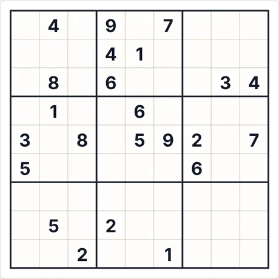 Puzzle iniziale (9×9 · medio · 23 indizi)</td><td align="center">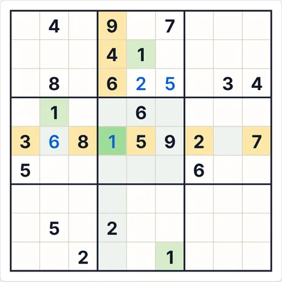 Dopo 4 passi di «Passo passo»</td></tr></table>

- **Ultimo passo spiegato dall'app:** 1 (riga 5, col. 4): tutte le altre cifre compaiono già tra le celle evidenziate (riga, colonna, regione o regola di vicinato).
- **Codice per lo stesso puzzle:** `symcomp-9-medium-913346369` (incollalo in «Nuova partita → Codice») · impegno del risolutore: nessuna ramificazione

<b>Galleria completa: tutti i tipi di schermata</b>

<b>Atlante</b>

<table>
<tr><td align="center" valign="top">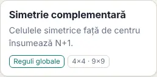 La scheda nell'Atlante</td><td align="center" valign="top">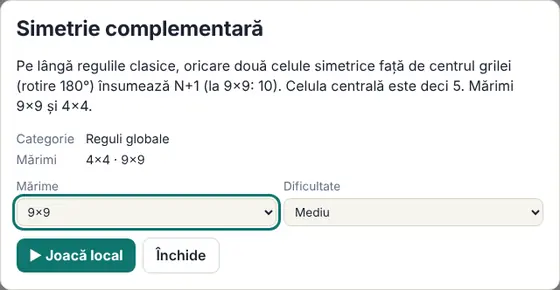 La scheda (si apre con un clic sulla carta)</td></tr>
</table>

<b>Dimensioni (livello medio)</b>

<table>
<tr><td align="center" valign="top">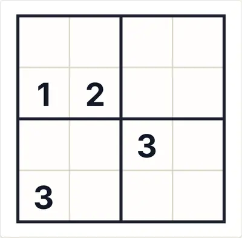 4×4</td><td align="center" valign="top">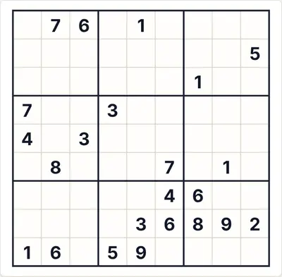 9×9</td></tr>
</table>

<b>Difficoltà</b>

<table>
<tr><td align="center" valign="top">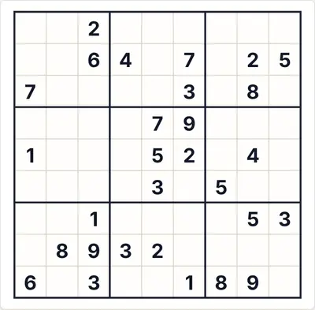 Facile</td><td align="center" valign="top"> Media</td><td align="center" valign="top">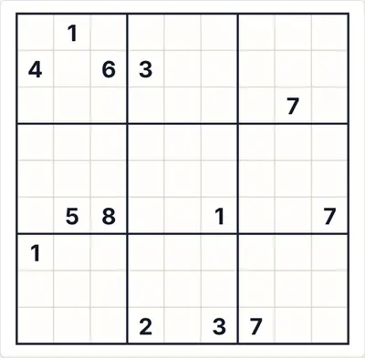 Difficile</td></tr>
</table>

<b>Stati di gioco</b>

<table>
<tr><td align="center" valign="top">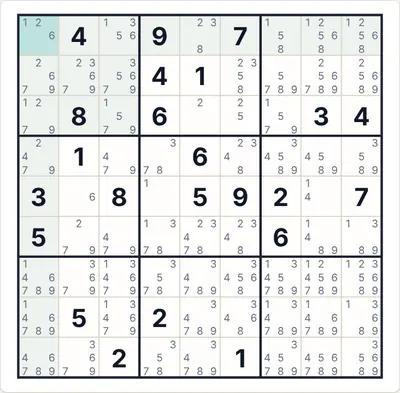 Appunti automatici (candidati)</td><td align="center" valign="top">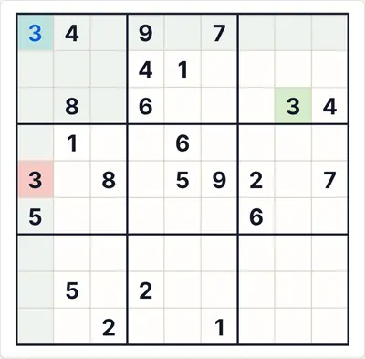 «Verifica» con una cifra sbagliata (rosso)</td><td align="center" valign="top">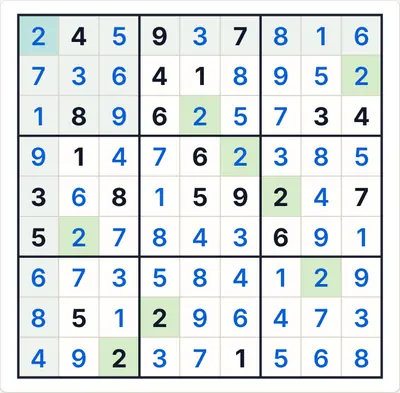 La soluzione completa</td></tr>
</table>

<b>Temi e dispositivi</b>

<table>
<tr><td align="center" valign="top">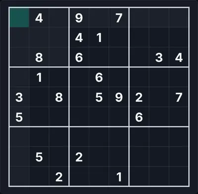 Tema scuro</td><td align="center" valign="top">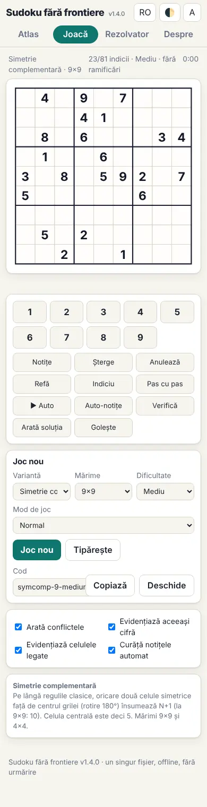 Telefono (390 px)</td><td align="center" valign="top">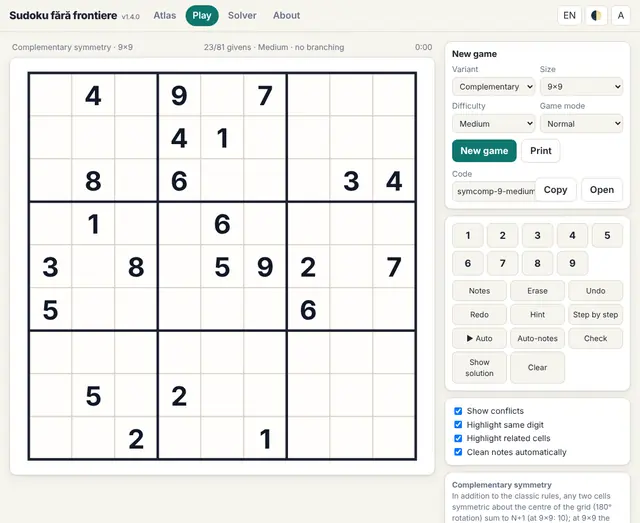 Interfaccia in inglese</td></tr>
</table>

<b>Il pannello delle regole nel gioco</b>

<table>
<tr><td align="center" valign="top">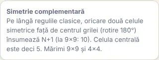 Le regole mostrate accanto alla tavola</td></tr>
</table>

#### 112. Parità simmetrica · Symmetric parity (`symparity`)

**Le celle simmetriche rispetto al centro hanno la stessa parità.**

Oltre alle regole classiche, due celle qualsiasi simmetriche rispetto al centro della griglia (rotazione di 180°) sono entrambe pari o entrambe dispari.

<table><tr><td align="center">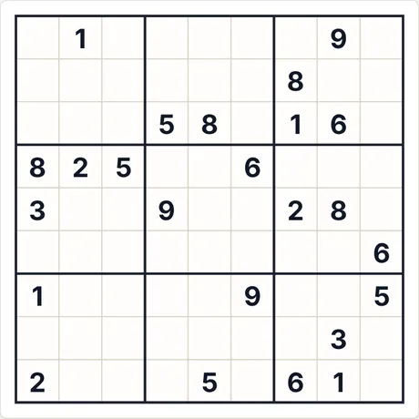 Puzzle iniziale (9×9 · medio · 24 indizi)</td><td align="center">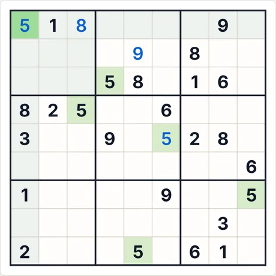 Dopo 4 passi di «Passo passo»</td></tr></table>

- **Ultimo passo spiegato dall'app:** 5 (riga 1, col. 1): deriva dalle regole specifiche della variante (indizi, somme, relazioni), combinate con le altre cifre.
- **Codice per lo stesso puzzle:** `symparity-9-medium-2361855335` (incollalo in «Nuova partita → Codice») · impegno del risolutore: nessuna ramificazione

<b>Galleria completa: tutti i tipi di schermata</b>

<b>Atlante</b>

<table>
<tr><td align="center" valign="top">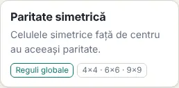 La scheda nell'Atlante</td><td align="center" valign="top">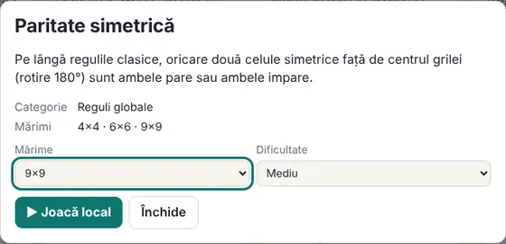 La scheda (si apre con un clic sulla carta)</td></tr>
</table>

<b>Dimensioni (livello medio)</b>

<table>
<tr><td align="center" valign="top">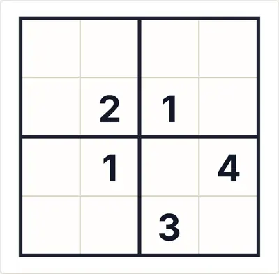 4×4</td><td align="center" valign="top">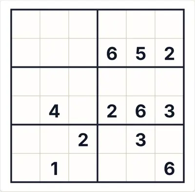 6×6</td><td align="center" valign="top">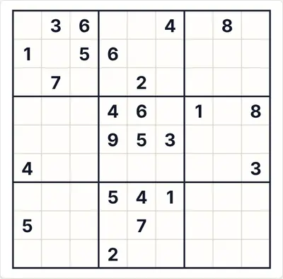 9×9</td></tr>
</table>

<b>Difficoltà</b>

<table>
<tr><td align="center" valign="top">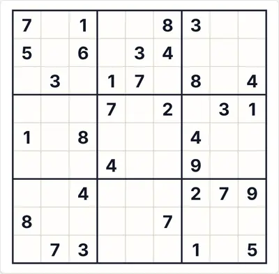 Facile</td><td align="center" valign="top"> Media</td><td align="center" valign="top">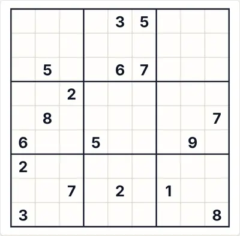 Difficile</td></tr>
</table>

<b>Stati di gioco</b>

<table>
<tr><td align="center" valign="top">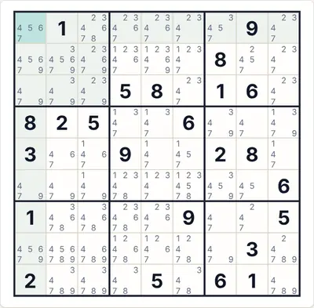 Appunti automatici (candidati)</td><td align="center" valign="top">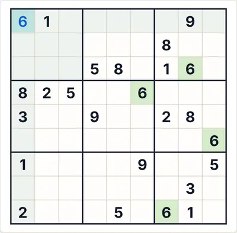 «Verifica» con una cifra sbagliata (rosso)</td><td align="center" valign="top">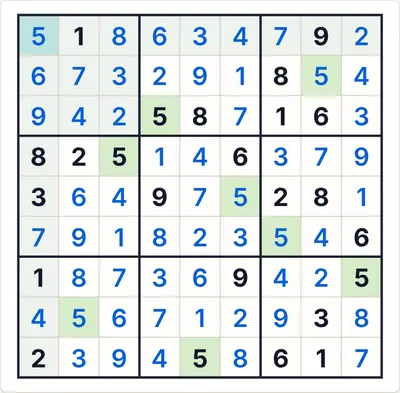 La soluzione completa</td></tr>
</table>

<b>Temi e dispositivi</b>

<table>
<tr><td align="center" valign="top">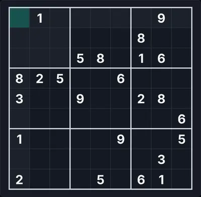 Tema scuro</td><td align="center" valign="top">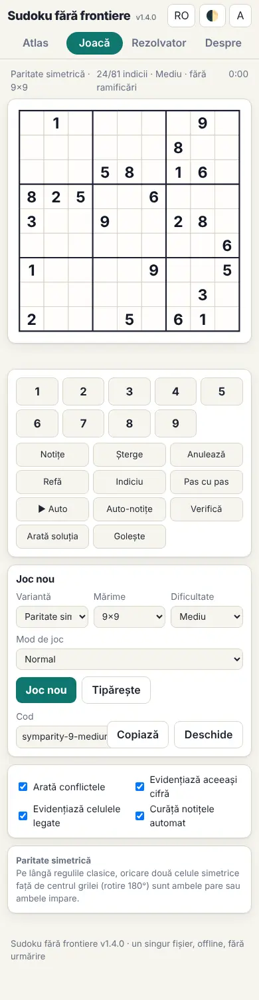 Telefono (390 px)</td><td align="center" valign="top">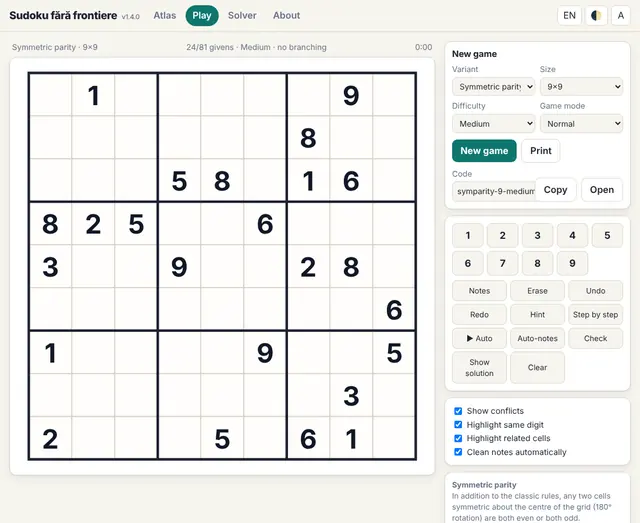 Interfaccia in inglese</td></tr>
</table>

<b>Il pannello delle regole nel gioco</b>

<table>
<tr><td align="center" valign="top">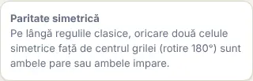 Le regole mostrate accanto alla tavola</td></tr>
</table>

#### 113. Baricentro · Centre of gravity (`cgrav`)

**Ogni riga sta in equilibrio come un'altalena.**

Oltre alle regole classiche, ogni riga è in equilibrio: se le posizioni si numerano da −4 a +4 e ogni cifra è un peso, la somma dei pesi × posizioni è 0 (il baricentro è esattamente al centro). Solo 9×9; la generazione può richiedere qualche secondo a Facile e fino a ~20 s a Difficile.

<table><tr><td align="center">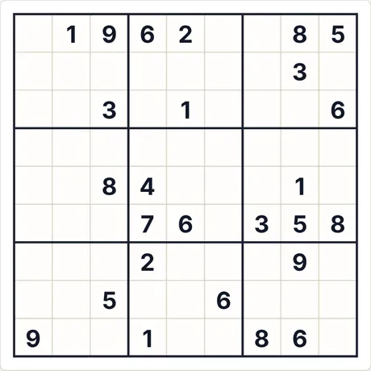 Puzzle iniziale (9×9 · medio · 26 indizi)</td><td align="center">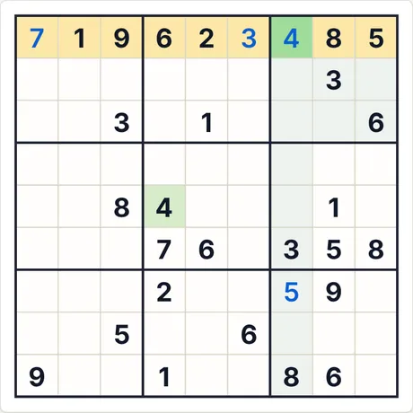 Dopo 4 passi di «Passo passo»</td></tr></table>

- **Ultimo passo spiegato dall'app:** 4 (riga 1, col. 7): tutte le altre cifre compaiono già tra le celle evidenziate (riga, colonna, regione o regola di vicinato).
- **Codice per lo stesso puzzle:** `cgrav-9-medium-1954301562` (incollalo in «Nuova partita → Codice») · impegno del risolutore: nessuna ramificazione

<b>Galleria completa: tutti i tipi di schermata</b>

<b>Atlante</b>

<table>
<tr><td align="center" valign="top">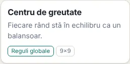 La scheda nell'Atlante</td><td align="center" valign="top">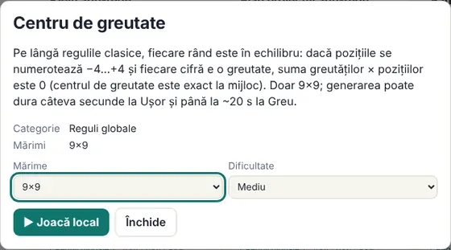 La scheda (si apre con un clic sulla carta)</td></tr>
</table>

<b>Dimensioni (livello medio)</b>

<table>
<tr><td align="center" valign="top">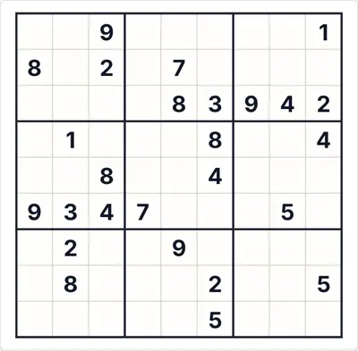 9×9</td></tr>
</table>

<b>Difficoltà</b>

<table>
<tr><td align="center" valign="top">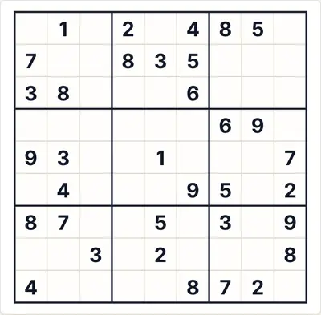 Facile</td><td align="center" valign="top"> Media</td></tr>
</table>

<b>Stati di gioco</b>

<table>
<tr><td align="center" valign="top">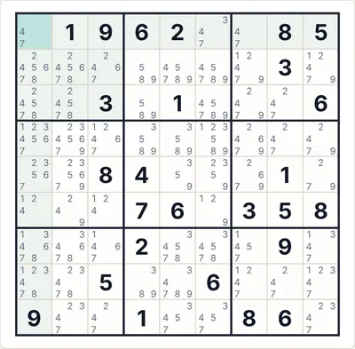 Appunti automatici (candidati)</td><td align="center" valign="top">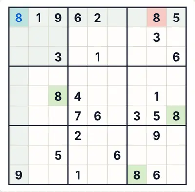 «Verifica» con una cifra sbagliata (rosso)</td><td align="center" valign="top">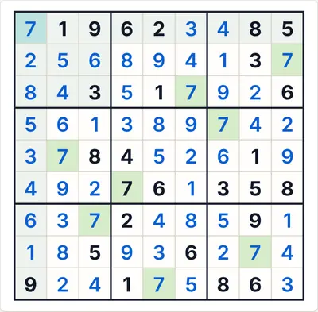 La soluzione completa</td></tr>
</table>

<b>Temi e dispositivi</b>

<table>
<tr><td align="center" valign="top">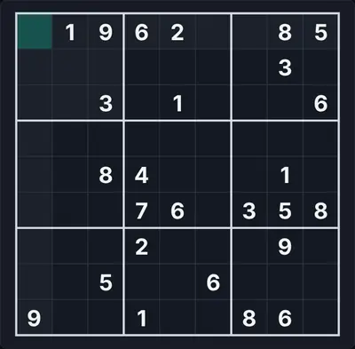 Tema scuro</td><td align="center" valign="top">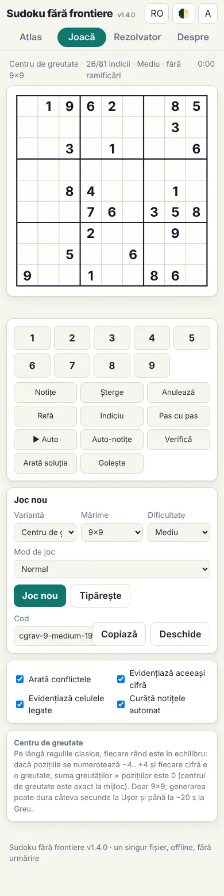 Telefono (390 px)</td><td align="center" valign="top">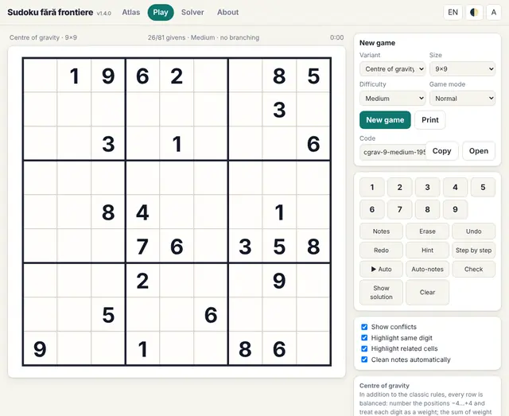 Interfaccia in inglese</td></tr>
</table>

<b>Il pannello delle regole nel gioco</b>

<table>
<tr><td align="center" valign="top">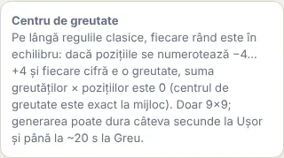 Le regole mostrate accanto alla tavola</td></tr>
</table>

#### 114. Righe lessicografiche · Lexicographic rows (`lexrows`)

**Le righe crescono come parole (prima colonna: 1…N).**

Oltre alle regole classiche, leggendo le righe dall'alto in basso come «parole» di cifre, ogni riga è strettamente minore in ordine lessicografico di quella sottostante (si confronta la prima cifra diversa). Poiché la prima colonna contiene cifre diverse, la regola significa in realtà che la prima colonna, letta dall'alto in basso, è 1, 2, …, N.

<table><tr><td align="center">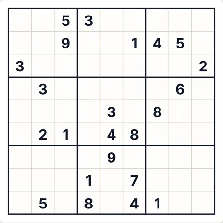 Puzzle iniziale (9×9 · medio · 23 indizi)</td><td align="center">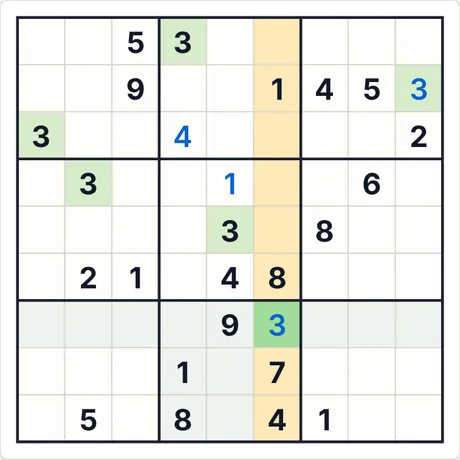 Dopo 4 passi di «Passo passo»</td></tr></table>

- **Ultimo passo spiegato dall'app:** 3 (riga 7, col. 6): è l'unica cella della colonna evidenziata in cui può stare 3.
- **Codice per lo stesso puzzle:** `lexrows-9-medium-957311172` (incollalo in «Nuova partita → Codice») · impegno del risolutore: 1 ramificazione

<b>Galleria completa: tutti i tipi di schermata</b>

<b>Atlante</b>

<table>
<tr><td align="center" valign="top">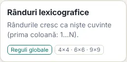 La scheda nell'Atlante</td><td align="center" valign="top">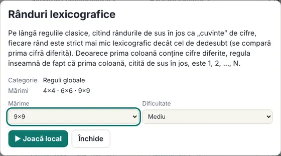 La scheda (si apre con un clic sulla carta)</td></tr>
</table>

<b>Dimensioni (livello medio)</b>

<table>
<tr><td align="center" valign="top">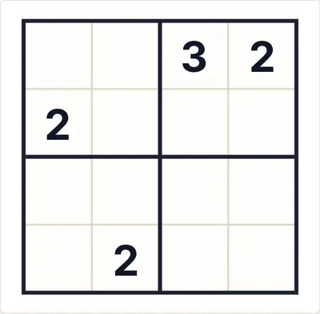 4×4</td><td align="center" valign="top">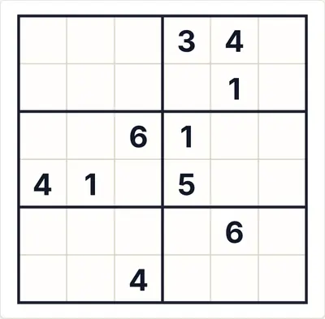 6×6</td><td align="center" valign="top"> 9×9</td></tr>
</table>

<b>Difficoltà</b>

<table>
<tr><td align="center" valign="top"> Facile</td><td align="center" valign="top"> Media</td><td align="center" valign="top"> Difficile</td></tr>
</table>

<b>Stati di gioco</b>

<table>
<tr><td align="center" valign="top"> Appunti automatici (candidati)</td><td align="center" valign="top"> «Verifica» con una cifra sbagliata (rosso)</td><td align="center" valign="top"> La soluzione completa</td></tr>
</table>

<b>Temi e dispositivi</b>

<table>
<tr><td align="center" valign="top"> Tema scuro</td><td align="center" valign="top"> Telefono (390 px)</td><td align="center" valign="top"> Interfaccia in inglese</td></tr>
</table>

<b>Il pannello delle regole nel gioco</b>

<table>
<tr><td align="center" valign="top"> Le regole mostrate accanto alla tavola</td></tr>
</table>

#### 115. Estremi adiacenti · Touching extremes (`extremes`)

**Il minimo e il massimo del riquadro si toccano.**

Oltre alle regole classiche, in ogni riquadro le cifre 1 e N stanno in celle adiacenti, anche in diagonale (mossa di re). La convenzione «anche in diagonale» è scelta qui: con soli vicini ortogonali non esistono griglie 9×9 (verificato in modo esaustivo).

<table><tr><td align="center"> Puzzle iniziale (9×9 · medio · 23 indizi)</td><td align="center"> Dopo 4 passi di «Passo passo»</td></tr></table>

- **Ultimo passo spiegato dall'app:** 6 (riga 4, col. 4): è l'unica cella della colonna evidenziata in cui può stare 6.
- **Codice per lo stesso puzzle:** `extremes-9-medium-1348183675` (incollalo in «Nuova partita → Codice») · impegno del risolutore: 2 ramificazioni

<b>Galleria completa: tutti i tipi di schermata</b>

<b>Atlante</b>

<table>
<tr><td align="center" valign="top"> La scheda nell'Atlante</td><td align="center" valign="top"> La scheda (si apre con un clic sulla carta)</td></tr>
</table>

<b>Dimensioni (livello medio)</b>

<table>
<tr><td align="center" valign="top"> 4×4</td><td align="center" valign="top"> 6×6</td><td align="center" valign="top"> 9×9</td></tr>
</table>

<b>Difficoltà</b>

<table>
<tr><td align="center" valign="top"> Facile</td><td align="center" valign="top"> Media</td><td align="center" valign="top"> Difficile</td></tr>
</table>

<b>Stati di gioco</b>

<table>
<tr><td align="center" valign="top"> Appunti automatici (candidati)</td><td align="center" valign="top"> «Verifica» con una cifra sbagliata (rosso)</td><td align="center" valign="top"> La soluzione completa</td></tr>
</table>

<b>Temi e dispositivi</b>

<table>
<tr><td align="center" valign="top"> Tema scuro</td><td align="center" valign="top"> Telefono (390 px)</td><td align="center" valign="top"> Interfaccia in inglese</td></tr>
</table>

<b>Il pannello delle regole nel gioco</b>

<table>
<tr><td align="center" valign="top"> Le regole mostrate accanto alla tavola</td></tr>
</table>

#### 116. Riquadri bilanciati · Balanced boxes (`boxbalance`)

**La prima e l'ultima colonna del riquadro hanno la stessa somma.**

Oltre alle regole classiche, in ogni riquadro la somma delle cifre della colonna di sinistra è uguale alla somma delle cifre della colonna di destra.

<table><tr><td align="center"> Puzzle iniziale (9×9 · medio · 23 indizi)</td><td align="center"> Dopo 4 passi di «Passo passo»</td></tr></table>

- **Ultimo passo spiegato dall'app:** 6 (riga 6, col. 4): nessuna deduzione diretta; la cifra è presa dalla soluzione unica (servirebbe un'ipotesi).
- **Codice per lo stesso puzzle:** `boxbalance-9-medium-1668427631` (incollalo in «Nuova partita → Codice») · impegno del risolutore: 314 ramificazioni

<b>Galleria completa: tutti i tipi di schermata</b>

<b>Atlante</b>

<table>
<tr><td align="center" valign="top"> La scheda nell'Atlante</td><td align="center" valign="top"> La scheda (si apre con un clic sulla carta)</td></tr>
</table>

<b>Dimensioni (livello medio)</b>

<table>
<tr><td align="center" valign="top"> 4×4</td><td align="center" valign="top"> 6×6</td><td align="center" valign="top"> 9×9</td></tr>
</table>

<b>Difficoltà</b>

<table>
<tr><td align="center" valign="top"> Facile</td><td align="center" valign="top"> Media</td><td align="center" valign="top"> Difficile</td></tr>
</table>

<b>Stati di gioco</b>

<table>
<tr><td align="center" valign="top"> Appunti automatici (candidati)</td><td align="center" valign="top"> «Verifica» con una cifra sbagliata (rosso)</td><td align="center" valign="top"> La soluzione completa</td></tr>
</table>

<b>Temi e dispositivi</b>

<table>
<tr><td align="center" valign="top"> Tema scuro</td><td align="center" valign="top"> Telefono (390 px)</td><td align="center" valign="top"> Interfaccia in inglese</td></tr>
</table>

<b>Il pannello delle regole nel gioco</b>

<table>
<tr><td align="center" valign="top"> Le regole mostrate accanto alla tavola</td></tr>
</table>

#### 117. Il cinque solitario · Lonely 5 (`lonely5`)

**Un 5 ha solo vicini pari.**

Oltre alle regole classiche, ogni 5 ha solo vicini ortogonali pari. Dimensioni 9×9 e 6×6.

<table><tr><td align="center"> Puzzle iniziale (9×9 · medio · 24 indizi)</td><td align="center"> Dopo 4 passi di «Passo passo»</td></tr></table>

- **Ultimo passo spiegato dall'app:** 2 (riga 5, col. 3): è l'unica cella della riga evidenziata in cui può stare 2.
- **Codice per lo stesso puzzle:** `lonely5-9-medium-4284537212` (incollalo in «Nuova partita → Codice») · impegno del risolutore: nessuna ramificazione

<b>Galleria completa: tutti i tipi di schermata</b>

<b>Atlante</b>

<table>
<tr><td align="center" valign="top"> La scheda nell'Atlante</td><td align="center" valign="top"> La scheda (si apre con un clic sulla carta)</td></tr>
</table>

<b>Dimensioni (livello medio)</b>

<table>
<tr><td align="center" valign="top"> 6×6</td><td align="center" valign="top"> 9×9</td></tr>
</table>

<b>Difficoltà</b>

<table>
<tr><td align="center" valign="top"> Facile</td><td align="center" valign="top"> Media</td><td align="center" valign="top"> Difficile</td></tr>
</table>

<b>Stati di gioco</b>

<table>
<tr><td align="center" valign="top"> Appunti automatici (candidati)</td><td align="center" valign="top"> «Verifica» con una cifra sbagliata (rosso)</td><td align="center" valign="top"> La soluzione completa</td></tr>
</table>

<b>Temi e dispositivi</b>

<table>
<tr><td align="center" valign="top"> Tema scuro</td><td align="center" valign="top"> Telefono (390 px)</td><td align="center" valign="top"> Interfaccia in inglese</td></tr>
</table>

<b>Il pannello delle regole nel gioco</b>

<table>
<tr><td align="center" valign="top"> Le regole mostrate accanto alla tavola</td></tr>
</table>

#### 118. Senza celle isolate · No lonely cells (`nolonely`)

**Ogni cella ha un vicino consecutivo.**

Oltre alle regole classiche, ogni cella ha almeno un vicino ortogonale la cui cifra differisce di esattamente 1.

<table><tr><td align="center"> Puzzle iniziale (9×9 · medio · 23 indizi)</td><td align="center"> Dopo 4 passi di «Passo passo»</td></tr></table>

- **Ultimo passo spiegato dall'app:** 5 (riga 9, col. 9): tutte le altre cifre compaiono già tra le celle evidenziate (riga, colonna, regione o regola di vicinato).
- **Codice per lo stesso puzzle:** `nolonely-9-medium-355818888` (incollalo in «Nuova partita → Codice») · impegno del risolutore: nessuna ramificazione

<b>Galleria completa: tutti i tipi di schermata</b>

<b>Atlante</b>

<table>
<tr><td align="center" valign="top"> La scheda nell'Atlante</td><td align="center" valign="top"> La scheda (si apre con un clic sulla carta)</td></tr>
</table>

<b>Dimensioni (livello medio)</b>

<table>
<tr><td align="center" valign="top"> 4×4</td><td align="center" valign="top"> 6×6</td><td align="center" valign="top"> 9×9</td></tr>
</table>

<b>Difficoltà</b>

<table>
<tr><td align="center" valign="top"> Facile</td><td align="center" valign="top"> Media</td><td align="center" valign="top"> Difficile</td></tr>
</table>

<b>Stati di gioco</b>

<table>
<tr><td align="center" valign="top"> Appunti automatici (candidati)</td><td align="center" valign="top"> «Verifica» con una cifra sbagliata (rosso)</td><td align="center" valign="top"> La soluzione completa</td></tr>
</table>

<b>Temi e dispositivi</b>

<table>
<tr><td align="center" valign="top"> Tema scuro</td><td align="center" valign="top"> Telefono (390 px)</td><td align="center" valign="top"> Interfaccia in inglese</td></tr>
</table>

<b>Il pannello delle regole nel gioco</b>

<table>
<tr><td align="center" valign="top"> Le regole mostrate accanto alla tavola</td></tr>
</table>

#### 119. Senza progressioni · No arithmetic progressions (`noprog`)

**Tre cifre adiacenti non formano una progressione aritmetica.**

Oltre alle regole classiche, tre celle adiacenti su una riga o su una colonna non possono formare una progressione aritmetica (ad es. 2-4-6 o 7-5-3 sono vietate).

<table><tr><td align="center"> Puzzle iniziale (9×9 · medio · 24 indizi)</td><td align="center"> Dopo 4 passi di «Passo passo»</td></tr></table>

- **Ultimo passo spiegato dall'app:** 2 (riga 3, col. 7): tutte le altre cifre compaiono già tra le celle evidenziate (riga, colonna, regione o regola di vicinato).
- **Codice per lo stesso puzzle:** `noprog-9-medium-3644248957` (incollalo in «Nuova partita → Codice») · impegno del risolutore: 6 ramificazioni

<b>Galleria completa: tutti i tipi di schermata</b>

<b>Atlante</b>

<table>
<tr><td align="center" valign="top"> La scheda nell'Atlante</td><td align="center" valign="top"> La scheda (si apre con un clic sulla carta)</td></tr>
</table>

<b>Dimensioni (livello medio)</b>

<table>
<tr><td align="center" valign="top"> 4×4</td><td align="center" valign="top"> 6×6</td><td align="center" valign="top"> 9×9</td></tr>
</table>

<b>Difficoltà</b>

<table>
<tr><td align="center" valign="top"> Facile</td><td align="center" valign="top"> Media</td><td align="center" valign="top"> Difficile</td></tr>
</table>

<b>Stati di gioco</b>

<table>
<tr><td align="center" valign="top"> Appunti automatici (candidati)</td><td align="center" valign="top"> «Verifica» con una cifra sbagliata (rosso)</td><td align="center" valign="top"> La soluzione completa</td></tr>
</table>

<b>Temi e dispositivi</b>

<table>
<tr><td align="center" valign="top"> Tema scuro</td><td align="center" valign="top"> Telefono (390 px)</td><td align="center" valign="top"> Interfaccia in inglese</td></tr>
</table>

<b>Il pannello delle regole nel gioco</b>

<table>
<tr><td align="center" valign="top"> Le regole mostrate accanto alla tavola</td></tr>
</table>

#### 120. Riquadri semimagici · Semi-magic boxes (`semimagic`)

**Le righe di ogni riquadro sommano 15; così le colonne.**

Oltre alle regole classiche, ogni riga e ogni colonna di ogni riquadro sommano 15. I riquadri completamente magici (con le diagonali) sono impossibili, perché i tre riquadri di una fascia avrebbero tutti il centro 5 nella stessa riga della griglia; per questo le diagonali non sono vincolate. Solo 9×9 (nel 4×4 le righe e le colonne richiederebbero riquadri con cifre ripetute).

<table><tr><td align="center"> Puzzle iniziale (9×9 · medio · 23 indizi)</td><td align="center"> Dopo 4 passi di «Passo passo»</td></tr></table>

- **Ultimo passo spiegato dall'app:** 8 (riga 5, col. 5): tutte le altre cifre compaiono già tra le celle evidenziate (riga, colonna, regione o regola di vicinato).
- **Codice per lo stesso puzzle:** `semimagic-9-medium-3291682902` (incollalo in «Nuova partita → Codice») · impegno del risolutore: nessuna ramificazione

<b>Galleria completa: tutti i tipi di schermata</b>

<b>Atlante</b>

<table>
<tr><td align="center" valign="top"> La scheda nell'Atlante</td><td align="center" valign="top"> La scheda (si apre con un clic sulla carta)</td></tr>
</table>

<b>Dimensioni (livello medio)</b>

<table>
<tr><td align="center" valign="top"> 9×9</td></tr>
</table>

<b>Difficoltà</b>

<table>
<tr><td align="center" valign="top"> Facile</td><td align="center" valign="top"> Media</td><td align="center" valign="top"> Difficile</td></tr>
</table>

<b>Stati di gioco</b>

<table>
<tr><td align="center" valign="top"> Appunti automatici (candidati)</td><td align="center" valign="top"> «Verifica» con una cifra sbagliata (rosso)</td><td align="center" valign="top"> La soluzione completa</td></tr>
</table>

<b>Temi e dispositivi</b>

<table>
<tr><td align="center" valign="top"> Tema scuro</td><td align="center" valign="top"> Telefono (390 px)</td><td align="center" valign="top"> Interfaccia in inglese</td></tr>
</table>

<b>Il pannello delle regole nel gioco</b>

<table>
<tr><td align="center" valign="top"> Le regole mostrate accanto alla tavola</td></tr>
</table>

