# Catálogo: Regiões e grupos (11)

[English](../en/02-regiuni-si-grupuri.md) · [Română](../02-regiuni-si-grupuri.md) · [Français](../fr/02-regiuni-si-grupuri.md) · [Italiano](../it/02-regiuni-si-grupuri.md) · [Español](../es/02-regiuni-si-grupuri.md) · **Português** · [Deutsch](../de/02-regiuni-si-grupuri.md) · [Magyar](../hu/02-regiuni-si-grupuri.md)

[← README](../../../README.pt.md) · [Todas as categorias](README.md)

[Tamanho e símbolos](01-marime-si-simboluri.md) · **Regiões e grupos** · [Vizinhos](03-vecini.md) · [Paridade, pontos, sinais](04-paritate-puncte-semne.md) · [Somas](05-sume.md) · [Pistas na margem](06-indicii-pe-margine.md) · [Linhas](07-linii.md) · [Grelhas compostas](08-grile-compuse.md) · [Parentes próximos](09-rude-apropiate.md) · [Topologias e saltos fairy](10-topologii-si-mutari-fairy.md) · [Regras globais](11-reguli-globale.md) · [Pistas nas células](12-indicii-in-celule.md) · [Dimensões superiores](13-dimensiuni-superioare.md)

---

_As regiões ou os grupos adicionais estão coloridos ou contornados no tabuleiro; cada um deve conter os algarismos uma única vez._

#### 5. Sudoku X · Sudoku X (`diag`)

**Mais as duas diagonais.**

Além das regras clássicas, cada uma das duas diagonais principais contém cada algarismo uma vez.

<table><tr><td align="center">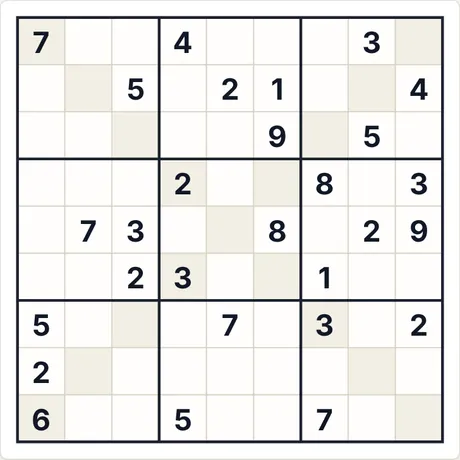 Puzzle inicial (9×9 · médio · 28 pistas)</td><td align="center">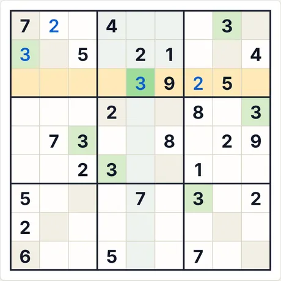 Após 4 passos de «Passo a passo»</td></tr></table>

- **Último passo explicado pela aplicação:** 3 (linha 3, col. 5): é a única célula da linha assinalada onde o 3 pode estar.
- **Código para o mesmo puzzle:** `diag-9-medium-2735589624` (cola-o em «Novo jogo → Código») · esforço do resolvedor: sem ramificações

<b>Galeria completa: todos os tipos de capturas</b>

<b>Atlas</b>

<table>
<tr><td align="center" valign="top">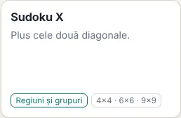 O cartão no Atlas</td><td align="center" valign="top">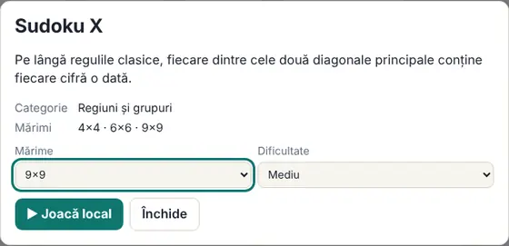 A ficha (abre-se ao clicar no cartão)</td></tr>
</table>

<b>Tamanhos (nível médio)</b>

<table>
<tr><td align="center" valign="top">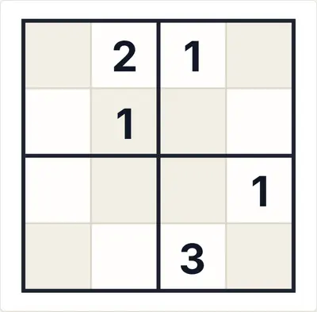 4×4</td><td align="center" valign="top">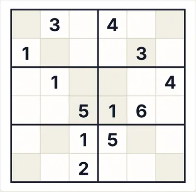 6×6</td><td align="center" valign="top">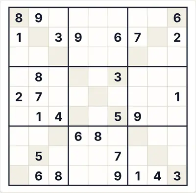 9×9</td></tr>
</table>

<b>Dificuldade</b>

<table>
<tr><td align="center" valign="top">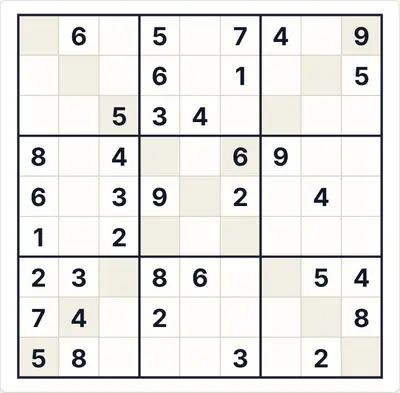 Fácil</td><td align="center" valign="top"> Médio</td><td align="center" valign="top">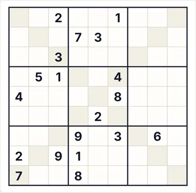 Difícil</td></tr>
</table>

<b>Estados de jogo</b>

<table>
<tr><td align="center" valign="top">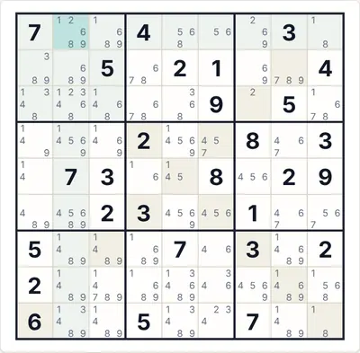 Notas automáticas (candidatos)</td><td align="center" valign="top">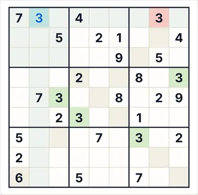 «Verificar» com um algarismo errado (vermelho)</td><td align="center" valign="top">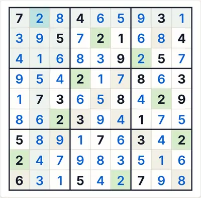 A solução completa</td></tr>
</table>

<b>Temas e dispositivos</b>

<table>
<tr><td align="center" valign="top">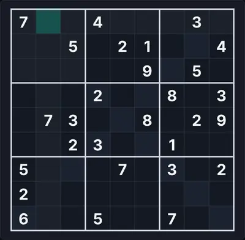 Tema escuro</td><td align="center" valign="top">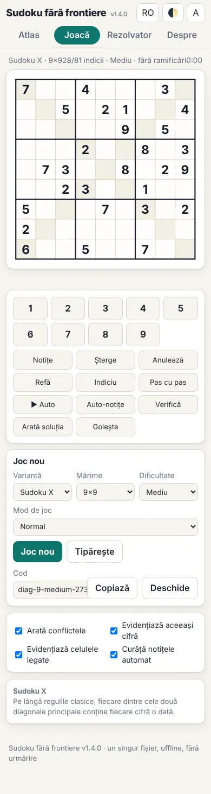 Telemóvel (390 px)</td><td align="center" valign="top">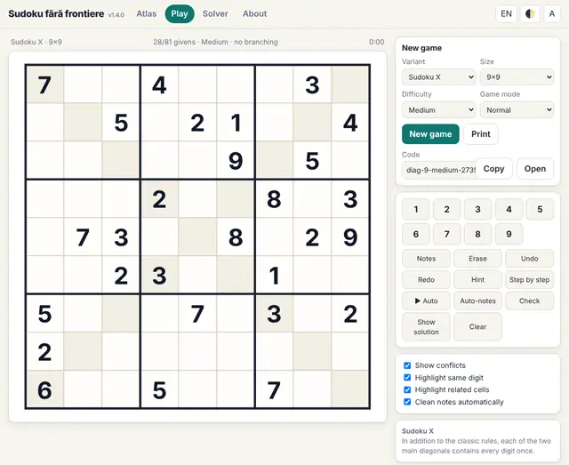 Interface em inglês</td></tr>
</table>

<b>O painel de regras no jogo</b>

<table>
<tr><td align="center" valign="top"> As regras apresentadas junto ao tabuleiro</td></tr>
</table>

#### 6. Hyper (Windoku) · Hyper (Windoku) (`hyper`)

**Quatro janelas 3×3 adicionais.**

Além das regras clássicas, quatro janelas 3×3 adicionais (coloridas) contêm cada uma cada algarismo uma vez. Só 9×9.

<table><tr><td align="center">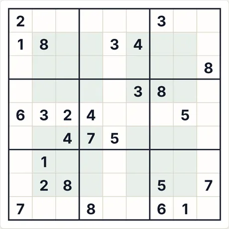 Puzzle inicial (9×9 · médio · 26 pistas)</td><td align="center">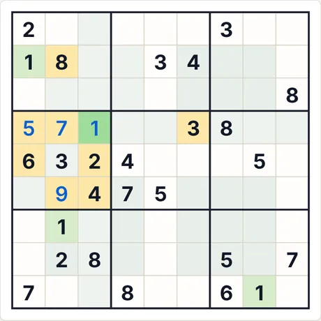 Após 4 passos de «Passo a passo»</td></tr></table>

- **Último passo explicado pela aplicação:** 1 (linha 4, col. 3): todos os outros algarismos já aparecem entre as células assinaladas (linha, coluna, região ou regra de vizinhança).
- **Código para o mesmo puzzle:** `hyper-9-medium-2663842152` (cola-o em «Novo jogo → Código») · esforço do resolvedor: sem ramificações

<b>Galeria completa: todos os tipos de capturas</b>

<b>Atlas</b>

<table>
<tr><td align="center" valign="top"> O cartão no Atlas</td><td align="center" valign="top">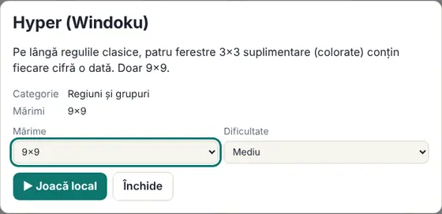 A ficha (abre-se ao clicar no cartão)</td></tr>
</table>

<b>Tamanhos (nível médio)</b>

<table>
<tr><td align="center" valign="top">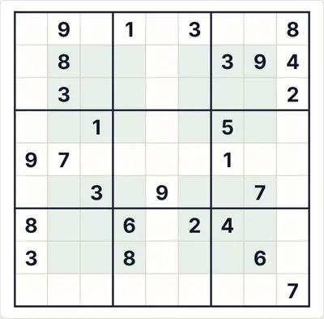 9×9</td></tr>
</table>

<b>Dificuldade</b>

<table>
<tr><td align="center" valign="top">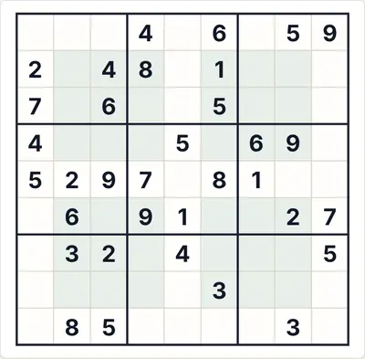 Fácil</td><td align="center" valign="top"> Médio</td><td align="center" valign="top">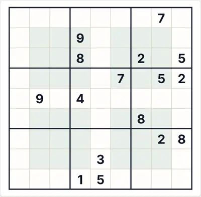 Difícil</td></tr>
</table>

<b>Estados de jogo</b>

<table>
<tr><td align="center" valign="top">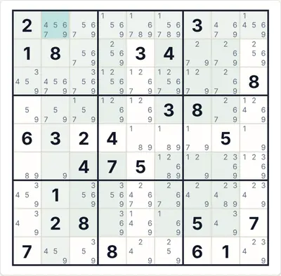 Notas automáticas (candidatos)</td><td align="center" valign="top">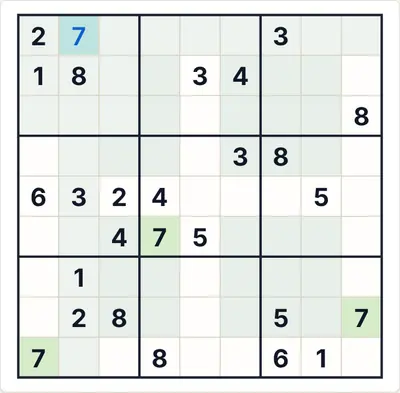 «Verificar» com um algarismo errado (vermelho)</td><td align="center" valign="top">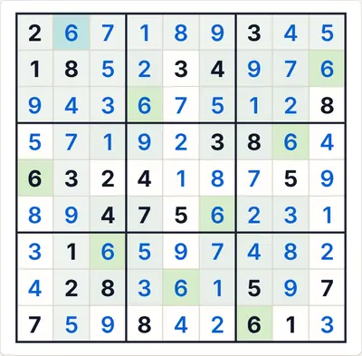 A solução completa</td></tr>
</table>

<b>Temas e dispositivos</b>

<table>
<tr><td align="center" valign="top">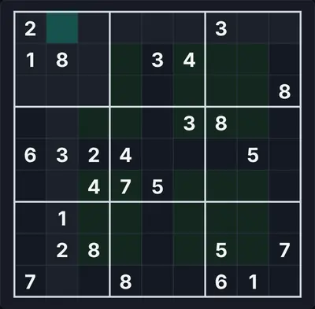 Tema escuro</td><td align="center" valign="top">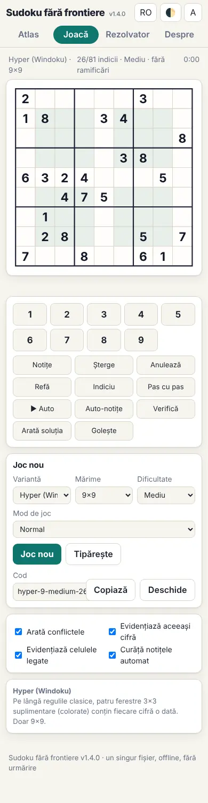 Telemóvel (390 px)</td><td align="center" valign="top">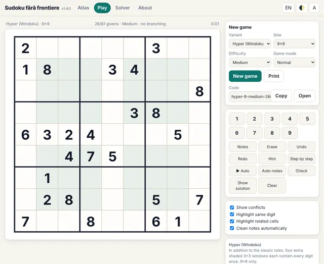 Interface em inglês</td></tr>
</table>

<b>O painel de regras no jogo</b>

<table>
<tr><td align="center" valign="top">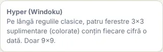 As regras apresentadas junto ao tabuleiro</td></tr>
</table>

#### 7. Jigsaw (irregular) · Jigsaw (irregular) (`jigsaw`)

**Caixas irregulares em vez de quadrados.**

As caixas são regiões irregulares de N células cada (contornadas a traço grosso). Cada linha, coluna e região contém cada algarismo uma vez. Cada puzzle tem regiões diferentes.

<table><tr><td align="center">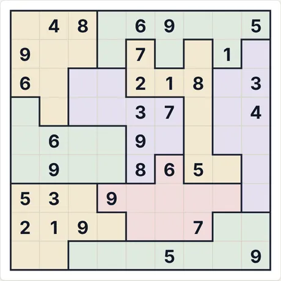 Puzzle inicial (9×9 · médio · 31 pistas)</td><td align="center">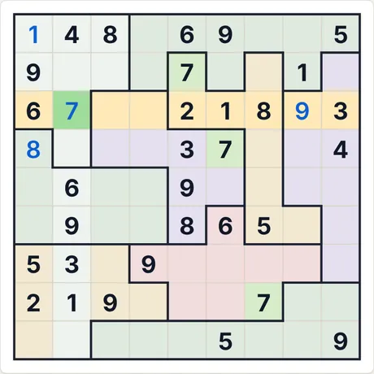 Após 4 passos de «Passo a passo»</td></tr></table>

- **Último passo explicado pela aplicação:** 7 (linha 3, col. 2): é a única célula da linha assinalada onde o 7 pode estar.
- **Código para o mesmo puzzle:** `jigsaw-9-medium-2756065667` (cola-o em «Novo jogo → Código») · esforço do resolvedor: 3 ramificações

<b>Galeria completa: todos os tipos de capturas</b>

<b>Atlas</b>

<table>
<tr><td align="center" valign="top">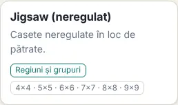 O cartão no Atlas</td><td align="center" valign="top">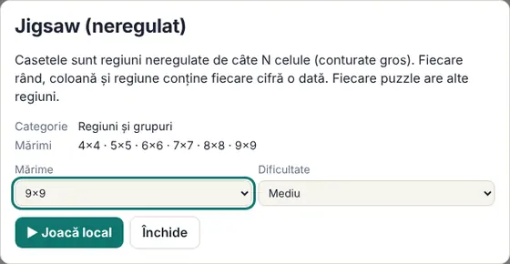 A ficha (abre-se ao clicar no cartão)</td></tr>
</table>

<b>Tamanhos (nível médio)</b>

<table>
<tr><td align="center" valign="top">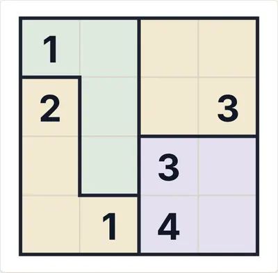 4×4</td><td align="center" valign="top">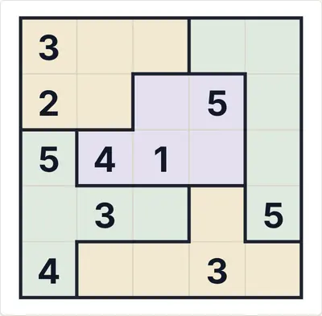 5×5</td><td align="center" valign="top">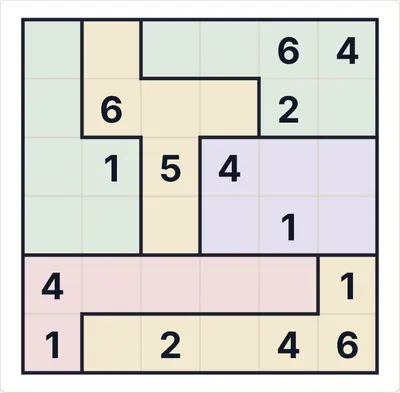 6×6</td></tr>
<tr><td align="center" valign="top">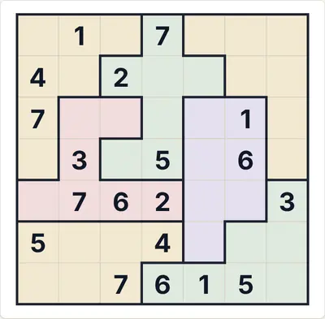 7×7</td><td align="center" valign="top">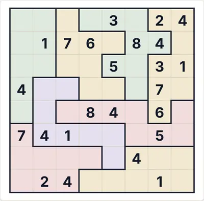 8×8</td><td align="center" valign="top">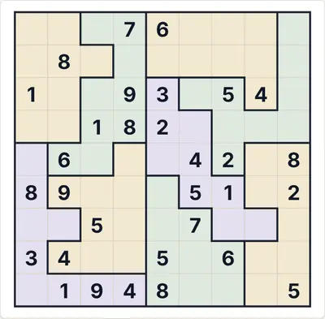 9×9</td></tr>
</table>

<b>Dificuldade</b>

<table>
<tr><td align="center" valign="top">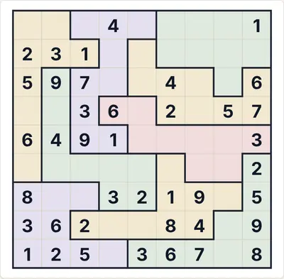 Fácil</td><td align="center" valign="top"> Médio</td><td align="center" valign="top">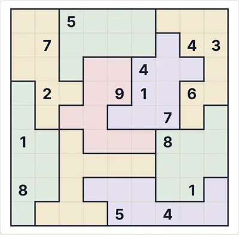 Difícil</td></tr>
</table>

<b>Estados de jogo</b>

<table>
<tr><td align="center" valign="top">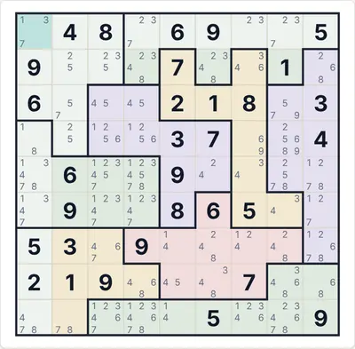 Notas automáticas (candidatos)</td><td align="center" valign="top">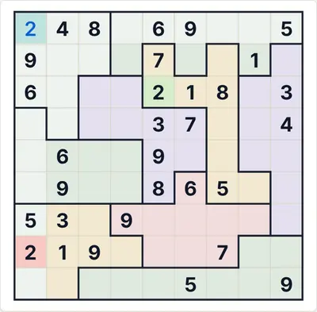 «Verificar» com um algarismo errado (vermelho)</td><td align="center" valign="top">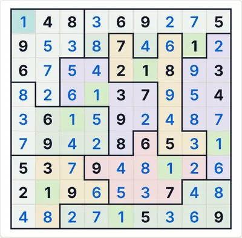 A solução completa</td></tr>
</table>

<b>Temas e dispositivos</b>

<table>
<tr><td align="center" valign="top">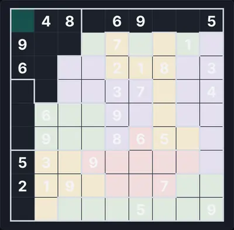 Tema escuro</td><td align="center" valign="top">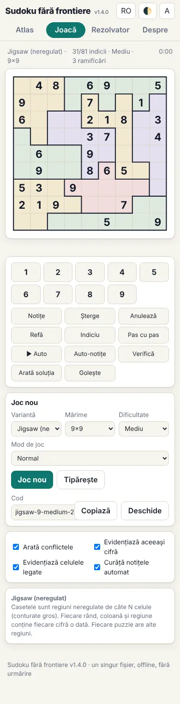 Telemóvel (390 px)</td><td align="center" valign="top">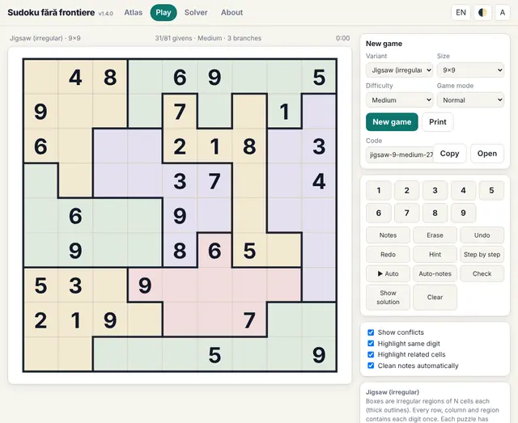 Interface em inglês</td></tr>
</table>

<b>O painel de regras no jogo</b>

<table>
<tr><td align="center" valign="top">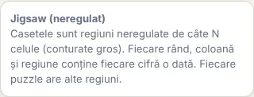 As regras apresentadas junto ao tabuleiro</td></tr>
</table>

#### 8. Grupos disjuntos · Disjoint groups (`dg`)

**A mesma posição na caixa = um grupo.**

Além das regras clássicas: todas as células que ocupam a mesma posição nas respetivas caixas (por exemplo, todos os cantos superiores esquerdos) contêm cada algarismo uma vez.

<table><tr><td align="center">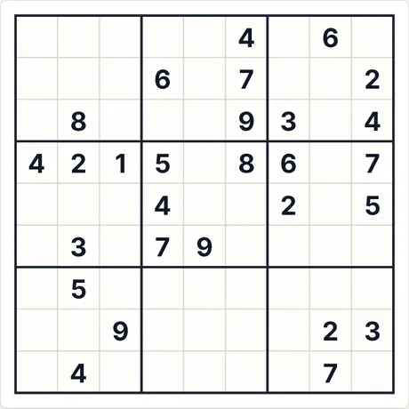 Puzzle inicial (9×9 · médio · 28 pistas)</td><td align="center">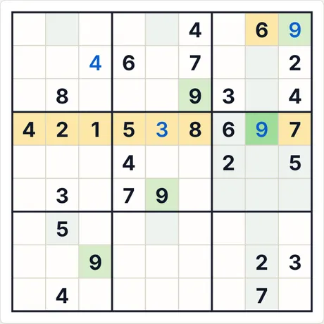 Após 4 passos de «Passo a passo»</td></tr></table>

- **Último passo explicado pela aplicação:** 9 (linha 4, col. 8): todos os outros algarismos já aparecem entre as células assinaladas (linha, coluna, região ou regra de vizinhança).
- **Código para o mesmo puzzle:** `dg-9-medium-3260982679` (cola-o em «Novo jogo → Código») · esforço do resolvedor: sem ramificações

<b>Galeria completa: todos os tipos de capturas</b>

<b>Atlas</b>

<table>
<tr><td align="center" valign="top">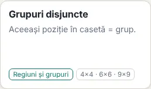 O cartão no Atlas</td><td align="center" valign="top"> A ficha (abre-se ao clicar no cartão)</td></tr>
</table>

<b>Tamanhos (nível médio)</b>

<table>
<tr><td align="center" valign="top"> 4×4</td><td align="center" valign="top"> 6×6</td><td align="center" valign="top"> 9×9</td></tr>
</table>

<b>Dificuldade</b>

<table>
<tr><td align="center" valign="top"> Fácil</td><td align="center" valign="top"> Médio</td><td align="center" valign="top"> Difícil</td></tr>
</table>

<b>Estados de jogo</b>

<table>
<tr><td align="center" valign="top"> Notas automáticas (candidatos)</td><td align="center" valign="top"> «Verificar» com um algarismo errado (vermelho)</td><td align="center" valign="top"> A solução completa</td></tr>
</table>

<b>Temas e dispositivos</b>

<table>
<tr><td align="center" valign="top"> Tema escuro</td><td align="center" valign="top"> Telemóvel (390 px)</td><td align="center" valign="top"> Interface em inglês</td></tr>
</table>

<b>O painel de regras no jogo</b>

<table>
<tr><td align="center" valign="top"> As regras apresentadas junto ao tabuleiro</td></tr>
</table>

#### 9. Pontos centrais · Centre dots (`center`)

**Os nove centros das caixas são distintos.**

Além das regras clássicas, as nove células centrais das caixas (assinaladas) contêm cada algarismo uma vez. Só 9×9.

<table><tr><td align="center"> Puzzle inicial (9×9 · médio · 28 pistas)</td><td align="center"> Após 4 passos de «Passo a passo»</td></tr></table>

- **Último passo explicado pela aplicação:** 5 (linha 7, col. 7): todos os outros algarismos já aparecem entre as células assinaladas (linha, coluna, região ou regra de vizinhança).
- **Código para o mesmo puzzle:** `center-9-medium-1216976528` (cola-o em «Novo jogo → Código») · esforço do resolvedor: sem ramificações

<b>Galeria completa: todos os tipos de capturas</b>

<b>Atlas</b>

<table>
<tr><td align="center" valign="top"> O cartão no Atlas</td><td align="center" valign="top"> A ficha (abre-se ao clicar no cartão)</td></tr>
</table>

<b>Tamanhos (nível médio)</b>

<table>
<tr><td align="center" valign="top"> 9×9</td></tr>
</table>

<b>Dificuldade</b>

<table>
<tr><td align="center" valign="top"> Fácil</td><td align="center" valign="top"> Médio</td><td align="center" valign="top"> Difícil</td></tr>
</table>

<b>Estados de jogo</b>

<table>
<tr><td align="center" valign="top"> Notas automáticas (candidatos)</td><td align="center" valign="top"> «Verificar» com um algarismo errado (vermelho)</td><td align="center" valign="top"> A solução completa</td></tr>
</table>

<b>Temas e dispositivos</b>

<table>
<tr><td align="center" valign="top"> Tema escuro</td><td align="center" valign="top"> Telemóvel (390 px)</td><td align="center" valign="top"> Interface em inglês</td></tr>
</table>

<b>O painel de regras no jogo</b>

<table>
<tr><td align="center" valign="top"> As regras apresentadas junto ao tabuleiro</td></tr>
</table>

#### 10. Girândola · Girandola (`girandola`)

**Mais um grupo de 9 células em forma de cata-vento.**

Além das regras clássicas, as nove células assinaladas (os quatro cantos, o centro e as quatro células situadas um passo para dentro a partir do meio de cada lado: r2c5, r5c2, r5c8, r8c5) devem conter os algarismos 1–9, cada um uma vez. É assim que a Girândola é descrita no Regexp::Sudoku (a forma de cata-vento); outras fontes não dão as coordenadas exatas. Só 9×9.

<table><tr><td align="center"> Puzzle inicial (9×9 · médio · 28 pistas)</td><td align="center"> Após 4 passos de «Passo a passo»</td></tr></table>

- **Último passo explicado pela aplicação:** 8 (linha 1, col. 7): todos os outros algarismos já aparecem entre as células assinaladas (linha, coluna, região ou regra de vizinhança).
- **Código para o mesmo puzzle:** `girandola-9-medium-2030539660` (cola-o em «Novo jogo → Código») · esforço do resolvedor: sem ramificações

<b>Galeria completa: todos os tipos de capturas</b>

<b>Atlas</b>

<table>
<tr><td align="center" valign="top"> O cartão no Atlas</td><td align="center" valign="top"> A ficha (abre-se ao clicar no cartão)</td></tr>
</table>

<b>Tamanhos (nível médio)</b>

<table>
<tr><td align="center" valign="top"> 9×9</td></tr>
</table>

<b>Dificuldade</b>

<table>
<tr><td align="center" valign="top"> Fácil</td><td align="center" valign="top"> Médio</td><td align="center" valign="top"> Difícil</td></tr>
</table>

<b>Estados de jogo</b>

<table>
<tr><td align="center" valign="top"> Notas automáticas (candidatos)</td><td align="center" valign="top"> «Verificar» com um algarismo errado (vermelho)</td><td align="center" valign="top"> A solução completa</td></tr>
</table>

<b>Temas e dispositivos</b>

<table>
<tr><td align="center" valign="top"> Tema escuro</td><td align="center" valign="top"> Telemóvel (390 px)</td><td align="center" valign="top"> Interface em inglês</td></tr>
</table>

<b>O painel de regras no jogo</b>

<table>
<tr><td align="center" valign="top"> As regras apresentadas junto ao tabuleiro</td></tr>
</table>

#### 11. Nove dispersos · Scattered nine (`sparse9`)

**Mais um grupo de 9 células: cantos, meios dos lados, centro.**

Além das regras clássicas, as nove células assinaladas (os quatro cantos, os meios dos quatro lados e a célula central) devem conter os algarismos 1–9, cada um uma vez. Esta era a disposição anteriormente chamada «Girândola» nesta aplicação; não a encontrei publicada sob um nome. Só 9×9.

<table><tr><td align="center"> Puzzle inicial (9×9 · médio · 28 pistas)</td><td align="center"> Após 4 passos de «Passo a passo»</td></tr></table>

- **Último passo explicado pela aplicação:** 8 (linha 5, col. 9): todos os outros algarismos já aparecem entre as células assinaladas (linha, coluna, região ou regra de vizinhança).
- **Código para o mesmo puzzle:** `sparse9-9-medium-2353202148` (cola-o em «Novo jogo → Código») · esforço do resolvedor: 3 ramificações

<b>Galeria completa: todos os tipos de capturas</b>

<b>Atlas</b>

<table>
<tr><td align="center" valign="top"> O cartão no Atlas</td><td align="center" valign="top"> A ficha (abre-se ao clicar no cartão)</td></tr>
</table>

<b>Tamanhos (nível médio)</b>

<table>
<tr><td align="center" valign="top"> 9×9</td></tr>
</table>

<b>Dificuldade</b>

<table>
<tr><td align="center" valign="top"> Fácil</td><td align="center" valign="top"> Médio</td><td align="center" valign="top"> Difícil</td></tr>
</table>

<b>Estados de jogo</b>

<table>
<tr><td align="center" valign="top"> Notas automáticas (candidatos)</td><td align="center" valign="top"> «Verificar» com um algarismo errado (vermelho)</td><td align="center" valign="top"> A solução completa</td></tr>
</table>

<b>Temas e dispositivos</b>

<table>
<tr><td align="center" valign="top"> Tema escuro</td><td align="center" valign="top"> Telemóvel (390 px)</td><td align="center" valign="top"> Interface em inglês</td></tr>
</table>

<b>O painel de regras no jogo</b>

<table>
<tr><td align="center" valign="top"> As regras apresentadas junto ao tabuleiro</td></tr>
</table>

#### 12. Asterisco · Asterisk (`asterisk`)

**Um grupo em forma de asterisco.**

As nove células assinaladas, dispostas como um asterisco em torno do centro (o centro, quatro a distância 3 na horizontal e na vertical, quatro nas diagonais a distância 2), devem conter os algarismos 1–9, cada um uma vez, além das regras clássicas. Só 9×9.

<table><tr><td align="center"> Puzzle inicial (9×9 · médio · 28 pistas)</td><td align="center"> Após 4 passos de «Passo a passo»</td></tr></table>

- **Último passo explicado pela aplicação:** 3 (linha 8, col. 4): é a única célula da coluna assinalada onde o 3 pode estar.
- **Código para o mesmo puzzle:** `asterisk-9-medium-1054724673` (cola-o em «Novo jogo → Código») · esforço do resolvedor: 1 ramificações

<b>Galeria completa: todos os tipos de capturas</b>

<b>Atlas</b>

<table>
<tr><td align="center" valign="top"> O cartão no Atlas</td><td align="center" valign="top"> A ficha (abre-se ao clicar no cartão)</td></tr>
</table>

<b>Tamanhos (nível médio)</b>

<table>
<tr><td align="center" valign="top"> 9×9</td></tr>
</table>

<b>Dificuldade</b>

<table>
<tr><td align="center" valign="top"> Fácil</td><td align="center" valign="top"> Médio</td><td align="center" valign="top"> Difícil</td></tr>
</table>

<b>Estados de jogo</b>

<table>
<tr><td align="center" valign="top"> Notas automáticas (candidatos)</td><td align="center" valign="top"> «Verificar» com um algarismo errado (vermelho)</td><td align="center" valign="top"> A solução completa</td></tr>
</table>

<b>Temas e dispositivos</b>

<table>
<tr><td align="center" valign="top"> Tema escuro</td><td align="center" valign="top"> Telemóvel (390 px)</td><td align="center" valign="top"> Interface em inglês</td></tr>
</table>

<b>O painel de regras no jogo</b>

<table>
<tr><td align="center" valign="top"> As regras apresentadas junto ao tabuleiro</td></tr>
</table>

#### 13. Diagonal simples · Single diagonal (`diag1`)

**Só a diagonal principal é especial.**

A diagonal principal (do canto superior esquerdo para o inferior direito) contém cada algarismo exatamente uma vez, além das regras clássicas. A outra diagonal não tem restrições.

<table><tr><td align="center"> Puzzle inicial (9×9 · médio · 29 pistas)</td><td align="center"> Após 4 passos de «Passo a passo»</td></tr></table>

- **Último passo explicado pela aplicação:** 7 (linha 2, col. 6): todos os outros algarismos já aparecem entre as células assinaladas (linha, coluna, região ou regra de vizinhança).
- **Código para o mesmo puzzle:** `diag1-9-medium-1552751539` (cola-o em «Novo jogo → Código») · esforço do resolvedor: 3 ramificações

<b>Galeria completa: todos os tipos de capturas</b>

<b>Atlas</b>

<table>
<tr><td align="center" valign="top"> O cartão no Atlas</td><td align="center" valign="top"> A ficha (abre-se ao clicar no cartão)</td></tr>
</table>

<b>Tamanhos (nível médio)</b>

<table>
<tr><td align="center" valign="top"> 4×4</td><td align="center" valign="top"> 6×6</td><td align="center" valign="top"> 9×9</td></tr>
</table>

<b>Dificuldade</b>

<table>
<tr><td align="center" valign="top"> Fácil</td><td align="center" valign="top"> Médio</td><td align="center" valign="top"> Difícil</td></tr>
</table>

<b>Estados de jogo</b>

<table>
<tr><td align="center" valign="top"> Notas automáticas (candidatos)</td><td align="center" valign="top"> «Verificar» com um algarismo errado (vermelho)</td><td align="center" valign="top"> A solução completa</td></tr>
</table>

<b>Temas e dispositivos</b>

<table>
<tr><td align="center" valign="top"> Tema escuro</td><td align="center" valign="top"> Telemóvel (390 px)</td><td align="center" valign="top"> Interface em inglês</td></tr>
</table>

<b>O painel de regras no jogo</b>

<table>
<tr><td align="center" valign="top"> As regras apresentadas junto ao tabuleiro</td></tr>
</table>

#### 14. Clone · Clone (`clone`)

**Zonas idênticas contêm os mesmos algarismos.**

Duas ou mais zonas com a mesma cor têm a mesma forma e algarismos idênticos nas células correspondentes (por translação). As zonas não se sobrepõem, e as células correspondentes não partilham uma linha, uma coluna nem uma caixa.

<table><tr><td align="center"> Puzzle inicial (9×9 · médio · 26 pistas)</td><td align="center"> Após 4 passos de «Passo a passo»</td></tr></table>

- **Último passo explicado pela aplicação:** 2 (linha 5, col. 7): é a única célula da linha assinalada onde o 2 pode estar.
- **Código para o mesmo puzzle:** `clone-9-medium-3085084441` (cola-o em «Novo jogo → Código») · esforço do resolvedor: sem ramificações

<b>Galeria completa: todos os tipos de capturas</b>

<b>Atlas</b>

<table>
<tr><td align="center" valign="top"> O cartão no Atlas</td><td align="center" valign="top"> A ficha (abre-se ao clicar no cartão)</td></tr>
</table>

<b>Tamanhos (nível médio)</b>

<table>
<tr><td align="center" valign="top"> 6×6</td><td align="center" valign="top"> 9×9</td></tr>
</table>

<b>Dificuldade</b>

<table>
<tr><td align="center" valign="top"> Fácil</td><td align="center" valign="top"> Médio</td><td align="center" valign="top"> Difícil</td></tr>
</table>

<b>Estados de jogo</b>

<table>
<tr><td align="center" valign="top"> Notas automáticas (candidatos)</td><td align="center" valign="top"> «Verificar» com um algarismo errado (vermelho)</td><td align="center" valign="top"> A solução completa</td></tr>
</table>

<b>Temas e dispositivos</b>

<table>
<tr><td align="center" valign="top"> Tema escuro</td><td align="center" valign="top"> Telemóvel (390 px)</td><td align="center" valign="top"> Interface em inglês</td></tr>
</table>

<b>O painel de regras no jogo</b>

<table>
<tr><td align="center" valign="top"> As regras apresentadas junto ao tabuleiro</td></tr>
</table>

#### 15. Pandiagonal · Pandiagonal (`pandiag`)

**Quadrado latino com todas as diagonais quebradas.**

Um quadrado latino (sem caixas) em que, além disso, todas as diagonais «quebradas» (que continuam do outro lado da margem, como num toro) nas duas direções contêm cada algarismo uma vez. Tamanhos 5 e 7 (para 4, 6, 8 e 9 não existem tais quadrados).

<table><tr><td align="center"> Puzzle inicial (5×5 · médio · 6 pistas)</td><td align="center"> Após 4 passos de «Passo a passo»</td></tr></table>

- **Último passo explicado pela aplicação:** 5 (linha 1, col. 4): todos os outros algarismos já aparecem entre as células assinaladas (linha, coluna, região ou regra de vizinhança).
- **Código para o mesmo puzzle:** `pandiag-5-medium-905286361` (cola-o em «Novo jogo → Código») · esforço do resolvedor: sem ramificações

<b>Galeria completa: todos os tipos de capturas</b>

<b>Atlas</b>

<table>
<tr><td align="center" valign="top"> O cartão no Atlas</td><td align="center" valign="top"> A ficha (abre-se ao clicar no cartão)</td></tr>
</table>

<b>Tamanhos (nível médio)</b>

<table>
<tr><td align="center" valign="top"> 5×5</td><td align="center" valign="top"> 7×7</td></tr>
</table>

<b>Dificuldade</b>

<table>
<tr><td align="center" valign="top"> Fácil</td><td align="center" valign="top"> Médio</td><td align="center" valign="top"> Difícil</td></tr>
</table>

<b>Estados de jogo</b>

<table>
<tr><td align="center" valign="top"> Notas automáticas (candidatos)</td><td align="center" valign="top"> «Verificar» com um algarismo errado (vermelho)</td><td align="center" valign="top"> A solução completa</td></tr>
</table>

<b>Temas e dispositivos</b>

<table>
<tr><td align="center" valign="top"> Tema escuro</td><td align="center" valign="top"> Telemóvel (390 px)</td><td align="center" valign="top"> Interface em inglês</td></tr>
</table>

<b>O painel de regras no jogo</b>

<table>
<tr><td align="center" valign="top"> As regras apresentadas junto ao tabuleiro</td></tr>
</table>

