# Catálogo: Pistas na margem (19)

[English](../en/06-indicii-pe-margine.md) · [Română](../06-indicii-pe-margine.md) · [Français](../fr/06-indicii-pe-margine.md) · [Italiano](../it/06-indicii-pe-margine.md) · [Español](../es/06-indicii-pe-margine.md) · **Português** · [Deutsch](../de/06-indicii-pe-margine.md) · [Magyar](../hu/06-indicii-pe-margine.md)

[← README](../../../README.pt.md) · [Todas as categorias](README.md)

[Tamanho e símbolos](01-marime-si-simboluri.md) · [Regiões e grupos](02-regiuni-si-grupuri.md) · [Vizinhos](03-vecini.md) · [Paridade, pontos, sinais](04-paritate-puncte-semne.md) · [Somas](05-sume.md) · **Pistas na margem** · [Linhas](07-linii.md) · [Grelhas compostas](08-grile-compuse.md) · [Parentes próximos](09-rude-apropiate.md) · [Topologias e saltos fairy](10-topologii-si-mutari-fairy.md) · [Regras globais](11-reguli-globale.md) · [Pistas nas células](12-indicii-in-celule.md) · [Dimensões superiores](13-dimensiuni-superioare.md)

---

_As pistas estão escritas fora da grelha, no fim da linha ou da coluna a que se referem._

#### 41. Sanduíche · Sandwich (`sandwich`)

**A soma entre o 1 e o maior algarismo.**

O número na margem é a soma dos algarismos que se encontram entre o algarismo 1 e o algarismo N (9 em 9×9) da linha ou coluna respetiva.

<table><tr><td align="center">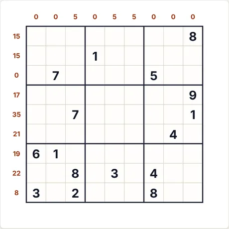 Puzzle inicial (9×9 · médio · 16 pistas)</td><td align="center">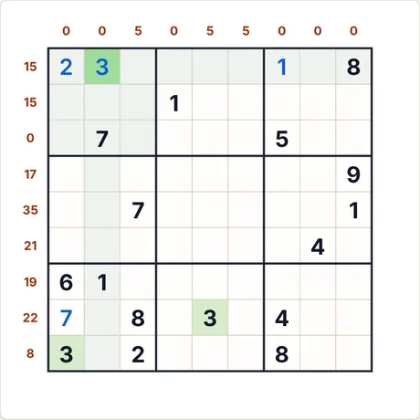 Após 4 passos de «Passo a passo»</td></tr></table>

- **Último passo explicado pela aplicação:** 3 (linha 1, col. 2): resulta das regras específicas da variante (pistas, somas, relações), combinadas com os restantes algarismos.
- **Código para o mesmo puzzle:** `sandwich-9-medium-4184518699` (cola-o em «Novo jogo → Código») · esforço do resolvedor: sem ramificações

<b>Galeria completa: todos os tipos de capturas</b>

<b>Atlas</b>

<table>
<tr><td align="center" valign="top">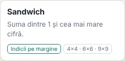 O cartão no Atlas</td><td align="center" valign="top">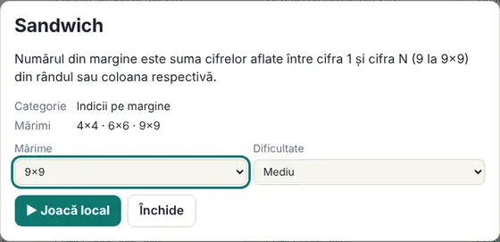 A ficha (abre-se ao clicar no cartão)</td></tr>
</table>

<b>Tamanhos (nível médio)</b>

<table>
<tr><td align="center" valign="top">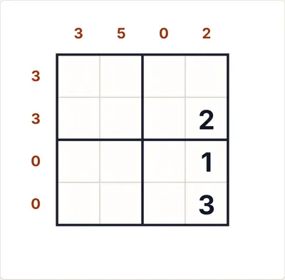 4×4</td><td align="center" valign="top">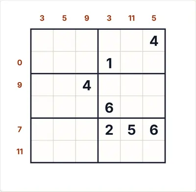 6×6</td><td align="center" valign="top">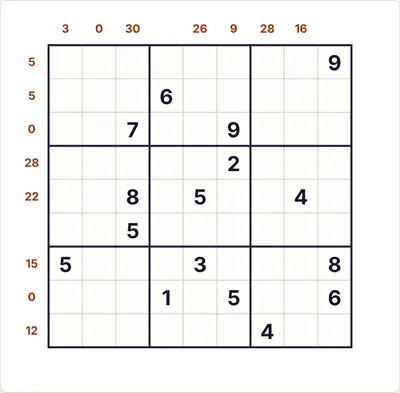 9×9</td></tr>
</table>

<b>Dificuldade</b>

<table>
<tr><td align="center" valign="top">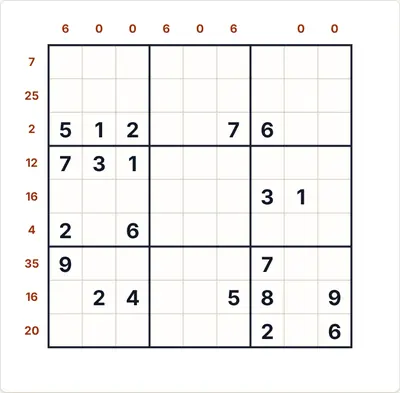 Fácil</td><td align="center" valign="top"> Médio</td><td align="center" valign="top">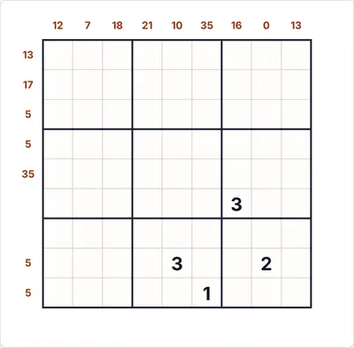 Difícil</td></tr>
</table>

<b>Estados de jogo</b>

<table>
<tr><td align="center" valign="top">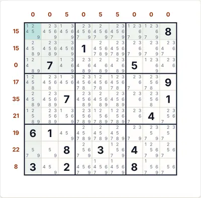 Notas automáticas (candidatos)</td><td align="center" valign="top">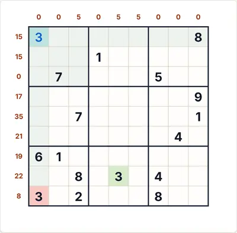 «Verificar» com um algarismo errado (vermelho)</td><td align="center" valign="top">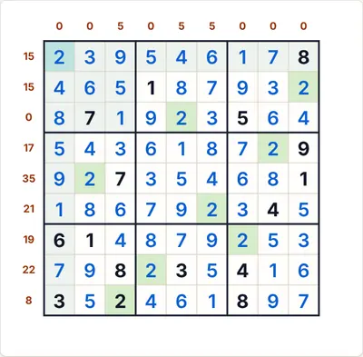 A solução completa</td></tr>
</table>

<b>Temas e dispositivos</b>

<table>
<tr><td align="center" valign="top">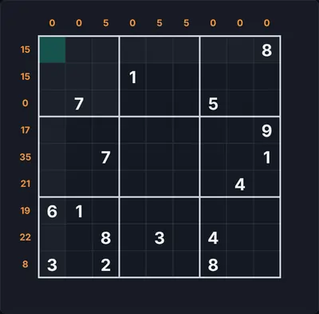 Tema escuro</td><td align="center" valign="top">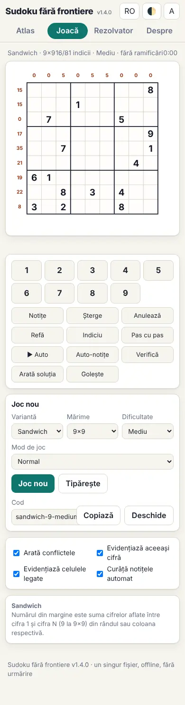 Telemóvel (390 px)</td><td align="center" valign="top">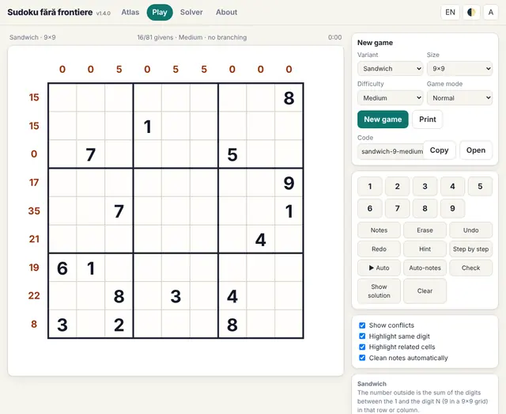 Interface em inglês</td></tr>
</table>

<b>O painel de regras no jogo</b>

<table>
<tr><td align="center" valign="top">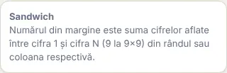 As regras apresentadas junto ao tabuleiro</td></tr>
</table>

#### 42. Somas X · X-Sums (`xsum`)

**Primeiro algarismo = quantas células se somam.**

Se o primeiro algarismo de uma linha ou coluna é k, a soma dos primeiros k algarismos (a partir dessa extremidade) é o número da margem.

<table><tr><td align="center">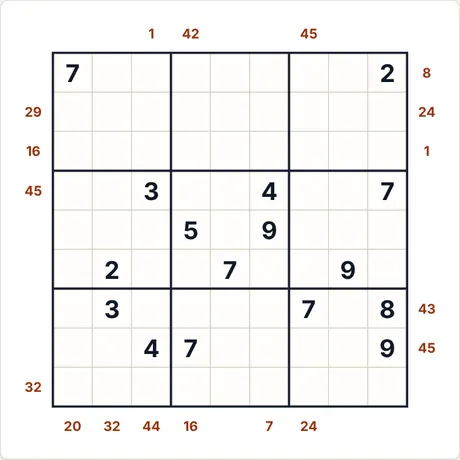 Puzzle inicial (9×9 · médio · 16 pistas)</td><td align="center">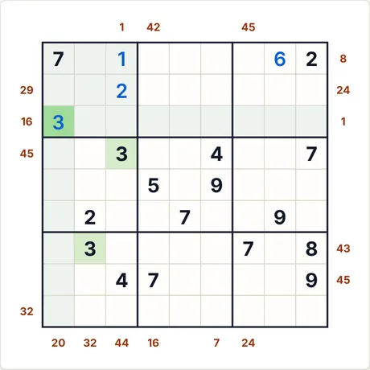 Após 4 passos de «Passo a passo»</td></tr></table>

- **Último passo explicado pela aplicação:** 3 (linha 3, col. 1): resulta das regras específicas da variante (pistas, somas, relações), combinadas com os restantes algarismos.
- **Código para o mesmo puzzle:** `xsum-9-medium-920107551` (cola-o em «Novo jogo → Código») · esforço do resolvedor: 5 ramificações

<b>Galeria completa: todos os tipos de capturas</b>

<b>Atlas</b>

<table>
<tr><td align="center" valign="top">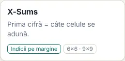 O cartão no Atlas</td><td align="center" valign="top"> A ficha (abre-se ao clicar no cartão)</td></tr>
</table>

<b>Tamanhos (nível médio)</b>

<table>
<tr><td align="center" valign="top">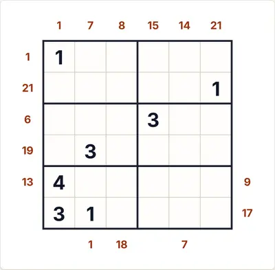 6×6</td><td align="center" valign="top">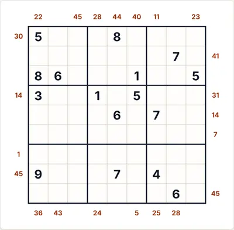 9×9</td></tr>
</table>

<b>Dificuldade</b>

<table>
<tr><td align="center" valign="top">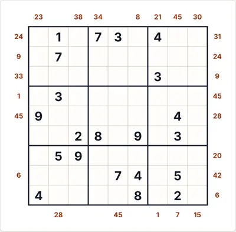 Fácil</td><td align="center" valign="top"> Médio</td><td align="center" valign="top">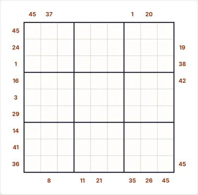 Difícil</td></tr>
</table>

<b>Estados de jogo</b>

<table>
<tr><td align="center" valign="top">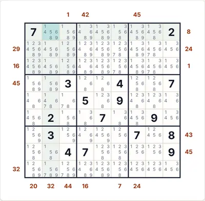 Notas automáticas (candidatos)</td><td align="center" valign="top">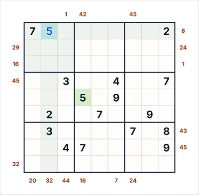 «Verificar» com um algarismo errado (vermelho)</td><td align="center" valign="top">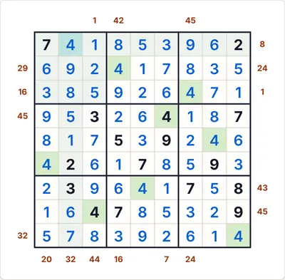 A solução completa</td></tr>
</table>

<b>Temas e dispositivos</b>

<table>
<tr><td align="center" valign="top">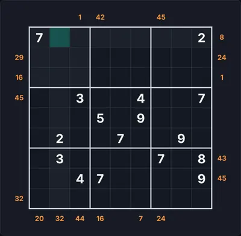 Tema escuro</td><td align="center" valign="top">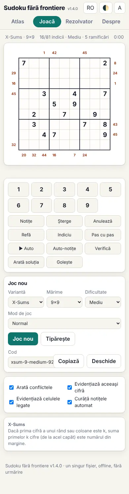 Telemóvel (390 px)</td><td align="center" valign="top">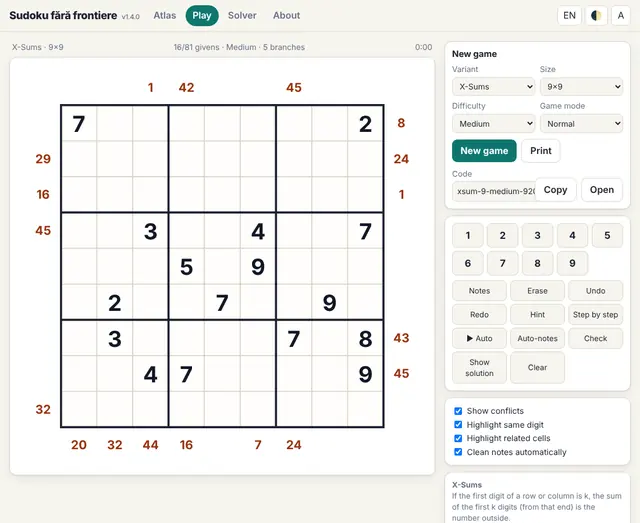 Interface em inglês</td></tr>
</table>

<b>O painel de regras no jogo</b>

<table>
<tr><td align="center" valign="top">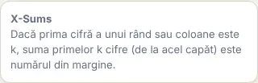 As regras apresentadas junto ao tabuleiro</td></tr>
</table>

#### 43. Moldura (primeiros três) · Frame (first three) (`frame`)

**A soma dos três primeiros algarismos.**

O número na margem é a soma dos três primeiros algarismos da linha ou coluna, a partir dessa extremidade.

<table><tr><td align="center">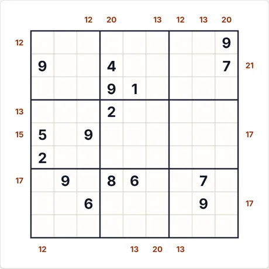 Puzzle inicial (9×9 · médio · 16 pistas)</td><td align="center">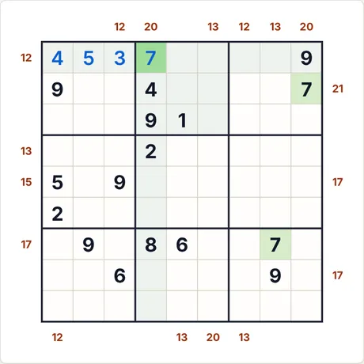 Após 4 passos de «Passo a passo»</td></tr></table>

- **Último passo explicado pela aplicação:** 7 (linha 1, col. 4): resulta das regras específicas da variante (pistas, somas, relações), combinadas com os restantes algarismos.
- **Código para o mesmo puzzle:** `frame-9-medium-3867362192` (cola-o em «Novo jogo → Código») · esforço do resolvedor: sem ramificações

<b>Galeria completa: todos os tipos de capturas</b>

<b>Atlas</b>

<table>
<tr><td align="center" valign="top">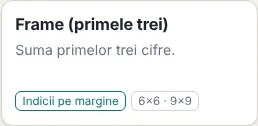 O cartão no Atlas</td><td align="center" valign="top">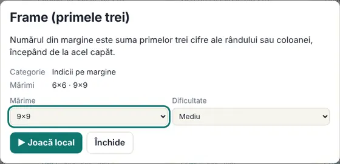 A ficha (abre-se ao clicar no cartão)</td></tr>
</table>

<b>Tamanhos (nível médio)</b>

<table>
<tr><td align="center" valign="top">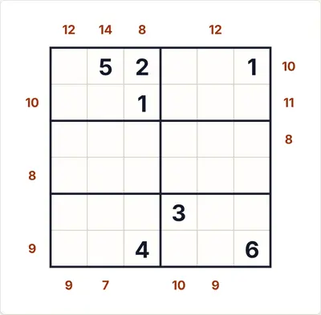 6×6</td><td align="center" valign="top">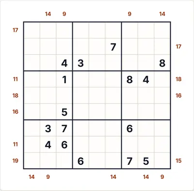 9×9</td></tr>
</table>

<b>Dificuldade</b>

<table>
<tr><td align="center" valign="top">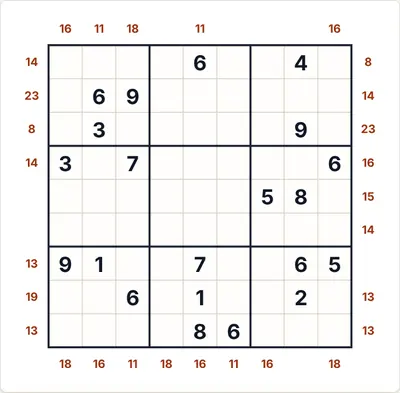 Fácil</td><td align="center" valign="top"> Médio</td><td align="center" valign="top">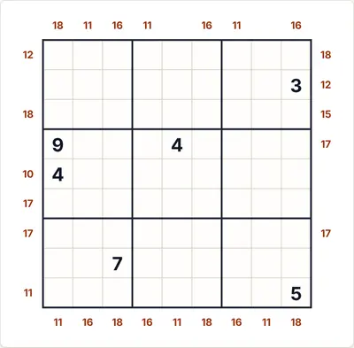 Difícil</td></tr>
</table>

<b>Estados de jogo</b>

<table>
<tr><td align="center" valign="top">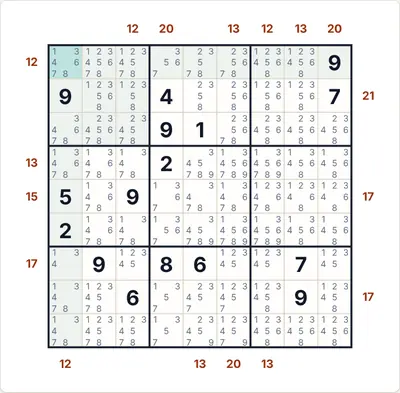 Notas automáticas (candidatos)</td><td align="center" valign="top">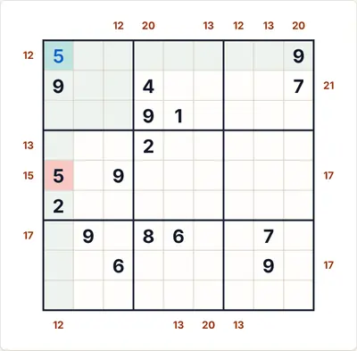 «Verificar» com um algarismo errado (vermelho)</td><td align="center" valign="top">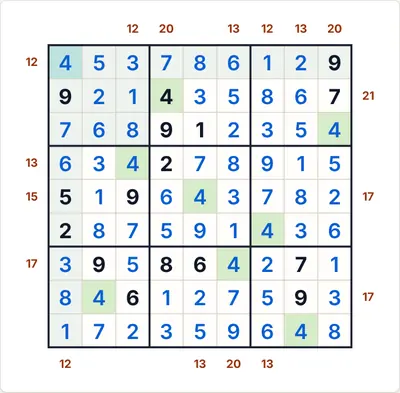 A solução completa</td></tr>
</table>

<b>Temas e dispositivos</b>

<table>
<tr><td align="center" valign="top">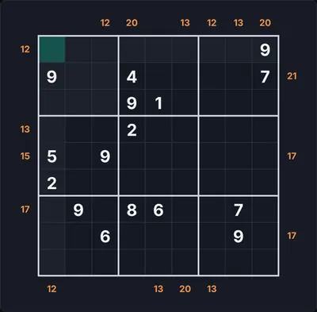 Tema escuro</td><td align="center" valign="top">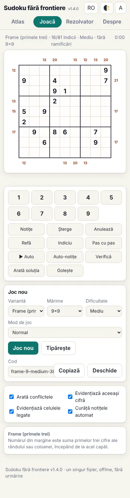 Telemóvel (390 px)</td><td align="center" valign="top">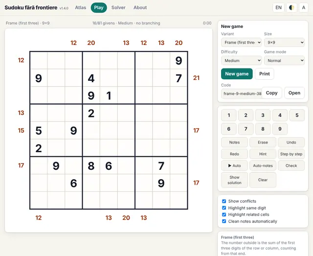 Interface em inglês</td></tr>
</table>

<b>O painel de regras no jogo</b>

<table>
<tr><td align="center" valign="top">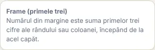 As regras apresentadas junto ao tabuleiro</td></tr>
</table>

#### 44. Arranha-céus · Skyscrapers (`skyscraper`)

**Quantos edifícios se veem da margem.**

Os algarismos são alturas de edifícios. O número na margem indica quantos edifícios se veem a partir dessa extremidade (um edifício esconde os mais baixos que estão atrás dele).

<table><tr><td align="center">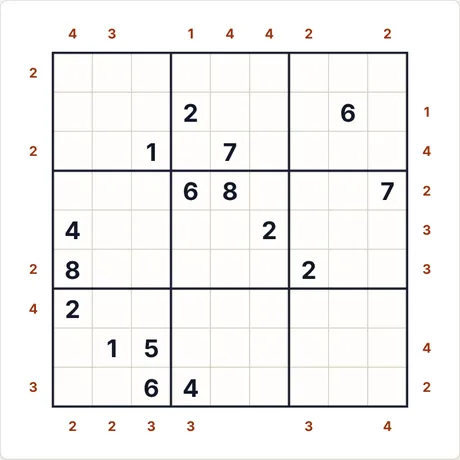 Puzzle inicial (9×9 · médio · 16 pistas)</td><td align="center">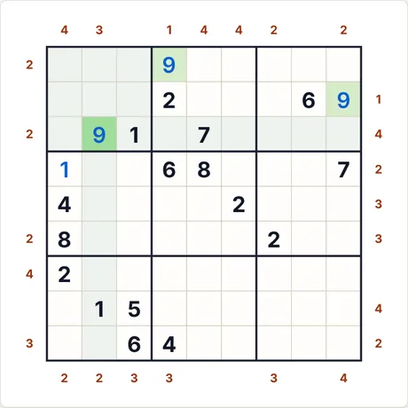 Após 4 passos de «Passo a passo»</td></tr></table>

- **Último passo explicado pela aplicação:** 9 (linha 3, col. 2): resulta das regras específicas da variante (pistas, somas, relações), combinadas com os restantes algarismos.
- **Código para o mesmo puzzle:** `skyscraper-9-medium-1967302454` (cola-o em «Novo jogo → Código») · esforço do resolvedor: 143 ramificações

<b>Galeria completa: todos os tipos de capturas</b>

<b>Atlas</b>

<table>
<tr><td align="center" valign="top">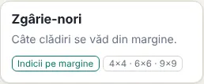 O cartão no Atlas</td><td align="center" valign="top">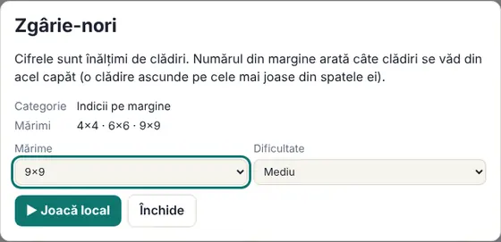 A ficha (abre-se ao clicar no cartão)</td></tr>
</table>

<b>Tamanhos (nível médio)</b>

<table>
<tr><td align="center" valign="top">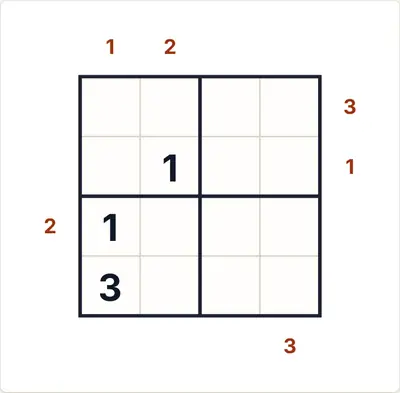 4×4</td><td align="center" valign="top"> 6×6</td><td align="center" valign="top"> 9×9</td></tr>
</table>

<b>Dificuldade</b>

<table>
<tr><td align="center" valign="top"> Fácil</td><td align="center" valign="top"> Médio</td><td align="center" valign="top"> Difícil</td></tr>
</table>

<b>Estados de jogo</b>

<table>
<tr><td align="center" valign="top"> Notas automáticas (candidatos)</td><td align="center" valign="top"> «Verificar» com um algarismo errado (vermelho)</td><td align="center" valign="top"> A solução completa</td></tr>
</table>

<b>Temas e dispositivos</b>

<table>
<tr><td align="center" valign="top"> Tema escuro</td><td align="center" valign="top"> Telemóvel (390 px)</td><td align="center" valign="top"> Interface em inglês</td></tr>
</table>

<b>O painel de regras no jogo</b>

<table>
<tr><td align="center" valign="top"> As regras apresentadas junto ao tabuleiro</td></tr>
</table>

#### 45. Rossini · Rossini (`rossini`)

**Seta na margem: os três primeiros algarismos crescem num sentido.**

Uma seta fora da grelha indica que os três primeiros algarismos, a partir dessa extremidade, são estritamente monótonos: crescem no sentido para onde a seta aponta (para o interior da grelha) ou, se a seta aponta para a margem, crescem em direção à margem, isto é, decrescem para o interior. Convenção: a ponta da seta aponta para o maior algarismo. A ausência de seta não indica nada (não é a variante Rossini clássica, em que as extremidades sem seta excluem as sequências monótonas).

<table><tr><td align="center"> Puzzle inicial (9×9 · médio · 19 pistas)</td><td align="center"> Após 4 passos de «Passo a passo»</td></tr></table>

- **Último passo explicado pela aplicação:** 8 (linha 1, col. 7): é a única célula da coluna assinalada onde o 8 pode estar.
- **Código para o mesmo puzzle:** `rossini-9-medium-4071954052` (cola-o em «Novo jogo → Código») · esforço do resolvedor: 2 ramificações

<b>Galeria completa: todos os tipos de capturas</b>

<b>Atlas</b>

<table>
<tr><td align="center" valign="top"> O cartão no Atlas</td><td align="center" valign="top"> A ficha (abre-se ao clicar no cartão)</td></tr>
</table>

<b>Tamanhos (nível médio)</b>

<table>
<tr><td align="center" valign="top"> 4×4</td><td align="center" valign="top"> 6×6</td><td align="center" valign="top"> 9×9</td></tr>
</table>

<b>Dificuldade</b>

<table>
<tr><td align="center" valign="top"> Fácil</td><td align="center" valign="top"> Médio</td><td align="center" valign="top"> Difícil</td></tr>
</table>

<b>Estados de jogo</b>

<table>
<tr><td align="center" valign="top"> Notas automáticas (candidatos)</td><td align="center" valign="top"> «Verificar» com um algarismo errado (vermelho)</td><td align="center" valign="top"> A solução completa</td></tr>
</table>

<b>Temas e dispositivos</b>

<table>
<tr><td align="center" valign="top"> Tema escuro</td><td align="center" valign="top"> Telemóvel (390 px)</td><td align="center" valign="top"> Interface em inglês</td></tr>
</table>

<b>O painel de regras no jogo</b>

<table>
<tr><td align="center" valign="top"> As regras apresentadas junto ao tabuleiro</td></tr>
</table>

#### 46. Exterior · Outside (`outside`)

**Os algarismos da margem aparecem entre os três primeiros.**

Os algarismos escritos fora da grelha devem aparecer entre as três primeiras células da linha ou coluna respetiva, a partir dessa extremidade, por qualquer ordem. Se forem três algarismos, são exatamente as três células.

<table><tr><td align="center"> Puzzle inicial (9×9 · médio · 23 pistas)</td><td align="center"> Após 4 passos de «Passo a passo»</td></tr></table>

- **Último passo explicado pela aplicação:** 5 (linha 2, col. 5): todos os outros algarismos já aparecem entre as células assinaladas (linha, coluna, região ou regra de vizinhança).
- **Código para o mesmo puzzle:** `outside-9-medium-3531544633` (cola-o em «Novo jogo → Código») · esforço do resolvedor: sem ramificações

<b>Galeria completa: todos os tipos de capturas</b>

<b>Atlas</b>

<table>
<tr><td align="center" valign="top"> O cartão no Atlas</td><td align="center" valign="top"> A ficha (abre-se ao clicar no cartão)</td></tr>
</table>

<b>Tamanhos (nível médio)</b>

<table>
<tr><td align="center" valign="top"> 4×4</td><td align="center" valign="top"> 6×6</td><td align="center" valign="top"> 9×9</td></tr>
</table>

<b>Dificuldade</b>

<table>
<tr><td align="center" valign="top"> Fácil</td><td align="center" valign="top"> Médio</td><td align="center" valign="top"> Difícil</td></tr>
</table>

<b>Estados de jogo</b>

<table>
<tr><td align="center" valign="top"> Notas automáticas (candidatos)</td><td align="center" valign="top"> «Verificar» com um algarismo errado (vermelho)</td><td align="center" valign="top"> A solução completa</td></tr>
</table>

<b>Temas e dispositivos</b>

<table>
<tr><td align="center" valign="top"> Tema escuro</td><td align="center" valign="top"> Telemóvel (390 px)</td><td align="center" valign="top"> Interface em inglês</td></tr>
</table>

<b>O painel de regras no jogo</b>

<table>
<tr><td align="center" valign="top"> As regras apresentadas junto ao tabuleiro</td></tr>
</table>

#### 47. Radar · Radar (`radar`)

**A pista diz onde está o maior.**

Além das regras clássicas, um número fora da grelha indica em que posição (contando a partir dessa extremidade) se encontra o maior algarismo (9 em 9×9) na linha ou coluna respetiva.

<table><tr><td align="center"> Puzzle inicial (9×9 · médio · 21 pistas)</td><td align="center"> Após 4 passos de «Passo a passo»</td></tr></table>

- **Último passo explicado pela aplicação:** 4 (linha 3, col. 6): é a única célula da linha assinalada onde o 4 pode estar.
- **Código para o mesmo puzzle:** `radar-9-medium-2588350498` (cola-o em «Novo jogo → Código») · esforço do resolvedor: sem ramificações

<b>Galeria completa: todos os tipos de capturas</b>

<b>Atlas</b>

<table>
<tr><td align="center" valign="top"> O cartão no Atlas</td><td align="center" valign="top"> A ficha (abre-se ao clicar no cartão)</td></tr>
</table>

<b>Tamanhos (nível médio)</b>

<table>
<tr><td align="center" valign="top"> 4×4</td><td align="center" valign="top"> 6×6</td><td align="center" valign="top"> 9×9</td></tr>
</table>

<b>Dificuldade</b>

<table>
<tr><td align="center" valign="top"> Fácil</td><td align="center" valign="top"> Médio</td><td align="center" valign="top"> Difícil</td></tr>
</table>

<b>Estados de jogo</b>

<table>
<tr><td align="center" valign="top"> Notas automáticas (candidatos)</td><td align="center" valign="top"> «Verificar» com um algarismo errado (vermelho)</td><td align="center" valign="top"> A solução completa</td></tr>
</table>

<b>Temas e dispositivos</b>

<table>
<tr><td align="center" valign="top"> Tema escuro</td><td align="center" valign="top"> Telemóvel (390 px)</td><td align="center" valign="top"> Interface em inglês</td></tr>
</table>

<b>O painel de regras no jogo</b>

<table>
<tr><td align="center" valign="top"> As regras apresentadas junto ao tabuleiro</td></tr>
</table>

#### 48. Sanduíche numérico · Counting sandwich (`sandnum`)

**Quantas células há entre o 1 e o N.**

Além das regras clássicas, um número fora da grelha indica quantas células se encontram entre o algarismo 1 e o algarismo N (9 em 9×9) na linha ou coluna respetiva.

<table><tr><td align="center"> Puzzle inicial (9×9 · médio · 19 pistas)</td><td align="center"> Após 4 passos de «Passo a passo»</td></tr></table>

- **Último passo explicado pela aplicação:** 8 (linha 6, col. 5): é a única célula da coluna assinalada onde o 8 pode estar.
- **Código para o mesmo puzzle:** `sandnum-9-medium-2830514440` (cola-o em «Novo jogo → Código») · esforço do resolvedor: 1802 ramificações

<b>Galeria completa: todos os tipos de capturas</b>

<b>Atlas</b>

<table>
<tr><td align="center" valign="top"> O cartão no Atlas</td><td align="center" valign="top"> A ficha (abre-se ao clicar no cartão)</td></tr>
</table>

<b>Tamanhos (nível médio)</b>

<table>
<tr><td align="center" valign="top"> 4×4</td><td align="center" valign="top"> 6×6</td><td align="center" valign="top"> 9×9</td></tr>
</table>

<b>Dificuldade</b>

<table>
<tr><td align="center" valign="top"> Fácil</td><td align="center" valign="top"> Médio</td><td align="center" valign="top"> Difícil</td></tr>
</table>

<b>Estados de jogo</b>

<table>
<tr><td align="center" valign="top"> Notas automáticas (candidatos)</td><td align="center" valign="top"> «Verificar» com um algarismo errado (vermelho)</td><td align="center" valign="top"> A solução completa</td></tr>
</table>

<b>Temas e dispositivos</b>

<table>
<tr><td align="center" valign="top"> Tema escuro</td><td align="center" valign="top"> Telemóvel (390 px)</td><td align="center" valign="top"> Interface em inglês</td></tr>
</table>

<b>O painel de regras no jogo</b>

<table>
<tr><td align="center" valign="top"> As regras apresentadas junto ao tabuleiro</td></tr>
</table>

#### 49. Sanduíche de paridade · Parity sandwich (`sandpar`)

**Quantos algarismos ímpares há entre o 1 e o N.**

Além das regras clássicas, um número fora da grelha indica quantos algarismos ímpares se encontram entre o 1 e o N na linha ou coluna respetiva.

<table><tr><td align="center"> Puzzle inicial (9×9 · médio · 19 pistas)</td><td align="center"> Após 4 passos de «Passo a passo»</td></tr></table>

- **Último passo explicado pela aplicação:** 2 (linha 5, col. 5): nenhuma dedução direta; o algarismo é tirado da solução única (seria necessária uma hipótese).
- **Código para o mesmo puzzle:** `sandpar-9-medium-3081747068` (cola-o em «Novo jogo → Código») · esforço do resolvedor: 38 ramificações

<b>Galeria completa: todos os tipos de capturas</b>

<b>Atlas</b>

<table>
<tr><td align="center" valign="top"> O cartão no Atlas</td><td align="center" valign="top"> A ficha (abre-se ao clicar no cartão)</td></tr>
</table>

<b>Tamanhos (nível médio)</b>

<table>
<tr><td align="center" valign="top"> 6×6</td><td align="center" valign="top"> 9×9</td></tr>
</table>

<b>Dificuldade</b>

<table>
<tr><td align="center" valign="top"> Fácil</td><td align="center" valign="top"> Médio</td><td align="center" valign="top"> Difícil</td></tr>
</table>

<b>Estados de jogo</b>

<table>
<tr><td align="center" valign="top"> Notas automáticas (candidatos)</td><td align="center" valign="top"> «Verificar» com um algarismo errado (vermelho)</td><td align="center" valign="top"> A solução completa</td></tr>
</table>

<b>Temas e dispositivos</b>

<table>
<tr><td align="center" valign="top"> Tema escuro</td><td align="center" valign="top"> Telemóvel (390 px)</td><td align="center" valign="top"> Interface em inglês</td></tr>
</table>

<b>O painel de regras no jogo</b>

<table>
<tr><td align="center" valign="top"> As regras apresentadas junto ao tabuleiro</td></tr>
</table>

#### 50. Sanduíche duplo · Double sandwich (`sand2`)

**Duas somas: entre 1 e 9, entre 2 e 8.**

Além das regras clássicas, a pista «a,b» fora da grelha indica: a = a soma dos algarismos entre o 1 e o 9, b = a soma dos algarismos entre o 2 e o 8 na linha ou coluna respetiva. Só 9×9.

<table><tr><td align="center"> Puzzle inicial (9×9 · médio · 16 pistas)</td><td align="center"> Após 4 passos de «Passo a passo»</td></tr></table>

- **Último passo explicado pela aplicação:** 8 (linha 6, col. 9): nenhuma dedução direta; o algarismo é tirado da solução única (seria necessária uma hipótese).
- **Código para o mesmo puzzle:** `sand2-9-medium-1633059211` (cola-o em «Novo jogo → Código») · esforço do resolvedor: 3778 ramificações

<b>Galeria completa: todos os tipos de capturas</b>

<b>Atlas</b>

<table>
<tr><td align="center" valign="top"> O cartão no Atlas</td><td align="center" valign="top"> A ficha (abre-se ao clicar no cartão)</td></tr>
</table>

<b>Tamanhos (nível médio)</b>

<table>
<tr><td align="center" valign="top"> 9×9</td></tr>
</table>

<b>Dificuldade</b>

<table>
<tr><td align="center" valign="top"> Fácil</td><td align="center" valign="top"> Médio</td><td align="center" valign="top"> Difícil</td></tr>
</table>

<b>Estados de jogo</b>

<table>
<tr><td align="center" valign="top"> Notas automáticas (candidatos)</td><td align="center" valign="top"> «Verificar» com um algarismo errado (vermelho)</td><td align="center" valign="top"> A solução completa</td></tr>
</table>

<b>Temas e dispositivos</b>

<table>
<tr><td align="center" valign="top"> Tema escuro</td><td align="center" valign="top"> Telemóvel (390 px)</td><td align="center" valign="top"> Interface em inglês</td></tr>
</table>

<b>O painel de regras no jogo</b>

<table>
<tr><td align="center" valign="top"> As regras apresentadas junto ao tabuleiro</td></tr>
</table>

#### 51. Cave · Basement (`subsol`)

**Como os Arranha-céus, mas com os algarismos invertidos.**

Além das regras clássicas, um número fora da grelha indica quantas vezes, olhando a partir dessa extremidade, aparece um algarismo menor do que todos os que o precedem (o primeiro algarismo conta). É o oposto dos arranha-céus: aqui contamos os mínimos sucessivos. É o Arranha-céus com os algarismos invertidos (d passa a N+1−d), pelo que é logicamente isomorfo a este.

<table><tr><td align="center"> Puzzle inicial (9×9 · médio · 16 pistas)</td><td align="center"> Após 4 passos de «Passo a passo»</td></tr></table>

- **Último passo explicado pela aplicação:** 8 (linha 1, col. 4): nenhuma dedução direta; o algarismo é tirado da solução única (seria necessária uma hipótese).
- **Código para o mesmo puzzle:** `subsol-9-medium-2589656574` (cola-o em «Novo jogo → Código») · esforço do resolvedor: 487 ramificações

<b>Galeria completa: todos os tipos de capturas</b>

<b>Atlas</b>

<table>
<tr><td align="center" valign="top"> O cartão no Atlas</td><td align="center" valign="top"> A ficha (abre-se ao clicar no cartão)</td></tr>
</table>

<b>Tamanhos (nível médio)</b>

<table>
<tr><td align="center" valign="top"> 4×4</td><td align="center" valign="top"> 6×6</td><td align="center" valign="top"> 9×9</td></tr>
</table>

<b>Dificuldade</b>

<table>
<tr><td align="center" valign="top"> Fácil</td><td align="center" valign="top"> Médio</td><td align="center" valign="top"> Difícil</td></tr>
</table>

<b>Estados de jogo</b>

<table>
<tr><td align="center" valign="top"> Notas automáticas (candidatos)</td><td align="center" valign="top"> «Verificar» com um algarismo errado (vermelho)</td><td align="center" valign="top"> A solução completa</td></tr>
</table>

<b>Temas e dispositivos</b>

<table>
<tr><td align="center" valign="top"> Tema escuro</td><td align="center" valign="top"> Telemóvel (390 px)</td><td align="center" valign="top"> Interface em inglês</td></tr>
</table>

<b>O painel de regras no jogo</b>

<table>
<tr><td align="center" valign="top"> As regras apresentadas junto ao tabuleiro</td></tr>
</table>

#### 52. Produto na margem · Edge product (`prodmargin`)

**O produto dos dois primeiros algarismos.**

Além das regras clássicas, um número fora da grelha é o produto dos dois primeiros algarismos da linha ou coluna respetiva, olhando a partir dessa extremidade.

<table><tr><td align="center"> Puzzle inicial (9×9 · médio · 18 pistas)</td><td align="center"> Após 4 passos de «Passo a passo»</td></tr></table>

- **Último passo explicado pela aplicação:** 1 (linha 3, col. 8): é a única célula da linha assinalada onde o 1 pode estar.
- **Código para o mesmo puzzle:** `prodmargin-9-medium-3463419111` (cola-o em «Novo jogo → Código») · esforço do resolvedor: 618 ramificações

<b>Galeria completa: todos os tipos de capturas</b>

<b>Atlas</b>

<table>
<tr><td align="center" valign="top"> O cartão no Atlas</td><td align="center" valign="top"> A ficha (abre-se ao clicar no cartão)</td></tr>
</table>

<b>Tamanhos (nível médio)</b>

<table>
<tr><td align="center" valign="top"> 4×4</td><td align="center" valign="top"> 6×6</td><td align="center" valign="top"> 9×9</td></tr>
</table>

<b>Dificuldade</b>

<table>
<tr><td align="center" valign="top"> Fácil</td><td align="center" valign="top"> Médio</td><td align="center" valign="top"> Difícil</td></tr>
</table>

<b>Estados de jogo</b>

<table>
<tr><td align="center" valign="top"> Notas automáticas (candidatos)</td><td align="center" valign="top"> «Verificar» com um algarismo errado (vermelho)</td><td align="center" valign="top"> A solução completa</td></tr>
</table>

<b>Temas e dispositivos</b>

<table>
<tr><td align="center" valign="top"> Tema escuro</td><td align="center" valign="top"> Telemóvel (390 px)</td><td align="center" valign="top"> Interface em inglês</td></tr>
</table>

<b>O painel de regras no jogo</b>

<table>
<tr><td align="center" valign="top"> As regras apresentadas junto ao tabuleiro</td></tr>
</table>

#### 53. Diferença na margem · Edge difference (`diffmargin`)

**A diferença dos dois primeiros algarismos.**

Além das regras clássicas, um número fora da grelha é a diferença (em valor absoluto) entre os dois primeiros algarismos da linha ou coluna respetiva, olhando a partir dessa extremidade.

<table><tr><td align="center"> Puzzle inicial (9×9 · médio · 18 pistas)</td><td align="center"> Após 4 passos de «Passo a passo»</td></tr></table>

- **Último passo explicado pela aplicação:** 2 (linha 6, col. 4): é a única célula da linha assinalada onde o 2 pode estar.
- **Código para o mesmo puzzle:** `diffmargin-9-medium-4161532716` (cola-o em «Novo jogo → Código») · esforço do resolvedor: 313 ramificações

<b>Galeria completa: todos os tipos de capturas</b>

<b>Atlas</b>

<table>
<tr><td align="center" valign="top"> O cartão no Atlas</td><td align="center" valign="top"> A ficha (abre-se ao clicar no cartão)</td></tr>
</table>

<b>Tamanhos (nível médio)</b>

<table>
<tr><td align="center" valign="top"> 4×4</td><td align="center" valign="top"> 6×6</td><td align="center" valign="top"> 9×9</td></tr>
</table>

<b>Dificuldade</b>

<table>
<tr><td align="center" valign="top"> Fácil</td><td align="center" valign="top"> Médio</td><td align="center" valign="top"> Difícil</td></tr>
</table>

<b>Estados de jogo</b>

<table>
<tr><td align="center" valign="top"> Notas automáticas (candidatos)</td><td align="center" valign="top"> «Verificar» com um algarismo errado (vermelho)</td><td align="center" valign="top"> A solução completa</td></tr>
</table>

<b>Temas e dispositivos</b>

<table>
<tr><td align="center" valign="top"> Tema escuro</td><td align="center" valign="top"> Telemóvel (390 px)</td><td align="center" valign="top"> Interface em inglês</td></tr>
</table>

<b>O painel de regras no jogo</b>

<table>
<tr><td align="center" valign="top"> As regras apresentadas junto ao tabuleiro</td></tr>
</table>

#### 54. Subidas · Ascents (`ascents`)

**Quantos pares vizinhos sobem.**

Além das regras clássicas, um número fora da grelha indica quantas vezes, olhando a partir dessa extremidade, um algarismo é seguido imediatamente por um maior.

<table><tr><td align="center"> Puzzle inicial (9×9 · médio · 18 pistas)</td><td align="center"> Após 4 passos de «Passo a passo»</td></tr></table>

- **Último passo explicado pela aplicação:** 9 (linha 2, col. 3): é a única célula da coluna assinalada onde o 9 pode estar.
- **Código para o mesmo puzzle:** `ascents-9-medium-1827630994` (cola-o em «Novo jogo → Código») · esforço do resolvedor: 361 ramificações

<b>Galeria completa: todos os tipos de capturas</b>

<b>Atlas</b>

<table>
<tr><td align="center" valign="top"> O cartão no Atlas</td><td align="center" valign="top"> A ficha (abre-se ao clicar no cartão)</td></tr>
</table>

<b>Tamanhos (nível médio)</b>

<table>
<tr><td align="center" valign="top"> 4×4</td><td align="center" valign="top"> 6×6</td><td align="center" valign="top"> 9×9</td></tr>
</table>

<b>Dificuldade</b>

<table>
<tr><td align="center" valign="top"> Fácil</td><td align="center" valign="top"> Médio</td><td align="center" valign="top"> Difícil</td></tr>
</table>

<b>Estados de jogo</b>

<table>
<tr><td align="center" valign="top"> Notas automáticas (candidatos)</td><td align="center" valign="top"> «Verificar» com um algarismo errado (vermelho)</td><td align="center" valign="top"> A solução completa</td></tr>
</table>

<b>Temas e dispositivos</b>

<table>
<tr><td align="center" valign="top"> Tema escuro</td><td align="center" valign="top"> Telemóvel (390 px)</td><td align="center" valign="top"> Interface em inglês</td></tr>
</table>

<b>O painel de regras no jogo</b>

<table>
<tr><td align="center" valign="top"> As regras apresentadas junto ao tabuleiro</td></tr>
</table>

#### 55. Inversões · Inversions (`inversions`)

**Quantos pares estão em ordem inversa.**

Além das regras clássicas, um número fora da grelha é o número de inversões da linha/coluna vista a partir dessa extremidade: quantos pares de algarismos (não necessariamente vizinhos) têm o da frente maior do que o que vem depois.

<table><tr><td align="center"> Puzzle inicial (9×9 · médio · 18 pistas)</td><td align="center"> Após 4 passos de «Passo a passo»</td></tr></table>

- **Último passo explicado pela aplicação:** 7 (linha 7, col. 6): todos os outros algarismos já aparecem entre as células assinaladas (linha, coluna, região ou regra de vizinhança).
- **Código para o mesmo puzzle:** `inversions-9-medium-2138830078` (cola-o em «Novo jogo → Código») · esforço do resolvedor: 62 ramificações

<b>Galeria completa: todos os tipos de capturas</b>

<b>Atlas</b>

<table>
<tr><td align="center" valign="top"> O cartão no Atlas</td><td align="center" valign="top"> A ficha (abre-se ao clicar no cartão)</td></tr>
</table>

<b>Tamanhos (nível médio)</b>

<table>
<tr><td align="center" valign="top"> 4×4</td><td align="center" valign="top"> 6×6</td><td align="center" valign="top"> 9×9</td></tr>
</table>

<b>Dificuldade</b>

<table>
<tr><td align="center" valign="top"> Fácil</td><td align="center" valign="top"> Médio</td><td align="center" valign="top"> Difícil</td></tr>
</table>

<b>Estados de jogo</b>

<table>
<tr><td align="center" valign="top"> Notas automáticas (candidatos)</td><td align="center" valign="top"> «Verificar» com um algarismo errado (vermelho)</td><td align="center" valign="top"> A solução completa</td></tr>
</table>

<b>Temas e dispositivos</b>

<table>
<tr><td align="center" valign="top"> Tema escuro</td><td align="center" valign="top"> Telemóvel (390 px)</td><td align="center" valign="top"> Interface em inglês</td></tr>
</table>

<b>O painel de regras no jogo</b>

<table>
<tr><td align="center" valign="top"> As regras apresentadas junto ao tabuleiro</td></tr>
</table>

#### 56. Ciclos · Cycles (`cycles`)

**Quantos ciclos tem a permutação.**

Além das regras clássicas, a linha/coluna lida a partir da extremidade é uma permutação (a posição i tem o algarismo a_i). A pista fora da grelha é o número de ciclos da permutação (a posição i remete para a posição a_i). Tamanhos 9×9 e 6×6.

<table><tr><td align="center"> Puzzle inicial (9×9 · médio · 18 pistas)</td><td align="center"> Após 4 passos de «Passo a passo»</td></tr></table>

- **Último passo explicado pela aplicação:** 4 (linha 2, col. 6): é a única célula da região assinalada onde o 4 pode estar.
- **Código para o mesmo puzzle:** `cycles-9-medium-708965529` (cola-o em «Novo jogo → Código») · esforço do resolvedor: 562 ramificações

<b>Galeria completa: todos os tipos de capturas</b>

<b>Atlas</b>

<table>
<tr><td align="center" valign="top"> O cartão no Atlas</td><td align="center" valign="top"> A ficha (abre-se ao clicar no cartão)</td></tr>
</table>

<b>Tamanhos (nível médio)</b>

<table>
<tr><td align="center" valign="top"> 6×6</td><td align="center" valign="top"> 9×9</td></tr>
</table>

<b>Dificuldade</b>

<table>
<tr><td align="center" valign="top"> Fácil</td><td align="center" valign="top"> Médio</td><td align="center" valign="top"> Difícil</td></tr>
</table>

<b>Estados de jogo</b>

<table>
<tr><td align="center" valign="top"> Notas automáticas (candidatos)</td><td align="center" valign="top"> «Verificar» com um algarismo errado (vermelho)</td><td align="center" valign="top"> A solução completa</td></tr>
</table>

<b>Temas e dispositivos</b>

<table>
<tr><td align="center" valign="top"> Tema escuro</td><td align="center" valign="top"> Telemóvel (390 px)</td><td align="center" valign="top"> Interface em inglês</td></tr>
</table>

<b>O painel de regras no jogo</b>

<table>
<tr><td align="center" valign="top"> As regras apresentadas junto ao tabuleiro</td></tr>
</table>

#### 57. Pontos fixos · Fixed points (`fixedpts`)

**Quantos algarismos estão na sua posição.**

Além das regras clássicas, um número fora da grelha indica quantos algarismos se encontram na posição igual ao seu valor (a segunda célula contém 2, etc.), contando a partir dessa extremidade. Tamanhos 9×9 e 6×6.

<table><tr><td align="center"> Puzzle inicial (9×9 · médio · 18 pistas)</td><td align="center"> Após 4 passos de «Passo a passo»</td></tr></table>

- **Último passo explicado pela aplicação:** 3 (linha 1, col. 8): nenhuma dedução direta; o algarismo é tirado da solução única (seria necessária uma hipótese).
- **Código para o mesmo puzzle:** `fixedpts-9-medium-3926317386` (cola-o em «Novo jogo → Código») · esforço do resolvedor: 4802 ramificações

<b>Galeria completa: todos os tipos de capturas</b>

<b>Atlas</b>

<table>
<tr><td align="center" valign="top"> O cartão no Atlas</td><td align="center" valign="top"> A ficha (abre-se ao clicar no cartão)</td></tr>
</table>

<b>Tamanhos (nível médio)</b>

<table>
<tr><td align="center" valign="top"> 6×6</td><td align="center" valign="top"> 9×9</td></tr>
</table>

<b>Dificuldade</b>

<table>
<tr><td align="center" valign="top"> Fácil</td><td align="center" valign="top"> Médio</td><td align="center" valign="top"> Difícil</td></tr>
</table>

<b>Estados de jogo</b>

<table>
<tr><td align="center" valign="top"> Notas automáticas (candidatos)</td><td align="center" valign="top"> «Verificar» com um algarismo errado (vermelho)</td><td align="center" valign="top"> A solução completa</td></tr>
</table>

<b>Temas e dispositivos</b>

<table>
<tr><td align="center" valign="top"> Tema escuro</td><td align="center" valign="top"> Telemóvel (390 px)</td><td align="center" valign="top"> Interface em inglês</td></tr>
</table>

<b>O painel de regras no jogo</b>

<table>
<tr><td align="center" valign="top"> As regras apresentadas junto ao tabuleiro</td></tr>
</table>

#### 58. Soma alternada · Alternating sum (`altsum`)

**a₁ − a₂ + a₃ − …**

Além das regras clássicas, um número fora da grelha é a soma alternada dos algarismos, olhando a partir dessa extremidade: o primeiro algarismo menos o segundo mais o terceiro e assim sucessivamente. Pode ser negativo. Tamanhos 9×9 e 6×6.

<table><tr><td align="center"> Puzzle inicial (9×9 · médio · 18 pistas)</td><td align="center"> Após 4 passos de «Passo a passo»</td></tr></table>

- **Último passo explicado pela aplicação:** 3 (linha 9, col. 4): todos os outros algarismos já aparecem entre as células assinaladas (linha, coluna, região ou regra de vizinhança).
- **Código para o mesmo puzzle:** `altsum-9-medium-1703080656` (cola-o em «Novo jogo → Código») · esforço do resolvedor: 2188 ramificações

<b>Galeria completa: todos os tipos de capturas</b>

<b>Atlas</b>

<table>
<tr><td align="center" valign="top"> O cartão no Atlas</td><td align="center" valign="top"> A ficha (abre-se ao clicar no cartão)</td></tr>
</table>

<b>Tamanhos (nível médio)</b>

<table>
<tr><td align="center" valign="top"> 6×6</td><td align="center" valign="top"> 9×9</td></tr>
</table>

<b>Dificuldade</b>

<table>
<tr><td align="center" valign="top"> Fácil</td><td align="center" valign="top"> Médio</td><td align="center" valign="top"> Difícil</td></tr>
</table>

<b>Estados de jogo</b>

<table>
<tr><td align="center" valign="top"> Notas automáticas (candidatos)</td><td align="center" valign="top"> «Verificar» com um algarismo errado (vermelho)</td><td align="center" valign="top"> A solução completa</td></tr>
</table>

<b>Temas e dispositivos</b>

<table>
<tr><td align="center" valign="top"> Tema escuro</td><td align="center" valign="top"> Telemóvel (390 px)</td><td align="center" valign="top"> Interface em inglês</td></tr>
</table>

<b>O painel de regras no jogo</b>

<table>
<tr><td align="center" valign="top"> As regras apresentadas junto ao tabuleiro</td></tr>
</table>

#### 59. Somas X diagonais · Diagonal X-sums (`dxsum`)

**Os primeiros d algarismos numa diagonal, d = o primeiro algarismo.**

Além das regras clássicas, uma pista na extremidade de uma diagonal (que parte da célula da margem) indica a soma das primeiras d células dessa diagonal, em que d é o primeiro algarismo que nela se encontra; se a diagonal tiver menos de d células, soma-se a diagonal inteira (como nas Somas X, mas em diagonais). Tamanhos 9×9 e 6×6.

<table><tr><td align="center"> Puzzle inicial (9×9 · médio · 18 pistas)</td><td align="center"> Após 4 passos de «Passo a passo»</td></tr></table>

- **Último passo explicado pela aplicação:** 1 (linha 8, col. 8): resulta das regras específicas da variante (pistas, somas, relações), combinadas com os restantes algarismos.
- **Código para o mesmo puzzle:** `dxsum-9-medium-391021028` (cola-o em «Novo jogo → Código») · esforço do resolvedor: 256 ramificações

<b>Galeria completa: todos os tipos de capturas</b>

<b>Atlas</b>

<table>
<tr><td align="center" valign="top"> O cartão no Atlas</td><td align="center" valign="top"> A ficha (abre-se ao clicar no cartão)</td></tr>
</table>

<b>Tamanhos (nível médio)</b>

<table>
<tr><td align="center" valign="top"> 6×6</td><td align="center" valign="top"> 9×9</td></tr>
</table>

<b>Dificuldade</b>

<table>
<tr><td align="center" valign="top"> Fácil</td><td align="center" valign="top"> Médio</td><td align="center" valign="top"> Difícil</td></tr>
</table>

<b>Estados de jogo</b>

<table>
<tr><td align="center" valign="top"> Notas automáticas (candidatos)</td><td align="center" valign="top"> «Verificar» com um algarismo errado (vermelho)</td><td align="center" valign="top"> A solução completa</td></tr>
</table>

<b>Temas e dispositivos</b>

<table>
<tr><td align="center" valign="top"> Tema escuro</td><td align="center" valign="top"> Telemóvel (390 px)</td><td align="center" valign="top"> Interface em inglês</td></tr>
</table>

<b>O painel de regras no jogo</b>

<table>
<tr><td align="center" valign="top"> As regras apresentadas junto ao tabuleiro</td></tr>
</table>

